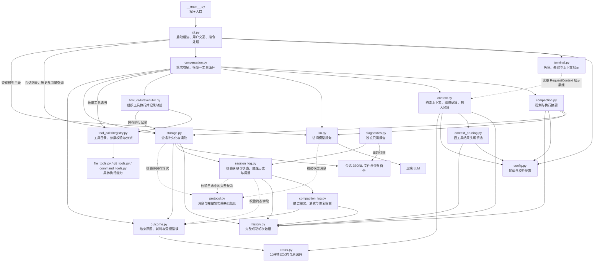
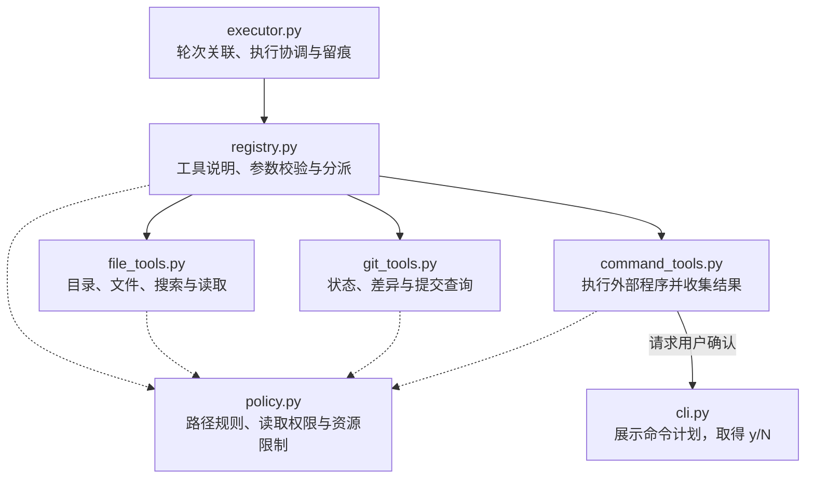
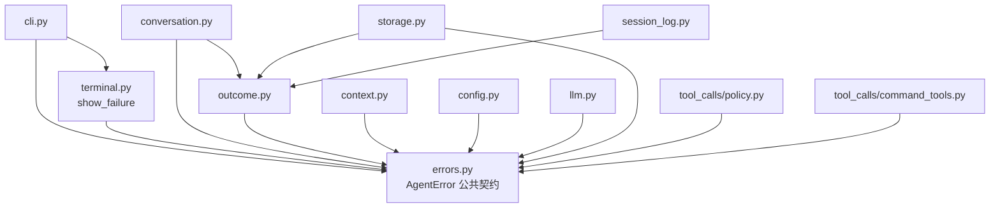

# Adam 系统架构

最近核对：2026-10-28

本次核对范围：V3.4a 压力下旧工具结果缩减、保护轮次、来源校验和原记录保留。

核对结论：ContextBuilder 在整轮选择前按压力调用 context_pruning；只修改独立请求副本。实际选择记录增加 pruned_tools 来源，SessionLog 验证关联；没有新增模型请求或原历史写入。

本文按模块说明职责和协作关系，不展开函数实现。版本任务和完成状态见 [练手 TODO](agent-practice-todo.md)，事件格式见 [会话执行轨迹](session-tracing.md)。

## 模块总览

实线表示主要调用、委托或读写关系，虚线表示协议校验或展示数据依赖；这是职责关系图，不是严格执行时序或完整 import 清单。`cli.py` 启动时还负责创建并连接模型客户端、存储和工具等组件，图中主要展示运行时的业务关系。

## 工具模块

实线表示执行委托或确认回调；虚线表示使用路径规则、权限配置或资源限制。图中权限检查与资源限制属于应用层控制，通用命令不运行在操作系统沙箱内。

`PathPolicy` 检查文件与 Git 查询的读取范围。通用命令单独展示具体命令和工作目录，请用户逐次确认；批准后的程序按当前系统账户权限运行，额外读取目录配置不是命令进程的沙箱边界。

`ToolExecutor` 负责调用所属轮次、请求和执行轨迹；`ToolRegistry` 负责工具目录、参数校验与分派；具体工具负责动作本身。命令工具通过记录回调把进程边界交给执行协调层保存，通过确认回调取得用户决定。

## 模块与抽象职责

| 模块 | 主要类或入口 | 抽象的职责 |
| --- | --- | --- |
| [__main__.py](../adam/__main__.py) | 程序入口 | 将 `python -m adam` 交给 CLI 启动 |
| [cli.py](../adam/cli.py) | `main`、`chat`、`handle_command` | 组装组件，处理输入和斜杠指令，展示结果与错误，取得命令确认 |
| [terminal.py](../adam/terminal.py) | `role_prefix`、`show_failure`、`show_context` | 展示角色、业务失败及上下文组成/全文；不读取会话或请求模型 |
| [errors.py](../adam/errors.py) | `AgentError`、`FailureCode`、`BudgetError`、`TurnSaveError` | 定义可展示说明、可选未保存回答及稳定失败类别，保持界面错误接口稳定 |
| [diagnostics.py](../adam/diagnostics.py) | `read_report`、`main` | 只读单个日志快照，按轮次输出请求和工具详情；不请求模型、不修复文件 |
| [outcome.py](../adam/outcome.py) | `ExecutionOutcome`、`outcome_details` | 表达请求或轮次的终态、原因和已测耗时；写入和回放共用字段校验，不负责计时或 IO |
| [config.py](../adam/config.py) | `AppConfig`、`LLMConfig`、`AgentConfig`、`ContextConfig` | 加载并校验运行配置，区分模型连接、循环/消费限额及单次输入预算 |
| [conversation.py](../adam/conversation.py) | `Conversation` | 管理当前会话，读取成功历史并委托上下文构造，组织请求、工具与提交；分别记录请求与轮次终态 |
| [context.py](../adam/context.py) | `ContextBuilder`、`RequestContext`、`ContextEstimate` | 按完整轮次选择连续历史后缀，估算输入、检查上限并提供来源记录；不改写原始消息 |
| [context_pruning.py](../adam/context_pruning.py) | `prune_history` | 缩减旧工具结果副本，保护近期轮次，保留错误状态和来源 |
| [history.py](../adam/history.py) | `HistoryTurn`、`Summary` | 成功轮次及有效摘要的共享数据 |
| [compaction.py](../adam/compaction.py) | `CompactionService`、`CompactionPlan` | 规划有界素材、无工具摘要、独立结算并提交；不修改原历史 |
| [compaction_log.py](../adam/compaction_log.py) | `CompactionLog` | 校验摘要来源与状态，仅完整提交激活摘要；恢复不猜未知用量 |
| [llm.py](../adam/llm.py) | `LLMClient`、`Completion` | 访问模型服务，将一次请求转换为模型消息和用量；模型消息也可能是工具请求 |
| [protocol.py](../adam/protocol.py) | `validate_assistant`、`validate_turn` | 定义合法助手消息和完整轮次的约束，检查工具请求与结果配对 |
| [storage.py](../adam/storage.py) | `SessionStore`、`Session`、`Message` | 管理会话文件、锁、读写与持锁恢复；先备份再原子替换，提供会话身份及已提交消息 |
| [session_log.py](../adam/session_log.py) | `SessionLog` | 解释日志事件，校验轮次、请求和工具关联，重建状态、有效历史及用量，规划并回放恢复事件；自身不访问文件 |
| [tool_calls/executor.py](../adam/tool_calls/executor.py) | `ToolExecutor` | 组织工具执行，将轨迹关联到轮次与请求，并形成回传模型的工具消息 |
| [tool_calls/registry.py](../adam/tool_calls/registry.py) | `ToolRegistry` | 提供模型可见的工具说明，校验参数、分派调用并统一结果格式 |
| [tool_calls/file_tools.py](../adam/tool_calls/file_tools.py) | `FileTools` | 文件系统查询、搜索与读取能力 |
| [tool_calls/git_tools.py](../adam/tool_calls/git_tools.py) | `GitTools` | 固定范围的只读 Git 查询能力 |
| [tool_calls/command_tools.py](../adam/tool_calls/command_tools.py) | `CommandTools`、`CommandRequest` | 表达待批准的命令计划，取得确认后运行程序，收集退出码、输出与执行结果 |
| [tool_calls/policy.py](../adam/tool_calls/policy.py) | `PathPolicy`、`PermissionConfig`、`ToolLimits` | 表达并检查路径访问规则，提供工具资源限制 |

`adam/__init__.py` 与 `adam/tool_calls/__init__.py` 是包入口，后者集中导出工具接口；它们不承担独立的业务流程。

## 关键职责边界

- **交互与流程：** CLI 处理用户怎样操作；`Conversation` 处理普通输入背后的会话流程。斜杠指令可以直接完成查询，不必请求模型。
- **流程与模型：** `Conversation` 决定何时请求、执行或停止；`LLMClient` 完成一次模型通信。一次用户输入可以触发多次模型请求。
- **历史与输入：** `SessionStore` 提供成功历史；`ContextBuilder` 组装系统提示、历史、当前轮次和工具说明。`Conversation.preview_context` 与实际请求使用同一构造逻辑，预览的当前轮次为空。terminal 只读取构造结果，不承担选择或预算决策。
- **协议与日志：** `protocol.py` 检查消息结构和工具配对；`session_log.py` 检查持久化事件的关联，并识别完整提交的历史。它们不验证回答事实是否正确。
- **日志与文件：** `SessionLog` 解释事件含义；`SessionStore` 负责文件访问和持久化。失败轮次可以留下诊断记录，但不会因此进入模型的有效历史。
- **配置与执行：** 配置对象描述权限、额度和限制，各业务模块负责实际执行检查。
- **失败处理：** 可反馈的工具错误交回模型；命令日志无法可靠保存等错误会终止本轮。已知失败实现 AgentError 契约，CLI 委托 terminal.show_failure 展示；终端 IO 故障和意外程序错误不会被当成业务失败吞掉。

当前已有轮次、请求和工具关联留痕，以及独立的请求/轮次状态、结束原因与耗时。独立开发诊断与持锁中断恢复已实现，真实进程强杀验收已完成，不计划增加轮次诊断聊天命令。上下文构造、预览与完整轮次选择已实现；手动摘要已实现，自动压缩与流式响应尚未实现，不应在现有架构图中画成已接入的组件。

## 公开错误契约

下面只展示与错误契约有关的源码依赖，箭头表示左侧模块导入右侧模块。它与上面的运行协作图视角不同；并非完整 import 清单。

- AgentError 提供受控的 user_message、可选 partial_reply、稳定 code 与可选数值 http_status，不决定恢复或重试。展示层仍只使用前两个字段，不逐个匹配具体异常；ExecutionOutcome 将后两个字段转换为持久化结束信息。
- ConfigError、LLMError、StorageError、SessionNotFoundError、ToolError 和 CommandLogError 仍由各模块定义，但都实现公共契约。预算使用 BudgetError，回答未保存使用 TurnSaveError；新增业务错误类型无需增加 CLI 分支。
- 原始 HTTP 异常和响应错误由模型模块转换。原始 OSError 仅在 SessionStore 的实际文件/锁操作边界转为 StorageError，保留原因链且不直接展示系统异常文本。
- Conversation 在最终回答或其用量无法保存时转为 TurnSaveError，保留回答。ToolExecutor 将命令记录的存储或关联失败转为 CommandLogError，确保它不会被工具注册表当作可修正参数错误继续执行。
- 同一次失败不因公共契约而自动重试。未识别的程序错误继续传播；终端输出自身的 OSError 也不会被误报为会话文件失败。chat 的清理范围覆盖组件初始化、会话恢复与交互循环，初始界面或回答展示失败时均释放会话锁。
- 对公开存储接口做故障替身时使用 StorageError；模拟真实文件系统故障时在 IO 边界注入 OSError，验证实际转换、回滚和原因链。

公开异常契约与界面展示保持稳定。第 2、3 项在该契约上补齐状态、原因和耗时，V1.3.2 已通过自动化验收。CLI 的组件组装和直接存储查询仍存在；它们的职责拆分属于后续工程改进。

## 请求与轮次状态边界

- 每次模型请求前构造输入并检查累计消费、单次输入预算；输入估算包含工具 JSON Schema 及本轮新增结果。超限在 request_started 之前抛出 BudgetError，轮次记 failed / context_input_limit，不伪造请求记录或未知用量。
- 开始事件建立 in_progress；request_finished 独立记录请求终态，和用量记录在同一块追加。响应有效而用量缺失时，请求可成功，整轮因预算统计不完整停止。
- 轮次成功只来自完整 message 块与 turn_completed 的成功提交；不能用独立状态事件跳过消息校验。turn_finished 只允许 failed / interrupted。
- Conversation 捕获失败后尽力保存终态，再传播原异常；KeyboardInterrupt / SystemExit 等退出信号记录 interrupted。失败日志本身出错只给原异常增加受控附注，不遮蔽最初失败。
- 原因与耗时通过 ExecutionOutcome 统一表达；Conversation 只负责在执行边界取单调时钟差，不在 CLI 增加错误类别分支。成功详情与完整消息同块保存，失败详情不含原始异常或远端正文。
- 新获会话写锁后，SessionStore 先备份原始字节，再用临时文件替换完整恢复结果；SessionLog 拒绝中间损坏，校验残留消息前缀并回放 session_recovered。完整物理记录不删除，未提交消息不成为历史。
- 恢复仅关闭缺少结束记录的操作，不推断真实请求结果、未知用量或未知命令结果，不自动重发。恢复失败保留原文件和原会话锁，重复重开不重复恢复。

## 文档维护

本文件是当前架构图与职责边界的统一维护位置。每次改动后的核对及更新要求见 [AGENTS.md](../AGENTS.md) 的“架构文档同步”；未改变架构时保留关系图，更新文首的核对范围和结论。
