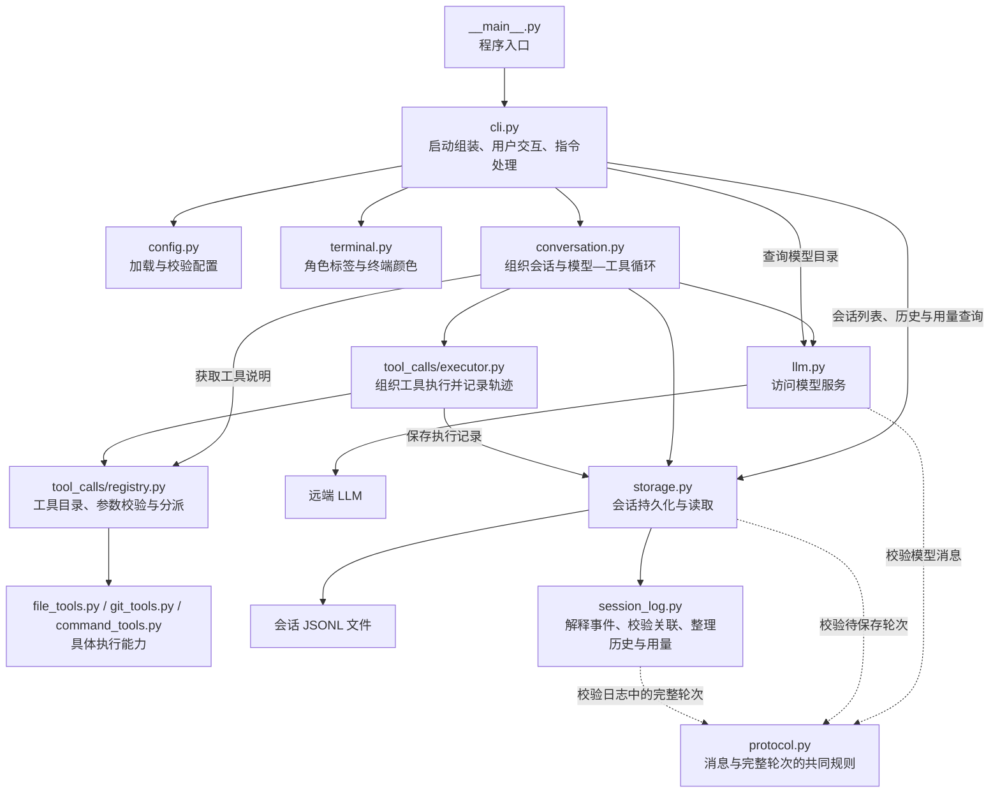
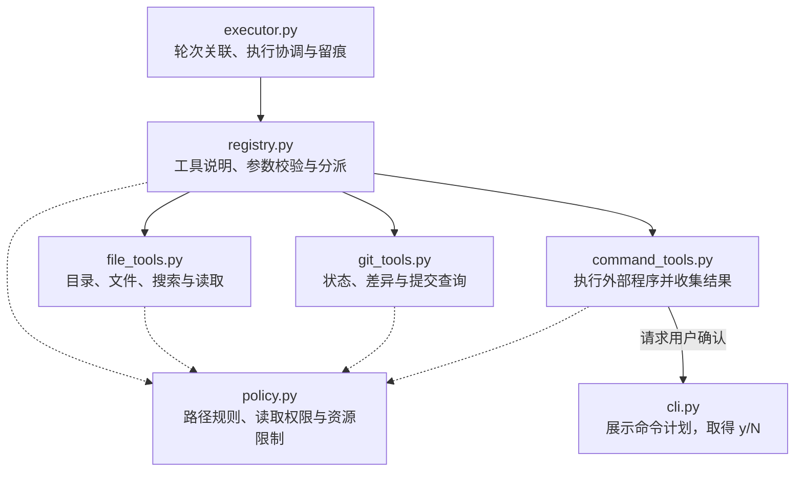

# Adam 系统架构

最近核对：2026-10-28

本次核对范围：提交前复核 V1.3.1 执行轨迹、业务测试组织、CLI 直接调用与架构说明。

核对结论：当前实现包含 V1.3.1 轮次与工具留痕；本次复核未改变代码架构，补全图中 CLI 查询模型目录的现有调用。启动组装拆分与统一业务异常契约尚未实施。

本文按模块说明职责和协作关系，不展开函数实现。版本任务和完成状态见 [练手 TODO](agent-practice-todo.md)，事件格式见 [会话执行轨迹](session-tracing.md)。

## 模块总览

实线表示主要调用、委托或读写关系，虚线表示协议校验依赖；这是职责关系图，不是严格执行时序或完整 import 清单。`cli.py` 启动时还负责创建并连接模型客户端、存储和工具等组件，图中主要展示运行时的业务关系。

## 工具模块

实线表示执行委托或确认回调；虚线表示使用路径规则、权限配置或资源限制。图中权限检查与资源限制属于应用层控制，通用命令不运行在操作系统沙箱内。

`PathPolicy` 检查文件与 Git 查询的读取范围。通用命令单独展示具体命令和工作目录，请用户逐次确认；批准后的程序按当前系统账户权限运行，额外读取目录配置不是命令进程的沙箱边界。

`ToolExecutor` 负责调用所属轮次、请求和执行轨迹；`ToolRegistry` 负责工具目录、参数校验与分派；具体工具负责动作本身。命令工具通过记录回调把进程边界交给执行协调层保存，通过确认回调取得用户决定。

## 模块与抽象职责

| 模块 | 主要类或入口 | 抽象的职责 |
| --- | --- | --- |
| [__main__.py](../adam/__main__.py) | 程序入口 | 将 `python -m adam` 交给 CLI 启动 |
| [cli.py](../adam/cli.py) | `main`、`chat`、`handle_command` | 组装组件，处理输入和斜杠指令，展示结果与错误，取得命令确认 |
| [terminal.py](../adam/terminal.py) | `role_prefix` | 将角色转换为终端标签和颜色；样式不进入消息内容或日志 |
| [config.py](../adam/config.py) | `AppConfig`、`LLMConfig`、`AgentConfig` | 加载并校验运行配置，区分整体应用、模型连接及对话循环额度 |
| [conversation.py](../adam/conversation.py) | `Conversation` | 管理当前会话，组织历史、模型请求、工具循环、额度检查和最终回答提交 |
| [llm.py](../adam/llm.py) | `LLMClient`、`Completion` | 访问模型服务，将一次请求转换为模型消息和用量；模型消息也可能是工具请求 |
| [protocol.py](../adam/protocol.py) | `validate_assistant`、`validate_turn` | 定义合法助手消息和完整轮次的约束，检查工具请求与结果配对 |
| [storage.py](../adam/storage.py) | `SessionStore`、`Session`、`Message` | 管理会话文件、锁和读写，提供会话身份及已提交消息 |
| [session_log.py](../adam/session_log.py) | `SessionLog` | 解释日志事件，校验轮次、请求和工具关联，整理有效历史及用量；自身不访问文件 |
| [tool_calls/executor.py](../adam/tool_calls/executor.py) | `ToolExecutor` | 组织工具执行，将轨迹关联到轮次与请求，并形成回传模型的工具消息 |
| [tool_calls/registry.py](../adam/tool_calls/registry.py) | `ToolRegistry` | 提供模型可见的工具说明，校验参数、分派调用并统一结果格式 |
| [tool_calls/file_tools.py](../adam/tool_calls/file_tools.py) | `FileTools` | 文件系统查询、搜索与读取能力 |
| [tool_calls/git_tools.py](../adam/tool_calls/git_tools.py) | `GitTools` | 固定范围的只读 Git 查询能力 |
| [tool_calls/command_tools.py](../adam/tool_calls/command_tools.py) | `CommandTools`、`CommandRequest` | 表达待批准的命令计划，取得确认后运行程序，收集退出码、输出与执行结果 |
| [tool_calls/policy.py](../adam/tool_calls/policy.py) | `PathPolicy`、`PermissionConfig`、`ToolLimits` | 表达并检查路径访问规则，提供工具资源限制 |

`adam/__init__.py` 与 `adam/tool_calls/__init__.py` 是包入口，后者集中导出工具接口；它们不承担独立的业务流程。

## 关键职责边界

- **交互与流程：** CLI 处理用户怎样操作；`Conversation` 处理普通输入背后的会话流程。斜杠指令可以直接完成查询，不必请求模型。
- **流程与模型：** `Conversation` 决定何时请求、执行或停止；`LLMClient` 完成一次模型通信。一次用户输入可以触发多次模型请求。
- **协议与日志：** `protocol.py` 检查消息结构和工具配对；`session_log.py` 检查持久化事件的关联，并识别完整提交的历史。它们不验证回答事实是否正确。
- **日志与文件：** `SessionLog` 解释事件含义；`SessionStore` 负责文件访问和持久化。失败轮次可以留下诊断记录，但不会因此进入模型的有效历史。
- **配置与执行：** 配置对象描述权限、额度和限制，各业务模块负责实际执行检查。
- **失败处理：** 可反馈的工具错误交回模型；命令日志无法可靠保存等错误会终止本轮。CLI 负责展示错误及可保留的未保存回答。

当前已有轮次、请求和工具关联留痕；完整请求/轮次状态、结束原因、诊断命令和自动中断恢复仍属于后续任务。上下文裁剪与流式响应也尚未实现，不应在现有架构图中画成已接入的组件。

## 文档维护

本文件是当前架构图与职责边界的统一维护位置。每次改动后的核对及更新要求见 [AGENTS.md](../AGENTS.md) 的“架构文档同步”；未改变架构时保留关系图，更新文首的核对范围和结论。
