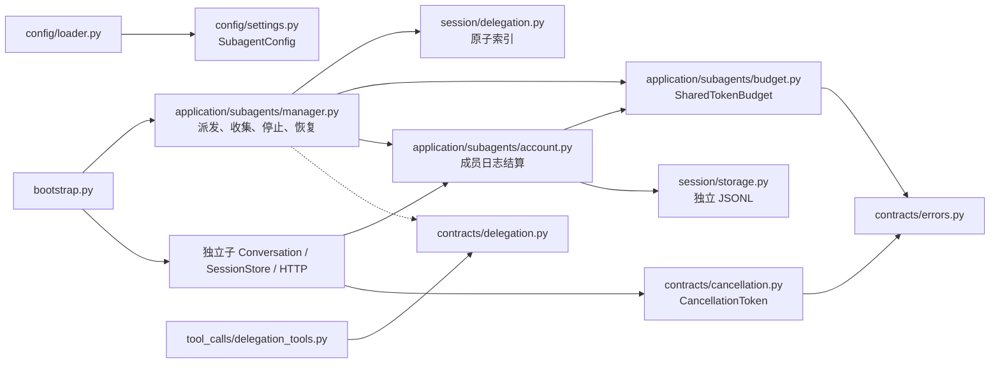
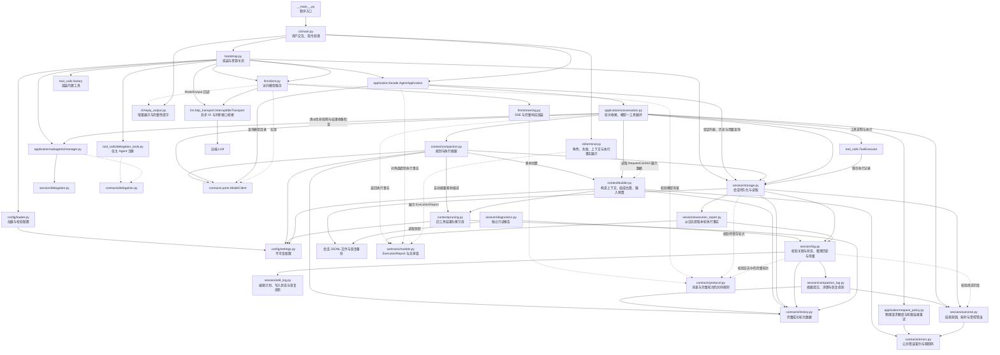
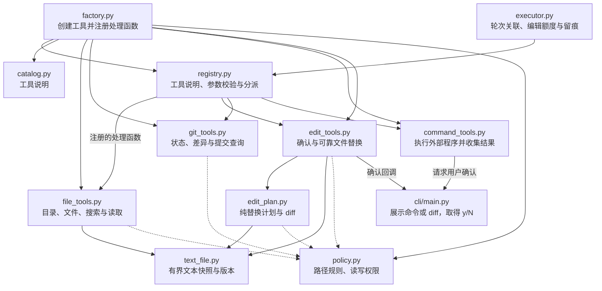
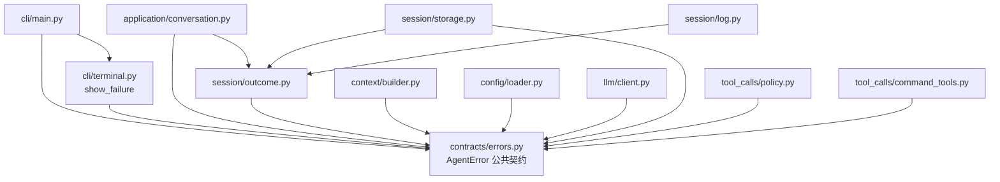

# Adam 系统架构

最近核对：2026-10-29

本次核对范围：V6.2 委派调度、独立子会话、共享记账、工具适配与请求取消边界。

核对结论：bootstrap 组装 SubagentManager，主 Conversation 经接口协调委派。子线程各自拥有 Conversation、SessionStore 和 HTTP；共享的只有受锁保护的额度及索引。工具适配依赖 contracts 接口，不反向导入应用。

本文描述已实现代码。版本任务见 [练手 TODO](agent-practice-todo.md)，日志格式见 [会话执行轨迹](session-tracing.md)。本次问题及修正见 [依赖边界重构](dependency-refactor.md)。

## 包目录与依赖边界

同一能力的文件放在同一个包内，包内仍按职责分文件。根目录保留 `__main__.py`、`bootstrap.py` 和 `diagnostics.py`，分别负责聊天启动、资源组装及原诊断命令入口。

| 包 | 归入的文件 | 允许的其他项目依赖 |
| --- | --- | --- |
| cli | main.py、terminal.py、reply_output.py | application、context、config、contracts；仅 main 调用 bootstrap |
| application | facade.py、conversation.py、request_policy.py、subagents/manager.py、budget.py、account.py | context、session、tool_calls、config、contracts |
| config | loader.py、settings.py | contracts |
| context | builder.py、pruning.py、compaction.py | session、config、contracts |
| llm | client.py、streaming.py、http_transport.py | config、contracts |
| session | storage.py、log.py、compaction_log.py、edit_log.py、outcome.py、execution_report.py、diagnostics.py、delegation.py | contracts |
| tool_calls | 工厂、注册表、执行器、权限和具体工具文件 | session、config、contracts |
| contracts | models.py、history.py、errors.py、ports.py、protocol.py、delegation.py、cancellation.py | 无 |

包内使用绝对路径显式导入所属实现；类型和错误直接从定义位置导入，避免经过其他业务模块转手。新包的 `__init__.py` 仅说明职责，不批量加载实现。contracts 只承载现有跨模块契约，不作为任意辅助函数目录。

bootstrap 可创建各层具体组件，业务包不反向调用它。cli/main 不直接依赖 Conversation、存储、HTTP 或具体工具。上下文构造是纯逻辑；同包的摘要服务经模型接口和会话存储完成持久化操作。会话包不依赖上下文算法，摘要事件的校验和恢复仍归 session。

ExecutionReport、ActionFact 放在 contracts/models.py，提取事实的 build_execution_report 留在 session/execution_report.py；展示层只依赖报告值，不连带导入日志解释器。tests/test_architecture.py 检查整包源码，新增文件同样受约束。业务测试继续按功能放在 tests/features。迁移前后收集项比对：原 408 项无遗漏，增加 8 项包依赖约束，共 416 项；本次没有改变业务场景断言。

## V6 委派、额度与资源边界

共享额度按成员保存持久化累计快照；在途预留只影响新请求准入，不能被当作用量未知。
这些组件已接入下面的聊天调用链。业务计划与使用方法见 [V6](subagents.md)。
主线程持有主会话锁；每次子运行在所属线程新建并关闭自己的存储与传输。
SubagentManager 保留可续聊身份和独立历史，线程池只负责当前运行，容量不足不排队。
SessionAccount 在请求登记前预留、结算日志后更新；普通请求与摘要共用同一整组账本。
root 的 /usage 显示聚合值；未知消费禁止新请求，但不主动取消其他在途请求。

委派索引关联父轮次/请求/工具及子轮次，保存位置独立于主会话日期目录；
子任务正文只通过 tool 消息返回主模型。最终回答前未收集的结果由协调接口检查，
主循环在既有请求限额内提醒模型读取，不虚构模型工具调用。
子工具目录没有委派能力，命令/编辑适配器直接返回 approval_required，不接终端审批。
主轮次失败或取消后先停止并等待所有子线程，再释放主会话锁。

## 启动与资源所有权

实线表示主要调用、委托或读写关系，虚线表示协议校验或展示数据依赖；这是职责关系图，不是严格执行时序或完整 import 清单。bootstrap 是依赖组装与资源所有权入口；CLI 只解释输入和展示结果。

共享的 `contracts/models.py` 定义 Session、Message、Completion、CommandRequest、SessionUsage、ContinuationStatus 和记录回调类型。`config/settings.py` 只定义配置值；`config/loader.py` 负责读取和校验。这些数据定义不引用 HTTP、文件存储实现或工具执行模块。

## 工具创建与执行

`PathPolicy` 分别检查读取和写入范围；读取授权不赋予写入权限，专用编辑禁止 .git、凭据及链接路径。通用命令单独展示具体命令和工作目录，请用户逐次确认；批准后的程序按当前系统账户权限运行，额外读取目录配置不是命令进程的沙箱边界。

`CommandTools` 只需要工作目录、资源限制和确认回调，不接收与其权限模型不相符的 PathPolicy。批准的通用命令按当前系统账户权限运行；额外读取目录只限制只读工具，不是命令进程的操作系统沙箱。

`ToolExecutor` 负责调用所属轮次、请求和执行轨迹；`ToolRegistry` 负责工具目录、参数校验与分派；具体工具负责动作本身。命令和编辑通过记录回调把副作用边界交给协调层保存，通过确认回调取得用户决定。拒绝结果保存后停止同批剩余调用及本轮请求；失败输入不进入有效历史。

ToolExecutor 在开始记录写入后调用工具，在结果落盘后回传模型。命令/编辑沿同一回调上报事件，执行器按 command_* / edit_* 分别记录；注册表不按工具名称分支。日志保存失败仍停止本轮。执行层通知工具名称，`工具>` 等展示文字由 CLI 生成。

## 模块职责

| 模块 | 主要接口 | 职责 |
| --- | --- | --- |
| [__main__.py](../adam/__main__.py) | 程序入口 | 将 `python -m adam` 交给 CLI 启动 |
| [cli/main.py](../adam/cli/main.py) | `main`、`chat`、`handle_command` | 调用组装入口，处理输入和指令，展示增量/结果/错误，取得命令和 diff 确认 |
| [cli/terminal.py](../adam/cli/terminal.py) | `role_prefix`、`show_failure`、`show_context`、`show_execution_report` | 展示角色、失败、上下文和执行事实；不读取会话或请求模型 |
| [session/execution_report.py](../adam/session/execution_report.py) | `build_execution_report` | 从已校验日志提取执行顺序、状态、版本和退出码；不解释模型的测试结论 |
| [contracts/errors.py](../adam/contracts/errors.py) | `AgentError`、`FailureCode`、`BudgetError`、`TurnSaveError` | 定义可展示说明、可选未保存回答及稳定失败类别，保持界面错误接口稳定 |
| [session/diagnostics.py](../adam/session/diagnostics.py) | `read_report`、`main` | 只读单个日志快照，按轮次输出请求和工具详情；不请求模型、不修复文件 |
| [session/outcome.py](../adam/session/outcome.py) | `ExecutionOutcome`、`outcome_details` | 表达请求或轮次的终态、原因和已测耗时；写入和回放共用字段校验，不负责计时或 IO |
| [bootstrap.py](../adam/bootstrap.py) | `open_application`、`build_application` | 组装组件并关闭自己创建的资源 |
| [application/facade.py](../adam/application/facade.py) | `AgentApplication` | 面向界面的会话、模型、上下文、继续方式与执行事实查询 |
| [config/settings.py](../adam/config/settings.py) | 配置值 | 不可变运行配置 |
| [contracts/models.py](../adam/contracts/models.py) | 共享数据、EditPlan、ActionFact 与 ExecutionReport | 不依赖具体实现的跨层数据 |
| [application/subagents/manager.py](../adam/application/subagents/manager.py) | SubagentManager | 委派准入、追问、结果交付、取消与重启恢复 |
| [application/subagents/account.py](../adam/application/subagents/account.py) | SessionAccount | 线程所属日志与整组额度之间的结算边界 |
| [session/delegation.py](../adam/session/delegation.py) | DelegationStore | 原子持久化成员与历次派发索引 |
| [contracts/delegation.py](../adam/contracts/delegation.py) | RequestAccount、Delegation、DelegationTools | 共享额度和委派流程接口，避免工具反向依赖应用 |
| [tool_calls/delegation_tools.py](../adam/tool_calls/delegation_tools.py) | SPECS、handlers | 委派工具说明与参数适配 |
| [contracts/ports.py](../adam/contracts/ports.py) | `ModelClient` | 模型目录与一次请求能力 |
| [tool_calls/factory.py](../adam/tool_calls/factory.py) | `create_tool_registry` | 组装内置工具和编码器 |
| [tool_calls/catalog.py](../adam/tool_calls/catalog.py) | `SPECS` | 模型可见的工具说明 |
| [config/loader.py](../adam/config/loader.py) | `load_config`、`load_llm_config` | 加载并校验运行配置，区分模型连接、循环/消费限额及单次输入预算 |
| [application/conversation.py](../adam/application/conversation.py) | `Conversation`、`TurnProgress` | 管理会话与轮次；依据输入压力协调自动摘要，统一限制摘要和聊天请求，组织工具与提交 |
| [context/builder.py](../adam/context/builder.py) | `ContextBuilder`、`RequestContext`、`ContextEstimate` | 按完整轮次选择连续历史后缀，估算输入、检查上限并提供来源记录；不改写原始消息 |
| [context/pruning.py](../adam/context/pruning.py) | `prune_history` | 缩减旧工具结果副本，保护近期轮次，保留错误状态和来源 |
| [contracts/history.py](../adam/contracts/history.py) | `HistoryTurn`、`Summary` | 成功轮次及有效摘要的共享数据 |
| [context/compaction.py](../adam/context/compaction.py) | `CompactionService`、`CompactionPlan` | 规划有界素材及压缩目标、复用旧工具缩减；执行无工具摘要、独立结算并提交，不修改原历史 |
| [session/compaction_log.py](../adam/session/compaction_log.py) | `CompactionLog` | 校验摘要来源与状态，仅完整提交激活摘要；恢复不猜未知用量 |
| [llm/http_transport.py](../adam/llm/http_transport.py) | `InterruptibleTransport` | 为每个所属线程的同步接口提供可取消的异步 IO；连接池不跨线程共享 |
| [application/request_policy.py](../adam/application/request_policy.py) | `RequestPolicy` | 单轮物理请求计数、明确未发送时有限重试，摘要与聊天共用额度 |
| [llm/streaming.py](../adam/llm/streaming.py) | `sse_events`、`StreamReply` | 有界 SSE 解析、工具参数拼接、结束校验 |
| [cli/reply_output.py](../adam/cli/reply_output.py) | `ReplyOutput` | 正文增量、换行、去重及未完成提示 |
| [llm/client.py](../adam/llm/client.py) | `LLMClient` | 访问模型服务，将一次请求转换为模型消息和用量；模型消息也可能是工具请求 |
| [contracts/protocol.py](../adam/contracts/protocol.py) | `validate_assistant`、`validate_turn` | 定义合法助手消息和完整轮次的约束，检查工具请求与结果配对 |
| [session/storage.py](../adam/session/storage.py) | `SessionStore` | 管理会话文件、锁、读写与持锁恢复；先备份再原子替换，提供会话身份及已提交消息 |
| [session/edit_log.py](../adam/session/edit_log.py) | `EditLog` | 编辑状态纯投影；未开始计划恢复为 not_started，写入未知结果不猜测 |
| [session/log.py](../adam/session/log.py) | `SessionLog` | 解释日志事件，校验轮次、请求和工具关联，重建状态、有效历史及用量，规划并回放恢复事件；自身不访问文件 |
| [tool_calls/executor.py](../adam/tool_calls/executor.py) | `ToolExecutor`、`ToolBudget` | 编辑尝试计数、组织工具执行，将轨迹关联到轮次与请求，并形成回传模型的工具消息 |
| [tool_calls/registry.py](../adam/tool_calls/registry.py) | `ToolRegistry` | 提供模型可见的工具说明，校验参数、分派调用并统一结果格式 |
| [tool_calls/text_file.py](../adam/tool_calls/text_file.py) | `TextSnapshot`、`read_snapshot` | 同一次读取的完整字节、UTF-8 文本和版本 |
| [tool_calls/edit_tools.py](../adam/tool_calls/edit_tools.py) | `EditTools` | 规划前检查写入权限，批准后复查版本，以同目录临时文件替换；不提供跨程序事务 |
| [tool_calls/edit_plan.py](../adam/tool_calls/edit_plan.py) | `EditPlan`、`plan_edit` | 校验版本与唯一匹配，保留编码形式，生成候选内容和 diff；不写文件 |
| [tool_calls/file_tools.py](../adam/tool_calls/file_tools.py) | `FileTools` | 文件系统查询、搜索与读取能力 |
| [tool_calls/git_tools.py](../adam/tool_calls/git_tools.py) | `GitTools` | 固定范围的只读 Git 查询能力 |
| [tool_calls/command_tools.py](../adam/tool_calls/command_tools.py) | `CommandTools` | 表达待批准的命令计划，取得确认后运行程序，收集退出码、输出与执行结果 |
| [tool_calls/policy.py](../adam/tool_calls/policy.py) | `PathPolicy` | 表达并检查路径访问规则；配置值来自 config/settings |

## 错误与兼容边界

已知失败统一继承 AgentError：user_message 是受控提示，partial_reply 携带未保存回答。预算耗尽使用 BudgetError，模型通信使用 LLMError；CLI 只交给 terminal.show_failure 展示。存储 IO 在 storage 的操作边界转换为 StorageError 并保留 cause，命令日志失败继续停止本轮。应用层原样传播公共错误，不重复包装；程序错误和终端 OSError 继续传播，资源由组装入口释放。

- **交互与流程：** CLI 通过 AgentApplication 处理用户操作；`Conversation` 处理普通输入背后的会话流程。斜杠指令可以直接完成查询，不必请求模型。
- **流程与模型：** `Conversation` 决定何时请求、执行或停止；`LLMClient` 完成一次模型通信。一次用户输入可以触发多次模型请求。
- **历史与输入：** `SessionStore` 提供成功历史；`ContextBuilder` 组装系统提示、历史、当前轮次和工具说明。`Conversation.preview_context` 与实际请求使用同一构造逻辑，预览的当前轮次为空。terminal 只读取构造结果，不承担选择或预算决策。
- **摘要与循环：** `Conversation._prepare_context` 只在真实发送时按压力规划摘要；`TurnProgress` 记录本轮请求数和尝试状态。`CompactionService` 处理单次摘要、消费及提交；`CompactionLog` 只解释持久化状态。摘要后重新构造输入并检查预算；仅未发出的连接失败有限重试，每次独立操作，其他失败停止。
- **协议与日志：** `contracts/protocol.py` 检查消息结构和工具配对；`session/log.py` 检查持久化事件的关联，并识别完整提交的历史。它们不验证回答事实是否正确。
- **日志与文件：** `SessionLog` 解释事件含义；`SessionStore` 负责文件访问和持久化。失败轮次可以留下诊断记录，但不会因此进入模型的有效历史。
- **事实与表述：** Conversation 只记住本次运行最近轮次的标识，SessionStore 从同一份快照提取事实；恢复后的历史轮次仍可由存储接口读取。未知副作用不能因回答失败、重启或读取失败而推断为未执行。报告不进入模型历史，纯聊天不刷执行信息。
- **配置与执行：** 配置对象描述权限、额度和限制，各业务模块负责实际执行检查。
- **失败处理：** 可反馈的工具错误交回模型；命令日志无法可靠保存等错误会终止本轮。已知失败实现 AgentError 契约，CLI 委托 terminal.show_failure 展示；终端 IO 故障和意外程序错误不会被当成业务失败吞掉。

当前已有轮次、请求和工具关联留痕，以及独立的请求/轮次状态、结束原因与耗时。独立开发诊断与持锁中断恢复已实现，真实进程强杀验收已完成，不计划增加轮次诊断聊天命令。上下文构造、预览、完整轮次选择、手动摘要和自动压缩均已实现；流式响应已实现；部分输出仅用于展示，完整协议消息才返回业务循环。

## 公开错误契约

下面只展示与错误契约有关的源码依赖，箭头表示左侧模块导入右侧模块。它与上面的运行协作图视角不同；并非完整 import 清单。

- AgentError 提供受控的 user_message、可选 partial_reply、稳定 code 与可选数值 http_status，不决定恢复或重试。展示层仍只使用前两个字段，不逐个匹配具体异常；ExecutionOutcome 将后两个字段转换为持久化结束信息。
- ConfigError、LLMError、StorageError、SessionNotFoundError、ToolError 和 CommandLogError 集中定义在 contracts/errors.py，调用方直接从定义模块导入。预算使用 BudgetError，回答未保存使用 TurnSaveError；新增业务错误类型无需增加 CLI 分支。
- 原始 HTTP 异常和响应错误由模型模块转换。原始 OSError 仅在 SessionStore 的实际文件/锁操作边界转为 StorageError，保留原因链且不直接展示系统异常文本。
- Conversation 在最终回答或其用量无法保存时转为 TurnSaveError，保留回答。ToolExecutor 将命令记录的存储或关联失败转为 CommandLogError，确保它不会被工具注册表当作可修正参数错误继续执行。
- 仅明确未发出的连接失败由 RequestPolicy 最多额外重试两次，每次独立记账；其他失败不因公共契约而自动重试。未识别的程序错误继续传播；终端输出自身的 OSError 也不会被误报为会话文件失败。open_application 的清理范围覆盖组件初始化、会话恢复与交互循环，初始界面或回答展示失败时均释放会话锁。
- 对公开存储接口做故障替身时使用 StorageError；模拟真实文件系统故障时在 IO 边界注入 OSError，验证实际转换、回滚和原因链。

公开异常契约与界面展示保持稳定。第 2、3 项在该契约上补齐状态、原因和耗时，V1.3.2 已通过自动化验收。组件组装和直接存储查询已分别移至 bootstrap 与 AgentApplication。

## 请求与轮次状态边界

- 每次模型请求前构造输入并检查累计消费、单次输入预算；输入估算包含工具 JSON Schema 及本轮新增结果。超限在 request_started 之前抛出 BudgetError，轮次记 failed / context_input_limit，不伪造请求记录或未知用量。
- 自动摘要沿用独立 compaction 事件，并通过 turn_id 关联触发轮次；摘要与聊天请求共同受每轮请求数和会话消费限制。预览没有副作用，旧工具缩减只作用于副本，只有提交完成的摘要才能替代对应历史。
- 开始事件建立 in_progress；request_finished 独立记录请求终态，和用量记录在同一块追加。响应有效而用量缺失时，请求可成功，整轮因预算统计不完整停止。
- 轮次成功只来自完整 message 块与 turn_completed 的成功提交；不能用独立状态事件跳过消息校验。turn_finished 只允许 failed / interrupted。
- Conversation 捕获失败后尽力保存终态，再传播原异常；KeyboardInterrupt / SystemExit 等退出信号记录 interrupted。失败日志本身出错只给原异常增加受控附注，不遮蔽最初失败。
- 原因与耗时通过 ExecutionOutcome 统一表达；Conversation 只负责在执行边界取单调时钟差，不在 CLI 增加错误类别分支。成功详情与完整消息同块保存，失败详情不含原始异常或远端正文。
- 新获会话写锁后，SessionStore 先备份原始字节，再用临时文件替换完整恢复结果；SessionLog 拒绝中间损坏，校验残留消息前缀并回放 session_recovered。完整物理记录不删除，未提交消息不成为历史。
- 恢复仅关闭缺少结束记录的操作，不推断真实请求结果、未知用量或未知命令结果，不自动重发。恢复失败保留原文件和原会话锁，重复重开不重复恢复。

## 文档维护

本文件统一维护当前架构图与职责边界。每次改动后的要求见 [AGENTS.md](../AGENTS.md) 的“架构文档同步”。测试中的组装辅助函数不属于生产架构。
