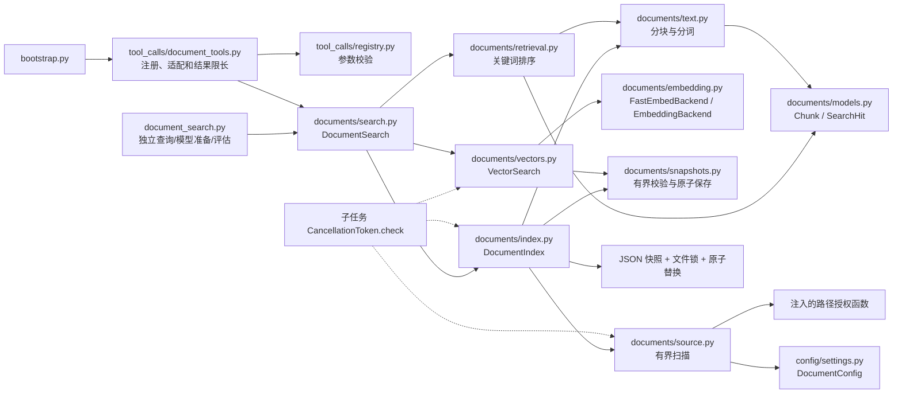
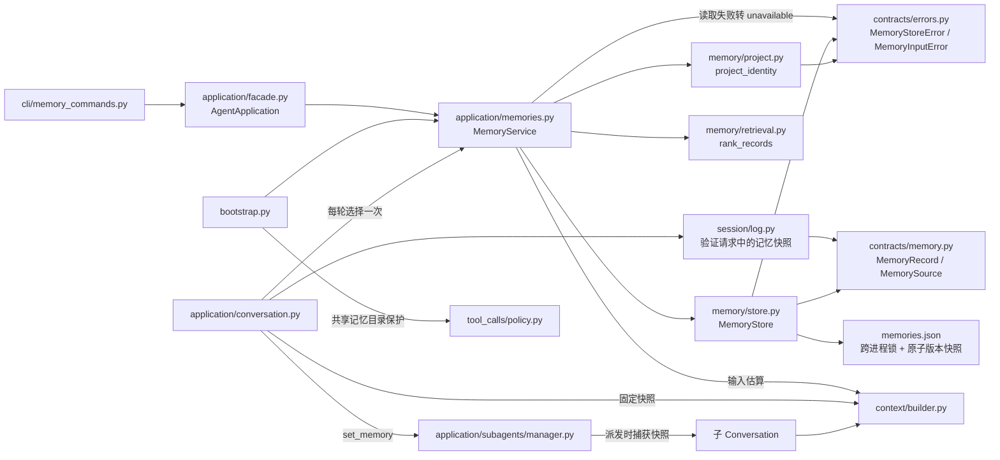
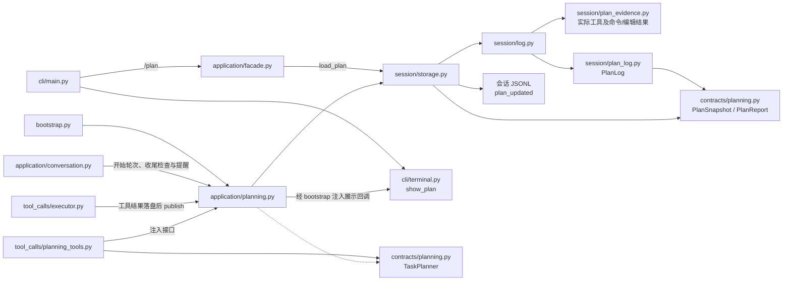
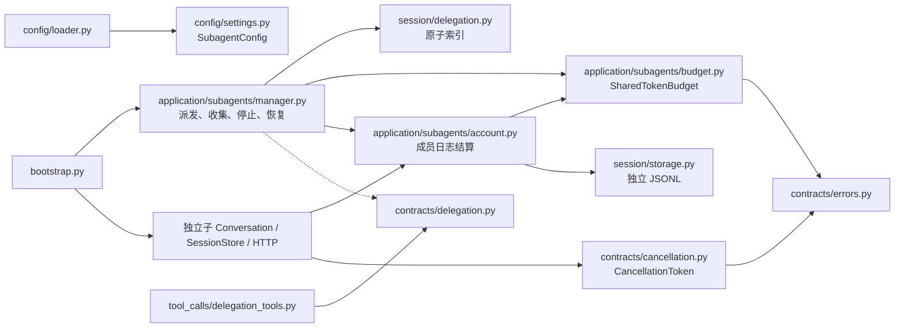
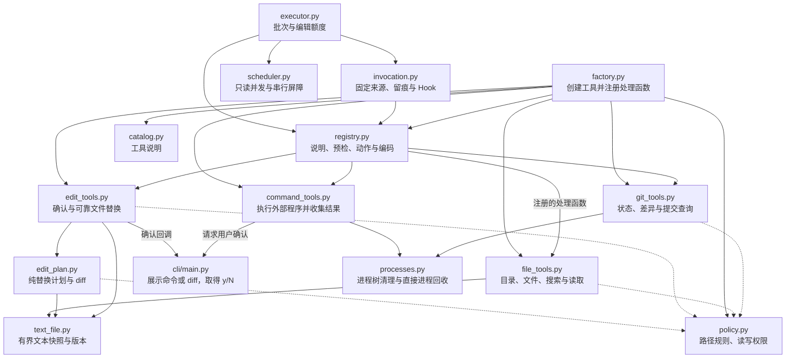
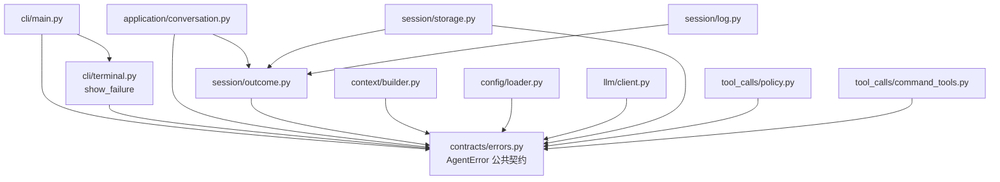

# Adam 系统架构

最近核对：2026-11-01

本次核对范围：B01.3 文件版本证据、并发停止与结果未知语义、主子隔离和真实强杀恢复。

核对结论：新增 file_evidence，把同次完整读取的版本随受控失败传到执行器；JSON 字段不能伪造宿主证据。并发取消和重启恢复复用已有调度/存储路径，CLI、Conversation、调度器及会话格式无新增分支。原有关键说明保留，新增类型写明来源及序列化边界。

本文描述已实现代码。版本任务见 [练手 TODO](agent-practice-todo.md)，日志格式见 [会话执行轨迹](session-tracing.md)。

## B01 连续失败策略与生产接入

~~~mermaid
flowchart LR
    PROG_CONFIG["loader / NoProgressConfig"] --> PROG_BOOT["bootstrap / 主子分别组装"]
    PROG_BOOT --> PROG_EXEC["ToolExecutor / 按会话与轮次保持状态"]
    PROG_EXEC --> PROG_INVOKE["ToolInvocation / 原预检、动作与结果保存"]
    PROG_INVOKE --> PROG_REG["ToolRegistry / 权限、Hook、批准、实际动作"]
    PROG_FILE["text_file / edit_tools / 已授权完整快照"] --> PROG_EVIDENCE["file_evidence / FileStateError 与 FileResult"]
    PROG_EVIDENCE -->|"本地版本元数据；不采信 JSON"| PROG_REG
    PROG_REG -->|"实际结果与核实版本；原序交付"| PROG_EXEC
    PROG_EXEC --> PROG_GUARD["NoProgressGuard.observe / 连续失败指纹"]
    PROG_GUARD --> PROG_DECISION["ProgressDecision / 继续、提醒、停止"]
    PROG_DECISION --> PROG_INVOKE
    PROG_INVOKE --> PROG_ENCODING["progress_output / 有界模型反馈"]
    PROG_ENCODING --> PROG_LOG["tool_finished.output / 实际回传内容"]
    PROG_EXEC -->|"保存结果后停止"| PROG_ERROR["NoProgressError / 公共错误契约"]
    PROG_ERROR --> PROG_TURN["Conversation 原收尾 / turn_finished"]
    PROG_LOG --> PROG_MODEL["下一次模型请求 / 提醒时"]
    PROG_CAPTURE["RecordingTools / 实际结果与异常"] --> PROG_EXEC
    PROG_REPLAY["ReplayTools / 读取录制，无外部执行"] --> PROG_LOG
~~~

[progress.py](../adam/tool_calls/progress.py) 是无 IO 的检测策略；
[executor.py](../adam/tool_calls/executor.py) 管理轮次作用域及停止，
[invocation.py](../adam/tool_calls/invocation.py) 通过
[progress_output.py](../adam/tool_calls/progress_output.py) 把反馈放入最终保存/回传的工具结果。
结果太长时只缩短预览，保留命令状态及附件引用；原附件正文保持不变。

NoProgressError 由 [errors.py](../adam/contracts/errors.py) 提供公共原因码，
[outcome.py](../adam/session/outcome.py) 和 [log.py](../adam/session/log.py) 沿用既有收尾及验证。
CLI 和 send 不识别工具种类或检测器。主子各有独立实例，同轮跨请求累计，新轮重建。
录制保存配置及实际反馈；重放恢复已记录结果/错误，不创建实时检测器或重做动作。
[file_evidence.py](../adam/tool_calls/file_evidence.py) 携带同次文件快照的版本；注册表保留元数据，执行器传给检测策略。版本只影响连续失败判定，不授予权限、不标记修复成功，也不增加文件读取。未交付的并发结果仍沿用日志未知及持锁恢复规则。契约与 B01.3 整体验收见 [无进展检测](no-progress.md)。

## T12 工具目录与实际请求可见性

~~~mermaid
flowchart LR
    DISC_BOOT["bootstrap / 主任务与子任务分别组装"] --> DISC_REG["ToolRegistry / 说明、分组、可信能力与动作"]
    DISC_BOOT --> DISC_SERVICE["ToolDiscovery / 单轮选择与发现入口"]
    DISC_SERVICE --> DISC_SELECTION["ToolVisibility / 选择、模式过滤"]
    DISC_REG -->|"directory() 快照"| DISC_DIR["ToolDirectory / 冻结目录"]
    DISC_SELECTION --> DISC_DIR
    DISC_DIR --> DISC_EXPOSURE["ToolExposure / 名称与 Schema 副本"]
    DISC_CONVERSATION["Conversation / 原请求循环"] -->|"turn_id；预览为 None"| DISC_EXECUTOR["ToolExecutor"]
    DISC_EXECUTOR -->|"definitions / 名单检查"| DISC_SERVICE
    DISC_CONVERSATION -->|"固定 tools 及名单"| DISC_REQUEST["RequestRunner / 实际模型请求"]
    DISC_REQUEST --> DISC_LOG["SessionStore / 请求工具名称与大小"]
    DISC_CONVERSATION -->|"返回调用 + 固定名单"| DISC_EXECUTOR
    DISC_EXECUTOR --> DISC_INVOKE["ToolInvocation / 原调度与日志"]
    DISC_INVOKE --> DISC_REG
    DISC_REG -->|"发现入口"| DISC_SERVICE
    DISC_REG --> DISC_GUARD["原模式、路径、规则、Hook、批准及实际动作"]
    DISC_CAPTURE["RecordingTools"] -->|"透传 turn_id、名单和结果"| DISC_EXECUTOR
    DISC_REPLAY["ReplayTools"] -->|"核对目录、名单并返回已录结果"| DISC_TAPE["ReplayTape / 录制轨迹"]
~~~

[tool_catalog.py](../adam/contracts/tool_catalog.py) 定义目录条目、请求快照和日志元数据；
[discovery.py](../adam/tool_calls/discovery.py) 冻结目录、按能力过滤并校验整批选择。
[discovery_tools.py](../adam/tool_calls/discovery_tools.py) 提供 list_tools/discover_tools、
精简分组预览和每轮选择；完整 Schema 仅进入后续请求，不重复写入发现结果。

[executor.py](../adam/tool_calls/executor.py) 接收 Conversation 在请求前固定的 provided_names，
先检查名单再进入原动作路径；隐藏且模式禁止的调用保留原拒绝分类，不触发普通错误反思。
每个主/子执行器有独立服务，普通预览使用初始副本。未注入服务的显式基础执行器保持原全量 API。

[request_runner.py](../adam/application/request_runner.py) 保存实际 tools 名称与统一 JSON 字节数；
不把字节当精确 token。录制适配器记录真实目录与名单，离线重放核对并替代外部执行，
不创建新发现状态或重新执行工具。配置与完整契约见 [按需工具说明](tool-discovery.md)。

## T11.2 子任务提案与主任务批准应用

~~~mermaid
flowchart LR
    PROP_BOOT["bootstrap / 独立主子资源"] --> PROP_CHILD["辅助子 Agent / submit_proposal"]
    PROP_CHILD --> PROP_SERVICE["ProposalSubmission / 读取证据和候选保存"]
    PROP_SERVICE --> PROP_CHILDLOG["子会话 JSONL / proposal_submitted"]
    PROP_BOOT --> PROP_TOOLS["主工具 / collect_proposals 与 apply_proposal"]
    PROP_TOOLS --> PROP_REVIEW["ProposalReview / 来源、分页、重复及版本检查"]
    PROP_REVIEW --> PROP_MANAGER["SubagentManager.candidates / 真实派发与成功子轮"]
    PROP_MANAGER --> PROP_CHILDLOG
    PROP_TOOLS --> PROP_GUARD["原模式、目录规则和 Hook / 已核对审计路径"]
    PROP_REVIEW --> PROP_PREPARE["EditTools.prepare / 当前写入权限与唯一替换"]
    PROP_PREPARE --> PROP_EXECUTE["EditTools.execute_plan / diff 与用户批准"]
    PROP_EXECUTE --> PROP_INVOCATION["ToolInvocation / 原检查点与编辑事件"]
    PROP_INVOCATION --> PROP_PARENTLOG["主 JSONL / edit_planned 附带不可变候选"]
    PROP_PARENTLOG --> PROP_VALIDATE["SessionLog + validate_application + EditLog"]
    PROP_PARENTLOG --> PROP_UNDO["已有 UndoService / 已成功编辑的撤销"]
~~~

contracts/proposals.py 增加 ProposalSource、ProposalSubmitter、ProposalReviewer 窄接口，
tool_calls/proposal_tools.py 只适配参数、能力、规则路径和工具结果，不依赖应用实现。
application/proposal_review.py 每次从 manager 获取已完成的实际候选，再协调原编辑组件；
application/proposals.py 保持子任务只保存候选。审查子任务不注册提案工具。

apply_proposal 的 path 必须与真实候选一致，验证通过后供原 Hook 和目录规则审计，
不用于让模型选择其他目标。编辑字节来自已验证候选；审批、检查点和写入失败语义复用原流程。
FILE_EDIT_TOOLS 统一编辑额度、状态日志、计划证据、执行报告和审查限制；CLI 与 Conversation 无新分支。
成功或未知应用都拒绝重复，包括撤销后的旧候选；不另建一套可能与文件事实分离的应用状态。
详细范围及30项业务验收见 [修改提案](edit-proposals.md)，T11.3 的双子任务和真实进程故障仍待完成。

## T11.1 有读取依据的修改候选

~~~mermaid
flowchart LR
    PROP_HOST["显式宿主 / 派发身份与工具来源"] --> PROP_SERVICE["ProposalSubmission.submit"]
    PROP_SERVICE --> PROP_SOURCE["SessionStore.tool_record / 同子轮真实读取"]
    PROP_SOURCE --> PROP_OBSERVE["contracts/proposals / observe_read"]
    PROP_SERVICE --> PROP_CURRENT["PathPolicy + read_snapshot / 当前权限与完整版本"]
    PROP_CURRENT --> PROP_PLAN["plan_edit / 唯一替换与目标字节"]
    PROP_OBSERVE --> PROP_VALUE["不可变 EditProposal"]
    PROP_PLAN --> PROP_VALUE
    PROP_VALUE --> PROP_STORE["SessionStore.validate_proposal / append_proposal"]
    PROP_STORE --> PROP_LOG["SessionLog + ProposalLog / 关联和参数校验"]
    PROP_LOG --> PROP_JSONL["现有子会话 JSONL / proposal_submitted"]
    PROP_JSONL --> PROP_LOAD["load_proposals / 仅历史候选"]
~~~

application/proposals.py 协调实际读取、当前文件校验与候选持久化，不申请批准或写目标文件。
contracts/proposals.py 是纯数据和读取证据校验；session/proposal_log.py 回放已保存事实，
不访问源文件、不授予权限、不把候选当成成功子任务或已应用修改。
read_file 新增实际路径返回值，与原完整字节版本和可见行共同固定读取来源。

本图展开子候选保存部分，已由上图 T11.2 生产工具接入；不在 Conversation 或 CLI 增加工具名称分支。详细契约见 [修改提案](edit-proposals.md)。

## T10 Python 结构与静态引用查询

~~~mermaid
flowchart LR
    CODE_FACTORY["工具工厂 / 三个只读 Schema"] --> CODE_REGISTRY["ToolRegistry / 模式、路径规则及取消"]
    CODE_REGISTRY --> CODE_TOOLS["CodeTools / 每次调用独立实例"]
    CODE_TOOLS --> CODE_INDEX["CodeIndex.refresh / 当前授权扫描"]
    CODE_INDEX -->|"注入回调"| CODE_POLICY["PathPolicy.resolve / 原保护范围"]
    CODE_INDEX --> CODE_READ["有界读取 / SHA-256 / 内存解析缓存"]
    CODE_READ --> CODE_PARSE["parse_module / UTF-8 与 Python 3.11 AST"]
    CODE_PARSE --> CODE_BINDINGS["BindingCollector / 名字使用与遮蔽"]
    CODE_BINDINGS --> CODE_SNAPSHOT["CodeSnapshot / 版本、作用域、定义、导入、诊断"]
    CODE_SNAPSHOT --> CODE_QUERY["ReferenceIndex / 唯一词法与显式本地导入"]
    CODE_TOOLS --> CODE_QUERY
    CODE_QUERY --> CODE_PAGE["完整 JSON 条目分页 / 来源与未知原因"]
    CODE_SNAPSHOT --> CODE_PAGE
    CODE_PAGE --> CODE_LOOP["既有工具结果、日志、额度和模型回传"]
~~~

code_index/models.py 表达不可变结构、名字使用、引用判断、限制和错误；
parser.py 只处理已提供字节，bindings.py 从 AST 区分语法作用域和遮蔽；
index.py 负责当前权限、有界读取与版本刷新；query.py 在快照内解析静态引用。
上述包仅依赖标准库及 contracts，不依赖工具工厂、会话、CLI 或模型。

tool_calls/code_tools.py 将纯查询接到现有工具协议，保留完整来源和分页。
factory.py 声明三个入口为可取消的可信只读工具，复用路径选择与既有并发调度；
主/子任务和 plan 模式共用原权限、Hook、额度和日志，不改变 Conversation 分支。

每次查询重新授权、读取和核对内容版本；工具实例不跨调用共享缓存。
复杂作用域、遮蔽、动态对象及包冲突标为未知，未执行目标源码。
详见 [T10 需求与边界](python-code-index.md)；T10.3 的12项整体验收已通过，图中产品结构无需修改。

## T9 显式单轮录制与离线重放

~~~mermaid
flowchart LR
    ENTRY["recordings.py / record"] --> BOOT["bootstrap / 真实应用组装"]
    ENTRY --> SEED["capture_seed / 配置白名单与持锁历史"]
    ENTRY --> RUN["TurnRecorder / 单轮边界"]
    BOOT --> CAP["CaptureRuntime / 宿主观察接口"]
    CAP --> INPUT["Conversation.observe_input"]
    CAP --> ENV["规则、记忆、模式、委派、审查、Skill 资料"]
    CAP --> IDS["SessionStore.identity_provider"]
    CAP --> ACCOUNT["SessionAccount / SharedTokenBudget 锁内快照"]
    BOOT --> REAL["原 Conversation / RequestRunner"]
    REAL --> RM["RecordingModel / 原 ModelClient"]
    REAL --> RT["RecordingTools / 原 ToolExecutor"]
    RM --> RUN
    RT --> RUN
    CAP --> RUN
    SEED --> WRITER["RecordingWriter / 排他写入与 fsync"]
    RUN --> WRITER
    RUN --> STORE["原 SessionStore / 实际会话增量"]
    WRITER --> TRACE["TraceState / 格式、顺序、来源"]
    TRACE --> LOG["SessionLog / 会话语义"]
    WRITER --> FILE["录制 JSONL"]

    REPLAY["recordings.py / replay"] --> LOAD["read_recording / 只读校验"]
    LOAD --> FILE
    LOAD --> TRACE
    REPLAY --> RUNTIME["build_replay / 纯离线组装"]
    RUNTIME --> FLOW["生产 Conversation、请求、上下文、计划、反思、摘要"]
    FLOW --> MODEL["ReplayModel"]
    FLOW --> TOOLS["ReplayTools"]
    FLOW --> OBS["外部资料与协作观察适配器"]
    FLOW --> BUDGET["ReplayAccount / 真实 SharedTokenBudget"]
    MODEL --> TAPE["ReplayTape / 次序、完整输入及首次停止原因"]
    TOOLS --> TAPE
    OBS --> TAPE
    BUDGET --> TAPE
    FLOW --> RS["ReplayStore / 比较内部生成事件"]
    TOOLS -->|"导入原工具事实并消费 ToolBudget"| RS
    RS --> LOG
    RS --> DIAG["全新诊断 JSONL"]
    TAPE --> REPORT["report.json / 状态、首次差异、实际原因"]
~~~

录制装饰器保留原审批、并发、错误和额度；资料是只读数据，不是可执行配置。
ReviewParticipant 声明主循环所需审查接口，实际 ReviewService 与离线观察适配器分别实现。
主流程及预算重新执行，模型/工具实现、子任务调度和外部资料读取由录制结果替代。
ReplayStore 复用生产验证、持锁及写入，仅导入工具拥有的事件，其余事件由实际主流程生成并比较。

身份在生成位置取回，避免随机 ID 造成虚假差异；时钟和受控错误说明不参与精确比较。
共享账本保留当时其他成员消费与预留，主成员消费取自诊断日志。输出目录必须全新，原会话及录制只读。
matched 表示轨迹一致，可能对应一轮完整记录的业务失败；导入工具事件不会重新执行动作。
ReplayStore 与 ReplayTape 共用首次停止原因；缺失后清理不推进游标，也不改报为差异，已有真实差异不被后续缺失覆盖。
完整边界、命令及25项故障/强杀验收见 [录制与重放](turn-recording.md)。

## T8 工具结果附件与按需读取

~~~mermaid
flowchart LR
    ART_BOOT["bootstrap / ArtifactConfig、目录与主子隔离"] --> ART_SERVICE["ToolArtifacts / 预览与分页"]
    ART_INV["ToolInvocation.finish / 原工具结果"] --> ART_SERVICE
    ART_COMMAND["CommandTools / 有界捕获、独立日志预览"] --> ART_INV
    ART_SERVICE --> ART_STORE["ArtifactStore / save、describe、read"]
    ART_SERVICE --> ART_SESSION["SessionStore / artifact_saved、load_artifact"]
    ART_SESSION --> ART_LOG["SessionLog / 实际工具来源、固定引用"]
    ART_SERVICE --> ART_REG["read_artifact / 普通工具消息与原输入预算"]
    ART_STORE --> ART_VALUE["ArtifactSource、ArtifactRef、ArtifactPage"]
    ART_STORE --> ART_LOCK["会话锁 / 字节与数量配额"]
    ART_STORE --> ART_FILE["单文件 JSON / 元数据与 UTF-8 正文"]
    ART_STORE --> ART_PUBLISH["临时写入、fsync、原子发布"]
    ART_PUBLISH --> ART_FILE
    ART_STORE --> ART_PAGE["固定内容版本 / Unicode 字符分页"]
~~~

ArtifactStore 保持独立存储契约；真实来源由 SessionLog 对照进行中工具和成功请求核验。
正文先发布，来源再可靠落盘；读取比较完整引用，文件存在不构成授权。
命令扩大有界捕获，但独立命令日志只保存状态与预览；超限、解码替换和部分保存明确不完整。
ToolArtifacts 注册串行只读工具，当前会话来自 SessionStore；不接受模型自选会话。
主/子根命名空间隔离，普通路径、规则、Skill 与文档工具保护整个附件树。
T8.1～T8.3 已实现并完成离线整体验收，包含输入对照、恢复和预算边界，见 [附件需求](tool-artifacts.md)。

## T7 检查点、编辑接入与用户撤销

~~~mermaid
flowchart LR
    CP_EDIT["EditTools.replace_text / 同次规划的原字节"] --> CP_INV["ToolInvocation / 检查点回调"]
    CP_INV --> CP_API["SessionStore / 检查点与撤销记录"]
    CP_API --> CP_LOG["SessionLog / EditLog"]
    CP_API --> CP_STORE["CheckpointStore / 原子发布"]
    CP_STORE --> CP_VALUE["EditCheckpoint / 不可变原字节与来源"]
    CP_CLI["CLI /undo"] --> CP_APP["AgentApplication.undo"]
    CP_APP --> CP_MODE["ModeController / 整次操作固定模式"]
    CP_APP --> CP_UNDO["UndoService / 选候选、批准、执行、留痕"]
    CP_UNDO --> CP_API
    CP_UNDO --> CP_RESTORE["EditTools.prepare_restore / apply"]
    CP_RESTORE --> CP_POLICY["当前 PathPolicy 与前后版本检查"]
    CP_RESTORE --> CP_PLAN["plan_restore / 逆向 diff 与原字节"]
    CP_API --> CP_ULOG["SessionLog / UndoLog"]
    CP_ULOG --> CP_RECOVER["session_recovered / 未开始中断，已开始未知"]
    CP_API --> CP_STATE["has_unconfirmed_actions / 统一副作用状态"]
    CP_STATE --> CP_CHECK["Conversation 与应用继续方式"]
~~~

快照在用户批准后、edit_started 前保存；原字节不写进普通 JSONL 或模型工具结果。
UndoService 使用相同配置的编辑器和确认回调，写入前再次检查权限与版本；CLI 只调用应用接口。
UndoLog 保存独立用户动作和原编辑来源，不伪造模型请求，不改写旧历史或原编辑成功事实。
SessionStore 集中查询未确认副作用，Conversation 无需增加撤销工具或异常类型分支。
标准组装将检查点目录加入主/子路径工具、规则、Skill 和文档检索保护范围。
T7.1～T7.3 工程实现与整体验收已完成；独立进程恢复不改变以上结构，详见 [修改检查点](edit-checkpoints.md)。

## T6 只读并发与单次调用边界

~~~mermaid
flowchart LR
    S_CONV["Conversation / 主与子"] --> S_PORT["ToolRunner / 共享接口"]
    S_EXEC["ToolExecutor / 批次与预算"] -.->|"实现"| S_PORT
    S_EXEC --> S_REG["ToolRegistry / 可信能力和可取消读取入口"]
    S_EXEC --> S_RUN["ToolScheduler / 最多两个读取与串行屏障"]
    S_RUN --> S_PREP["协调线程 / ToolInvocation.prepare"]
    S_PREP --> S_CHECK["Registry.prepare / 参数、模式、规则、前置 Hook"]
    S_CHECK --> S_ACTION["已预检动作"]
    S_RUN --> S_WORK["工作线程 / FileTools 与 GitTools"]
    S_ACTION --> S_WORK
    S_RUN --> S_SERIAL["协调线程 / 编辑、命令及有状态工具"]
    S_WORK --> S_RESULT["ToolResult / 原调用 ID"]
    S_SERIAL --> S_RESULT
    S_RESULT --> S_FINISH["协调线程 / ToolInvocation.finish"]
    S_FINISH --> S_ART["ToolArtifacts / 长结果正文与引用"]
    S_ART --> S_ENCODE["短结果沿用 Registry.encode / 附件结果有界预览"]
    S_FINISH --> S_STORE["SessionStore / tool_finished"]
    S_FINISH --> S_AFTER["ToolHooks.after / 后置审计"]
    S_RUN --> S_CANCEL["CancellationToken / 组内取消"]
    S_CANCEL --> S_WORK
    S_WORK --> S_PROC["processes.py / 终止 Git 进程"]
    S_RUN --> S_ERROR["contracts/errors.py / ToolCleanupError"]
~~~

ToolInvocation 为每项固定来源和检查快照；开始记录成功才交出动作，结果编码与保存后才运行后置 Hook。
Registry 的 parallel_handlers 独立于 READ_ONLY 能力，扩展、规则和模式包装均保留声明；
八个文件/Git 入口每次创建绑定本组令牌的读取实例，其他扩展默认串行。
源绑定、审批、所有 JSONL 和自定义编码器只在协调线程执行；串行动作隔开前后读取批次。
Git 与通用命令共用进程树清理，取消不再等待正常查询超时。清理失败使用公共原因码停止，
该调度器不再派发；不声称 Python 线程能被强制终止。详细边界见 [只读工具并发](parallel-tools.md)。
T6.1～T6.3 工程实现及组合验收完成，真实文件/Git、子任务和 CLI 中断均有可运行场景；测试中的同步屏障与等待注入不属于生产架构。

## T5 工具生命周期 Hooks

~~~mermaid
flowchart LR
    HOOK_BOOT["bootstrap / 主与子应用"] --> HOOK_CONFIG["config/hooks.py / HooksConfig"]
    HOOK_BOOT --> HOOK_RUNNER["hooks/runner.py / HookRunner"]
    HOOK_CONFIG --> HOOK_RUNNER
    HOOK_RUNNER -.实现.-> HOOK_PORT["contracts/hooks.py / HookService"]
    HOOK_BOOT --> HOOK_EXEC["tool_calls/executor.py / ToolExecutor"]
    HOOK_EXEC --> HOOK_CALL["tool_calls/invocation.py / ToolInvocation"]
    HOOK_CALL --> HOOK_COORD["tool_calls/lifecycle.py / 每次调用的 ToolHooks"]
    HOOK_COORD --> HOOK_PORT
    HOOK_RUNNER --> HOOK_PROCESS["hooks/process.py / 有界 JSON 子进程"]
    HOOK_PROCESS --> HOOK_EXAMPLES["examples/hooks / 目录编辑保护与 Python 语法检查"]
    HOOK_CANCEL["子取消令牌 / 主 KeyboardInterrupt"] --> HOOK_PROCESS
    HOOK_COORD --> HOOK_STORE["SessionStore / append_hook_event"]
    HOOK_STORE --> HOOK_LOG["SessionLog / HookLog"]
    HOOK_LOG --> HOOK_RECOVER["session_recovered / 关闭遗留检查"]
    HOOK_DIAG["session/diagnostics.py / 只读报告"] --> HOOK_LOG
~~~

~~~mermaid
flowchart TD
    HSTART["tool_started"] --> HVALID["ToolRegistry / 参数、模式、路径规则"]
    HVALID --> HBEFORE["ToolHooks.before / 前置审计及检查"]
    HBEFORE -->|允许或未配置| HACTION["具体工具 / 权限、批准、执行"]
    HBEFORE -->|拒绝或检查失败| HBLOCK["hook_blocked / 无实际工具动作"]
    HACTION --> HFINISH["tool_finished / 原结果可靠落盘"]
    HBLOCK --> HBF["tool_finished / 保存阻止结果"]
    HBF --> HRETURN["回传本次工具结果"]
    HFINISH --> HAFTER["ToolHooks.after / 后置审计及观察"]
    HAFTER --> HRETURN
    HAFTER -->|检查失败| HNOTICE["提示用户 / 不改写工具结果"]
~~~

HookRunner 不导入工具、会话或模型；ToolHooks 经 HookService 调用，独立协调存储与提示。ToolRegistry 只获得前置回调，不持有检查进程或存储实现。关闭或未配置事件不产生 Hook 记录；参数、模式或规则拦截时不运行检查器。后置仅接收已落盘的有界工具 JSON，失败不更改 ok、status 或退出码；子任务继承配置，用自己的来源、取消令牌和日志，提示包含子任务 ID。任意审计故障停止本轮；取消尽力结算，重启恢复遗留检查且不重跑。工具结果记录、有效聊天历史与 Hook 审计各自保留原有语义。T5.3 的示例不导入 Adam，也不注册新模型工具；独立诊断读取同一投影，不启动程序或写日志。详见 [Hooks 契约](lifecycle-hooks.md)。

## T4 工具能力、用户模式与子任务继承

~~~mermaid
flowchart LR
    MODE_REG["factory / 各扩展注册 / bootstrap"] --> CAPABILITY["ToolCapability / 可信能力声明"]
    MODE_SOURCE["主 ModeController.current / 子固定模式读取器"] --> MODE_POLICY["contracts/execution.py / check_tool_mode"]
    CAPABILITY --> MODE_POLICY
    MODE_EXEC["ToolRegistry / JSON 参数校验"] --> MODE_POLICY
    MODE_POLICY -->|允许| RULE_GUARD["路径规则检查"]
    RULE_GUARD --> MODE_ACTION["具体工具 / 原有权限与审批"]
    MODE_POLICY -->|阻止| MODE_RESULT["mode_blocked / 无实际动作"]
    MODE_RESULT --> MODE_LOG["ToolExecutor / 工具轨迹"]
    MODE_LOG --> FEEDBACK_FILTER["FeedbackLog / 不触发自动反思"]
~~~

~~~mermaid
flowchart LR
    MODE_CLI["CLI /mode 与状态展示"] --> MODE_APP["AgentApplication / select_mode 与 send"]
    MODE_BOOT["bootstrap / 同一来源组装"] --> MODE_CONTROL["application/modes.py / ModeController"]
    MODE_APP --> MODE_CONTROL
    MODE_CONTROL --> MODE_READ["current 只读入口"]
    MODE_READ --> MODE_REGISTRY["主 ToolRegistry / 能力检查"]
    MODE_READ --> MODE_CONV["Conversation / ContextBuilder"]
    MODE_CONV --> MODE_CONTEXT["受保护 system 说明 / 请求 execution_mode"]
    MODE_CONTEXT --> MODE_SESSION["SessionLog / 快照校验"]
    MODE_READ --> MODE_MANAGER["SubagentManager / 派发时捕获"]
    MODE_MANAGER --> MODE_CHILD_RECORD["ChildRun / DelegationStore"]
    MODE_CHILD_RECORD --> MODE_CHILD_BOOT["bootstrap._open_child / 固定模式"]
    MODE_CHILD_BOOT --> MODE_CHILD_REG["子 ToolRegistry / 原权限与模式"]
    MODE_CHILD_BOOT --> MODE_CHILD_CONTEXT["子 Conversation / 同一固定模式"]
~~~

ModeController 保证一次任务中模式不变，包括子任务收尾；异常也释放占用。只有应用公开切换接口，注册表和上下文只获得读取器。请求说明与原系统提示合并，计入预算，不复制进有效历史；/context 使用相同来源。ChildRun 在启动线程前保存派发模式，续聊按新主轮次捕获；子 act 仍没有主审批回调。会话切换不恢复旧模式，重启默认 act。当前 T4.1～T4.3 已实现并完成工程组合验收，使用与边界见 [执行模式](execution-modes.md)。

## T3 多来源技能与显式启用

~~~mermaid
flowchart LR
    SKILL_BOOT["bootstrap / register_skills"] --> LIBRARY["skills/library.py / SkillLibrary"]
    SKILL_CLI["CLI /skills 与 /skill"] --> SKILL_APP["AgentApplication / SkillProvider"]
    SKILL_APP --> LIBRARY
    SKILL_APP --> SELECTED_TURN["Conversation / SkillSelection"]
    SELECTED_TURN --> SKILL_CONTEXT["ContextBuilder / 预算与单份指导"]
    SKILL_CONTEXT --> SKILL_LOG["SessionLog / 指定正文与来源校验"]
    LIBRARY --> PROJECT_CATALOG["SkillCatalog / 项目目录"]
    LIBRARY --> USER_CATALOG["SkillCatalog / 用户目录"]
    LIBRARY --> LISTING["contracts/skills.py / SkillListing"]
    LIBRARY --> ACTIVE_CATALOG["生效目录 / 项目同名优先"]
    LIBRARY --> OVERRIDE["含被覆盖项的只读列表"]
    PROJECT_CATALOG --> PATH_AUTH["调用方注入的各自授权器"]
    USER_CATALOG --> PATH_AUTH
~~~

SkillLibrary 不持有应用或普通工具权限，只调用各自目录的读取器。来源选择启动时冻结，原来源失效时报错；目录字典是副本，展示列表为不可变值。生效目录的 scope/source 成对校验，旧无来源日志仍可读。主/子应用通过同一组装接口获得独立目录与授权器，用户目录只授予技能读取器权限。应用依赖 SkillProvider，不导入文件实现；CLI 复用正常聊天的流式展示及错误处理。指定正文每轮只选一次，各请求引用同一快照并计入预算；不进入成功历史，下一轮与 /context 基础预览不会继续注入。

## T2 标准与 TOML Skill 加载

~~~mermaid
flowchart LR
    TOOL_SKILL["tool_calls/skill_tools.py / load_skill"] --> RUNTIME_LIBRARY["skills/library.py / 生效来源"]
    RUNTIME_LIBRARY --> CATALOG_SKILL["skills/catalog.py / SkillCatalog 与 SkillPackage"]
    CATALOG_SKILL --> DISC["skills/discovery.py / SkillSource"]
    CATALOG_SKILL --> MATERIAL["包内材料清单 / 按需文本读取"]
    CATALOG_SKILL --> SNAP_SKILL["目录格式与元数据版本 / 工具内容版本"]
    DISC --> HEADER["skills/frontmatter.py / SkillHeader"]
    DISC --> PATH_RULE["注入的路径授权 / 包内边界"]
    HEADER --> YAML["PyYAML SafeLoader / 重复键与解析上限"]
    HEADER --> NAME["contracts/skills.py / 标准 Unicode 名称"]
    DISC --> SOURCE_FILE["SKILL.md 头部或 skill.toml 来源"]
~~~

发现器只遍历一层目录，标准包只读取头部；旧包读取格式标记以发现双来源冲突，不加载正文。可选和扩展字段保留为数据，不能创建工具权限或执行钩子。统一目录通过既有 load_skill 工具接入主/子应用，不修改 Conversation 主循环。正文去除头部后返回，附属材料只登记路径并按需读取，脚本不会因读取而执行。旧 TOML 字段规则保留；元数据变化要求重启，旧请求和工具内容仍由 JSONL 快照恢复。

## T1 项目规则读取与执行

~~~mermaid
flowchart LR
    SOURCE["rules/catalog.py / RuleCatalog"] --> CONTRACT["contracts/rules.py / RuleSelection"]
    SOURCE --> AUTH["注入的路径授权函数"]
    SOURCE --> FILE["目标祖先目录 / AGENTS.md"]
    TRACK["rules/tracker.py / RuleTracker"] --> SOURCE
    CONV["Conversation / ProjectRules 接口"] --> TRACK
    CONV --> BUILD["ContextBuilder / 快照与预算"]
    CONV --> ACK["成功请求后确认实际快照"]
    ACK --> TRACK
    REG["ToolRegistry / 已校验参数和路径选择器"] --> TRACK
    REG --> TOOL["规则已展示才进入工具与审批"]
    BUILD --> LOG["SessionLog / 请求规则快照校验"]
    BUILD --> CLI_RULES["terminal.show_context / 来源、范围与预算"]
~~~

规则按根到叶排序并保留各自作用域，兄弟目录互不覆盖。每次选择重新读取当前文件，旧快照不变；无权读取、非法编码或超限明确失败，不返回残缺指导。每个主/子应用持有独立 RuleTracker；每轮重新读取，预览不改变运行状态。新规则或删除通过 deferred 结果让模型先获取新快照，同批后续调用同样等待；不触发自动反思。规则在预算内整体保留，失败不静默截断。原生工具声明路径，命令按 cwd 检查；不推测命令内部访问范围，实际审批与读写权限保持独立。CLI 只读取 RequestContext 展示来源，预览不确认模型已读；请求快照自带内容和版本，重启回放不依赖当前源文件。

## E2 文档检索

DocumentIndex 持锁刷新配置范围内的源文件；源文件经授权和限额检查后计算内容版本。缓存损坏或读写失败明确报错，不返回旧资料。仅变更文件重新分块。搜索通过普通工具结果进入上下文与会话日志；不修改 Conversation。子任务逐个授权源文件，主子文件工具均保护索引目录。embedding 延迟加载，仅显式 prepare-model 可下载；查询失败不自动切策略。独立 document_search 入口不读取聊天密钥，evaluation 按固定标注统计候选证据。

## E7.1～E7.2 MCP 服务接入

~~~mermaid
flowchart LR
    BOOT["bootstrap.py"] --> RES["ExitStack"]
    APP["application/facade.py"] -->|close| RES
    BOOT --> TOOL["tool_calls/mcp_tools.py"]
    TOOL --> REG["tool_calls/registry.py 可选参数校验器"]
    REG --> SCHEMA["mcp/schema.py"]
    TOOL --> CLIENT["mcp/client.py"]
    CONF["config/mcp.py"] --> CLIENT
    CLIENT --> PORTAL["AnyIO BlockingPortal"]
    PORTAL --> SDK["官方 mcp.Client"]
    SDK -->|stdio| SERVER["本地服务进程"]
~~~

默认关闭，程序和工具允许列表由配置指定；模型不接触进程参数。失败/取消后不复用连接，重启应用才能重新连接。

## E6.1～E6.2 Skill 目录与按需加载

~~~mermaid
flowchart LR
    BOOT["bootstrap.py"] --> TOOL["tool_calls/skill_tools.py"]
    TOOL --> CAT["skills/catalog.py"]
    BOOT --> CONV["application/conversation.py"]
    CONV --> BUILDER["context/builder.py"]
    BUILDER --> CONTRACT["contracts/skills.py"]
    LOG["session/log.py"] --> CONTRACT
    CAT["skills/catalog.py"] --> META["skills/id/skill.toml 启动只读元数据"]
    CAT -->|按需 load| BODY["SKILL.md / 已登记材料"]
    CAT -->|注入 resolve| POLICY["路径权限"]
    CAT --> ERR["contracts/errors.py"]
~~~

主/子应用都可只读加载，tools 不提供新权限。目录单独计入 skill_tokens，正文作为工具消息沿用 turn/history 预算；日志回放不读当前文件。返回完整内容与 SHA-256，超长报错，包外材料拒绝。

## E5.1～E5.2 独立审查

~~~mermaid
flowchart LR
    CONV["application/conversation.py"] --> SERVICE["application/review.py"]
    TOOL["tool_calls/review_tools.py"] -->|Reviewer 接口| SERVICE
    EXEC["tool_calls/executor.py"] -->|check_call| SERVICE
    SERVICE --> MANAGER["application/subagents/manager.py"]
    SERVICE --> STORE
    SERVICE --> POLICY["tool_calls/policy.py + text_file.py"]
    MANAGER["application/subagents/manager.py"] --> CHILD["子 SessionStore 已结束轮次的真实工具记录"]
    MANAGER --> INDEX["session/delegation.py helper / reviewer"]
    STORE["session/storage.py"] --> LOG["session/log.py"]
    LOG --> REVIEW["session/review_log.py"]
    REVIEW --> CONTRACT["contracts/review.py 来源、结论及读取依据"]
~~~

主执行和只读审查复用 V6；审查状态与子回复是否成功保存分开。恢复只关闭 pending，不重发请求。

## E1.1～E1.4 记忆存储、管理、上下文与继承

命令解析与展示归 CLI，范围、来源与管理归 MemoryService；CLI 不直接导入 memory 包。记忆存储不依赖会话存储或模型；来源会话 ID 只作为可选值保留。MemorySelection 与记录校验位于 contracts/memory.py，存储和请求日志复用契约，避免两个存储模块互相导入。包依赖测试已覆盖 memory 及应用对它的单向依赖。

## E4.1～E4.3 反馈与反思请求

~~~mermaid
flowchart LR
    CONV["application/conversation.py"] --> RUNNER["application/request_runner.py"]
    CONV -->|整批工具后| SERVICE["application/reflection.py"]
    BOOT["bootstrap.py"] --> SERVICE
    TOOL["tool_calls/feedback_tools.py"] -->|FeedbackReporter| SERVICE
    CONV -->|本轮参考资料| BUILDER["context/builder.py"]
    SERVICE --> RUNNER
    RUNNER --> PORT["contracts/ports.py ModelClient"]
    RUNNER --> STORE["session/storage.py"]
    SERVICE --> STORE
    CLI["cli/memory_commands.py"] --> APP["application/facade.py"]
    APP --> EXP["application/experiences.py"]
    EXP --> STORE
    EXP --> MEMORY["memory/store.py 来源幂等写入"]
    STORE --> LOG["session/log.py"]
    LOG --> REFLECT["session/reflection_log.py"]
    LOG --> FEEDBACK["session/feedback_log.py"]
    FEEDBACK --> CONTRACT["contracts/reflection.py Feedback"]
    STORE -->|有界事实投影| FEEDBACK
    STORE --> JSONL["会话 JSONL feedback_recorded"]
~~~

反馈诊断与成功历史分别保存，查询不调用模型；存储实现不依赖应用服务。阶段状态见 [E4](reflection-and-experience.md)。

## E3.1～E3.3 计划记录、工具与交互

计划事件与请求、工具关联，版本回放不访问磁盘。读取报告结合所属轮次的终态；中断恢复沿用 session_recovered，不重跑计划。模型工具和界面均已接入；未闭合时主循环暂存流式正文并最多提醒一次，额度不足或再次遗漏时保留回答并明确提示未完成。完整状态见 [E3](task-planning.md)。

## 包目录与依赖边界

同一能力的文件放在同一个包内，包内仍按职责分文件。根目录的 `__main__.py`、`bootstrap.py`、`diagnostics.py` 分别负责聊天启动、资源组装和原诊断入口；`document_search.py` 负责独立的文档查询、模型准备与评估，不组装聊天应用或读取其密钥。

| 包 | 归入的文件 | 允许的其他项目依赖 |
| --- | --- | --- |
| cli | main.py、terminal.py、reply_output.py、memory_commands.py | application、context、config、contracts；仅 main 调用 bootstrap |
| application | facade.py、conversation.py、request_policy.py、memories.py、experiences.py、planning.py、reflection.py、request_runner.py、subagents/manager.py、budget.py、account.py | context、session、memory、tool_calls、config、contracts |
| config | loader.py、settings.py | contracts |
| context | builder.py、pruning.py、compaction.py | session、config、contracts |
| llm | client.py、streaming.py、http_transport.py | config、contracts |
| session | storage.py、log.py、compaction_log.py、edit_log.py、plan_log.py、plan_evidence.py、feedback_log.py、reflection_log.py、review_log.py、outcome.py、execution_report.py、diagnostics.py、delegation.py | contracts |
| documents | 分块、来源、文本/向量检索、快照、embedding 与 evaluation | config、contracts |
| memory | store.py、project.py、retrieval.py | contracts |
| tool_calls | 工厂、注册表、执行器、权限、document_tools.py、planning_tools.py 和具体工具 | documents、session、config、contracts |
| contracts | models.py、history.py、errors.py、ports.py、protocol.py、delegation.py、cancellation.py、memory.py、planning.py、reflection.py、review.py | 无 |

包内使用绝对路径显式导入所属实现；类型和错误直接从定义位置导入，避免经过其他业务模块转手。新包的 `__init__.py` 仅说明职责，不批量加载实现。contracts 只承载现有跨模块契约，不作为任意辅助函数目录。

bootstrap 可创建各层具体组件，业务包不反向调用它。cli/main 不直接依赖 Conversation、存储、HTTP 或具体工具。上下文构造是纯逻辑；同包的摘要服务经模型接口和会话存储完成持久化操作。会话包不依赖上下文算法，摘要事件的校验和恢复仍归 session。

ExecutionReport、ActionFact 放在 contracts/models.py，提取事实的 build_execution_report 留在 session/execution_report.py；展示层只依赖报告值，不连带导入日志解释器。tests/test_architecture.py 检查整包源码，新增文件同样受约束。业务测试继续按功能放在 tests/features。迁移前后收集项比对：原 408 项无遗漏，增加 8 项包依赖约束，共 416 项；本次没有改变业务场景断言。

## V6 委派、额度与资源边界

共享额度按成员保存持久化累计快照；在途预留只影响新请求准入，不能被当作用量未知。
这些组件已接入下面的聊天调用链。业务计划与使用方法见 [V6](subagents.md)。
主线程持有主会话锁；每次子运行在所属线程新建并关闭自己的存储与传输。
SubagentManager 保留可续聊身份和独立历史，线程池只负责当前运行，容量不足不排队。
SessionAccount 在请求登记前预留、结算日志后更新；普通请求与摘要共用同一整组账本。
root 的 /usage 显示聚合值；未知消费禁止新请求，但不主动取消其他在途请求。

委派索引关联父轮次/请求/工具及子轮次，保存位置独立于主会话日期目录；
子任务正文只通过 tool 消息返回主模型。最终回答前未收集的结果由协调接口检查，
主循环在既有请求限额内提醒模型读取，不虚构模型工具调用。
子工具目录没有委派能力，命令/编辑适配器直接返回 approval_required，不接终端审批。
主轮次失败或取消后先停止并等待所有子线程，再释放主会话锁。索引恢复从子日志的 child_turn_id 查找已提交历史或失败终态；没有完整结束记录才标为中断。索引缺失但子日志存在时拒绝静默初始化，避免遗漏消费。

取消令牌关闭子线程当前 HTTP 等待；清理连接时不再次检查已置位的令牌。文件/Git 等同步动作沿阶段边界协作取消。真实单独/整组取消、其他终端隔离及两个强杀边界由 tests/features/test_subagent_recovery.py 验证；整体图中没有新增依赖边，原有约束保持。

## 启动与资源所有权

实线表示主要调用、委托或读写关系，虚线表示协议校验或展示数据依赖；这是职责关系图，不是严格执行时序或完整 import 清单。bootstrap 是依赖组装与资源所有权入口；CLI 只解释输入和展示结果。

```mermaid
flowchart TD
    ENTRY["__main__.py<br/>程序入口"] --> CLI["cli/main.py<br/>用户交互、指令处理"]
    CLI --> BOOT["bootstrap.py<br/>组装与资源关闭"]
    BOOT --> CONFIG["config/loader.py<br/>加载与校验配置"]
    CONFIG --> SETTINGS["config/settings.py<br/>不可变配置"]
    BOOT --> APP["application.facade.AgentApplication"]
    CLI --> APP
    BOOT --> LLM
    BOOT --> STORE
    BOOT --> FACTORY["tool_calls.factory<br/>组装内置工具"]
    BOOT --> DELEGATE["application/subagents/manager.py"]
    CONV -->|委派生命周期与结果收集检查| DELEGATE
    DELEGATE --> DINDEX["session/delegation.py"]
    BOOT --> DTOOLS["tool_calls/delegation_tools.py<br/>仅主 Agent 注册"]
    DTOOLS -.-> DPORT["contracts/delegation.py"]
    DELEGATE -.-> DPORT
    CLI --> TERMINAL["cli/terminal.py<br/>角色、失败、上下文、计划与执行事实展示"]
    APP --> CONV["application/conversation.py<br/>轮次收尾、模型—工具循环"]
    APP -->|"会话列表、历史、计划与用量查询"| STORE["session/storage.py<br/>会话持久化与读取"]

    CONV --> COMPACT["context/compaction.py<br/>规划与执行摘要"]
    COMPACT --> STORE
    COMPACT --> PORT
    COMPACT --> SETTINGS
    COMPACT --> HISTORY
    COMPACT -->|"素材估算"| CONTEXT
    COMPACT -->|"自动摘要素材缩减"| PRUNE
    LOG --> EDITLOG["session/edit_log.py<br/>编辑计划、写入状态与恢复投影"]
    LOG --> CLOG["session/compaction_log.py<br/>摘要提交、消费与恢复投影"]
    CLOG --> HISTORY
    CLOG --> OUTCOME
    CONV --> CONTEXT["context/builder.py<br/>构造上下文、组成估算、输入预算"]
    CONTEXT --> HISTORY["contracts/history.py<br/>完整成功轮次数据"]
    STORE --> HISTORY
    LOG --> HISTORY
    CONTEXT --> PRUNE["context/pruning.py<br/>旧工具结果头尾节选"]
    PRUNE --> SETTINGS
    PRUNE --> HISTORY
    CONTEXT --> SETTINGS
    CONTEXT --> ERROR
    TERMINAL -.->|"读取 RequestContext 展示数据"| CONTEXT
    CONV --> RETRY["application/request_policy.py<br/>物理请求额度与有限连接重试"]
    RETRY --> ERROR
    CONV --> RUNNER["application/request_runner.py<br/>请求登记、结算、取消"]
    RUNNER --> PORT
    BOOT --> LLM["llm/client.py<br/>访问模型服务"]
    APP -->|"查询模型目录"| PORT["contracts.ports.ModelClient"]
    LLM -.->|"实现"| PORT
    BOOT --> HTTP["llm.http_transport.InterruptibleTransport<br/>异步 IO 与同步接口桥接"]
    LLM --> HTTP
    HTTP --> API["远端 LLM"]
    LLM --> STREAM["llm/streaming.py<br/>SSE 与完整响应组装"]
    STREAM -.-> PROTOCOL
    LLM -.->|"ModelOutput 回调"| OUTPUT["cli/reply_output.py<br/>增量展示与完整性提示"]
    CLI --> OUTPUT
    CONV -->|"工具说明与执行"| TOOL_PORT["contracts.ports.ToolRunner"]
    EXEC["tool_calls.ToolExecutor"] -.->|"实现"| TOOL_PORT
    CONV --> STORE
    EXEC --> INVOKE["tool_calls/invocation.py / ToolInvocation"]
    INVOKE -->|"保存执行记录"| STORE
    EXEC --> SCHEDULER["tool_calls/scheduler.py / ToolScheduler"]
    STORE --> FILE["会话 JSONL 文件与恢复备份"]
    DIAG["session/diagnostics.py<br/>独立只读报告"] -->|读取快照| FILE
    DIAG --> LOG
    STORE --> LOG["session/log.py<br/>校验关联与状态、整理历史与用量"]
    STORE --> REPORT["session/execution_report.py<br/>从日志提取本轮执行事实"]
    REPORT --> LOG
    REPORT --> VALUES["contracts/models.py<br/>ExecutionReport 与共享值"]
    CONV -.->|"返回执行事实"| VALUES
    APP -.->|"对界面提供执行事实"| VALUES
    TERMINAL -.->|"展示 ExecutionReport"| VALUES
    CONV --> OUTCOME["session/outcome.py<br/>结束原因、耗时与受控错误"]
    STORE --> OUTCOME
    LOG -.->|"校验终态字段"| OUTCOME
    OUTCOME --> ERROR["contracts/errors.py<br/>公共错误契约与原因码"]

    LLM -.->|"校验模型消息"| PROTOCOL["contracts/protocol.py<br/>消息与完整轮次的共同规则"]
    STORE -.->|"校验待保存轮次"| PROTOCOL
    LOG -.->|"校验日志中的完整轮次"| PROTOCOL
```

共享的 `contracts/models.py` 定义 Session、Message、Completion、CommandRequest、SessionUsage、ContinuationStatus 和记录回调类型。`config/settings.py` 只定义配置值；`config/loader.py` 负责读取和校验。这些数据定义不引用 HTTP、文件存储实现或工具执行模块。

## 工具创建与执行

`PathPolicy` 分别检查读取和写入范围；读取授权不赋予写入权限，专用编辑禁止 .git、凭据及链接路径。通用命令单独展示具体命令和工作目录，请用户逐次确认；批准后的程序按当前系统账户权限运行，额外读取目录配置不是命令进程的沙箱边界。

`CommandTools` 只需要工作目录、资源限制和确认回调，不接收与其权限模型不相符的 PathPolicy。批准的通用命令按当前系统账户权限运行；额外读取目录只限制只读工具，不是命令进程的操作系统沙箱。

`ToolExecutor` 负责批次、预算与回传顺序，`ToolInvocation` 固定所属轮次、请求和单次执行轨迹；`ToolRegistry` 负责目录、预检、动作和结果编码；具体工具负责动作本身。命令和编辑通过记录回调把副作用边界交给协调层保存，通过确认回调取得用户决定。拒绝结果保存后停止同批剩余调用及本轮请求；失败输入不进入有效历史。

ToolInvocation 在开始记录写入后返回动作，在结果落盘后交付；ToolScheduler 只把明确安全的读取交给工作线程。命令/编辑在协调线程沿同一回调上报事件，单次调用按 command_* / edit_* 分别记录；注册表不按工具名称分支。日志保存失败仍停止本轮。执行层通知工具名称，`工具>` 等展示文字由 CLI 生成。

## 模块职责

| 模块 | 主要接口 | 职责 |
| --- | --- | --- |
| [__main__.py](../adam/__main__.py) | 程序入口 | 将 `python -m adam` 交给 CLI 启动 |
| [cli/main.py](../adam/cli/main.py) | `main`、`chat`、`handle_command` | 调用组装入口，处理输入和指令，展示增量/结果/错误，取得命令和 diff 确认 |
| [cli/terminal.py](../adam/cli/terminal.py) | `role_prefix`、`show_failure`、`show_context`、`show_execution_report` | 展示角色、失败、上下文和执行事实；不读取会话或请求模型 |
| [session/execution_report.py](../adam/session/execution_report.py) | `build_execution_report` | 从已校验日志提取执行顺序、状态、版本和退出码；不解释模型的测试结论 |
| [contracts/errors.py](../adam/contracts/errors.py) | `AgentError`、`FailureCode`、`BudgetError`、`TurnSaveError` | 定义可展示说明、可选未保存回答及稳定失败类别，保持界面错误接口稳定 |
| [session/diagnostics.py](../adam/session/diagnostics.py) | `read_report`、`main` | 只读单个日志快照，按轮次输出请求和工具详情；不请求模型、不修复文件 |
| [session/outcome.py](../adam/session/outcome.py) | `ExecutionOutcome`、`outcome_details` | 表达请求或轮次的终态、原因和已测耗时；写入和回放共用字段校验，不负责计时或 IO |
| [bootstrap.py](../adam/bootstrap.py) | `open_application`、`build_application` | 组装组件并关闭自己创建的资源 |
| [application/facade.py](../adam/application/facade.py) | `AgentApplication` | 面向界面的会话、模型、上下文、继续方式与执行事实查询 |
| [config/settings.py](../adam/config/settings.py) | 配置值 | 不可变运行配置 |
| [contracts/models.py](../adam/contracts/models.py) | 共享数据、EditPlan、ActionFact 与 ExecutionReport | 不依赖具体实现的跨层数据 |
| [application/subagents/manager.py](../adam/application/subagents/manager.py) | SubagentManager | 委派准入、追问、结果交付、取消与重启恢复 |
| [application/subagents/account.py](../adam/application/subagents/account.py) | SessionAccount | 线程所属日志与整组额度之间的结算边界 |
| [session/delegation.py](../adam/session/delegation.py) | DelegationStore | 原子持久化成员与历次派发索引 |
| [contracts/delegation.py](../adam/contracts/delegation.py) | RequestAccount、Delegation、DelegationTools | 共享额度和委派流程接口，避免工具反向依赖应用 |
| [tool_calls/delegation_tools.py](../adam/tool_calls/delegation_tools.py) | SPECS、handlers | 委派工具说明与参数适配 |
| [contracts/ports.py](../adam/contracts/ports.py) | `ModelClient`、`ToolRunner`、`ReviewParticipant`、`SkillProvider` | 应用所需模型、工具批次、审查状态与技能选择接口 |
| [contracts/execution.py](../adam/contracts/execution.py) | `ExecutionMode`、`ToolCapability`、`ToolBudget` | 可信能力声明、模式限制与单轮编辑额度 |
| [code_index/models.py](../adam/code_index/models.py) | `CodeLimits`、`Definition`、`ImportBinding`、`CodeModule`、`CodeSnapshot` | 结构身份、源码版本、诊断与资源边界 |
| [code_index/parser.py](../adam/code_index/parser.py) | `parse_module` | UTF-8 声明、Python 3.11 AST、作用域定义及导入元数据 |
| [code_index/index.py](../adam/code_index/index.py) | `CodeIndex` | 注入授权、有界读取、SHA-256 增量刷新及内存缓存 |
| [code_index/bindings.py](../adam/code_index/bindings.py) | `BindingCollector` | 收集名字使用、作用域及不能静态确定的绑定 |
| [code_index/query.py](../adam/code_index/query.py) | `ReferenceIndex` | 快照内静态引用解析、导入链及未知原因 |
| [tool_calls/code_tools.py](../adam/tool_calls/code_tools.py) | `CodeTools`、`pack_page` | 三个只读查询、共享查询截止时间、完整来源分页 |
| [recording/snapshot.py](../adam/recording/snapshot.py) | `capture_seed`、`validate_seed` | 选定轮次的历史与非凭据配置白名单 |
| [recording/capture.py](../adam/recording/capture.py) | `TurnRecorder`、`RecordingModel`、`RecordingTools` | 装饰原调用，采集输入/结果/流式/实际日志，不替换动作 |
| [recording/format.py](../adam/recording/format.py) | `RecordingLimits`、`TraceState` | 有界 JSON、事件顺序、模型协议与工具来源校验 |
| [recording/journal.py](../adam/recording/journal.py) | `RecordingWriter`、`read_recording` | 独立文件排他创建、同步写入和只读前缀加载 |
| [recordings.py](../adam/recordings.py) | `record_turn`、`main` | 独立 record / inspect / replay 入口与资源管理 |
| [recording/runtime.py](../adam/recording/runtime.py) | `CaptureRuntime`、`ReplayAccount`、`build_replay`、`replay_turn` | 资料观察、同锁额度快照、真实内部流程组装及报告 |
| [recording/environment.py](../adam/recording/environment.py) | `ObservedRules`、`ObservedDelegation`、`ObservedReview` | 冻结外部来源及状态，保持主流程接口 |
| [recording/replay.py](../adam/recording/replay.py) | `ReplayTape`、`ReplayDifference` | 精确比较全局调用、参数和完整终态，固定首次差异或缺失 |
| [recording/replay_adapters.py](../adam/recording/replay_adapters.py) | `ReplayModel`、`ReplayTools` | 返回录制外部结果，零真实网络和工具动作 |
| [recording/replay_store.py](../adam/recording/replay_store.py) | `ReplayStore` | 独立诊断写入、内部事件比较及原工具事实导入 |
| [tool_calls/factory.py](../adam/tool_calls/factory.py) | `create_tool_registry` | 组装内置工具和编码器 |
| [tool_calls/catalog.py](../adam/tool_calls/catalog.py) | `SPECS` | 模型可见的工具说明 |
| [config/loader.py](../adam/config/loader.py) | `load_config`、`load_llm_config` | 加载并校验运行配置，区分模型连接、循环/消费限额及单次输入预算 |
| [application/conversation.py](../adam/application/conversation.py) | `Conversation`、`TurnProgress` | 管理会话与轮次；依据输入压力协调自动摘要，统一限制摘要和聊天请求，组织工具与提交 |
| [context/builder.py](../adam/context/builder.py) | `ContextBuilder`、`RequestContext`、`ContextEstimate` | 按完整轮次选择连续历史后缀，估算输入、检查上限并提供来源记录；不改写原始消息 |
| [context/pruning.py](../adam/context/pruning.py) | `prune_history` | 缩减旧工具结果副本，保护近期轮次，保留错误状态和来源 |
| [contracts/history.py](../adam/contracts/history.py) | `HistoryTurn`、`Summary` | 成功轮次及有效摘要的共享数据 |
| [context/compaction.py](../adam/context/compaction.py) | `CompactionService`、`CompactionPlan` | 规划有界素材及压缩目标、复用旧工具缩减；执行无工具摘要、独立结算并提交，不修改原历史 |
| [session/compaction_log.py](../adam/session/compaction_log.py) | `CompactionLog` | 校验摘要来源与状态，仅完整提交激活摘要；恢复不猜未知用量 |
| [llm/http_transport.py](../adam/llm/http_transport.py) | `InterruptibleTransport` | 为每个所属线程的同步接口提供可取消的异步 IO；连接池不跨线程共享 |
| [application/request_policy.py](../adam/application/request_policy.py) | `RequestPolicy` | 单轮物理请求计数、明确未发送时有限重试，摘要与聊天共用额度 |
| [llm/streaming.py](../adam/llm/streaming.py) | `sse_events`、`StreamReply` | 有界 SSE 解析、工具参数拼接、结束校验 |
| [cli/reply_output.py](../adam/cli/reply_output.py) | `ReplyOutput` | 正文增量、换行、去重及未完成提示 |
| [llm/client.py](../adam/llm/client.py) | `LLMClient` | 访问模型服务，将一次请求转换为模型消息和用量；模型消息也可能是工具请求 |
| [application/proposal_review.py](../adam/application/proposal_review.py) | ProposalReview | 核对真实候选、分页、重复与当前版本，再协调原批准编辑 |
| [tool_calls/proposal_tools.py](../adam/tool_calls/proposal_tools.py) | register_submission、register_review | 主子工具说明与适配、能力声明、已校验审计路径 |
| [contracts/proposals.py](../adam/contracts/proposals.py) | ProposalOwner、ReadEvidence、ProposalEdit、EditProposal | 不可变候选与真实读取窗口校验，不访问文件或授予权限 |
| [application/proposals.py](../adam/application/proposals.py) | ProposalSubmission | 当前读取权限/字节版本、唯一替换与候选保存，不写目标 |
| [session/proposal_log.py](../adam/session/proposal_log.py) | ProposalLog、validate_application | 回放子候选来源与主编辑候选关联，不重读源文件或执行修改 |
| [contracts/protocol.py](../adam/contracts/protocol.py) | `validate_assistant`、`validate_turn` | 定义合法助手消息和完整轮次的约束，检查工具请求与结果配对 |
| [session/storage.py](../adam/session/storage.py) | `SessionStore` | 管理会话文件、锁、读写与持锁恢复；先备份再原子替换，提供会话身份及已提交消息 |
| [session/edit_log.py](../adam/session/edit_log.py) | `EditLog` | 编辑状态纯投影；未开始计划恢复为 not_started，写入未知结果不猜测 |
| [session/log.py](../adam/session/log.py) | `SessionLog` | 解释日志事件，校验轮次、请求和工具关联，重建状态、有效历史及用量，规划并回放恢复事件；自身不访问文件 |
| [tool_calls/executor.py](../adam/tool_calls/executor.py) | `ToolExecutor` | 实现 ToolRunner，消费共享编辑额度、组装批次任务、绑定来源并形成有序消息 |
| [tool_calls/invocation.py](../adam/tool_calls/invocation.py) | `ToolInvocation` | 单次调用预检、开始/结束及副作用日志、前后 Hook；仅协调线程访问 |
| [tool_calls/scheduler.py](../adam/tool_calls/scheduler.py) | `ToolScheduler`、`ToolTask`、`ToolResult` | 有限只读并发、串行屏障、取消、清理与有序交付 |
| [tool_calls/processes.py](../adam/tool_calls/processes.py) | `terminate_process` | 通用命令与固定 Git 查询共用进程清理 |
| [tool_calls/registry.py](../adam/tool_calls/registry.py) | `ToolRegistry` | 提供模型可见的工具说明，在协调线程预检及编码，返回可独立执行的动作，保留可信并发声明 |
| [tool_calls/text_file.py](../adam/tool_calls/text_file.py) | `TextSnapshot`、`read_snapshot` | 同一次读取的完整字节、UTF-8 文本和版本 |
| [tool_calls/edit_tools.py](../adam/tool_calls/edit_tools.py) | `EditTools` | 规划前检查写入权限，批准后复查版本，以同目录临时文件替换；不提供跨程序事务 |
| [tool_calls/edit_plan.py](../adam/tool_calls/edit_plan.py) | `EditPlan`、`plan_edit` | 校验版本与唯一匹配，保留编码形式，生成候选内容和 diff；不写文件 |
| [tool_calls/file_tools.py](../adam/tool_calls/file_tools.py) | `FileTools` | 文件系统查询、搜索与读取能力 |
| [tool_calls/git_tools.py](../adam/tool_calls/git_tools.py) | `GitTools` | 固定范围的只读 Git 查询能力 |
| [tool_calls/command_tools.py](../adam/tool_calls/command_tools.py) | `CommandTools` | 表达待批准的命令计划，取得确认后运行程序，收集退出码、输出与执行结果 |
| [tool_calls/policy.py](../adam/tool_calls/policy.py) | `PathPolicy` | 表达并检查路径访问规则；配置值来自 config/settings |

## 错误与兼容边界

已知失败统一继承 AgentError：user_message 是受控提示，partial_reply 携带未保存回答。预算耗尽使用 BudgetError，模型通信使用 LLMError；CLI 只交给 terminal.show_failure 展示。存储 IO 在 storage 的操作边界转换为 StorageError 并保留 cause，命令日志失败继续停止本轮。应用层原样传播公共错误，不重复包装；程序错误和终端 OSError 继续传播，资源由组装入口释放。

- **交互与流程：** CLI 通过 AgentApplication 处理用户操作；`Conversation` 处理普通输入背后的会话流程。斜杠指令可以直接完成查询，不必请求模型。
- **流程与模型：** `Conversation` 决定何时请求、执行或停止；`LLMClient` 完成一次模型通信。一次用户输入可以触发多次模型请求。
- **历史与输入：** `SessionStore` 提供成功历史；`ContextBuilder` 组装系统提示、历史、当前轮次和工具说明。`Conversation.preview_context` 与实际请求使用同一构造逻辑，预览的当前轮次为空。terminal 只读取构造结果，不承担选择或预算决策。
- **摘要与循环：** `Conversation._prepare_context` 只在真实发送时按压力规划摘要；`TurnProgress` 记录本轮请求数和尝试状态。`CompactionService` 处理单次摘要、消费及提交；`CompactionLog` 只解释持久化状态。摘要后重新构造输入并检查预算；仅未发出的连接失败有限重试，每次独立操作，其他失败停止。
- **协议与日志：** `contracts/protocol.py` 检查消息结构和工具配对；`session/log.py` 检查持久化事件的关联，并识别完整提交的历史。它们不验证回答事实是否正确。
- **日志与文件：** `SessionLog` 解释事件含义；`SessionStore` 负责文件访问和持久化。失败轮次可以留下诊断记录，但不会因此进入模型的有效历史。
- **事实与表述：** Conversation 只记住本次运行最近轮次的标识，SessionStore 从同一份快照提取事实；恢复后的历史轮次仍可由存储接口读取。未知副作用不能因回答失败、重启或读取失败而推断为未执行。报告不进入模型历史，纯聊天不刷执行信息。
- **配置与执行：** 配置对象描述权限、额度和限制，各业务模块负责实际执行检查。
- **失败处理：** 可反馈的工具错误交回模型；命令日志无法可靠保存等错误会终止本轮。已知失败实现 AgentError 契约，CLI 委托 terminal.show_failure 展示；终端 IO 故障和意外程序错误不会被当成业务失败吞掉。

当前已有轮次、请求和工具关联留痕，以及独立的请求/轮次状态、结束原因与耗时。独立开发诊断与持锁中断恢复已实现，真实进程强杀验收已完成，不计划增加轮次诊断聊天命令。上下文构造、预览、完整轮次选择、手动摘要和自动压缩均已实现；流式响应已实现；部分输出仅用于展示，完整协议消息才返回业务循环。

## 公开错误契约

下面只展示与错误契约有关的源码依赖，箭头表示左侧模块导入右侧模块。它与上面的运行协作图视角不同；并非完整 import 清单。

- AgentError 提供受控的 user_message、可选 partial_reply、稳定 code 与可选数值 http_status，不决定恢复或重试。展示层仍只使用前两个字段，不逐个匹配具体异常；ExecutionOutcome 将后两个字段转换为持久化结束信息。
- ConfigError、LLMError、StorageError、SessionNotFoundError、ToolError 和 CommandLogError 集中定义在 contracts/errors.py，调用方直接从定义模块导入。预算使用 BudgetError，回答未保存使用 TurnSaveError；新增业务错误类型无需增加 CLI 分支。
- 原始 HTTP 异常和响应错误由模型模块转换。原始 OSError 仅在 SessionStore 的实际文件/锁操作边界转为 StorageError，保留原因链且不直接展示系统异常文本。
- Conversation 在最终回答或其用量无法保存时转为 TurnSaveError，保留回答。ToolInvocation 将命令记录的存储或关联失败转为 CommandLogError，确保它不会被工具注册表当作可修正参数错误继续执行。
- 仅明确未发出的连接失败由 RequestPolicy 最多额外重试两次，每次独立记账；其他失败不因公共契约而自动重试。未识别的程序错误继续传播；终端输出自身的 OSError 也不会被误报为会话文件失败。open_application 的清理范围覆盖组件初始化、会话恢复与交互循环，初始界面或回答展示失败时均释放会话锁。
- 对公开存储接口做故障替身时使用 StorageError；模拟真实文件系统故障时在 IO 边界注入 OSError，验证实际转换、回滚和原因链。

公开异常契约与界面展示保持稳定。第 2、3 项在该契约上补齐状态、原因和耗时，V1.3.2 已通过自动化验收。组件组装和直接存储查询已分别移至 bootstrap 与 AgentApplication。

## 请求与轮次状态边界

- 每次模型请求前构造输入并检查累计消费、单次输入预算；输入估算包含工具 JSON Schema 及本轮新增结果。超限在 request_started 之前抛出 BudgetError，轮次记 failed / context_input_limit，不伪造请求记录或未知用量。
- 自动摘要沿用独立 compaction 事件，并通过 turn_id 关联触发轮次；摘要与聊天请求共同受每轮请求数和会话消费限制。预览没有副作用，旧工具缩减只作用于副本，只有提交完成的摘要才能替代对应历史。
- 开始事件建立 in_progress；request_finished 独立记录请求终态，和用量记录在同一块追加。响应有效而用量缺失时，请求可成功，整轮因预算统计不完整停止。
- 轮次成功只来自完整 message 块与 turn_completed 的成功提交；不能用独立状态事件跳过消息校验。turn_finished 只允许 failed / interrupted。
- Conversation 捕获失败后尽力保存终态，再传播原异常；KeyboardInterrupt / SystemExit 等退出信号记录 interrupted。失败日志本身出错只给原异常增加受控附注，不遮蔽最初失败。
- 原因与耗时通过 ExecutionOutcome 统一表达；Conversation 只负责在执行边界取单调时钟差，不在 CLI 增加错误类别分支。成功详情与完整消息同块保存，失败详情不含原始异常或远端正文。
- 新获会话写锁后，SessionStore 先备份原始字节，再用临时文件替换完整恢复结果；SessionLog 拒绝中间损坏，校验残留消息前缀并回放 session_recovered。完整物理记录不删除，未提交消息不成为历史。
- 恢复仅关闭缺少结束记录的操作，不推断真实请求结果、未知用量或未知命令结果，不自动重发。恢复失败保留原文件和原会话锁，重复重开不重复恢复。

## 文档维护

本文件统一维护当前架构图与职责边界。每次改动后的要求见 [AGENTS.md](../AGENTS.md) 的“架构文档同步”。测试中的组装辅助函数不属于生产架构。
