# Adam 系统架构

最近核对：2026-11-03

主线同步基线：固定main 144543e（B41.2），53个既有C提交全部重放；保留私有副本编辑/审批合并及显式角色移交。
本次核对范围：C/B41同步及C05工程交付。主线角色工具收窄保持，子工具统一保护_handoffs；普通子任务保护_private，宿主授权私有子任务仍以自身工作区授权。语音沿已有模块，不新增架构。原B40/B41图与调用关系已核对；C05按用户要求不做真实麦克风实测。

本次同步验证：固定main 0bf79c2（B27.2.2）已纳入私有C分支。原后台、浏览器与桌面中断统一用ExitStack尝试全部清理；原中断保留，输入收尾与来源绑定分别保留，浏览器批准复用CLI唯一读取入口。定向130项中129项通过、1项Chrome favicon计数失败（201.88秒）；修正断言后该项通过（5.30秒），不是再次全跑。Ruff与Pyright通过。

此前同步229b4fb的结论：架构关系保持，组装入口保留 FileChangePlan 与浏览器/桌面批准参数；Conversation 和录制同时保留诊断与媒体输入，日志同时校验诊断与视觉来源。合并双方契约说明，移除重复架构段落。验证：相关重放、多模态、消费、桌面动作与诊断选择共 85 项通过；Ruff、Pyright 通过，本次不重复运行全量。

核对结论：新增 scripts.web_evaluation 独立评估入口与对应关系图；生产对话、网络和存储职责保持。主子文件、文档、规则、Skill、提案及图片读取同时保护 _media 和 _mcp_media。图片路径授权不依赖可选规则开关，真实子任务回归确认拒绝后无媒体来源/正文副作用。当前同步 main 固定 446d767 的 B16.1～3；只读取已提交内容。C00.4 新增 contracts.consumption、config.consumption、context.consumption、session.consumption_log 与 subagents.unit_budget；复用原请求/摘要事件和 token 账本，不新增消费文件。启用时实际请求冻结单价与各单位预留，成员刷新/恢复同时维护单位快照；录制只增加可选配置/决策快照，旧文本录制格式保持。当前消费者工程验收完成，不把音频账本当作语音能力。C04.2 新增 application.image_questions、config.vision、contracts.vision、llm.local_vision、cli.image_question；bootstrap 只在显式独立入口组装回环模型，复用 ContextBuilder/RequestRunner 与 SessionAccount/SharedTokenBudget，subagents.account.restore_account 恢复既有子日志，不生成新任务。SessionLog 验证可选 image_question 来源及未知费用，旧文本格式不变；默认聊天/DeepSeek/主子工具链不升级。真实视觉首批严格 2/4、最终复验 3/4，均非全通过，不能当通用可靠布局能力；详见 [视觉问答](visual-question-answering.md)。C04.1 新增 vision.models/service/adapters.pillow 与 tool_calls.vision_tools；bootstrap 按 VisionConfig 注入原路径策略及主子独立 SessionMedia，Conversation 不新增图片工具分支或 SDK 依赖，默认模型不获视觉能力。C00.3 新增 contracts.model_input、application.media_input、llm.message_encoding 与 recording.media；复用 C00.2，不新增上传/解码能力。媒体字节只在模型发送边界编码及录制旁路冻结，Conversation 只编排通用输入预检与引用，不认识具体图片 SDK；默认客户端仍无视觉声明。C01.3 新增 web.evidence 与 tool_calls.web_sources，复用原工具/JSONL 边界。B12.2.2 新增 documents.knowledge_review，通过 contracts.ModelClient 发起一次显式审查并保存独立请求记录；不依赖 HTTP 实现、聊天历史或应用层。生命周期在返回后复核来源，模型请求成功不等于意见采用；B12.2.3 已接入显式知识入口与主子目录保护，B12.3 已验收竞争/中断边界。B12.2.1 的独立状态、锁外回调与落盘前来源/修订复核，以及 B11.3 的原文审计和冻结证据说明保留；上述C媒体/知识路径不新增最终回答拦截；B38宿主显式可信验收另见后文。来源与逐字引用有效不能证明语义正确。

主线同步：recording.journal 提取 parse_recording，读取与导出复用原协议和残缺尾部规则；新增 redaction 与 sharing，仅处理本地数据。先识别敏感值再替换重复文本，报告不保存原文；同目录临时文件完成后排他发布，分享格式不当作录制格式。原注释及协议说明保持并补充同份字节来源约束。

B13.3 同步核对：有界嵌套 JSON 脱敏、完整凭据、规则版本及组合验收已保留；redaction 的完整字符串解析与 share_format 的 v1/v2 校验不新增模型或重放依赖。

B14.1～3/B19.1 同步核对（固定主线 103add4）：保留 WSL/Bubblewrap、资源看守与有界 RPC，B14.2 已通过原 ToolExecutor.execute_nested 接入主子聊天、共同工具/编辑额度、完整 Hook、来源日志及冻结录制；独立 code_bridge 仍只供显式 API。B14.3 新增真实清理、故障及强杀恢复验收，生产架构不另改。原线程、限额、未知结果、非阻塞回复、两阶段 exec 和不重跑说明保留，B15.1/2 的已提交资源与模板另见下图。

B15.1/2 同步核对（固定主线 7e35959）：保留显式 MCP 文本资源与提示模板目录、参数/内容版本校验和原连接清理；外部角色只在工具结果中保存，不提升为真实历史权限，不执行 URI 或服务指令。该次未纳入尚未提交的远端 MCP 传输；当前已同步 fd2f19a 的已提交 HTTP/媒体实现，见下述 B15.3 核对。

B15.3 同步核对（固定主线 fd2f19a）：生产模块与下图保持。测试 HTTP 服务仅在媒体场景增加工具、资源和模板，真实认证 JSON/SSE 验证共享转换/存储路径，错误及满缓存保留旧字节，取消不声称远端停止。会话重开和离线重放经过原应用，后者禁止两套 HTTP 客户端及子进程。新增测试说明已核对，原协议/进程说明保留。

B16.2 同步核对（固定主线 51be036）：bootstrap 为主/子 ToolDiscovery 分别注入本地 FastEmbedBackend，list_tools 使用 SemanticToolRanker 并返回实际排序来源。查询仍不改变选择，discover/固定请求名单与原权限检查保持。分页预算含元信息，记录和重放复用原工具边界。原完整分页、不截断和无副作用说明已保留并扩展。

B16.3 同步核对（固定主线 446d767）：生产架构无变化；新增离线评估入口复用真实注册目录、list_tools/discover_tools 和本地向量适配器，记录候选、Schema 字节、权限及耗时。教学工具不能执行，不增加聊天入口。原发现/执行和注释契约保留，新增脚本说明固定题目、降级和计量边界。

主线 B22 同步核对：
本次核对范围：B22.3.2 独立宿主发布竞争和创建/撤销强杀恢复。

主线 B26 同步核对：
本次核对范围：B26.2.1 后台输出游标。架构无变化；BackgroundJobs.read_output委托现有OutputCapture.read_since，复用有界头尾，不增加存储模块。后台显式启用及时读取，同步命令默认行为保持。

核对结论：SubagentManager持有每运行RunMailbox，子工具经宿主绑定的publish回调报告，父工具按run/游标收集；双向状态写独立快照，EventQueue回调保存接受/消费事实。子运行恢复以原日志/索引为准，不重建执行邮箱。

本文描述已实现代码。版本任务见 [练手 TODO](agent-practice-todo.md)，日志格式见 [会话执行轨迹](session-tracing.md)。

C 系列最近核对（2026-11-02）：C01.4 的 prepare/evaluate/run_case 复用正式主应用与原 JSONL，只在受控阅读页注入精确环回源，真实百科搜索工厂保持；citation_report 只校验保存来源和字符范围，语义质量独立判读。严格完整通过 2/5、另 1 项部分通过，不宣称可靠搜索。C00.3 已接入宿主 send 的当前会话固定媒体引用、能力与正文双重校验、摘要/反思媒体预算，以及完整字节旁路校验的离线重放；实际图片加载/解码由 C04.1 接入原工具/媒体边界，C04.2 显式本地问答已接通但真实烟测首批严格 2/4、最终复验 3/4，OCR 与综合质量仍为 C04.3～4。C01.3 把 search_web 与 read_web_source 接入主子原工具管线；web.evidence 先限长再绑定快照 ID/逐字范围，WebSources 只从当前所属 SessionStore 已保存 read_webpage 结果回查，搜索候选不成为正文证据。原 JSONL/录制格式保持，无新来源数据库或回答语义拦截。C01.2 新增独立 SearchBackend/SearchResult、WikipediaSearch 及搜索 CLI；open_search 按次创建 JSON 专用 HTTP 资源，复用原 DNS 固定/TLS/取消边界，候选与网页正文版本分开，独立后端本身不改变日志协议。C02.3 扩展每会话标签/弹窗/对话框及显式附件下载；浏览器保持窄端口，SDK 仅由适配器持有。bootstrap 把原执行来源和 SessionMedia 注入主浏览器工具，并向 facade 注入主轮次中断清理；字节经 C00.2 发布并提交来源后才交付引用，录制重放仅导入媒体事实、不重做动作。弹窗事件窗口从点击完成后计时，原标签丢失不自动创建重定向替代页；原逐次批准、_media 保护、文本附件与主线 B 关系保持，C02.4 固定本地模型任务已完成一次真实查询/提交/回执，结果及限制另存。主线文首与正文保留。

## C00.4 多单位消费

~~~mermaid
flowchart LR
    CU_CONFIG["config.consumption / 显式上限、逐模型单价"] --> CU_PLAN["context.consumption / 按实际消息冻结计划"]
    CU_PLAN --> CU_RUN["RequestRunner / 主子、反思、显式图问"]
    CU_PLAN --> CU_SUM["CompactionService / 独立摘要请求"]
    CU_RUN --> CU_ACCOUNT["SessionAccount / 只刷新自己的日志"]
    CU_SUM --> CU_ACCOUNT
    CU_ACCOUNT --> CU_TOKEN["SharedTokenBudget / 同锁准入"]
    CU_TOKEN --> CU_UNITS["UnitBudget / 单位预留与成员快照替换"]
    CU_RUN --> CU_STORE["SessionStore / 原请求和摘要事件"]
    CU_SUM --> CU_STORE
    CU_STORE --> CU_LOG["SessionLog + ConsumptionLog / 单次结算验证"]
    CU_LOG --> CU_ACCOUNT
    CU_LOG --> CU_READ["diagnostics / 小计、未知、分币种估价"]
    CU_CONFIG --> CU_REPLAY["CaptureRuntime + ReplayAccount / 可选配置与单位证据"]
    CU_REPLAY --> CU_TOKEN
~~~

以上接入均已存在；单价冻结和独立计量不是账单或服务端执行/费用硬上限。图片按每次实际发送的媒体份数计，不按唯一媒体 ID 或 load_image 次数；calls 只计物理模型适配器尝试，不证明远端收到/收费。主子、反思、摘要与显式图问共用同组额度；没有子调度器也恢复已有子日志。读取失败保留原已知量并标未知，不从活跃子线程外读取其日志。

原 token 限额保持；单位预留和 token 准入在同一锁内通过，退出释放。取消/不明失败和崩溃遗留不能补零；明确连接未建立、本地输入拒绝可保存零提交但保留一次尝试。旧请求缺图片/音频计量时保留未知，启用新账本会拒绝继续，不能据文本记录反推免费。

价格仅接受宿主配置的十进制字符串；按请求冻结并复算，无价保持未知，币种分别汇总。新录制保存可选 consumption 配置及共享单位决策状态；重放核对主日志实际消费，并重新运行生产预算，不采用录制成功标记授权。旧录制无该标记时继续原路径。

音频毫秒目前只有账本/预留/存储契约，没有可信时长消费者；未知媒体不按零音频接纳。语音/视频生成仍为后续 C05/C06/C10。独立知识审查等非会话运行沿其原独立预算，不混入主子会话上限。详细配置与限制见 [多模态输入](multimodal-input.md#c004-多单位消费)。C00.4 当前消费者已验收：新增 105 项（含显式图问 2 项），保留旧行为；收尾时点决策另行录制，避免其他成员在 IO 期间结算造成重放偏差。注释审查保留原并发/失败/来源说明，提交门禁执行 Ruff、Pyright 和全量 pytest。

## C04.2 单图本地问答

~~~mermaid
flowchart LR
    VQ_CLI["cli.image_question / 显式图 ID 与版本"] --> VQ_BOOT["bootstrap.open_image_questions / 独占主会话与 HTTP"]
    VQ_BOOT --> VQ_APP["application.ImageQuestions / 单次问题"]
    VQ_APP --> VQ_MEDIA["MediaInputService / 当前 SessionMedia 原图"]
    VQ_APP --> VQ_CTX["ContextBuilder / 原系统约束与当前图问"]
    VQ_APP --> VQ_REQ["RequestRunner / 原开始、用量与终态"]
    VQ_REQ --> VQ_BUDGET["restore_account / SessionAccount / SharedTokenBudget"]
    VQ_BUDGET --> VQ_CHILD["既有子日志 / 持锁恢复消费，不重发"]
    VQ_REQ --> VQ_LLM["LlamaVisionClient / ChatInputEncoder / LLMClient"]
    VQ_LLM --> VQ_LOCAL["127.0.0.1 / llama.cpp 真实视觉模型"]
    VQ_APP --> VQ_STORE["SessionStore / 原问题、图片引用与已提交回答"]
    VQ_REQ --> VQ_STORE
    VQ_STORE --> VQ_CONTRACT["contracts.vision / 严格来源与未知费用"]
~~~

不接入普通聊天自动选工具，不发送旧历史，不把已有引用升级成跨会话授权。CLI 与宿主入口使用同一单次问答服务；费用未配置保持未知；可选独立单位/配置估价已由 C00.4 接入。测试架构只给 main 与 image_question 两个 CLI 组装入口放行，不放宽其他模块。正式流程尚未连接录制 CLI 的重建配置；本次不宣称该独立问答已可冻结离线回放。固定真实烟测及限制见 [视觉问答](visual-question-answering.md)。

[PDF 组合验收入口](../scripts/pdf_acceptance.py) 读取显式原文件，建立临时资料副本，调用 DocumentIndex → DocumentSearch → 原 read_pdf 工具，再修改副本核对版本拒绝；输出仅元数据。它不扫描整个原目录、不改原件、不调用付费模型，见 [验收结果](pdf-perception.md)。

[B23.3对照入口](../scripts/span_edit_eval.py)只生成独立教学样本，经同一工具工厂真实编辑并保存参数/文件版本；[实际结果](span-editing.md)不代表聊天质量或token成本。

## B25.1 流式监控基础

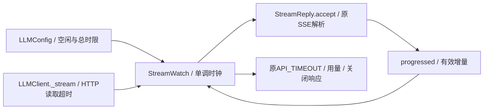

策略已接入HTTP及原会话失败流程；[约束说明](stream-deadlines.md)。

## B24.2 双协议入口

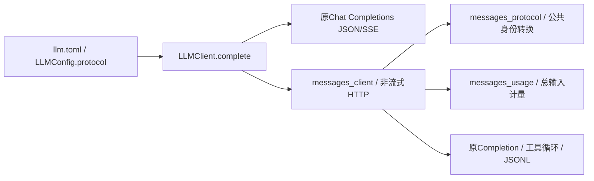

## B24.1 公共消息视图

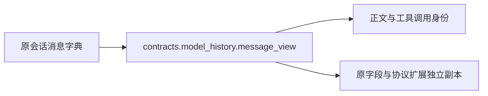

公共视图由B24.2的Messages适配使用，原Chat传输保留；[能力边界](model-adapters.md)。

## B23.2 正式首尾工具

~~~mermaid
flowchart LR
    SP_REG["factory / replace_span与EDIT_FILE"] --> SP_GATE["原发现、参数、模式、路径和Hook"]
    SP_GATE --> SP_ENTRY["EditTools.replace_span"]
    SP_ENTRY --> SP_PREP["prepare_span / 原EditPlan"]
    SP_ENTRY --> SP_EXEC["execute_plan / 原批准和写入"]
    SP_KIND["FILE_EDIT_TOOLS"] --> SP_BUDGET["原编辑额度、日志及执行证据"]
    SP_KIND --> SP_DIAG["原诊断来源匹配"]
~~~

原检查点保留完整字节，用户undo恢复原版本；记录重放不重复文件写入。见 [工具验收](span-editing.md)。

## B23.1 首尾锚点规划

~~~mermaid
flowchart LR
    SP_PREP["EditTools.prepare_span / 仅规划"] --> SP_POLICY["原PathPolicy.resolve_write"]
    SP_PREP --> SP_SNAPSHOT["read_snapshot / 完整字节与版本"]
    SP_PREP --> SP_PLAN["plan_span_edit / 唯一非重叠首尾"]
    SP_PLAN --> SP_EXISTING["plan_edit / 原EditPlan与完整diff"]
~~~

规划接口本身不批准或执行，生产replace_span随后复用原execute_plan。具体范围及书稿取舍见 [首尾编辑](span-editing.md)。


## B17 PDF 读取与提取

~~~mermaid
flowchart LR
    PDF_FACTORY["factory / read_pdf / 原模式和请求名单"] --> PDF_TOOL["PdfTools / 只读参数、版本、协作期限"]
    PDF_TOOL --> PDF_SOURCE["pdf_source / 原 PathPolicy / 字节快照与读取复查"]
    PDF_SOURCE --> PDF_BYTES["已授权且有界的原字节"]
    PDF_BYTES --> PDF_READ["documents.pdf.extract_pdf"]
    PDF_RESULT --> PDF_PACK["PdfTools / 再授权、完整页状态、JSON限长"]
    PDF_PACK --> PDF_LOG["原工具结果 / JSONL / 录制与离线重放"]
    PDF_LIMIT["PdfLimits / 字节、页、字符与解析边界"] --> PDF_READ
    PDF_READ --> PDF_LIB["pypdf / ContextVar 配置与物理页"]
    PDF_LIB --> PDF_RESULT["PdfExtract / PdfPage / 原 SHA、页码、截断与 OCR 提示"]
    PDF_READ --> PDF_ERROR["DocumentError / 整次失败或原取消传播"]
    PDF_SCAN["DocumentSource / 配置资料根与扫描期限"] --> PDF_SOURCE
    PDF_SCAN --> PDF_ALL["extract_pdf_all / 一次全文解析、拒绝文字截断"]
    PDF_ALL --> PDF_LIB
    PDF_ALL --> PDF_INDEX["DocumentIndex / 每物理页独立 Chunk 与 DocumentNotice"]
    PDF_INDEX --> PDF_SEARCH["DocumentSearch / 原关键词、向量与融合"]
    PDF_INDEX --> PDF_KNOW["KnowledgeDirectory / ContextPrefixStore / 页级来源"]
    PDF_INDEX --> PDF_AUDIT["evidence_audit / evaluation / 页码身份校验"]
    PDF_SEARCH --> PDF_LOG
~~~

读取工具与资料索引均已接入；PDF 页码是物理页，行号是页内提取位置，扫描提示不代表执行了 OCR；原文件授权、元数据校验和资源限制见 [PDF 感知](pdf-perception.md)。

## B16 语义工具目录与运行时接入

[B16.3 评估脚本](../scripts/tool_discovery_eval.py) 使用二十项教学目录经过同一发现链路，模型与目录预先固定，实际记录与失败证据见[对照报告](tool-discovery-evaluation.md)。生产调用关系保持下图。

~~~mermaid
flowchart LR
    ST_BOOT["bootstrap / 每个主子任务独立本地后端"] --> ST_QUERY["ToolDiscovery.list_tools / 真实轮次查询"]
    ST_QUERY --> ST_RANK
    ST_RESULT --> ST_PAGE["有界候选页 / 原工具 JSONL 与重放"]
    ST_CHOOSE["discover_tools / 原单轮选择"] --> ST_REQUEST["下次完整 Schema / 固定请求名单 / 原执行授权"]
    ST_REG["可信 ToolRegistry"] --> ST_DIR["ToolDirectory / 完整 Schema 与能力版本"]
    ST_DIR --> ST_RANK["SemanticToolRanker / 先模式与分组过滤"]
    ST_CFG["ToolDiscoveryConfig / 本地模型与数量阈值"] --> ST_RANK
    ST_RANK --> ST_BACK["注入的 EmbeddingBackend / 仅名称与摘要"]
    ST_BACK --> ST_CACHE["整批校验 / 有界单份内存向量"]
    ST_CACHE --> ST_RESULT["ToolRanking / 候选、版本、分数或降级原因"]
    ST_RANK --> ST_RESULT
~~~

list_tools 返回候选后由模型决定是否调用 discover_tools；候选不会自动流入已选择集合。bootstrap 使用 documents_dir/models 的本地缓存，预览不推理，正常查询不自动下载。见 [语义工具发现](semantic-tool-discovery.md)。

## B15.3.2 MCP 二进制引用接入

~~~mermaid
flowchart LR
    MC_BOOT["bootstrap / 受保护的 _mcp_media"] --> MC_STORE["MCPMediaStore"]
    MC_BOOT --> MC_CONN["MCPConnection / 原 stdio 或 HTTP"]
    MC_CONN --> MC_CONVERT["content.ResultContent / 来源、混合文本与二进制准备"]
    MC_CONN --> MC_PROTO["resources / prompts / URI、角色、版本"]
    MC_PROTO --> MC_CONVERT
    MC_CONVERT -->|"全部验证后 publish"| MC_STORE
    MC_STORE --> MC_BYTES["固定 ID.bin / 有界实际字节"]
    MC_CONVERT --> MC_RESULT["文本、未读取链接和媒体引用"]
    MC_RESULT --> MC_TOOL["原工具执行 / JSONL / 录制与重放"]
    MC_BOOT --> MC_POLICY["主子 PathPolicy / 资料加载与审查保护"]
~~~

二进制不会自动变为模型可见图片；外部模板角色和资料链接只作为结果数据。存储细节：

~~~mermaid
flowchart LR
    MS_CALLER["显式宿主 API 调用者"] --> MS_PREP["prepare_media / 有界解码与来源摘要"]
    MS_PREP --> MS_VALUE["PreparedMedia / 字节与固定引用"]
    MS_CALLER --> MS_STORE["MCPMediaStore / 锁、整批配额与摘要校验"]
    MS_VALUE --> MS_STORE
    MS_STORE --> MS_FILE["宿主指定目录 / ID.bin 原子发布"]
    MS_STORE --> MS_REF["MediaReference / 无路径、无 base64"]
~~~

MCPConnection 负责来源及整份结果校验，MCPMediaStore 负责字节与配额。只有宿主显式 read 接口能从完整引用恢复字节；会话重放不重启服务，亦不自动复制媒体目录。详见 [MCP 引用](mcp.md)。

## B15.3.1 MCP 传输与认证

~~~mermaid
flowchart LR
    MT_CFG["MCPServerConfig / command 或 url、token_env"] --> MT_CONN["MCPConnection / 目录与业务请求"]
    MT_CONN --> MT_PORTAL["AnyIO / 同一异步任务进出"]
    MT_PORTAL --> MT_TRANS["mcp.transport.open_client / 资源生命周期"]
    MT_TRANS --> MT_LOCAL["SDK stdio / 本地进程"]
    MT_TRANS --> MT_HTTP["httpx2 + SDK Streamable HTTP / 固定端点与TLS"]
    MT_ENV["环境变量 / 连接时读取"] --> MT_HTTP
    MT_HTTP --> MT_REMOTE["显式远程服务 / 不由宿主管理进程"]
~~~

tools、resources 与 prompts 共用此连接。失败不重发业务请求，认证头不进入模型资料或记录。实际边界与验收见 [MCP](mcp.md)。

## B15.2 MCP 提示模板

~~~mermaid
flowchart LR
    MP_CFG["MCPServerConfig.prompts / 显式名称"] --> MP_REG["register_mcp / 可信服务与资源栈"]
    MP_REG --> MP_TOOL["mcp_prompts / list 与 get"]
    MP_TOOL --> MP_CONN["MCPConnection / 有界请求与原清理"]
    MP_CONN --> MP_DATA["mcp.prompts / 参数、来源与文本验证"]
    MP_CONN --> MP_SDK["ClientSession / prompts/list 与 prompts/get"]
    MP_TOOL --> MP_LOOP["原 ToolRegistry 与执行器 / 日志、额度、重放"]
~~~

模板消息只进入工具结果，不拼接为系统、用户或助手历史。说明与真实 SDK 验收见 [MCP](mcp.md)。

## B15.1 MCP 文本资源

~~~mermaid
flowchart LR
    MR_CFG["MCPServerConfig.resources / 显式 URI"] --> MR_REG["register_mcp / 组装与资源栈"]
    MR_REG --> MR_CONN["MCPConnection / 共用总等待与清理"]
    MR_CONN --> MR_SDK["ClientSession / 配置选择的服务"]
    MR_CONN --> MR_DATA["mcp.resources / 目录、正文与内容版本"]
    MR_REG --> MR_TOOLS["mcp_resources / list 与 read"]
    MR_TOOLS --> MR_CONN
    MR_TOOLS --> MR_LOOP["原 ToolRegistry 与 ToolExecutor / 日志及额度"]
~~~

资源正文仅回传为工具结果，不转成系统提示，不执行 URI 或服务给出的指令。限制、教学配置和真实 SDK 验收见 [MCP](mcp.md)。

## B14.2.2 生产隔离工具

~~~mermaid
flowchart LR
    OC_CONFIG["OrchestrationConfig / 显式开启与发行版"] --> OC_BOOT["bootstrap / 主与子应用分别组装"]
    OC_BOOT --> OC_TOOL["orchestration_tools / execute_code"]
    OC_BOOT --> OC_RUNNER["IsolatedOrchestrator / 固定 WSL 后端"]
    OC_TOOL --> OC_PORT["contracts.orchestration / CodeRunner"]
    OC_RUNNER -.实现.-> OC_PORT
    OC_RUNNER --> OC_NESTED["原 ToolExecutor.execute_nested"]
    OC_NESTED --> OC_FACTS["宿主 nested_calls / 实际 JSONL 事实"]
    OC_FACTS --> OC_PLAN["plan_evidence / 根及底层成功校验"]
~~~

默认关闭；查看目录不启动后端，失败不回退宿主。组装与实际 WSL 验收见 [代码编排](code-orchestration.md)。

## B14.2.1 嵌套执行基础

~~~mermaid
flowchart LR
    NE_TURN["Conversation / 单轮处理"] --> NE_ROOT["ToolExecutor / 根编排串行动作"]
    NE_TURN --> NE_BUDGET["ToolBudget / 共用调用与编辑额度"]
    NE_ROOT --> NE_CHILD["execute_nested / 固定名单与父来源"]
    NE_CHILD --> NE_INV["原 ToolInvocation / 权限、Hook、批准、附件"]
    NE_INV --> NE_LOG["SessionLog / 独立工具 ID 与 parent_tool_call_id"]
    NE_CHILD --> NE_BUDGET
    NE_ROOT --> NE_BUDGET
    NE_LOG --> NE_CAPTURE["RecordingTools / 批次事件增量"]
    NE_CAPTURE --> NE_REPLAY["ReplayStore / 逐项扣额，零真实动作"]
~~~

生产隔离工具已通过该执行基础接入；独立工具桥仍只供显式 API，不替代完整执行器。见 [代码编排](code-orchestration.md)。

## B14.1 窄 RPC 与注册工具桥

~~~mermaid
flowchart LR
    RPC_HOST["显式 API / IsolatedOrchestrator"] --> RPC_WSL["linux_rpc / 可信转发与看守"]
    RPC_WSL --> RPC_WORKER["固定 OS 隔离 / Python call_tool 与 result"]
    RPC_WORKER --> RPC_FRAME["rpc_protocol / 有界一问一答"]
    RPC_FRAME --> RPC_HOST
    RPC_HOST --> RPC_CALLBACK["当前协调线程 / 宿主 invoke"]
    RPC_CALLBACK --> RPC_BRIDGE["RegisteredToolBridge / 显式允许名称"]
    RPC_BRIDGE --> RPC_REG["原 ToolRegistry / 参数、模式、路径"]
    RPC_REG --> RPC_RESPONSE["原工具结果 / 回到 worker 聚合"]
    RPC_RESPONSE --> RPC_WSL
~~~

此图描述独立 API；生产聊天使用上面的 B14.2 执行器连接，不使用简化工具桥。见 [边界与验收](code-orchestration.md)。

## B19.1 隔离前置

~~~mermaid
flowchart LR
    IS_HOST["显式宿主 API / WslBubblewrap"] --> IS_WSL["选定 WSL 发行版 / 固定 argv"]
    IS_WSL --> IS_LINUX["linux_worker / 可信启动器"]
    IS_LINUX --> IS_BWRAP["Bubblewrap / 命名空间与只读挂载"]
    IS_BWRAP --> IS_FILTER["seccomp 两阶段 + 资源硬限额"]
    IS_FILTER --> IS_CODE["单进程 Python 代码"]
    IS_LINUX --> IS_WATCH["墙钟、双流限额和回收"]
    IS_WATCH --> IS_RESULT["退出事实 / 有界 JSON"]
    IS_RESULT --> IS_HOST
~~~

B14.2 已复用计算后端进行窄 RPC；B19.2/3 的独立 run_isolated_command 使用原生命令策略并已验收故障清理，run_command 仍明确在宿主运行。详见 [固定策略与真实证据](runtime-isolation.md)。

## B13.2 分享命令与来源核对

~~~mermaid
flowchart LR
    SC_CLI["recordings / share"] --> SC_RULES["share_format.load_redaction_rules / 私有 TOML"]
    SC_RULES --> SC_EXPORT["sharing.export_share"]
    SC_VIEW["recordings / inspect-share"] --> SC_READ["share_format.read_share / 有界格式与统计"]
    SC_READ --> SC_CHECK["inspect_share / 显式来源字节核对"]
    SC_CHECK --> SC_SUMMARY["摘要与未验证标记 / 无原敏感值"]
    SC_REPLAY["recordings / replay"] --> SC_TRACE["read_recording / 原录制协议"]
~~~

分享事件不转换为 Recording。来源匹配仅证明提供的原字节与声明摘要相同，不证明分享正文真实性或脱敏充分。

## B13.1 脱敏分享副本

~~~mermaid
flowchart LR
    RS_SOURCE["原录制 / 一次有界读取"] --> RS_PARSE["journal.parse_recording / 原协议校验"]
    RS_PARSE --> RS_COLLECT["redaction / 规则与显式字面值"]
    RS_COLLECT --> RS_NESTED["完整 JSON 字符串 / 有界解析与字段扫描"]
    RS_NESTED --> RS_COPY
    RS_NESTED --> RS_REJECT["重复字段、超限或非有限数 / 整次拒绝"]
    RS_COLLECT --> RS_COPY["脱敏副本 + 无原文位置报告"]
    RS_COPY --> RS_SAVE["sharing.export_share / 排他发布"]
    RS_SOURCE --> RS_HASH["同份字节 SHA256 与完整性标记"]
    RS_HASH --> RS_SAVE
    RS_SAVE --> RS_ART["human_review_only / replayable=false"]
~~~

宿主 API 与上方显式 CLI 均不注册模型工具、不加载模型配置、不改变原录制；规则边界见 [分享脱敏](recording-sharing.md)。

## B12.2.3 知识使用与目录保护

~~~mermaid
flowchart LR
    KE_CONFIG["config.loader / storage.knowledge_dir"] --> KE_BOOT["bootstrap / 主子装配与保留目录"]
    KE_BOOT --> KE_TOOLS["knowledge_fact_tools / 主 propose + query；子仅 query"]
    KE_TOOLS --> KE_ACCESS["KnowledgeAccess / 唯一原文补全与有界分页"]
    KE_ACCESS --> KE_INDEX["DocumentIndex / 当前授权来源"]
    KE_ACCESS --> KE_LIFE["KnowledgeProposals + KnowledgeLifecycle"]
    KE_CLI["adam.knowledge / 显式本地命令"] --> KE_ACCESS
    KE_CLI --> KE_LIFE
    KE_CLI --> KE_REVIEW["KnowledgeModelReviewer / 单次独立计费"]
    KE_CLI --> KE_CONFIRM["展示支持、反证和意见 / 用户 yes"]
    KE_CONFIRM --> KE_LIFE
    KE_BOOT --> KE_POLICY["PathPolicy / 文件、资料、规则、Skill、审查快照保护"]
~~~

候选工具走原 SESSION_STATE 调用、预算和日志；发布查询为 READ_ONLY，已录制结果可离线重放。模型没有批准/发布工具。目录保护不等于通用命令的 OS 沙箱。见 [知识入口](knowledge-proposals.md)。

## B12.2.2 独立模型审查

~~~mermaid
flowchart LR
    KM_HOST["宿主显式组装"] --> KM["KnowledgeModelReviewer / 单次实例"]
    KM --> KM_INTENT["reviews/请求ID.json / 先写 intent"]
    KM_INTENT --> KM_CLIENT["contracts.ModelClient / 无 tools"]
    KM_CLIENT --> KM_CHECK["有界意见、可靠用量与证据 ID 校验"]
    KM_CHECK --> KM_SAVE["保存响应或失败 / 不重试"]
    KM_SAVE --> KM_LIFE["KnowledgeLifecycle / 重新核对来源和修订"]
~~~

请求记录与发布状态分开；异常不保存远端异常正文，启动中断保持未知消费而不自动重发。见 [知识审查](knowledge-proposals.md)。

## B12.2.1 发布状态与当前知识

~~~mermaid
flowchart LR
    KL_HOST["宿主"] --> KL["KnowledgeLifecycle"]
    KL --> KP["KnowledgeProposals / 冻结候选"]
    KL --> KR["KnowledgeReviewer / 锁外审查意见"]
    KL --> KC["宿主 confirm / 锁外用户确认"]
    KL --> KA["evidence_audit / 前后核对原文"]
    KL --> KS["knowledge_states / 修订与转换校验"]
    KS --> KJ["states.json / 共用锁与原子历史"]
    KL --> KQ["current / 已发布、来源当前且在有效期"]
~~~

审查意见只允许建议，用户发布决定由宿主回调提供；来源变化后停止复用，旧候选保持冻结。当前不新增聊天自动请求或模型发布权限。详见 [知识发布](knowledge-proposals.md)。

## B12.1 待审知识候选

~~~mermaid
flowchart LR
    KP_INPUT["结构化候选 / 支持、反证、适用时间"] --> KP_VALIDATE["knowledge_proposals / validate_proposal"]
    KP_VALIDATE --> KP_AUDIT["evidence_audit / 当前授权原文核对"]
    KP_AUDIT --> KP_SAVE["KnowledgeProposals / 范围锁与原子保存"]
    KP_SAVE --> KP_PENDING["冻结 pending / unreviewed 候选"]
    KP_PENDING --> KP_READ["read / 保留当时原文，不替换证据"]
~~~

候选记录本身没有批准字段；发布决定由上方独立状态模块保存。当前没有自动模型输入注入。接口及下一步边界见 [知识候选](knowledge-proposals.md)。

## B11.3 总结来源与对照

~~~mermaid
flowchart LR
    KA_FIX["knowledge_eval / 固定合成资料"] --> KA_GLOBAL["KnowledgeDirectory / 全部主题概览"]
    KA_FIX --> KA_SINGLE["DocumentSearch / 四题单点查询"]
    KA_GLOBAL --> KA_QUOTES["逐字总结基线 / 结构化引用"]
    KA_QUOTES --> KA_AUDIT["evidence_audit / 重新授权读取与定位核对"]
    KA_AUDIT --> KA_REPORT["来源与覆盖报告 / 语义未检查"]
    KA_SINGLE --> KA_REPORT
~~~

该审计是独立接口，不自动替代聊天回答的语义判断；对照和实际遗漏见 [知识目录](knowledge-catalog.md)。

## B11.2 知识目录入口

~~~mermaid
flowchart LR
    KQ_REG["register_documents / 同一授权索引"] --> KQ_TOOLS["knowledge_tools / 两个只读工具"]
    KQ_CLI["document_search / catalog 与 read-topic"] --> KQ_SERVICE["KnowledgeDirectory / 版本分页与完整输出"]
    KQ_TOOLS --> KQ_SERVICE
    KQ_SERVICE --> KQ_INDEX["DocumentIndex / 每次重新授权读取"]
    KQ_INDEX --> KQ_STORE["KnowledgeCatalogStore / 当前概览与引用"]
    KQ_SERVICE --> KQ_LOG["普通工具结果 / 录制与会话日志"]
~~~

概览不是全库总结，详情不接受任意路径；已录结果重放不再读取源资料。

## B11.1 二层知识目录

~~~mermaid
flowchart LR
    KC_INDEX["DocumentIndex / 已授权 Corpus"] --> KC_BUILD["documents.catalog / build_catalog"]
    KC_BUILD --> KC_TOPICS["KnowledgeTopic / 有界逐字概览"]
    KC_TOPICS --> KC_REFS["CatalogReference / 全部原文版本与位置"]
    KC_STORE["KnowledgeCatalogStore / 文件锁"] --> KC_BUILD
    KC_STORE --> KC_SNAPSHOT["原子快照 / 来源与规则版本"]
~~~

目录不增加文件权限，查询入口见上图；详见 [知识目录](knowledge-catalog.md)。

## B10.3 独立语境实验

~~~mermaid
flowchart LR
    CX_ENTRY["scripts.context_eval / 新目录与显式开关"] --> CX_DATA["合成资料 / 固定金标准"]
    CX_ENTRY --> CX_BASE["原文检索基线"]
    CX_ENTRY --> CX_MODEL["scripts.context_generation / 有界请求与证据"]
    CX_MODEL --> CX_HTTP["生产 LLMClient / 无工具、无重试"]
    CX_MODEL --> CX_STORE["ContextPrefixStore / 全批有效说明"]
    CX_STORE --> CX_SEARCH["DocumentSearch / 增强检索"]
    CX_BASE --> CX_COMPARE["相同来源 / 逐题指标与人工判读"]
    CX_SEARCH --> CX_COMPARE
~~~

本地入口不使用 CX_MODEL 分支；真实模型只在用户显式开启实验时运行。详见 [语境对照](contextual-retrieval.md)。


## B10.2 语境进入评分

~~~mermaid
flowchart LR
    CT_SEARCH["DocumentSearch / 显式开关"] --> CT_STORE["ContextPrefixStore / 当前源版本"]
    CT_STORE --> CT_INDEX["有界前缀 + 原标题/正文"]
    CT_INDEX --> CT_BM25["keyword_search / 增强评分"]
    CT_INDEX --> CT_VECTOR["VectorSearch / 前缀绑定缓存键"]
    CT_BM25 --> CT_HITS["原始 Chunk / 融合与原文精排"]
    CT_VECTOR --> CT_HITS
    CT_HITS --> CT_PACK["工具与评估 / 原文、说明分别保存"]
~~~

## B10.1 独立分块语境

~~~mermaid
flowchart LR
    CP_CORPUS["DocumentIndex / 已授权原文快照"] --> CP_STORE["ContextPrefixStore / 持锁与版本校验"]
    CP_STORE --> CP_REQUEST["ContextRequest / 同文件有界原文与邻块"]
    CP_REQUEST --> CP_BUILDER["ContextBuilder / 默认本地摘录"]
    CP_BUILDER --> CP_NOTE["ContextPrefix / 说明与原文身份分离"]
    CP_NOTE --> CP_CACHE["独立原子缓存 / 全批成功才返回"]
~~~

[contextualization.py](../adam/documents/contextualization.py) 不修改源文件或原索引，搜索接入见上图；契约见 [语境前缀](contextual-retrieval.md)。

## B09.3 检索评估

~~~mermaid
flowchart LR
    EV_CASES["固定题集 / 文件版本与片段位置"] --> EV_VALIDATE["documents.evaluation / 先验证全部题"]
    EV_CLI["document_search evaluate / 同版本四路"] --> EV_VALIDATE
    EV_VALIDATE --> EV_SEARCH["DocumentSearch / 当前候选与实际排序"]
    EV_SEARCH --> EV_METRICS["逐题证据 / Hit、MRR、宏微 Recall、无答案"]
    EV_METRICS --> EV_REPORT["完整报告 / 来源变化则停止"]
~~~

真实小题集与指标边界见 [检索评估](retrieval-evaluation.md)。源检索图保持，模型分数不等于回答正确性。

## B09.2 可选精排

~~~mermaid
flowchart LR
    RR_FUSE["融合候选池 / 原文与各路排名"] --> RR_RUN["rerank_hits / 有界前缀与逐段取消"]
    RR_RUN --> RR_PORT["contracts.reranking / 仅分数接口"]
    RR_LOCAL["FastEmbedReranker / 本地 CPU cross-encoder"] --> RR_PORT
    RR_RUN --> RR_PASS["全部评分有效 / 精排后截取"]
    RR_RUN --> RR_FAIL["后端失败 / 完整融合排序"]
    RR_PASS --> RR_EVIDENCE["原引用 + 分数 + 实际状态"]
    RR_FAIL --> RR_EVIDENCE
    RR_EVIDENCE --> RR_REPORT["工具日志、输出限额与评估"]
~~~

精排默认关闭，取消不会进入降级分支；模型准备与输入窗口限制见 [混合检索](hybrid-retrieval.md)。

## B09.1 混合检索

~~~mermaid
flowchart LR
    HY_ENTRY["文档工具 / 独立 CLI"] --> HY_SEARCH["DocumentSearch / 当前配置"]
    HY_SEARCH --> HY_INDEX["DocumentIndex / 同一有效语料"]
    HY_INDEX --> HY_BM25["keyword_search / BM25"]
    HY_INDEX --> HY_VECTOR["VectorSearch / 余弦阈值"]
    HY_BM25 --> HY_RRF["documents.fusion / ID 去重与 RRF"]
    HY_VECTOR --> HY_RRF
    HY_RRF --> HY_HIT["SearchHit / 原文、版本、各路排名"]
    HY_HIT --> HY_PACK["pack_results / 整条片段与输出上限"]
~~~

图示为 hybrid 路径，keyword / semantic 保留独立运行；限额、失败和分数含义见 [混合检索](hybrid-retrieval.md)。

## B08.2 历史工具接入

~~~mermaid
flowchart LR
    ST_CONFIG["SessionSearchConfig / 用户明确授权"] --> ST_BOOT["bootstrap / 仅主应用"]
    ST_BOOT --> ST_TOOLS["SessionTools / 当前身份与范围"]
    ST_STORE["SessionStore.active_session_id"] --> ST_TOOLS
    ST_TOOLS --> ST_INDEX["SessionSearchIndex / 原文与诊断标记"]
    ST_TOOLS --> ST_REG["ToolRegistry / history 分组与只读能力"]
    ST_REG --> ST_EXEC["原执行器 / 额度、模式、Hook、日志"]
    ST_EXEC --> ST_REPLY["有界原文与准确续读位置"]
~~~

配置、主子隔离和重放边界见 [旧对话检索](session-search.md)。工具注册不改变原文件读取授权或命令执行规则。

## B08.1 旧对话只读索引

~~~mermaid
flowchart LR
    SS_CLI["session_search / 显式会话范围"] --> SS_INDEX["session.search / 有界只读索引"]
    SS_INDEX --> SS_FILES["授权 JSONL / 版本快照"]
    SS_INDEX --> SS_LOG["session.log / 严格协议解析"]
    SS_LOG --> SS_SOURCE["成功原文 / 显式诊断输入"]
    SS_INDEX --> SS_DATA["contracts.session_search / 位置、引用、覆盖问题"]
~~~

索引缓存每次验证当前文件字节，失败来源淘汰旧结果。独立入口不加载聊天 API 配置；范围、来源字段及限额见 [旧对话检索](session-search.md)。模型工具接入见上图。

## B07.3 拒绝与恢复边界

~~~mermaid
flowchart LR
    MR_USER["CLI / accept 或 reject"] --> MR_STORE["MemoryStore / 共享文件锁"]
    MR_STORE --> MR_CHECK["organization / 锁内重读候选"]
    MR_CHECK --> MR_REJECT["原子保存 rejected / 来源保留"]
    MR_CHECK --> MR_ACCEPT["未拒绝且快照匹配 / 才能采纳"]
    MR_ACCEPT --> MR_MEMORY["原子记忆版本 / 完整旧或新状态"]
~~~

独立进程竞争与强杀后重启结果见 [记忆整理](memory-organization.md)。

## B07.2 接受与撤销

~~~mermaid
flowchart LR
    MC_CLI["CLI / 用户明确采纳或撤销"] --> MC_APP["AgentApplication / MemoryService"]
    MC_APP --> MC_PLAN["organization / 冻结候选"]
    MC_APP --> MC_STORE["MemoryStore / 同一把锁"]
    MC_STORE --> MC_CHANGE["organization_change / 校验来源与构造版本"]
    MC_CHANGE --> MC_DATA["MemoryDerivation / 精确原版本"]
    MC_STORE --> MC_ATOMIC["原子替换 / 概览与全部来源"]
    MC_ATOMIC --> MC_CONTEXT["原召回与请求记录 / 仍按有效期选择"]
~~~

确认、幂等、TTL 与撤销的边界见 [记忆整理](memory-organization.md)。

## B07.1 离线记忆整理

~~~mermaid
flowchart LR
    MO_CLI["memory_commands / tidy"] --> MO_APP["AgentApplication / MemoryService"]
    MO_APP --> MO_STORE["MemoryStore / 当前范围快照"]
    MO_APP --> MO_RULES["memory.organization / 离线候选"]
    MO_RULES --> MO_DATA["contracts.memory_organization / 来源版本"]
    MO_RULES --> MO_FILE["organizations/ID.json / 独立候选"]
    MO_FILE --> MO_VIEW["校验并显示冻结候选"]
~~~

范围、分类局限和保存失败语义见 [记忆整理](memory-organization.md)。采纳与撤销由 B07.2 实现。

## B06.3 记忆召回验收

~~~mermaid
flowchart LR
    ME_CASES["memory_eval / 十题与合成来源"] --> ME_STORE["MemoryStore / 独立评估目录"]
    ME_STORE --> ME_SERVICE["MemoryService / 相同范围及预算"]
    ME_SERVICE --> ME_KEYWORD["关键词排序"]
    ME_SERVICE --> ME_VECTOR["SemanticMemoryRanker / 本地模型"]
    ME_KEYWORD --> ME_PROOF["manifest、逐题选择、report"]
    ME_VECTOR --> ME_PROOF
~~~

[运行器](../scripts/memory_eval.py) 不加载聊天连接配置；真实结果与工程验收的区别见 [召回评估](memory-retrieval-evaluation.md)。

## B06.2 主体和事实时间

~~~mermaid
flowchart LR
    MI_CLI["memory_commands / 显式元数据"] --> MI_APP["MemoryService / 范围与管理"]
    MI_APP --> MI_STORE["MemoryStore / 锁内旧版本校验"]
    MI_STORE --> MI_ATOMIC["一个原子快照 / 旧事实到期与新事实"]
    MI_DATA["MemoryRecord / 主体、生效期、替代引用"] --> MI_STORE
    MI_APP --> MI_SUBJECT["memory.subjects / 时间过滤后消歧"]
    MI_SUBJECT --> MI_RANK["关键词或本地语义排序"]
    MI_RANK --> MI_TRACE["MemorySelection / 实际原文、身份与版本来源"]
~~~

来源、同名提示、时间边界和保存失败契约见 [主体与时间](memory-identity.md)。

## B06.1 本地语义记忆

~~~mermaid
flowchart LR
    SM_BOOT["bootstrap / 组装本地后端"] --> SM_BACKEND["documents.embedding / FastEmbedBackend"]
    SM_BOOT --> SM_RANK["memory.semantic / SemanticMemoryRanker"]
    SM_STORE["MemoryStore / 项目与全局最新版本"] --> SM_SERVICE["MemoryService / 范围与输入预算"]
    SM_SERVICE --> SM_RANK
    SM_RANK --> SM_PORT["contracts.embedding / 接口与向量校验"]
    SM_BACKEND --> SM_PORT
    SM_RANK --> SM_KEYWORD["rank_records / 明确降级"]
    SM_SERVICE --> SM_SELECTION["MemorySelection / 实际策略与选中来源"]
    SM_SELECTION --> SM_CONTEXT["模型资料消息 / 原输入预算"]
    SM_SELECTION --> SM_LOG["SessionLog 与录制 / 冻结来源，不重新推理"]
~~~

主体、时间消歧已由 B06.2 接入。模型准备、范围和降级契约见 [语义记忆](semantic-memory.md)。

## C00.2 二进制媒体证据

~~~mermaid
flowchart LR
    MEDIA_HOST["可信输入或工具宿主 / 当前所有者"] --> MEDIA_API["SessionMedia / 发布与读取边界"]
    MEDIA_API --> MEDIA_STORE["MediaStore / 完整二进制与配额"]
    MEDIA_API --> MEDIA_SESSION["SessionStore / validate、append、load_media"]
    MEDIA_SESSION --> MEDIA_LOG["SessionLog / MediaLog 来源投影"]
    MEDIA_STORE --> MEDIA_FILE["单个 .media / 版本头与原字节原子发布"]
    MEDIA_LOG --> MEDIA_REF["contracts.media / MediaRef 与 MediaSource"]
    MEDIA_SESSION --> MEDIA_JSONL["media_saved / 仅完整引用"]
    MEDIA_BOOT["bootstrap / _media 保留目录"] --> MEDIA_POLICY["主子文件、规则、Skill、文档路径保护"]
~~~

存储不解码媒体，不导入 SDK 或应用内核。SessionMedia 先核对当前宿主/来源，完整正文发布后才提交引用；读取比较日志和文件中的完整引用，IO 返回后复查所有者。文件存在不能替代授权，日志失败的孤立正文不自动发布或重跑来源。原 ArtifactStore 文本契约保持；C00.3 的模型消息与冻结重放见下一节，不将存储 API 当成模型视觉能力。接口、格式与真实 PNG/WAV 验收见 [媒体证据](media-evidence.md)。

## C00.3 消息、能力与媒体重放

~~~mermaid
flowchart LR
    MI_HOST["宿主 send / 当前会话已有 MediaRef"] --> MI_CONV["Conversation / 预检与固定引用"]
    MI_BOOT["bootstrap / 主子独立所属媒体根"] --> MI_VALIDATE["MediaInputService / 声明、来源与字节"]
    MI_CONV --> MI_VALIDATE
    MI_VALIDATE --> MI_SESSION["SessionMedia / 当前所有者"]
    MI_CONV --> MI_CONTRACT["contracts.model_input / MessageView、parts、ModelCapabilities"]
    MI_CONV --> MI_LOG["SessionStore / turn_started.media 与消息一致"]
    MI_CONV --> MI_CONTEXT["ContextBuilder / 每媒体预算预留"]
    MI_CONTEXT --> MI_SUMMARY["CompactionService、ReflectionService / 保留真实媒体输入"]
    MI_CONV --> MI_MODEL["ModelClient / 现有请求管线"]
    MI_MODEL --> MI_ENCODER["LLMClient、ChatInputEncoder / 声明与完整字节复核"]
    MI_ENCODER --> MI_WIRE["HTTP 前编码 / data URL 不入日志"]
    MI_MODEL --> MI_CAPTURE["RecordingModel、TurnRecorder / 调用前冻结"]
    MI_CAPTURE --> MI_ARCHIVE["MediaArchive / 同名 .media 目录"]
    MI_ARCHIVE --> MI_FILES["MediaStore.restore / 幂等且不覆盖身份"]
    MI_PARSE["parse_recording / 仅事件与来源校验"] --> MI_READ["read_recording / 来源与字节只读校验"]
    MI_READ --> MI_ARCHIVE
    MI_READ --> MI_REPLAY["ReplayMediaInput / 冻结引用及零外部动作回放"]
~~~

公共视图保留工具 ID/名称/原参数、结果身份及推理字段，未知供应商字段显式拒绝；原文字 content 与文本会话事件不变。宿主只能提交当前会话已有引用，主子不自动共享图片；输入预检和显式冻结失败不登记轮次，发送边界失败以零消费本地原因收尾。摘要和反思同时携带真实媒体并计预算，不把引用 JSON 当成已读取图片。媒体模型能力只由宿主显式声明，默认 DeepSeek 不升级；B24.1 仅必要增量，第二协议与切换未实现。

录制 JSONL 仍保存原引用和顺序，TraceState 核对已提交来源，媒体正文按录制路径派生旁路目录冻结。parse_recording 仅解析同一份字节供人工分享，带媒体时 media_verified=False；read_recording 验证完整来源、时间、大小和 SHA-256 后才置 True，不访问原会话或创建锁；缺失/损坏及仅解析未验证副本不得回放或匹配，离线运行使用已验证引用、不重发。新消息契约、配额/隐私、8192 token 预留的非计费保证及 88 项新增工程验收（同步后 392 项联合回归）见 [多模态输入](multimodal-input.md)；C04.1 的解码见下一节，真实视觉问答/OCR 尚待实现。

## C04.1 真实图片输入

~~~mermaid
flowchart LR
    IMG_CONFIG["VisionConfig / 默认关闭与显式安装"] --> IMG_BOOT["bootstrap / 主子独立来源、路径与媒体根"]
    IMG_BOOT --> IMG_TOOL["vision_tools / register_vision、ImageTools"]
    IMG_EXEC["ToolExecutor / 原发现、模式、规则、Hook、预算、取消"] --> IMG_TOOL
    IMG_TOOL --> IMG_PATH["PathPolicy / 普通文件有界快照"]
    IMG_PATH --> IMG_LOAD["vision.service.ImageLoader / 解码后发布"]
    IMG_LOAD --> IMG_DECODE["ImageDecoder / adapters.pillow / 头部边界、verify、load、EXIF"]
    IMG_LOAD --> IMG_MEDIA["SessionMedia / 原来源复核、正文及 media_saved"]
    IMG_MEDIA --> IMG_RESULT["完整 MediaRef + ImageInfo / tool_finished"]
    IMG_RESULT -.宿主另行显式附图.-> IMG_SEND["已有 send(media=...) / 能力与来源校验"]
~~~

vision 只依赖本包/contracts，SDK 仅在适配器实际调用时导入；工具串行 SESSION_STATE 可在 plan 调查，但不授予额外读写权限。ImageLoader 不认识会话、路径或模型，发布端口由组装层注入。原字节、EXIF 与版本不变，显示换轴不是重编码；无模型能力时附图在登记轮次前拒绝。尺寸/方向随工具结果保存，不另建媒体日志。解码/保存失败不交付伪引用，孤立正文及重启不自动重做。像素/字节限制不是 OS 内存沙箱或硬取消保证。29 项业务与 49 项解码/配置场景、真实本地后端及使用限制见 [图片输入](image-input.md)；C04.2 显式问答已接通并保留真实失败，C04.3～4 仍待验收。

## C02.3 浏览器资源与下载

~~~mermaid
flowchart LR
    BL_BOOT["bootstrap / 主会话资源与来源"] --> BL_TOOLS["BrowserTools / 标签、关闭、显式下载批准"]
    BL_TOOLS --> BL_OBSERVER["BrowserObserver / 当前标签与原引用复检"]
    BL_OBSERVER --> BL_DRIVER["ChromiumDriver / 有限标签、弹窗、对话框"]
    BL_DRIVER --> BL_NETWORK["白名单逐请求路由 / 完整附件"]
    BL_NETWORK --> BL_RESULT["BrowserDownload / 窄字节结果"]
    BL_RESULT --> BL_TOOLS
    BL_TOOLS --> BL_MEDIA["SessionMedia / 保存后提交来源"]
    BL_MEDIA --> BL_LOG["media_saved / 原工具来源与固定版本"]
    BL_BOOT --> BL_FACADE["AgentApplication.send / 宿主中断清理"]
    BL_FACADE --> BL_CLOSE["BrowserTools.close / 所属线程回收全部上下文"]
    BL_LOG --> BL_REPLAY["ReplayStore / 导入引用事实，不执行动作"]
~~~

网络字节经窄下载结果返回工具绑定，再由其调用 SessionMedia；SDK 不访问会话存储。上下文独立且有总数/标签限制，关闭/取消/崩溃不自动重提表单。模型只见固定身份，不能提供保存路径或 JS。SDK 缓冲限制、弹窗首请求关联、取消及真实 POST 后终止证据见 [浏览器生命周期](browser-observation.md)。

## C02.1 / C02.2 DOM 浏览器观察与动作

~~~mermaid
flowchart LR
    BR_BOOT["bootstrap / BrowserConfig 与宿主当前会话"] --> BR_TOOLS["browser_tools / 主会话独立资源与批准"]
    BR_TOOLS --> BR_REGISTRY["ToolRegistry / 发现、模式、Hook、预算与串行取消"]
    BR_TOOLS --> BR_RUNTIME
    BR_TOOLS --> BR_APPROVAL["contracts.browser / BrowserApproval"]
    BR_APPROVAL --> BR_UI["cli.main.confirm_browser / 转义展示与明确 y"]
    BR_CLI["python -m adam.browser / 显式站点入口"] --> BR_RUNTIME["browser.runtime.open_browser / 临时资源所有权"]
    BR_RUNTIME --> BR_SERVICE["browser.service.BrowserObserver / 观察与引用校验"]
    BR_SERVICE --> BR_PORT["browser.models.BrowserDriver / 窄后端"]
    BR_PORT --> BR_ADAPTER["browser.adapters.chromium / Playwright 与独立无头上下文"]
    BR_ADAPTER --> BR_DOM["adapters.dom / 固定观察程序与原节点版本"]
    BR_ADAPTER --> BR_POLICY["browser.policy / 宿主 origin 白名单、逐跳打开"]
    BR_SERVICE --> BR_POLICY
    BR_SERVICE --> BR_RESULT["BrowserObservation / 身份、URL、时间、有界文字与引用"]
    BR_ADAPTER --> BR_SITE["真实 Chromium 与 HTTP 测试网站"]
~~~

[观察服务](../adam/browser/service.py) 不导入 SDK、应用内核或会话存储。[资源入口](../adam/browser/runtime.py) 只在实际调用时导入适配器，主/子聊天默认不创建浏览器资源。每次观察替换引用表；[固定 DOM 程序](../adam/browser/adapters/dom.py) 验证原节点、文档、revision 和属性状态。同名替换不可沿用旧引用。主页面显式逐跳打开，观察阶段子资源重定向/自动 POST/WebSocket 拒绝；origin 白名单不是 DNS 固定或系统沙箱。C02.3 的会话标签/弹窗/下载已在上节实现；C02.4 固定任务及真实模型完整验收仍待完成，不因资源和单表单闭环就提前勾选。接口、真实测试与限制见 [浏览器观察](browser-observation.md)。

C02.2：BrowserAction 校验四类有限动作与引用；BrowserObserver 形成 BrowserApproval 并在批准后复检。BrowserTools 仅在 approved open 时延迟创建隔离上下文，所有浏览器工具声明 EXTERNAL_ACTION 且不并行，子任务不注册。ChromiumDriver 使用原节点句柄，不执行调用者脚本；动作期间允许白名单 POST，主页面只按 GET 跟随 301/302/303，拒绝保留方法的 307/308。SDK/OS 动作故障按 BrowserActionUnknownError 停止；动作后观察失败保留 dispatched，不能当成业务成功或要求重做。取消/未知结果丢弃当前资源，应用关闭回收所有资源。真实本地表单、JSONL 与故障验收见浏览器文档。

## C01.2 独立百科搜索

~~~mermaid
flowchart LR
    WS_CLI["python -m adam.web.search / 显式后端"] --> WS_RUNTIME["web.runtime.open_search / 按次资源"]
    WS_RUNTIME --> WS_PORT["search_models.SearchBackend / 有界候选契约"]
    WS_PORT --> WS_ADAPTER["adapters.wikipedia.WikipediaSearch / 查询、严格 JSON 与整批校验"]
    WS_ADAPTER --> WS_HTTP["PageTransport / JSON 专用 HttpPageTransport"]
    WS_HTTP --> WS_POLICY["NetworkPolicy / 全 DNS 校验、固定 IP 与 TLS"]
    WS_HTTP --> WS_API["官方 MediaWiki Search API / English Wikipedia"]
    WS_ADAPTER --> WS_RESULT["SearchResult / API 响应版本、候选、摘要与范围"]
~~~

[搜索契约](../adam/web/search_models.py) 不包含 SDK 或会话；[百科适配器](../adam/web/adapters/wikipedia.py) 借用窄网络端口，只从默认官方端点或可信本地验收端点构造候选。未配置后端先失败、不创建资源；API 重定向拒绝、无自动重试。标题/摘要/条数/响应字节有界，非法整批不作为空结果。`search_snippets` 的响应摘要不代表候选网页版本，独立 CLI 不经过模型请求或 JSONL；主子工具与来源片段闭环见下节。原 WebReader 类型、主子可选读取、权限/批准及 B 系列关系保持。接口、限制、真实 HTTP 与真实百科后端验证见 [网页与搜索](web-reading.md)。

## C02.4 独立浏览器验收

~~~mermaid
flowchart LR
    BA_RUN["scripts.browser_acceptance / 冻结任务与临时会话"] --> BA_APP["原 build_application / 工具、逐次批准、JSONL"]
    BA_APP --> BA_MODEL["真实环回模型 / LLMClient SSE"]
    BA_APP --> BA_BROWSER["原 BrowserTools / ChromiumDriver"]
    BA_BROWSER --> BA_SITE["scripts.browser_fixture / 临时查询、表单、回执"]
    BA_SITE --> BA_FILE["receipts.json / 仅实际 POST 保存"]
    BA_FILE --> BA_CHECK["observables / 独立核对一次保存"]
    BA_APP --> BA_TRACE["原请求与工具日志 / 真实观察"]
    BA_TRACE --> BA_CHECK
~~~

生产浏览器图保持；脚本只运行一个固定测试闭环，不注册新的产品工具。真实模型单次通过，旧引用/重复/取消由独立业务场景验证，见 [浏览器验收](browser-observation.md#c024-固定任务验收)。

## C01.4 固定真实模型对照

~~~mermaid
flowchart LR
    WE_PREP["scripts.web_evaluation.prepare / 冻结五题和测试页"] --> WE_FIXED["fixed.json / 新批次，不覆盖"]
    WE_FIXED --> WE_RUN["evaluate / baseline 与 web 两组"]
    WE_RUN --> WE_CASE["run_case / 隔离会话与 plan 模式"]
    WE_CASE --> WE_APP["bootstrap.build_application / 原工具、额度、JSONL"]
    WE_APP --> WE_LLM["LLMClient SSE / 显式环回本地模型"]
    WE_APP --> WE_SEARCH["原 open_search / 真实 Wikipedia"]
    WE_APP --> WE_SITE["open_reader / 公网或精确本地测试源"]
    WE_CASE --> WE_LOG["实际 JSONL / 模型正文与结果文件"]
    WE_LOG --> WE_REPORT["read_report + citation_report / 用量与范围"]
    WE_REPORT --> WE_REVIEW["独立人工语义判读 / 失败保留、费用未知"]
~~~

该入口不注册产品工具、不读取默认模型密钥。两组仅改变 WebConfig；固定页的宿主例外不进入生产配置。范围有效不能证明语义正确；当前真实严格通过 2/5，限制及复现见 [网页对照](web-reading.md#固定五题真实对照c014)。
## C01.3 搜索、正文与当前会话引用

~~~mermaid
flowchart LR
    WR_CONFIG["WebConfig / enabled 与独立 search_backend"] --> WR_BOOT["bootstrap / 主子各自 store"]
    WR_BOOT --> WR_TOOLS["web_tools / 原发现、权限、Hook、预算、取消"]
    WR_TOOLS --> WR_SEARCH["search_web / 独立 SearchBackend 候选"]
    WR_TOOLS --> WR_READ["read_webpage / WebReader 正文快照"]
    WR_READ --> WR_REF["web.evidence / 限长后 source_id、范围与片段摘要"]
    WR_REF --> WR_LOG["ToolInvocation / 原 tool_finished 与 JSONL"]
    WR_TOOLS --> WR_LOOKUP["read_web_source / WebSources 串行所属会话"]
    WR_LOOKUP --> WR_LOG
    WR_LOOKUP --> WR_QUOTE["quote_page / 已保存正文逐字范围、citation"]
    WR_LOG --> WR_REPLAY["原录制工具结果 / 重放不搜索、抓取或回查"]
~~~

[证据值模块](../adam/web/evidence.py) 只处理固定快照和范围，不访问网络/会话。ID 绑定实际交付文本及抓取元数据，实体 SHA-256 与片段文本摘要分别保留；同 URL 的新抓取与旧快照不混装。[WebSources](../adam/tool_calls/web_sources.py) 核对当前 store 的真实工具关联、正文完整性与 IO 返回后的所有者，不接受会话/路径参数；来源缺失或日志/版本故障不补抓。主子各用自身日志；搜索/读取独占连接可并发，回查不并发访问会话。未保存尾部不可续读，空 next_offset 只表示保存部分读完。原模式/批准/日志失败停止、_media/_artifacts 保护及 B 模块边界保持；引用存在不证明模型结论受支持。使用、失败边界和真实本地 HTTP 验收见 [网页研究](web-reading.md)。

## C00.1 / C01.1 可选网页读取

~~~mermaid
flowchart LR
    WEB_CONFIG["config.WebConfig / 默认禁用"] --> WEB_BOOT["bootstrap / 主子分别组装"]
    WEB_BOOT --> WEB_TOOLS["tool_calls.web_tools / 只读声明与有界来源"]
    WEB_EXEC["原 ToolExecutor / 发现、预算、Hook、日志、取消"] --> WEB_TOOLS
    WEB_TOOLS --> WEB_RUNTIME["web.runtime.open_reader / 实际调用拥有资源"]
    WEB_RUNTIME --> WEB_SERVICE
    WEB_CLI["python -m adam.web / 独立读取入口"] --> WEB_SERVICE["web.service.WebReader / 逐跳、期限与来源快照"]
    WEB_SERVICE --> WEB_PORT["web.models.PageTransport / 可取消窄端口"]
    WEB_SERVICE --> WEB_POLICY["web.policy.NetworkPolicy / URL 与地址策略"]
    WEB_PORT --> WEB_HTTP["web.adapters.http / HTTPX、已验证 IP 与 TLS SNI"]
    WEB_HTTP --> WEB_POLICY
    WEB_HTTP --> WEB_SITE["真实 HTTP(S) 网站 / 有界实体"]
    WEB_SERVICE --> WEB_PAGE["WebPage / 正文、标题、最终 URL、时间与摘要"]
~~~

[WebReader](../adam/web/service.py) 不导入 SDK 或应用内核；[网络策略](../adam/web/policy.py) 默认拒绝非公共地址。[HTTP 适配器](../adam/web/adapters/http.py) 拥有事件循环/连接，创建方负责 close；独立入口不创建模型和会话。主/子通过 [register_web](../adam/tool_calls/web_tools.py) 接入原工具循环；禁用时不导入后端，实际调用通过 [open_reader](../adam/web/runtime.py) 独占并关闭资源。成功来源随工具 JSON 入日志，不额外建立来源数据库；C01.3 的来源 ID/片段从同一已保存结果回查。接口/限制及系统 DNS 清理边界见 [网页读取](web-reading.md)。

## B05.3 压缩对照入口

~~~mermaid
flowchart LR
    CE_CASES["compaction_cases / 固定历史和判据"] --> CE_FIXTURE["compaction_fixture / 独立合成来源与运行顺序"]
    CE_FIXTURE --> CE_RUN["compaction_eval / 生产摘要规划与预算"]
    CE_RUN --> CE_API["LLMClient / 显式启用真实请求"]
    CE_RUN --> CE_FILES["新目录 / manifest 与逐请求证据"]
    CE_API --> CE_FILES
    CE_FILES --> CE_REPORT["compaction_report / 只读验证与引用审计"]
    CE_CASES --> CE_REPORT
    CE_REVIEW["绑定哈希的人工判读"] --> CE_REPORT
~~~

[运行器](../scripts/compaction_eval.py)、[合成来源](../scripts/compaction_fixture.py) 和 [报告](../scripts/compaction_report.py) 的成功、故障、未知消费与质量边界见 [压缩保真评估](compaction-evaluation.md)。

## B05.1 任务导向摘要

B05.2 的独立评估关系为 `examples/compaction-evaluation/cases-v1.json → scripts.compaction_cases → 原文定位与待评审报告`。它复用 HistoryTurn/validate_turn，只读取指定资料，没有模型客户端、工具执行器或会话写入依赖。详见 [压缩保真评估](compaction-evaluation.md)；以下生产关系保持。

~~~mermaid
flowchart LR
    TC_APP["Conversation / 当前问题与完整工具前缀"] --> TC_SERVICE["CompactionService / 复制任务及有界连续历史"]
    TC_STORE["SessionStore / 原历史与上一摘要"] --> TC_SERVICE
    TC_SERVICE --> TC_MODEL["无工具摘要请求 / 全输入计入预算"]
    TC_SERVICE --> TC_LOG["SessionLog / 轮次与真实工具来源校验"]
    TC_MODEL --> TC_COMMIT["请求结算 / 完整摘要提交"]
    TC_LOG --> TC_COMMIT
    TC_COMMIT --> TC_STORE
    TC_CAPTURE["CaptureRuntime / compaction_version"] --> TC_REPLAY["离线重放 / 保持旧新摘要协议"]
    TC_REPLAY --> TC_SERVICE
~~~

[CompactionService](../adam/context/compaction.py) 的任务快照不扩展历史覆盖；[SessionLog](../adam/session/log.py) 复用工具轨迹校验，记录可追溯且失败仍原子回退。引用要求及尚未完成的质量验收见 [任务导向压缩](task-aware-compaction.md)。

## B04.2 状态进入上下文与记录

~~~mermaid
flowchart LR
    RS_BOOT["bootstrap / 主子来源组装"] --> RS_READ["RuntimeStateReader / 窄查询"]
    RS_ACCOUNT["SessionAccount.snapshot / 共享消费与预留"] --> RS_READ
    RS_EXEC["ToolExecutor.failure_state / 本轮失败"] --> RS_READ
    RS_MANAGER["SubagentManager.pending_agents / 未交付 ID"] --> RS_READ
    RS_APP["Conversation / 实际请求和工具次数"] --> RS_READ
    RS_READ --> RS_VALUE["RuntimeState / 来源数据与有界文本"]
    RS_VALUE --> RS_CONTEXT["ContextBuilder / 运行资料预算与排列"]
    RS_CONTEXT --> RS_LOG["request_started.context / SessionLog 校验"]
    RS_CAPTURE["CaptureRuntime / context-state 观察"] --> RS_READ
    RS_CAPTURE --> RS_REPLAY["state_reader 适配 / 冻结来源与次数比较"]
    RS_REPLAY --> RS_VALUE
    RS_CONTEXT --> RS_TERMINAL["terminal / 基础预览说明"]
~~~

[来源汇总](../adam/application/runtime_state.py) 不持有全局配置；[Conversation](../adam/application/conversation.py) 不理解执行器内部状态。[录制来源适配](../adam/recording/environment.py) 保存真实观察，旧录制没有状态版本时不创建查询。主/子额度检查、工具权限和终端按需用量保持，详见 [状态说明](runtime-state.md)。

## B04.1 只读执行状态

~~~mermaid
flowchart LR
    RS_REQUEST["RequestPolicy.snapshot / 物理次数"] --> RS_COUNT["CountState"]
    RS_BUDGET["SharedTokenBudget.snapshot / 锁内消费和预留"] --> RS_TOKEN["TokenState"]
    RS_COUNT --> RS_STATE["RuntimeState / 不可变汇总"]
    RS_TOKEN --> RS_STATE
    RS_FAILURE["FailureState / 宿主失败计数和指纹"] --> RS_STATE
    RS_HOST["宿主目录、模式、待收集 ID"] --> RS_STATE
    RS_STATE --> RS_RECORD["as_record / 独立 JSON 数据"]
~~~

[状态契约](../adam/contracts/runtime.py) 不依赖执行实现；[请求计数](../adam/application/request_policy.py) 和 [共享预算](../adam/application/subagents/budget.py) 提供读取接口。消费和预留在同一锁内取得，聚合其他来源时不保证全局原子性。动态接入见上面的 B04.2 关系；边界和 API 验收见 [状态说明](runtime-state.md)。

## B03.3 显式缓存/耗时实验

~~~mermaid
flowchart LR
    CE_CLI["scripts.cache_eval / 显式 run"] --> CE_LAYOUT["ContextBuilder / 固定历史、两种排列"]
    CE_LAYOUT --> CE_MODEL["LLMClient / JSON或SSE"]
    CE_MODEL --> CE_HTTP["显式LLM配置 / 真实HTTP或测试传输"]
    CE_MODEL --> CE_ROW["开始和结果文件 / 可选缓存与前缀"]
    CE_CLI --> CE_WRITE["injection_capture.write_record / 刷盘"]
    CE_WRITE --> CE_ROW
    CE_ROW --> CE_REPORT["report_suite / 只读校验"]
    CE_REPORT --> CE_PRICE["Decimal用户单价 / 未知保持未知"]
    CE_REPORT --> CE_STATS["按组状态、延时、已知缓存与未知数量"]
~~~

[独立入口](../scripts/cache_eval.py) 串行交错调用两个模型客户端，各自比较前缀，共享HTTP连接。失败、未知用量和消费停止线阻止后续请求；report只读取证据，不调用模型。原始运行错误不会被伴随的诊断写入错误替换。它不替代会话日志或V3压缩，也不证明真实收益。使用和边界见 [缓存对照](cache-evaluation.md)。

## B03.2 稳定前缀与运行资料

~~~mermaid
flowchart LR
    LAYOUT_APP["Conversation / 原系统约束、运行提示分开"] --> LAYOUT_BUILDER["ContextBuilder / 排列完整来源块"]
    LAYOUT_SERVICES["子任务、计划、审查 instructions"] --> LAYOUT_APP
    LAYOUT_CONTRACT["contracts.history / 布局版本"] --> LAYOUT_BUILDER
    LAYOUT_BUILDER --> LAYOUT_CONTEXT["RequestContext / 消息、运行提示估算、选择版本"]
    LAYOUT_CONTEXT --> LAYOUT_REQUEST["RequestRunner / 实际模型请求"]
    LAYOUT_CONTEXT --> LAYOUT_UI["terminal.show_context / 只读展示"]
    LAYOUT_REQUEST --> LAYOUT_LOG["SessionLog / 校验排列版本"]
    LAYOUT_CONTRACT --> LAYOUT_LOG
    LAYOUT_CAPTURE["CaptureRuntime / 保存 context_layout"] --> LAYOUT_REPLAY["build_replay / 注入旧或新布局"]
    LAYOUT_REPLAY --> LAYOUT_APP
~~~

[构造器](../adam/context/builder.py) 保留系统/模式与目录前缀，将运行提示作为历史之后的参考资料；完整历史及本轮工具链内部不重排。运行提示计入受保护预算，审查内容不提升为 system。排列版本定义于 [历史契约](../adam/contracts/history.py)，[录制运行组装](../adam/recording/runtime.py) 通过 Conversation 参数恢复旧布局，不直接依赖上下文实现。详见 [上下文排列](cache-observation.md)。

## B03.1 模型缓存与输入前缀观测

~~~mermaid
flowchart LR
    CACHE_APP["RequestRunner / CompactionService"] --> CACHE_CLIENT["LLMClient.complete"]
    CACHE_CLIENT --> CACHE_PREFIX["PrefixTracker / 本客户端上一份逻辑输入字节"]
    CACHE_CLIENT --> CACHE_PARSE["_complete_json / StreamReply / usage 解析"]
    CACHE_PREFIX --> CACHE_DATA["contracts.usage / InputPrefix、CacheUsage"]
    CACHE_PARSE --> CACHE_DATA
    CACHE_DATA --> CACHE_RESULT["Completion / 已知模型错误；可选观测"]
    CACHE_RESULT --> CACHE_SAVE["请求和摘要结算 / 可选字段"]
    CACHE_SAVE --> CACHE_LOG["SessionLog / CompactionLog / 严格校验，独立总量"]
    CACHE_LOG --> CACHE_DIAG["diagnostics.read_report"]
    CACHE_RESULT --> CACHE_RECORD["recording.capture / format 校验"]
    CACHE_RECORD --> CACHE_REPLAY["ReplayModel / restore_error；恢复原观察"]
    CACHE_REPLAY --> CACHE_SAVE
~~~

[usage 契约](../adam/contracts/usage.py) 定义可选计数与前缀，
[远端解析](../adam/llm/usage.py) 不补填未知字段，
[输入观察](../adam/llm/input_observation.py) 仅串行比较同客户端的逻辑字节；不持有全部历史。
[模型适配器](../adam/llm/client.py) 统一携带观测，
[请求编排](../adam/application/request_runner.py) 与 [摘要服务](../adam/context/compaction.py) 只传递结果。
[存储](../adam/session/storage.py)、[会话投影](../adam/session/log.py)、[摘要投影](../adam/session/compaction_log.py) 保留原计费与失败语义。

[录制](../adam/recording/capture.py) 保存可选字段，[协议校验](../adam/recording/format.py) 不放开任意字段，
[重放适配](../adam/recording/replay_adapters.py) 与 [错误恢复](../adam/recording/replay.py) 直接恢复原数据，离线不创建新模型客户端。
字节观测与消息排列各有独立版本；兼容及验收边界见 [缓存观测](cache-observation.md)。

## B02 成对评估、显式运行与只读报告

~~~mermaid
flowchart LR
    INJ_DATA["examples/injection-evaluation/cases-v1.json"] --> INJ_LOAD["scripts/injection_cases.load_suite"]
    INJ_LOAD --> INJ_VALIDATE["字段、版本、来源、效果与权限条件校验"]
    INJ_VALIDATE --> INJ_SUITE["InjectionSuite / CasePair / Variant；不可变记录"]
    INJ_SUITE --> INJ_MAIN["injection_cases.main / 只读清单"]
    INJ_MAIN --> INJ_REPORT["版本、源文件哈希、state=not_run"]
    INJ_SUITE --> INJ_FIX["injection_fixture / 新目录、合成标记、固定批准"]
    INJ_FIX --> INJ_TEST["test_injection_boundaries / 14 个确定变体"]
    INJ_TEST --> INJ_APP["build_application / 真实应用；假 HTTP 模型"]
    INJ_APP --> INJ_SOURCE["文件读取、MCP stdio、E1 记忆、显式 Skill"]
    INJ_APP --> INJ_POLICY["原模式、路径、凭据和实际批准"]
    INJ_POLICY --> INJ_RESULT["实际读写、固定命令、JSONL 和用量"]
    INJ_RESULT --> INJ_ASSERT["样本效果判据、敏感标记与来源核对"]
    INJ_RUN["injection_eval.run_suite / 显式付费开关和新目录"] --> INJ_FIX
    INJ_RUN --> INJ_VARIANT["run_variant / 复用生产应用，无子任务"]
    INJ_VARIANT --> INJ_APP
    INJ_VARIANT --> INJ_CAPTURE["CapturedModel / 实际请求输入与响应状态；不存 HTTP 头"]
    INJ_CAPTURE --> INJ_CLIENT["LLMClient / 显式配置的模型"]
    INJ_CAPTURE --> INJ_SNAP["请求捕获文件"]
    INJ_SNAP --> INJ_READ["injection_report / 只读文件、parse_log 校验"]
    INJ_RESULT --> INJ_READ
    INJ_READ --> INJ_METRICS["越权 / 正常完成 / 人工拒绝判读 / 未暴露与未知"]
~~~

[injection_cases.py](../scripts/injection_cases.py) 只依赖 Python 标准库；
[成对数据](../examples/injection-evaluation/cases-v1.json) 定义允许、必需和禁止的效果。
[injection_fixture.py](../scripts/injection_fixture.py) 通过宿主配置准备独立条件；[业务测试](../tests/features/test_injection_boundaries.py) 经过真实工具注册表和存储。假 HTTP 验证确定的尝试，不提供真实模型效果结论。
[injection_eval.py](../scripts/injection_eval.py) 组装真实模型与固定批准；[injection_capture.py](../scripts/injection_capture.py) 只装饰 ModelClient；[injection_report.py](../scripts/injection_report.py) 复用 SessionLog 验证，不启动应用。捕获或执行失败后保留已知事实，报告不修复、不重跑。契约与人工验收边界见 [成对评估](injection-evaluation.md)。

## B01 连续失败策略与生产接入

~~~mermaid
flowchart LR
    PROG_CONFIG["loader / NoProgressConfig"] --> PROG_BOOT["bootstrap / 主子分别组装"]
    PROG_BOOT --> PROG_EXEC["ToolExecutor / 按会话与轮次保持状态"]
    PROG_EXEC --> PROG_INVOKE["ToolInvocation / 原预检、动作与结果保存"]
    PROG_INVOKE --> PROG_REG["ToolRegistry / 权限、Hook、批准、实际动作"]
    PROG_FILE["text_file / edit_tools / 已授权完整快照"] --> PROG_EVIDENCE["file_evidence / FileStateError 与 FileResult"]
    PROG_EVIDENCE -->|"本地版本元数据；不采信 JSON"| PROG_REG
    PROG_REG -->|"实际结果与核实版本；原序交付"| PROG_EXEC
    PROG_EXEC --> PROG_GUARD["NoProgressGuard.observe / 连续失败指纹"]
    PROG_GUARD --> PROG_DECISION["ProgressDecision / 继续、提醒、停止"]
    PROG_DECISION --> PROG_INVOKE
    PROG_INVOKE --> PROG_ENCODING["progress_output / 有界模型反馈"]
    PROG_ENCODING --> PROG_LOG["tool_finished.output / 实际回传内容"]
    PROG_EXEC -->|"保存结果后停止"| PROG_ERROR["NoProgressError / 公共错误契约"]
    PROG_ERROR --> PROG_TURN["Conversation 原收尾 / turn_finished"]
    PROG_LOG --> PROG_MODEL["下一次模型请求 / 提醒时"]
    PROG_CAPTURE["RecordingTools / 实际结果与异常"] --> PROG_EXEC
    PROG_REPLAY["ReplayTools / 读取录制，无外部执行"] --> PROG_LOG
~~~

[progress.py](../adam/tool_calls/progress.py) 是无 IO 的检测策略；
[executor.py](../adam/tool_calls/executor.py) 管理轮次作用域及停止，
[invocation.py](../adam/tool_calls/invocation.py) 通过
[progress_output.py](../adam/tool_calls/progress_output.py) 把反馈放入最终保存/回传的工具结果。
结果太长时只缩短预览，保留命令状态及附件引用；原附件正文保持不变。

NoProgressError 由 [errors.py](../adam/contracts/errors.py) 提供公共原因码，
[outcome.py](../adam/session/outcome.py) 和 [log.py](../adam/session/log.py) 沿用既有收尾及验证。
CLI 和 send 不识别工具种类或检测器。主子各有独立实例，同轮跨请求累计，新轮重建。
录制保存配置及实际反馈；重放恢复已记录结果/错误，不创建实时检测器或重做动作。
[file_evidence.py](../adam/tool_calls/file_evidence.py) 携带同次文件快照的版本；注册表保留元数据，执行器传给检测策略。版本只影响连续失败判定，不授予权限、不标记修复成功，也不增加文件读取。未交付的并发结果仍沿用日志未知及持锁恢复规则。契约与 B01.3 整体验收见 [无进展检测](no-progress.md)。

## T12 工具目录与实际请求可见性

~~~mermaid
flowchart LR
    DISC_BOOT["bootstrap / 主任务与子任务分别组装"] --> DISC_REG["ToolRegistry / 说明、分组、可信能力与动作"]
    DISC_BOOT --> DISC_SERVICE["ToolDiscovery / 单轮选择与发现入口"]
    DISC_SERVICE --> DISC_SELECTION["ToolVisibility / 选择、模式过滤"]
    DISC_REG -->|"directory() 快照"| DISC_DIR["ToolDirectory / 冻结目录"]
    DISC_SELECTION --> DISC_DIR
    DISC_DIR --> DISC_EXPOSURE["ToolExposure / 名称与 Schema 副本"]
    DISC_CONVERSATION["Conversation / 原请求循环"] -->|"turn_id；预览为 None"| DISC_EXECUTOR["ToolExecutor"]
    DISC_EXECUTOR -->|"definitions / 名单检查"| DISC_SERVICE
    DISC_CONVERSATION -->|"固定 tools 及名单"| DISC_REQUEST["RequestRunner / 实际模型请求"]
    DISC_REQUEST --> DISC_LOG["SessionStore / 请求工具名称与大小"]
    DISC_CONVERSATION -->|"返回调用 + 固定名单"| DISC_EXECUTOR
    DISC_EXECUTOR --> DISC_INVOKE["ToolInvocation / 原调度与日志"]
    DISC_INVOKE --> DISC_REG
    DISC_REG -->|"发现入口"| DISC_SERVICE
    DISC_REG --> DISC_GUARD["原模式、路径、规则、Hook、批准及实际动作"]
    DISC_CAPTURE["RecordingTools"] -->|"透传 turn_id、名单和结果"| DISC_EXECUTOR
    DISC_REPLAY["ReplayTools"] -->|"核对目录、名单并返回已录结果"| DISC_TAPE["ReplayTape / 录制轨迹"]
~~~

[tool_catalog.py](../adam/contracts/tool_catalog.py) 定义目录条目、请求快照和日志元数据；
[discovery.py](../adam/tool_calls/discovery.py) 冻结目录、按能力过滤并校验整批选择。
[discovery_tools.py](../adam/tool_calls/discovery_tools.py) 提供 list_tools/discover_tools、
精简分组预览和每轮选择；完整 Schema 仅进入后续请求，不重复写入发现结果。

[executor.py](../adam/tool_calls/executor.py) 接收 Conversation 在请求前固定的 provided_names，
先检查名单再进入原动作路径；隐藏且模式禁止的调用保留原拒绝分类，不触发普通错误反思。
每个主/子执行器有独立服务，普通预览使用初始副本。未注入服务的显式基础执行器保持原全量 API。

[request_runner.py](../adam/application/request_runner.py) 保存实际 tools 名称与统一 JSON 字节数；
不把字节当精确 token。录制适配器记录真实目录与名单，离线重放核对并替代外部执行，
不创建新发现状态或重新执行工具。配置与完整契约见 [按需工具说明](tool-discovery.md)。

## T11.2 子任务提案与主任务批准应用

~~~mermaid
flowchart LR
    PROP_BOOT["bootstrap / 独立主子资源"] --> PROP_CHILD["辅助子 Agent / submit_proposal"]
    PROP_CHILD --> PROP_SERVICE["ProposalSubmission / 读取证据和候选保存"]
    PROP_SERVICE --> PROP_CHILDLOG["子会话 JSONL / proposal_submitted"]
    PROP_BOOT --> PROP_TOOLS["主工具 / collect_proposals 与 apply_proposal"]
    PROP_TOOLS --> PROP_REVIEW["ProposalReview / 来源、分页、重复及版本检查"]
    PROP_REVIEW --> PROP_MANAGER["SubagentManager.candidates / 真实派发与成功子轮"]
    PROP_MANAGER --> PROP_CHILDLOG
    PROP_TOOLS --> PROP_GUARD["原模式、目录规则和 Hook / 已核对审计路径"]
    PROP_REVIEW --> PROP_PREPARE["EditTools.prepare / 当前写入权限与唯一替换"]
    PROP_PREPARE --> PROP_EXECUTE["EditTools.execute_plan / diff 与用户批准"]
    PROP_EXECUTE --> PROP_INVOCATION["ToolInvocation / 原检查点与编辑事件"]
    PROP_INVOCATION --> PROP_PARENTLOG["主 JSONL / edit_planned 附带不可变候选"]
    PROP_PARENTLOG --> PROP_VALIDATE["SessionLog + validate_application + EditLog"]
    PROP_PARENTLOG --> PROP_UNDO["已有 UndoService / 已成功编辑的撤销"]
~~~

contracts/proposals.py 增加 ProposalSource、ProposalSubmitter、ProposalReviewer 窄接口，
tool_calls/proposal_tools.py 只适配参数、能力、规则路径和工具结果，不依赖应用实现。
application/proposal_review.py 每次从 manager 获取已完成的实际候选，再协调原编辑组件；
application/proposals.py 保持子任务只保存候选。审查子任务不注册提案工具。

apply_proposal 的 path 必须与真实候选一致，验证通过后供原 Hook 和目录规则审计，
不用于让模型选择其他目标。编辑字节来自已验证候选；审批、检查点和写入失败语义复用原流程。
FILE_EDIT_TOOLS 统一编辑额度、状态日志、计划证据、执行报告和审查限制；CLI 与 Conversation 无新分支。
成功或未知应用都拒绝重复，包括撤销后的旧候选；不另建一套可能与文件事实分离的应用状态。
详细范围及30项业务验收见 [修改提案](edit-proposals.md)，T11.3 的双子任务和真实进程故障仍待完成。


## T11.1 有读取依据的修改候选

~~~mermaid
flowchart LR
    PROP_HOST["显式宿主 / 派发身份与工具来源"] --> PROP_SERVICE["ProposalSubmission.submit"]
    PROP_SERVICE --> PROP_SOURCE["SessionStore.tool_record / 同子轮真实读取"]
    PROP_SOURCE --> PROP_OBSERVE["contracts/proposals / observe_read"]
    PROP_SERVICE --> PROP_CURRENT["PathPolicy + read_snapshot / 当前权限与完整版本"]
    PROP_CURRENT --> PROP_PLAN["plan_edit / 唯一替换与目标字节"]
    PROP_OBSERVE --> PROP_VALUE["不可变 EditProposal"]
    PROP_PLAN --> PROP_VALUE
    PROP_VALUE --> PROP_STORE["SessionStore.validate_proposal / append_proposal"]
    PROP_STORE --> PROP_LOG["SessionLog + ProposalLog / 关联和参数校验"]
    PROP_LOG --> PROP_JSONL["现有子会话 JSONL / proposal_submitted"]
    PROP_JSONL --> PROP_LOAD["load_proposals / 仅历史候选"]
~~~

application/proposals.py 协调实际读取、当前文件校验与候选持久化，不申请批准或写目标文件。
contracts/proposals.py 是纯数据和读取证据校验；session/proposal_log.py 回放已保存事实，
不访问源文件、不授予权限、不把候选当成成功子任务或已应用修改。
read_file 新增实际路径返回值，与原完整字节版本和可见行共同固定读取来源。

本图展开子候选保存部分，已由上图 T11.2 生产工具接入；不在 Conversation 或 CLI 增加工具名称分支。详细契约见 [修改提案](edit-proposals.md)。


## T10 Python 结构与静态引用查询

~~~mermaid
flowchart LR
    CODE_FACTORY["工具工厂 / 三个只读 Schema"] --> CODE_REGISTRY["ToolRegistry / 模式、路径规则及取消"]
    CODE_REGISTRY --> CODE_TOOLS["CodeTools / 每次调用独立实例"]
    CODE_TOOLS --> CODE_INDEX["CodeIndex.refresh / 当前授权扫描"]
    CODE_INDEX -->|"注入回调"| CODE_POLICY["PathPolicy.resolve / 原保护范围"]
    CODE_INDEX --> CODE_READ["有界读取 / SHA-256 / 内存解析缓存"]
    CODE_READ --> CODE_PARSE["parse_module / UTF-8 与 Python 3.11 AST"]
    CODE_PARSE --> CODE_BINDINGS["BindingCollector / 名字使用与遮蔽"]
    CODE_BINDINGS --> CODE_SNAPSHOT["CodeSnapshot / 版本、作用域、定义、导入、诊断"]
    CODE_SNAPSHOT --> CODE_QUERY["ReferenceIndex / 唯一词法与显式本地导入"]
    CODE_TOOLS --> CODE_QUERY
    CODE_QUERY --> CODE_PAGE["完整 JSON 条目分页 / 来源与未知原因"]
    CODE_SNAPSHOT --> CODE_PAGE
    CODE_PAGE --> CODE_LOOP["既有工具结果、日志、额度和模型回传"]
~~~

code_index/models.py 表达不可变结构、名字使用、引用判断、限制和错误；
parser.py 只处理已提供字节，bindings.py 从 AST 区分语法作用域和遮蔽；
index.py 负责当前权限、有界读取与版本刷新；query.py 在快照内解析静态引用。
上述包仅依赖标准库及 contracts，不依赖工具工厂、会话、CLI 或模型。

tool_calls/code_tools.py 将纯查询接到现有工具协议，保留完整来源和分页。
factory.py 声明三个入口为可取消的可信只读工具，复用路径选择与既有并发调度；
主/子任务和 plan 模式共用原权限、Hook、额度和日志，不改变 Conversation 分支。

每次查询重新授权、读取和核对内容版本；工具实例不跨调用共享缓存。
复杂作用域、遮蔽、动态对象及包冲突标为未知，未执行目标源码。
详见 [T10 需求与边界](python-code-index.md)；T10.3 的12项整体验收已通过，图中产品结构无需修改。

## T9 显式单轮录制与离线重放

~~~mermaid
flowchart LR
    ENTRY["recordings.py / record"] --> BOOT["bootstrap / 真实应用组装"]
    ENTRY --> SEED["capture_seed / 配置白名单与持锁历史"]
    ENTRY --> RUN["TurnRecorder / 单轮边界"]
    BOOT --> CAP["CaptureRuntime / 宿主观察接口"]
    CAP --> INPUT["Conversation.observe_input"]
    CAP --> ENV["规则、记忆、模式、委派、审查、Skill 资料"]
    CAP --> IDS["SessionStore.identity_provider"]
    CAP --> ACCOUNT["SessionAccount / SharedTokenBudget 锁内快照"]
    BOOT --> REAL["原 Conversation / RequestRunner"]
    REAL --> RM["RecordingModel / 原 ModelClient"]
    REAL --> RT["RecordingTools / 原 ToolExecutor"]
    RM --> RUN
    RT --> RUN
    CAP --> RUN
    SEED --> WRITER["RecordingWriter / 排他写入与 fsync"]
    RUN --> WRITER
    RUN --> STORE["原 SessionStore / 实际会话增量"]
    WRITER --> TRACE["TraceState / 格式、顺序、来源"]
    TRACE --> LOG["SessionLog / 会话语义"]
    WRITER --> FILE["录制 JSONL"]

    REPLAY["recordings.py / replay"] --> LOAD["read_recording / 只读校验"]
    LOAD --> FILE
    LOAD --> TRACE
    REPLAY --> RUNTIME["build_replay / 纯离线组装"]
    RUNTIME --> FLOW["生产 Conversation、请求、上下文、计划、反思、摘要"]
    FLOW --> MODEL["ReplayModel"]
    FLOW --> TOOLS["ReplayTools"]
    FLOW --> OBS["外部资料与协作观察适配器"]
    FLOW --> BUDGET["ReplayAccount / 真实 SharedTokenBudget"]
    MODEL --> TAPE["ReplayTape / 次序、完整输入及首次停止原因"]
    TOOLS --> TAPE
    OBS --> TAPE
    BUDGET --> TAPE
    FLOW --> RS["ReplayStore / 比较内部生成事件"]
    TOOLS -->|"导入原工具事实并消费 ToolBudget"| RS
    RS --> LOG
    RS --> DIAG["全新诊断 JSONL"]
    TAPE --> REPORT["report.json / 状态、首次差异、实际原因"]
~~~

录制装饰器保留原审批、并发、错误和额度；资料是只读数据，不是可执行配置。
ReviewParticipant 声明主循环所需审查接口，实际 ReviewService 与离线观察适配器分别实现。
主流程及预算重新执行，模型/工具实现、子任务调度和外部资料读取由录制结果替代。
ReplayStore 复用生产验证、持锁及写入，仅导入工具拥有的事件，其余事件由实际主流程生成并比较。

身份在生成位置取回，避免随机 ID 造成虚假差异；时钟和受控错误说明不参与精确比较。
共享账本保留当时其他成员消费与预留，主成员消费取自诊断日志。输出目录必须全新，原会话及录制只读。
matched 表示轨迹一致，可能对应一轮完整记录的业务失败；导入工具事件不会重新执行动作。
ReplayStore 与 ReplayTape 共用首次停止原因；缺失后清理不推进游标，也不改报为差异，已有真实差异不被后续缺失覆盖。
完整边界、命令及25项故障/强杀验收见 [录制与重放](turn-recording.md)。


## T8 工具结果附件与按需读取

~~~mermaid
flowchart LR
    ART_BOOT["bootstrap / ArtifactConfig、目录与主子隔离"] --> ART_SERVICE["ToolArtifacts / 预览与分页"]
    ART_INV["ToolInvocation.finish / 原工具结果"] --> ART_SERVICE
    ART_COMMAND["CommandTools / 有界捕获、独立日志预览"] --> ART_INV
    ART_SERVICE --> ART_STORE["ArtifactStore / save、describe、read"]
    ART_SERVICE --> ART_SESSION["SessionStore / artifact_saved、load_artifact"]
    ART_SESSION --> ART_LOG["SessionLog / 实际工具来源、固定引用"]
    ART_SERVICE --> ART_REG["read_artifact / 普通工具消息与原输入预算"]
    ART_STORE --> ART_VALUE["ArtifactSource、ArtifactRef、ArtifactPage"]
    ART_STORE --> ART_LOCK["会话锁 / 字节与数量配额"]
    ART_STORE --> ART_FILE["单文件 JSON / 元数据与 UTF-8 正文"]
    ART_STORE --> ART_PUBLISH["临时写入、fsync、原子发布"]
    ART_PUBLISH --> ART_FILE
    ART_STORE --> ART_PAGE["固定内容版本 / Unicode 字符分页"]
~~~

ArtifactStore 保持独立存储契约；真实来源由 SessionLog 对照进行中工具和成功请求核验。
正文先发布，来源再可靠落盘；读取比较完整引用，文件存在不构成授权。
命令扩大有界捕获，但独立命令日志只保存状态与预览；超限、解码替换和部分保存明确不完整。
ToolArtifacts 注册串行只读工具，当前会话来自 SessionStore；不接受模型自选会话。
主/子根命名空间隔离，普通路径、规则、Skill 与文档工具保护整个附件树。
T8.1～T8.3 已实现并完成离线整体验收，包含输入对照、恢复和预算边界，见 [附件需求](tool-artifacts.md)。

## T7 检查点、编辑接入与用户撤销

~~~mermaid
flowchart LR
    CP_EDIT["EditTools.replace_text / 同次规划的原字节"] --> CP_INV["ToolInvocation / 检查点回调"]
    CP_INV --> CP_API["SessionStore / 检查点与撤销记录"]
    CP_API --> CP_LOG["SessionLog / EditLog"]
    CP_API --> CP_STORE["CheckpointStore / 原子发布"]
    CP_STORE --> CP_VALUE["EditCheckpoint / 不可变原字节与来源"]
    CP_CLI["CLI /undo"] --> CP_APP["AgentApplication.undo"]
    CP_APP --> CP_MODE["ModeController / 整次操作固定模式"]
    CP_APP --> CP_UNDO["UndoService / 选候选、批准、执行、留痕"]
    CP_UNDO --> CP_API
    CP_UNDO --> CP_RESTORE["EditTools.prepare_restore / apply"]
    CP_RESTORE --> CP_POLICY["当前 PathPolicy 与前后版本检查"]
    CP_RESTORE --> CP_PLAN["plan_restore / 逆向 diff 与原字节"]
    CP_API --> CP_ULOG["SessionLog / UndoLog"]
    CP_ULOG --> CP_RECOVER["session_recovered / 未开始中断，已开始未知"]
    CP_API --> CP_STATE["has_unconfirmed_actions / 统一副作用状态"]
    CP_STATE --> CP_CHECK["Conversation 与应用继续方式"]
~~~

快照在用户批准后、edit_started 前保存；原字节不写进普通 JSONL 或模型工具结果。
UndoService 使用相同配置的编辑器和确认回调，写入前再次检查权限与版本；CLI 只调用应用接口。
UndoLog 保存独立用户动作和原编辑来源，不伪造模型请求，不改写旧历史或原编辑成功事实。
SessionStore 集中查询未确认副作用，Conversation 无需增加撤销工具或异常类型分支。
标准组装将检查点目录加入主/子路径工具、规则、Skill 和文档检索保护范围。
T7.1～T7.3 工程实现与整体验收已完成；独立进程恢复不改变以上结构，详见 [修改检查点](edit-checkpoints.md)。

## T6 只读并发与单次调用边界

~~~mermaid
flowchart LR
    S_CONV["Conversation / 主与子"] --> S_PORT["ToolRunner / 共享接口"]
    S_EXEC["ToolExecutor / 批次与预算"] -.->|"实现"| S_PORT
    S_EXEC --> S_REG["ToolRegistry / 可信能力和可取消读取入口"]
    S_EXEC --> S_RUN["ToolScheduler / 最多两个读取与串行屏障"]
    S_RUN --> S_PREP["协调线程 / ToolInvocation.prepare"]
    S_PREP --> S_CHECK["Registry.prepare / 参数、模式、规则、前置 Hook"]
    S_CHECK --> S_ACTION["已预检动作"]
    S_RUN --> S_WORK["工作线程 / FileTools 与 GitTools"]
    S_ACTION --> S_WORK
    S_RUN --> S_SERIAL["协调线程 / 编辑、命令及有状态工具"]
    S_WORK --> S_RESULT["ToolResult / 原调用 ID"]
    S_SERIAL --> S_RESULT
    S_RESULT --> S_FINISH["协调线程 / ToolInvocation.finish"]
    S_FINISH --> S_ART["ToolArtifacts / 长结果正文与引用"]
    S_ART --> S_ENCODE["短结果沿用 Registry.encode / 附件结果有界预览"]
    S_FINISH --> S_STORE["SessionStore / tool_finished"]
    S_FINISH --> S_AFTER["ToolHooks.after / 后置审计"]
    S_RUN --> S_CANCEL["CancellationToken / 组内取消"]
    S_CANCEL --> S_WORK
    S_WORK --> S_PROC["processes.py / 终止 Git 进程"]
    S_RUN --> S_ERROR["contracts/errors.py / ToolCleanupError"]
~~~

ToolInvocation 为每项固定来源和检查快照；开始记录成功才交出动作，结果编码与保存后才运行后置 Hook。
Registry 的 parallel_handlers 独立于 READ_ONLY 能力，扩展、规则和模式包装均保留声明；
八个文件/Git 入口每次创建绑定本组令牌的读取实例，其他扩展默认串行。
源绑定、审批、所有 JSONL 和自定义编码器只在协调线程执行；串行动作隔开前后读取批次。
Git 与通用命令共用进程树清理，取消不再等待正常查询超时。清理失败使用公共原因码停止，
该调度器不再派发；不声称 Python 线程能被强制终止。详细边界见 [只读工具并发](parallel-tools.md)。
T6.1～T6.3 工程实现及组合验收完成，真实文件/Git、子任务和 CLI 中断均有可运行场景；测试中的同步屏障与等待注入不属于生产架构。

## T5 工具生命周期 Hooks

~~~mermaid
flowchart LR
    HOOK_BOOT["bootstrap / 主与子应用"] --> HOOK_CONFIG["config/hooks.py / HooksConfig"]
    HOOK_BOOT --> HOOK_RUNNER["hooks/runner.py / HookRunner"]
    HOOK_CONFIG --> HOOK_RUNNER
    HOOK_RUNNER -.实现.-> HOOK_PORT["contracts/hooks.py / HookService"]
    HOOK_BOOT --> HOOK_EXEC["tool_calls/executor.py / ToolExecutor"]
    HOOK_EXEC --> HOOK_CALL["tool_calls/invocation.py / ToolInvocation"]
    HOOK_CALL --> HOOK_COORD["tool_calls/lifecycle.py / 每次调用的 ToolHooks"]
    HOOK_COORD --> HOOK_PORT
    HOOK_RUNNER --> HOOK_PROCESS["hooks/process.py / 有界 JSON 子进程"]
    HOOK_PROCESS --> HOOK_EXAMPLES["examples/hooks / 目录编辑保护与 Python 语法检查"]
    HOOK_CANCEL["子取消令牌 / 主 KeyboardInterrupt"] --> HOOK_PROCESS
    HOOK_COORD --> HOOK_STORE["SessionStore / append_hook_event"]
    HOOK_STORE --> HOOK_LOG["SessionLog / HookLog"]
    HOOK_LOG --> HOOK_RECOVER["session_recovered / 关闭遗留检查"]
    HOOK_DIAG["session/diagnostics.py / 只读报告"] --> HOOK_LOG
~~~

~~~mermaid
flowchart TD
    HSTART["tool_started"] --> HVALID["ToolRegistry / 参数、模式、路径规则"]
    HVALID --> HBEFORE["ToolHooks.before / 前置审计及检查"]
    HBEFORE -->|允许或未配置| HACTION["具体工具 / 权限、批准、执行"]
    HBEFORE -->|拒绝或检查失败| HBLOCK["hook_blocked / 无实际工具动作"]
    HACTION --> HFINISH["tool_finished / 原结果可靠落盘"]
    HBLOCK --> HBF["tool_finished / 保存阻止结果"]
    HBF --> HRETURN["回传本次工具结果"]
    HFINISH --> HAFTER["ToolHooks.after / 后置审计及观察"]
    HAFTER --> HRETURN
    HAFTER -->|检查失败| HNOTICE["提示用户 / 不改写工具结果"]
~~~

HookRunner 不导入工具、会话或模型；ToolHooks 经 HookService 调用，独立协调存储与提示。ToolRegistry 只获得前置回调，不持有检查进程或存储实现。关闭或未配置事件不产生 Hook 记录；参数、模式或规则拦截时不运行检查器。后置仅接收已落盘的有界工具 JSON，失败不更改 ok、status 或退出码；子任务继承配置，用自己的来源、取消令牌和日志，提示包含子任务 ID。任意审计故障停止本轮；取消尽力结算，重启恢复遗留检查且不重跑。工具结果记录、有效聊天历史与 Hook 审计各自保留原有语义。T5.3 的示例不导入 Adam，也不注册新模型工具；独立诊断读取同一投影，不启动程序或写日志。详见 [Hooks 契约](lifecycle-hooks.md)。

## T4 工具能力、用户模式与子任务继承

~~~mermaid
flowchart LR
    MODE_REG["factory / 各扩展注册 / bootstrap"] --> CAPABILITY["ToolCapability / 可信能力声明"]
    MODE_SOURCE["主 ModeController.current / 子固定模式读取器"] --> MODE_POLICY["contracts/execution.py / check_tool_mode"]
    CAPABILITY --> MODE_POLICY
    MODE_EXEC["ToolRegistry / JSON 参数校验"] --> MODE_POLICY
    MODE_POLICY -->|允许| RULE_GUARD["路径规则检查"]
    RULE_GUARD --> MODE_ACTION["具体工具 / 原有权限与审批"]
    MODE_POLICY -->|阻止| MODE_RESULT["mode_blocked / 无实际动作"]
    MODE_RESULT --> MODE_LOG["ToolExecutor / 工具轨迹"]
    MODE_LOG --> FEEDBACK_FILTER["FeedbackLog / 不触发自动反思"]
~~~

~~~mermaid
flowchart LR
    MODE_CLI["CLI /mode 与状态展示"] --> MODE_APP["AgentApplication / select_mode 与 send"]
    MODE_BOOT["bootstrap / 同一来源组装"] --> MODE_CONTROL["application/modes.py / ModeController"]
    MODE_APP --> MODE_CONTROL
    MODE_CONTROL --> MODE_READ["current 只读入口"]
    MODE_READ --> MODE_REGISTRY["主 ToolRegistry / 能力检查"]
    MODE_READ --> MODE_CONV["Conversation / ContextBuilder"]
    MODE_CONV --> MODE_CONTEXT["受保护 system 说明 / 请求 execution_mode"]
    MODE_CONTEXT --> MODE_SESSION["SessionLog / 快照校验"]
    MODE_READ --> MODE_MANAGER["SubagentManager / 派发时捕获"]
    MODE_MANAGER --> MODE_CHILD_RECORD["ChildRun / DelegationStore"]
    MODE_CHILD_RECORD --> MODE_CHILD_BOOT["bootstrap._open_child / 固定模式"]
    MODE_CHILD_BOOT --> MODE_CHILD_REG["子 ToolRegistry / 原权限与模式"]
    MODE_CHILD_BOOT --> MODE_CHILD_CONTEXT["子 Conversation / 同一固定模式"]
~~~

ModeController 保证一次任务中模式不变，包括子任务收尾；异常也释放占用。只有应用公开切换接口，注册表和上下文只获得读取器。请求说明与原系统提示合并，计入预算，不复制进有效历史；/context 使用相同来源。ChildRun 在启动线程前保存派发模式，续聊按新主轮次捕获；子 act 仍没有主审批回调。会话切换不恢复旧模式，重启默认 act。当前 T4.1～T4.3 已实现并完成工程组合验收，使用与边界见 [执行模式](execution-modes.md)。

## T3 多来源技能与显式启用

~~~mermaid
flowchart LR
    SKILL_BOOT["bootstrap / register_skills"] --> LIBRARY["skills/library.py / SkillLibrary"]
    SKILL_CLI["CLI /skills 与 /skill"] --> SKILL_APP["AgentApplication / SkillProvider"]
    SKILL_APP --> LIBRARY
    SKILL_APP --> SELECTED_TURN["Conversation / SkillSelection"]
    SELECTED_TURN --> SKILL_CONTEXT["ContextBuilder / 预算与单份指导"]
    SKILL_CONTEXT --> SKILL_LOG["SessionLog / 指定正文与来源校验"]
    LIBRARY --> PROJECT_CATALOG["SkillCatalog / 项目目录"]
    LIBRARY --> USER_CATALOG["SkillCatalog / 用户目录"]
    LIBRARY --> LISTING["contracts/skills.py / SkillListing"]
    LIBRARY --> ACTIVE_CATALOG["生效目录 / 项目同名优先"]
    LIBRARY --> OVERRIDE["含被覆盖项的只读列表"]
    PROJECT_CATALOG --> PATH_AUTH["调用方注入的各自授权器"]
    USER_CATALOG --> PATH_AUTH
~~~

SkillLibrary 不持有应用或普通工具权限，只调用各自目录的读取器。来源选择启动时冻结，原来源失效时报错；目录字典是副本，展示列表为不可变值。生效目录的 scope/source 成对校验，旧无来源日志仍可读。主/子应用通过同一组装接口获得独立目录与授权器，用户目录只授予技能读取器权限。应用依赖 SkillProvider，不导入文件实现；CLI 复用正常聊天的流式展示及错误处理。指定正文每轮只选一次，各请求引用同一快照并计入预算；不进入成功历史，下一轮与 /context 基础预览不会继续注入。

## T2 标准与 TOML Skill 加载

~~~mermaid
flowchart LR
    TOOL_SKILL["tool_calls/skill_tools.py / load_skill"] --> RUNTIME_LIBRARY["skills/library.py / 生效来源"]
    RUNTIME_LIBRARY --> CATALOG_SKILL["skills/catalog.py / SkillCatalog 与 SkillPackage"]
    CATALOG_SKILL --> DISC["skills/discovery.py / SkillSource"]
    CATALOG_SKILL --> MATERIAL["包内材料清单 / 按需文本读取"]
    CATALOG_SKILL --> SNAP_SKILL["目录格式与元数据版本 / 工具内容版本"]
    DISC --> HEADER["skills/frontmatter.py / SkillHeader"]
    DISC --> PATH_RULE["注入的路径授权 / 包内边界"]
    HEADER --> YAML["PyYAML SafeLoader / 重复键与解析上限"]
    HEADER --> NAME["contracts/skills.py / 标准 Unicode 名称"]
    DISC --> SOURCE_FILE["SKILL.md 头部或 skill.toml 来源"]
~~~

发现器只遍历一层目录，标准包只读取头部；旧包读取格式标记以发现双来源冲突，不加载正文。可选和扩展字段保留为数据，不能创建工具权限或执行钩子。统一目录通过既有 load_skill 工具接入主/子应用，不修改 Conversation 主循环。正文去除头部后返回，附属材料只登记路径并按需读取，脚本不会因读取而执行。旧 TOML 字段规则保留；元数据变化要求重启，旧请求和工具内容仍由 JSONL 快照恢复。

## T1 项目规则读取与执行

~~~mermaid
flowchart LR
    SOURCE["rules/catalog.py / RuleCatalog"] --> CONTRACT["contracts/rules.py / RuleSelection"]
    SOURCE --> AUTH["注入的路径授权函数"]
    SOURCE --> FILE["目标祖先目录 / AGENTS.md"]
    TRACK["rules/tracker.py / RuleTracker"] --> SOURCE
    CONV["Conversation / ProjectRules 接口"] --> TRACK
    CONV --> BUILD["ContextBuilder / 快照与预算"]
    CONV --> ACK["成功请求后确认实际快照"]
    ACK --> TRACK
    REG["ToolRegistry / 已校验参数和路径选择器"] --> TRACK
    REG --> TOOL["规则已展示才进入工具与审批"]
    BUILD --> LOG["SessionLog / 请求规则快照校验"]
    BUILD --> CLI_RULES["terminal.show_context / 来源、范围与预算"]
~~~

规则按根到叶排序并保留各自作用域，兄弟目录互不覆盖。每次选择重新读取当前文件，旧快照不变；无权读取、非法编码或超限明确失败，不返回残缺指导。每个主/子应用持有独立 RuleTracker；每轮重新读取，预览不改变运行状态。新规则或删除通过 deferred 结果让模型先获取新快照，同批后续调用同样等待；不触发自动反思。规则在预算内整体保留，失败不静默截断。原生工具声明路径，命令按 cwd 检查；不推测命令内部访问范围，实际审批与读写权限保持独立。CLI 只读取 RequestContext 展示来源，预览不确认模型已读；请求快照自带内容和版本，重启回放不依赖当前源文件。

## E2 文档检索

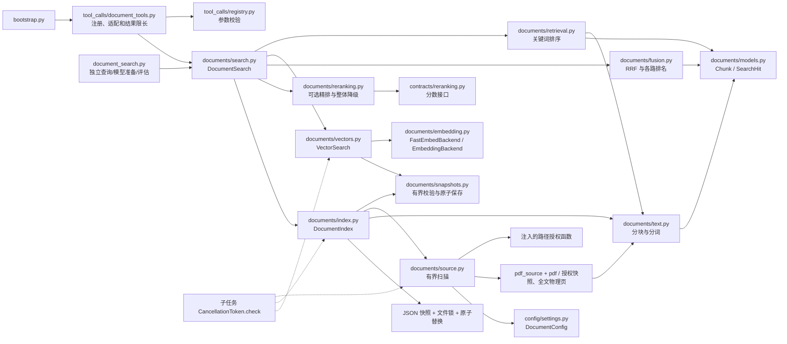

DocumentIndex 持锁刷新配置范围内的源文件；源文件经授权和限额检查后计算内容版本。缓存损坏或读写失败明确报错，不返回旧资料。仅变更文件重新分块。搜索通过普通工具结果进入上下文与会话日志；不修改 Conversation。子任务逐个授权源文件，主子文件工具均保护索引目录。embedding 延迟加载，仅显式 prepare-model 可下载；查询失败不自动切策略。独立 document_search 入口不读取聊天密钥，evaluation 按固定标注统计候选证据。

## E7.1～E7.2 MCP 服务接入

~~~mermaid
flowchart LR
    BOOT["bootstrap.py"] --> RES["ExitStack"]
    APP["application/facade.py"] -->|close| RES
    BOOT --> TOOL["tool_calls/mcp_tools.py"]
    TOOL --> REG["tool_calls/registry.py<br/>可选参数校验器"]
    REG --> SCHEMA["mcp/schema.py"]
    TOOL --> CLIENT["mcp/client.py"]
    CONF["config/mcp.py"] --> CLIENT
    CLIENT --> PORTAL["AnyIO BlockingPortal"]
    PORTAL --> TRANSPORT["mcp/transport.py / 认证与连接生命周期"]
    TRANSPORT --> SDK["官方 mcp.Client"]
    SDK -->|stdio| SERVER["本地服务进程"]
    SDK -->|Streamable HTTP| ENDPOINT["显式配置端点 / TLS 与目的地校验"]
~~~

默认关闭，本地程序或远程端点及能力允许列表由配置指定；模型不接触进程参数或认证头。失败/取消后不复用连接，重启应用才能重新连接。

## E6.1～E6.2 Skill 目录与按需加载

~~~mermaid
flowchart LR
    BOOT["bootstrap.py"] --> TOOL["tool_calls/skill_tools.py"]
    TOOL --> CAT["skills/catalog.py"]
    BOOT --> CONV["application/conversation.py"]
    CONV --> BUILDER["context/builder.py"]
    BUILDER --> CONTRACT["contracts/skills.py"]
    LOG["session/log.py"] --> CONTRACT
    CAT["skills/catalog.py"] --> META["skills/id/skill.toml<br/>启动只读元数据"]
    CAT -->|按需 load| BODY["SKILL.md / 已登记材料"]
    CAT -->|注入 resolve| POLICY["路径权限"]
    CAT --> ERR["contracts/errors.py"]
~~~

主/子应用都可只读加载，tools 不提供新权限。目录单独计入 skill_tokens，正文作为工具消息沿用 turn/history 预算；日志回放不读当前文件。返回完整内容与 SHA-256，超长报错，包外材料拒绝。

## E5.1～E5.2 独立审查

~~~mermaid
flowchart LR
    CONV["application/conversation.py"] --> SERVICE["application/review.py"]
    TOOL["tool_calls/review_tools.py"] -->|Reviewer 接口| SERVICE
    EXEC["tool_calls/executor.py"] -->|check_call| SERVICE
    SERVICE --> MANAGER["application/subagents/manager.py"]
    SERVICE --> STORE
    SERVICE --> POLICY["tool_calls/policy.py + text_file.py"]
    MANAGER["application/subagents/manager.py"] --> CHILD["子 SessionStore<br/>已结束轮次的真实工具记录"]
    MANAGER --> INDEX["session/delegation.py<br/>helper / reviewer"]
    STORE["session/storage.py"] --> LOG["session/log.py"]
    LOG --> REVIEW["session/review_log.py"]
    REVIEW --> CONTRACT["contracts/review.py<br/>来源、结论及读取依据"]
~~~

主执行和只读审查复用 V6；审查状态与子回复是否成功保存分开。恢复只关闭 pending，不重发请求。

## E1.1～E1.4 记忆存储、管理、上下文与继承

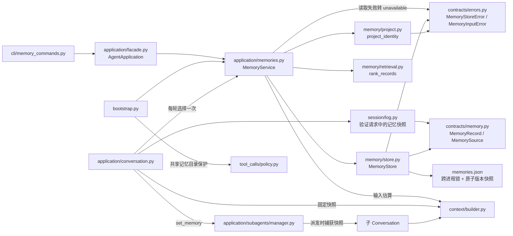

命令解析与展示归 CLI，范围、来源与管理归 MemoryService；CLI 不直接导入 memory 包。记忆存储不依赖会话存储或模型；来源会话 ID 只作为可选值保留。MemorySelection 与记录校验位于 contracts/memory.py，存储和请求日志复用契约，避免两个存储模块互相导入。包依赖测试已覆盖 memory 及应用对它的单向依赖。

## E4.1～E4.3 反馈与反思请求

~~~mermaid
flowchart LR
    CONV["application/conversation.py"] --> RUNNER["application/request_runner.py"]
    CONV -->|整批工具后| SERVICE["application/reflection.py"]
    BOOT["bootstrap.py"] --> SERVICE
    TOOL["tool_calls/feedback_tools.py"] -->|FeedbackReporter| SERVICE
    CONV -->|本轮参考资料| BUILDER["context/builder.py"]
    SERVICE --> RUNNER
    RUNNER --> PORT["contracts/ports.py<br/>ModelClient"]
    RUNNER --> STORE["session/storage.py"]
    SERVICE --> STORE
    CLI["cli/memory_commands.py"] --> APP["application/facade.py"]
    APP --> EXP["application/experiences.py"]
    EXP --> STORE
    EXP --> MEMORY["memory/store.py<br/>来源幂等写入"]
    STORE --> LOG["session/log.py"]
    LOG --> REFLECT["session/reflection_log.py"]
    LOG --> FEEDBACK["session/feedback_log.py"]
    FEEDBACK --> CONTRACT["contracts/reflection.py<br/>Feedback"]
    STORE -->|有界事实投影| FEEDBACK
    STORE --> JSONL["会话 JSONL<br/>feedback_recorded"]
~~~

反馈诊断与成功历史分别保存，查询不调用模型；存储实现不依赖应用服务。阶段状态见 [E4](reflection-and-experience.md)。

## E3.1～E3.3 计划记录、工具与交互

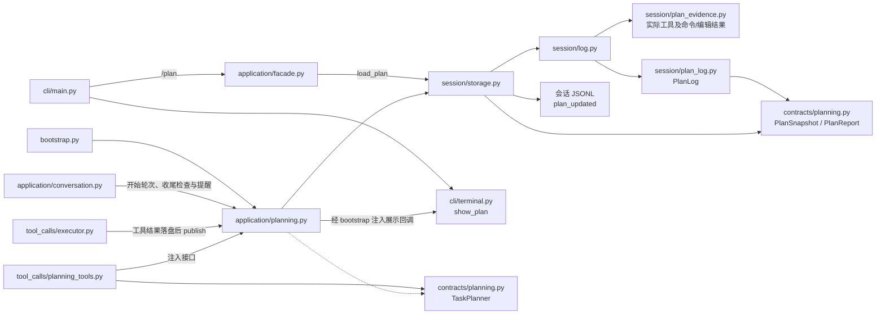

计划事件与请求、工具关联，版本回放不访问磁盘。读取报告结合所属轮次的终态；中断恢复沿用 session_recovered，不重跑计划。模型工具和界面均已接入；未闭合时主循环暂存流式正文并最多提醒一次，额度不足或再次遗漏时保留回答并明确提示未完成。完整状态见 [E3](task-planning.md)。

## 包目录与依赖边界

同一能力的文件放在同一个包内，包内仍按职责分文件。根目录的 `__main__.py`、`bootstrap.py`、`diagnostics.py` 分别负责聊天启动、资源组装和原诊断入口；`document_search.py` 负责独立的文档查询、模型准备与评估，不组装聊天应用或读取其密钥。

| 包 | 归入的文件 | 允许的其他项目依赖 |
| --- | --- | --- |
| web | service.py、models.py、policy.py、adapters/http.py | web、contracts；HTTP SDK 仅在 adapters |
| browser | service.py、models.py、policy.py、runtime.py、adapters/chromium.py、adapters/dom.py | browser、contracts；Playwright 仅在 adapters |
| cli | main.py、terminal.py、reply_output.py、memory_commands.py | application、context、config、contracts；仅 main 调用 bootstrap |
| application | facade.py、conversation.py、request_policy.py、memories.py、experiences.py、planning.py、reflection.py、request_runner.py、subagents/manager.py、budget.py、account.py | context、session、memory、tool_calls、config、contracts |
| config | loader.py、settings.py | contracts |
| context | builder.py、pruning.py、compaction.py | session、config、contracts |
| llm | client.py、streaming.py、http_transport.py | config、contracts |
| session | storage.py、log.py、compaction_log.py、edit_log.py、plan_log.py、plan_evidence.py、feedback_log.py、reflection_log.py、review_log.py、outcome.py、execution_report.py、diagnostics.py、delegation.py、media.py、media_evidence.py、media_log.py | contracts |
| documents | 分块、来源、文本/向量检索、快照、embedding 与 evaluation | config、contracts |
| memory | store.py、project.py、retrieval.py、semantic.py、subjects.py、organization.py、organization_change.py | contracts |
| tool_calls | 工厂、注册表、执行器、权限、browser_tools.py 和具体工具 | documents、web、browser、code_index、skills、mcp、session、config、contracts |
| contracts | models.py、history.py、errors.py、ports.py、protocol.py、delegation.py、cancellation.py、memory.py、memory_organization.py、embedding.py、media.py、planning.py、reflection.py、review.py | 无 |

包内使用绝对路径显式导入所属实现；类型和错误直接从定义位置导入，避免经过其他业务模块转手。新包的 `__init__.py` 仅说明职责，不批量加载实现。contracts 只承载现有跨模块契约，不作为任意辅助函数目录。

bootstrap 可创建各层具体组件，业务包不反向调用它。cli/main 不直接依赖 Conversation、存储、HTTP 或具体工具。上下文构造是纯逻辑；同包的摘要服务经模型接口和会话存储完成持久化操作。会话包不依赖上下文算法，摘要事件的校验和恢复仍归 session。

ExecutionReport、ActionFact 放在 contracts/models.py，提取事实的 build_execution_report 留在 session/execution_report.py；展示层只依赖报告值，不连带导入日志解释器。tests/test_architecture.py 检查整包源码，新增文件同样受约束。业务测试继续按功能放在 tests/features。迁移前后收集项比对：原 408 项无遗漏，增加 8 项包依赖约束，共 416 项；本次没有改变业务场景断言。

## V6 委派、额度与资源边界

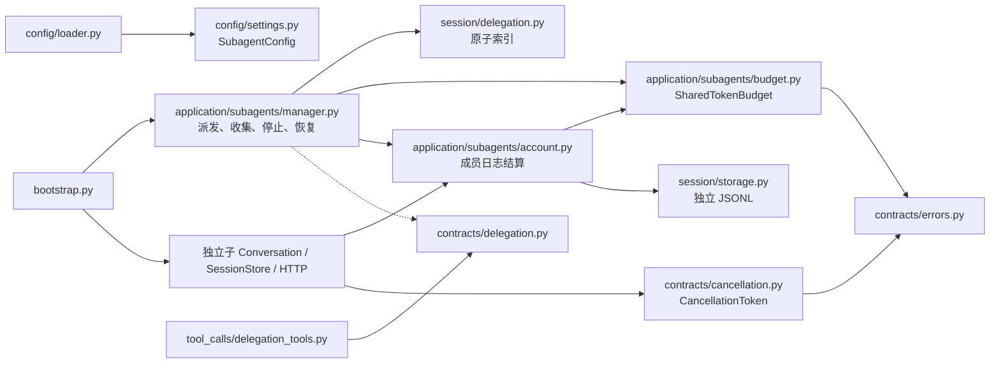

共享额度按成员保存持久化累计快照；在途预留只影响新请求准入，不能被当作用量未知。
这些组件已接入下面的聊天调用链。业务计划与使用方法见 [V6](subagents.md)。
主线程持有主会话锁；每次子运行在所属线程新建并关闭自己的存储与传输。
SubagentManager 保留可续聊身份和独立历史，线程池只负责当前运行，容量不足不排队。
SessionAccount 在请求登记前预留、结算日志后更新；普通请求与摘要共用同一整组账本。
root 的 /usage 显示聚合值；未知消费禁止新请求，但不主动取消其他在途请求。

委派索引关联父轮次/请求/工具及子轮次，保存位置独立于主会话日期目录；
子任务正文只通过 tool 消息返回主模型。最终回答前未收集的结果由协调接口检查，
主循环在既有请求限额内提醒模型读取，不虚构模型工具调用。
子工具目录没有委派能力，命令/编辑适配器直接返回 approval_required，不接终端审批。
主轮次失败或取消后先停止并等待所有子线程，再释放主会话锁。索引恢复从子日志的 child_turn_id 查找已提交历史或失败终态；没有完整结束记录才标为中断。索引缺失但子日志存在时拒绝静默初始化，避免遗漏消费。

取消令牌关闭子线程当前 HTTP 等待；清理连接时不再次检查已置位的令牌。文件/Git 等同步动作沿阶段边界协作取消。真实单独/整组取消、其他终端隔离及两个强杀边界由 tests/features/test_subagent_recovery.py 验证；整体图中没有新增依赖边，原有约束保持。

## 启动与资源所有权

实线表示主要调用、委托或读写关系，虚线表示协议校验或展示数据依赖；这是职责关系图，不是严格执行时序或完整 import 清单。bootstrap 是依赖组装与资源所有权入口；CLI 只解释输入和展示结果。

```mermaid
flowchart TD
    ENTRY["__main__.py<br/>程序入口"] --> CLI["cli/main.py<br/>用户交互、指令处理"]
    CLI --> BOOT["bootstrap.py<br/>组装与资源关闭"]
    BOOT --> CONFIG["config/loader.py<br/>加载与校验配置"]
    CONFIG --> SETTINGS["config/settings.py<br/>不可变配置"]
    BOOT --> APP["application.facade.AgentApplication"]
    CLI --> APP
    BOOT --> LLM
    BOOT --> STORE
    BOOT --> FACTORY["tool_calls.factory<br/>组装内置工具"]
    BOOT --> DELEGATE["application/subagents/manager.py"]
    CONV -->|委派生命周期与结果收集检查| DELEGATE
    DELEGATE --> DINDEX["session/delegation.py"]
    BOOT --> DTOOLS["tool_calls/delegation_tools.py<br/>仅主 Agent 注册"]
    DTOOLS -.-> DPORT["contracts/delegation.py"]
    DELEGATE -.-> DPORT
    CLI --> TERMINAL["cli/terminal.py<br/>角色、失败、上下文、计划与执行事实展示"]
    APP --> CONV["application/conversation.py<br/>轮次收尾、模型—工具循环"]
    APP -->|"会话列表、历史、计划与用量查询"| STORE["session/storage.py<br/>会话持久化与读取"]

    CONV --> COMPACT["context/compaction.py<br/>规划与执行摘要"]
    COMPACT --> STORE
    COMPACT --> PORT
    COMPACT --> SETTINGS
    COMPACT --> HISTORY
    COMPACT -->|"素材估算"| CONTEXT
    COMPACT -->|"自动摘要素材缩减"| PRUNE
    LOG --> EDITLOG["session/edit_log.py<br/>编辑计划、写入状态与恢复投影"]
    LOG --> CLOG["session/compaction_log.py<br/>摘要提交、消费与恢复投影"]
    CLOG --> HISTORY
    CLOG --> OUTCOME
    CONV --> CONTEXT["context/builder.py<br/>构造上下文、组成估算、输入预算"]
    CONTEXT --> HISTORY["contracts/history.py<br/>完整成功轮次数据"]
    STORE --> HISTORY
    LOG --> HISTORY
    CONTEXT --> PRUNE["context/pruning.py<br/>旧工具结果头尾节选"]
    PRUNE --> SETTINGS
    PRUNE --> HISTORY
    CONTEXT --> SETTINGS
    CONTEXT --> ERROR
    TERMINAL -.->|"读取 RequestContext 展示数据"| CONTEXT
    CONV --> RETRY["application/request_policy.py<br/>物理请求额度与有限连接重试"]
    RETRY --> ERROR
    CONV --> RUNNER["application/request_runner.py<br/>请求登记、结算、取消"]
    RUNNER --> PORT
    BOOT --> LLM["llm/client.py<br/>访问模型服务"]
    APP -->|"查询模型目录"| PORT["contracts.ports.ModelClient"]
    LLM -.->|"实现"| PORT
    BOOT --> HTTP["llm.http_transport.InterruptibleTransport<br/>异步 IO 与同步接口桥接"]
    LLM --> HTTP
    HTTP --> API["远端 LLM"]
    LLM --> STREAM["llm/streaming.py<br/>SSE 与完整响应组装"]
    STREAM -.-> PROTOCOL
    LLM -.->|"ModelOutput 回调"| OUTPUT["cli/reply_output.py<br/>增量展示与完整性提示"]
    CLI --> OUTPUT
    CONV -->|"工具说明与执行"| TOOL_PORT["contracts.ports.ToolRunner"]
    EXEC["tool_calls.ToolExecutor"] -.->|"实现"| TOOL_PORT
    CONV --> STORE
    EXEC --> INVOKE["tool_calls/invocation.py / ToolInvocation"]
    INVOKE -->|"保存执行记录"| STORE
    EXEC --> SCHEDULER["tool_calls/scheduler.py / ToolScheduler"]
    STORE --> FILE["会话 JSONL 文件与恢复备份"]
    DIAG["session/diagnostics.py<br/>独立只读报告"] -->|读取快照| FILE
    DIAG --> LOG
    STORE --> LOG["session/log.py<br/>校验关联与状态、整理历史与用量"]
    STORE --> REPORT["session/execution_report.py<br/>从日志提取本轮执行事实"]
    REPORT --> LOG
    REPORT --> VALUES["contracts/models.py<br/>ExecutionReport 与共享值"]
    CONV -.->|"返回执行事实"| VALUES
    APP -.->|"对界面提供执行事实"| VALUES
    TERMINAL -.->|"展示 ExecutionReport"| VALUES
    CONV --> OUTCOME["session/outcome.py<br/>结束原因、耗时与受控错误"]
    STORE --> OUTCOME
    LOG -.->|"校验终态字段"| OUTCOME
    OUTCOME --> ERROR["contracts/errors.py<br/>公共错误契约与原因码"]

    LLM -.->|"校验模型消息"| PROTOCOL["contracts/protocol.py<br/>消息与完整轮次的共同规则"]
    STORE -.->|"校验待保存轮次"| PROTOCOL
    LOG -.->|"校验日志中的完整轮次"| PROTOCOL
```

共享的 `contracts/models.py` 定义 Session、Message、Completion、CommandRequest、SessionUsage、ContinuationStatus 和记录回调类型。`config/settings.py` 只定义配置值；`config/loader.py` 负责读取和校验。这些数据定义不引用 HTTP、文件存储实现或工具执行模块。

## 工具创建与执行

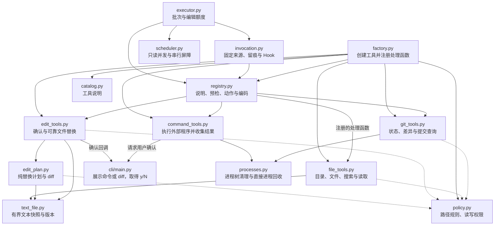

`PathPolicy` 分别检查读取和写入范围；读取授权不赋予写入权限，专用编辑禁止 .git、凭据及链接路径。通用命令单独展示具体命令和工作目录，请用户逐次确认；批准后的程序按当前系统账户权限运行，额外读取目录配置不是命令进程的沙箱边界。

`CommandTools` 只需要工作目录、资源限制和确认回调，不接收与其权限模型不相符的 PathPolicy。批准的通用命令按当前系统账户权限运行；额外读取目录只限制只读工具，不是命令进程的操作系统沙箱。

`ToolExecutor` 负责批次、预算与回传顺序，`ToolInvocation` 固定所属轮次、请求和单次执行轨迹；`ToolRegistry` 负责目录、预检、动作和结果编码；具体工具负责动作本身。命令和编辑通过记录回调把副作用边界交给协调层保存，通过确认回调取得用户决定。拒绝结果保存后停止同批剩余调用及本轮请求；失败输入不进入有效历史。

ToolInvocation 在开始记录写入后返回动作，在结果落盘后交付；ToolScheduler 只把明确安全的读取交给工作线程。命令/编辑在协调线程沿同一回调上报事件，单次调用按 command_* / edit_* 分别记录；注册表不按工具名称分支。日志保存失败仍停止本轮。执行层通知工具名称，`工具>` 等展示文字由 CLI 生成。

## 模块职责

| 模块 | 主要接口 | 职责 |
| --- | --- | --- |
| [__main__.py](../adam/__main__.py) | 程序入口 | 将 `python -m adam` 交给 CLI 启动 |
| [cli/main.py](../adam/cli/main.py) | `main`、`chat`、`handle_command` | 调用组装入口，处理输入和指令，展示增量/结果/错误，取得命令和 diff 确认 |
| [cli/terminal.py](../adam/cli/terminal.py) | `role_prefix`、`show_failure`、`show_context`、`show_execution_report` | 展示角色、失败、上下文和执行事实；不读取会话或请求模型 |
| [session/execution_report.py](../adam/session/execution_report.py) | `build_execution_report` | 从已校验日志提取执行顺序、状态、版本和退出码；不解释模型的测试结论 |
| [contracts/errors.py](../adam/contracts/errors.py) | `AgentError`、`FailureCode`、`BudgetError`、`TurnSaveError` | 定义可展示说明、可选未保存回答及稳定失败类别，保持界面错误接口稳定 |
| [session/diagnostics.py](../adam/session/diagnostics.py) | `read_report`、`main` | 只读单个日志快照，按轮次输出请求和工具详情；不请求模型、不修复文件 |
| [session/outcome.py](../adam/session/outcome.py) | `ExecutionOutcome`、`outcome_details` | 表达请求或轮次的终态、原因和已测耗时；写入和回放共用字段校验，不负责计时或 IO |
| [bootstrap.py](../adam/bootstrap.py) | `open_application`、`build_application` | 组装组件并关闭自己创建的资源 |
| [application/facade.py](../adam/application/facade.py) | `AgentApplication` | 面向界面的会话、模型、上下文、继续方式与执行事实查询；主轮次中断调用宿主交互资源清理，不依赖浏览器 SDK |
| [config/settings.py](../adam/config/settings.py) | 配置值 | 不可变运行配置 |
| [contracts/models.py](../adam/contracts/models.py) | 共享数据、EditPlan、ActionFact 与 ExecutionReport | 不依赖具体实现的跨层数据 |
| [application/subagents/manager.py](../adam/application/subagents/manager.py) | SubagentManager | 委派准入、追问、结果交付、取消与重启恢复 |
| [application/subagents/account.py](../adam/application/subagents/account.py) | SessionAccount | 线程所属日志与整组额度之间的结算边界 |
| [session/delegation.py](../adam/session/delegation.py) | DelegationStore | 原子持久化成员与历次派发索引 |
| [contracts/delegation.py](../adam/contracts/delegation.py) | RequestAccount、Delegation、DelegationTools | 共享额度和委派流程接口，避免工具反向依赖应用 |
| [tool_calls/delegation_tools.py](../adam/tool_calls/delegation_tools.py) | SPECS、handlers | 委派工具说明与参数适配 |
| [contracts/ports.py](../adam/contracts/ports.py) | `ModelClient`、`ToolRunner`、`ReviewParticipant`、`SkillProvider` | 应用所需模型、工具批次、审查状态与技能选择接口 |
| [contracts/execution.py](../adam/contracts/execution.py) | `ExecutionMode`、`ToolCapability`、`ToolBudget` | 可信能力声明、模式限制与单轮编辑额度 |
| [code_index/models.py](../adam/code_index/models.py) | `CodeLimits`、`Definition`、`ImportBinding`、`CodeModule`、`CodeSnapshot` | 结构身份、源码版本、诊断与资源边界 |
| [code_index/parser.py](../adam/code_index/parser.py) | `parse_module` | UTF-8 声明、Python 3.11 AST、作用域定义及导入元数据 |
| [code_index/index.py](../adam/code_index/index.py) | `CodeIndex` | 注入授权、有界读取、SHA-256 增量刷新及内存缓存 |
| [code_index/bindings.py](../adam/code_index/bindings.py) | `BindingCollector` | 收集名字使用、作用域及不能静态确定的绑定 |
| [code_index/query.py](../adam/code_index/query.py) | `ReferenceIndex` | 快照内静态引用解析、导入链及未知原因 |
| [contracts/media.py](../adam/contracts/media.py) | MediaSource、MediaRef、MediaContent | 纯媒体来源、固定版本、MIME/时间与可信宿主字节结果 |
| [session/media.py](../adam/session/media.py) | MediaStore | 完整二进制原子保存、会话配额、版本和真实路径验证 |
| [session/media_evidence.py](../adam/session/media_evidence.py) | SessionMedia | 当前所有者与日志授权；发布顺序、完整引用比对及 IO 后复检 |
| [session/media_log.py](../adam/session/media_log.py) | MediaLog | 当前输入/工具来源与 media_saved 的纯关联校验 |
| [browser/](../adam/browser/) | BrowserObserver、BrowserAction、BrowserTab、BrowserDownload、open_browser | 版本化 DOM/标签、原节点复检、弹窗/对话框和附件窄结果；隔离可选 Chromium 后端 |
| [tool_calls/browser_tools.py](../adam/tool_calls/browser_tools.py) | register_browser、BrowserTools | 主会话资源、原来源绑定、逐次批准、标签分页与下载字节交付 SessionMedia，原调度接入 |
| [contracts/browser.py](../adam/contracts/browser.py) | BrowserApproval、BrowserActionUnknownError | 纯批准数据与未知副作用停止契约 |
| [tool_calls/code_tools.py](../adam/tool_calls/code_tools.py) | `CodeTools`、`pack_page` | 三个只读查询、共享查询截止时间、完整来源分页 |
| [recording/snapshot.py](../adam/recording/snapshot.py) | `capture_seed`、`validate_seed` | 选定轮次的历史与非凭据配置白名单 |
| [recording/capture.py](../adam/recording/capture.py) | `TurnRecorder`、`RecordingModel`、`RecordingTools` | 装饰原调用，采集输入/结果/流式/实际日志，不替换动作 |
| [recording/format.py](../adam/recording/format.py) | `RecordingLimits`、`TraceState` | 有界 JSON、事件顺序、模型协议与工具来源校验 |
| [recording/journal.py](../adam/recording/journal.py) | `RecordingWriter`、`read_recording` | 独立文件排他创建、同步写入和只读前缀加载 |
| [recordings.py](../adam/recordings.py) | `record_turn`、`main` | 独立 record / inspect / replay 入口与资源管理 |
| [recording/runtime.py](../adam/recording/runtime.py) | `CaptureRuntime`、`ReplayAccount`、`build_replay`、`replay_turn` | 资料观察、同锁额度快照、真实内部流程组装及报告 |
| [recording/environment.py](../adam/recording/environment.py) | `ObservedRules`、`ObservedDelegation`、`ObservedReview` | 冻结外部来源及状态，保持主流程接口 |
| [recording/replay.py](../adam/recording/replay.py) | `ReplayTape`、`ReplayDifference` | 精确比较全局调用、参数和完整终态，固定首次差异或缺失 |
| [recording/replay_adapters.py](../adam/recording/replay_adapters.py) | `ReplayModel`、`ReplayTools` | 返回录制外部结果，零真实网络和工具动作 |
| [recording/replay_store.py](../adam/recording/replay_store.py) | `ReplayStore` | 独立诊断写入、内部事件比较及原工具/媒体引用事实导入，不重做动作 |
| [tool_calls/factory.py](../adam/tool_calls/factory.py) | `create_tool_registry` | 组装内置工具和编码器 |
| [tool_calls/catalog.py](../adam/tool_calls/catalog.py) | `SPECS` | 模型可见的工具说明 |
| [config/loader.py](../adam/config/loader.py) | `load_config`、`load_llm_config` | 加载并校验运行配置，区分模型连接、循环/消费限额及单次输入预算 |
| [application/conversation.py](../adam/application/conversation.py) | `Conversation`、`TurnProgress` | 管理会话与轮次；依据输入压力协调自动摘要，统一限制摘要和聊天请求，组织工具与提交 |
| [context/builder.py](../adam/context/builder.py) | `ContextBuilder`、`RequestContext`、`ContextEstimate` | 按完整轮次选择连续历史后缀，估算输入、检查上限并提供来源记录；不改写原始消息 |
| [context/pruning.py](../adam/context/pruning.py) | `prune_history` | 缩减旧工具结果副本，保护近期轮次，保留错误状态和来源 |
| [contracts/history.py](../adam/contracts/history.py) | `HistoryTurn`、`Summary` | 成功轮次及有效摘要的共享数据 |
| [context/compaction.py](../adam/context/compaction.py) | `CompactionService`、`CompactionPlan` | 规划有界素材及压缩目标、复用旧工具缩减；执行无工具摘要、独立结算并提交，不修改原历史 |
| [session/compaction_log.py](../adam/session/compaction_log.py) | `CompactionLog` | 校验摘要来源与状态，仅完整提交激活摘要；恢复不猜未知用量 |
| [llm/http_transport.py](../adam/llm/http_transport.py) | `InterruptibleTransport` | 为每个所属线程的同步接口提供可取消的异步 IO；连接池不跨线程共享 |
| [application/request_policy.py](../adam/application/request_policy.py) | `RequestPolicy` | 单轮物理请求计数、明确未发送时有限重试，摘要与聊天共用额度 |
| [llm/streaming.py](../adam/llm/streaming.py) | `sse_events`、`StreamReply` | 有界 SSE 解析、工具参数拼接、结束校验 |
| [cli/reply_output.py](../adam/cli/reply_output.py) | `ReplyOutput` | 正文增量、换行、去重及未完成提示 |
| [llm/client.py](../adam/llm/client.py) | `LLMClient` | 访问模型服务，将一次请求转换为模型消息和用量；模型消息也可能是工具请求 |
| [application/proposal_review.py](../adam/application/proposal_review.py) | ProposalReview | 核对真实候选、分页、重复与当前版本，再协调原批准编辑 |
| [tool_calls/proposal_tools.py](../adam/tool_calls/proposal_tools.py) | register_submission、register_review | 主子工具说明与适配、能力声明、已校验审计路径 |
| [contracts/proposals.py](../adam/contracts/proposals.py) | ProposalOwner、ReadEvidence、ProposalEdit、EditProposal | 不可变候选与真实读取窗口校验，不访问文件或授予权限 |
| [application/proposals.py](../adam/application/proposals.py) | ProposalSubmission | 当前读取权限/字节版本、唯一替换与候选保存，不写目标 |
| [session/proposal_log.py](../adam/session/proposal_log.py) | ProposalLog、validate_application | 回放子候选来源与主编辑候选关联，不重读源文件或执行修改 |
| [contracts/protocol.py](../adam/contracts/protocol.py) | `validate_assistant`、`validate_turn` | 定义合法助手消息和完整轮次的约束，检查工具请求与结果配对 |
| [session/storage.py](../adam/session/storage.py) | `SessionStore` | 管理会话文件、锁、读写与持锁恢复；先备份再原子替换，提供会话身份及已提交消息 |
| [session/search.py](../adam/session/search.py) | `SessionSearchIndex` | 读取明确授权日志、原文倒排检索和版本引用；损坏来源淘汰缓存，不执行恢复 |
| [tool_calls/session_tools.py](../adam/tool_calls/session_tools.py) | `SessionTools` | 主 Agent 授权范围、原文检索与续读适配、整体输出预算；复用工具执行边界 |
| [contracts/session_search.py](../adam/contracts/session_search.py) | `SessionExcerpt`、`SessionSearchResult` | 精确来源位置、成功或诊断状态及不完整覆盖；不提供授权或写入能力 |
| [session_search.py](../adam/session_search.py) | `main` | 独立显式会话查询、JSON 输出与覆盖失败退出码，无模型连接，不改变聊天 CLI 依赖 |
| [session/edit_log.py](../adam/session/edit_log.py) | `EditLog` | 编辑状态纯投影；未开始计划恢复为 not_started，写入未知结果不猜测 |
| [session/log.py](../adam/session/log.py) | `SessionLog` | 解释日志事件，校验轮次、请求和工具关联，重建状态、有效历史及用量，规划并回放恢复事件；自身不访问文件 |
| [tool_calls/executor.py](../adam/tool_calls/executor.py) | `ToolExecutor` | 实现 ToolRunner，消费共享编辑额度、组装批次任务、绑定来源并形成有序消息 |
| [tool_calls/invocation.py](../adam/tool_calls/invocation.py) | `ToolInvocation` | 单次调用预检、开始/结束及副作用日志、前后 Hook；仅协调线程访问 |
| [tool_calls/scheduler.py](../adam/tool_calls/scheduler.py) | `ToolScheduler`、`ToolTask`、`ToolResult` | 有限只读并发、串行屏障、取消、清理与有序交付 |
| [tool_calls/processes.py](../adam/tool_calls/processes.py) | `terminate_process` | 通用命令与固定 Git 查询共用进程清理 |
| [tool_calls/registry.py](../adam/tool_calls/registry.py) | `ToolRegistry` | 提供模型可见的工具说明，在协调线程预检及编码，返回可独立执行的动作，保留可信并发及串行取消声明 |
| [tool_calls/text_file.py](../adam/tool_calls/text_file.py) | `TextSnapshot`、`read_snapshot` | 同一次读取的完整字节、UTF-8 文本和版本 |
| [tool_calls/edit_tools.py](../adam/tool_calls/edit_tools.py) | `EditTools` | 规划前检查写入权限，批准后复查版本，以同目录临时文件替换；不提供跨程序事务 |
| [tool_calls/edit_plan.py](../adam/tool_calls/edit_plan.py) | `EditPlan`、`plan_edit` | 校验版本与唯一匹配，保留编码形式，生成候选内容和 diff；不写文件 |
| [tool_calls/file_tools.py](../adam/tool_calls/file_tools.py) | `FileTools` | 文件系统查询、搜索与读取能力 |
| [tool_calls/git_tools.py](../adam/tool_calls/git_tools.py) | `GitTools` | 固定范围的只读 Git 查询能力 |
| [tool_calls/command_tools.py](../adam/tool_calls/command_tools.py) | `CommandTools` | 表达待批准的命令计划，取得确认后运行程序，收集退出码、输出与执行结果 |
| [tool_calls/policy.py](../adam/tool_calls/policy.py) | `PathPolicy` | 表达并检查路径访问规则；配置值来自 config/settings |

## 错误与兼容边界

已知失败统一继承 AgentError：user_message 是受控提示，partial_reply 携带未保存回答。预算耗尽使用 BudgetError，模型通信使用 LLMError；CLI 只交给 terminal.show_failure 展示。存储 IO 在 storage 的操作边界转换为 StorageError 并保留 cause，命令日志失败继续停止本轮。应用层原样传播公共错误，不重复包装；程序错误和终端 OSError 继续传播，资源由组装入口释放。

- **交互与流程：** CLI 通过 AgentApplication 处理用户操作；`Conversation` 处理普通输入背后的会话流程。斜杠指令可以直接完成查询，不必请求模型。
- **流程与模型：** `Conversation` 决定何时请求、执行或停止；`LLMClient` 完成一次模型通信。一次用户输入可以触发多次模型请求。
- **历史与输入：** `SessionStore` 提供成功历史；`ContextBuilder` 组装系统提示、历史、当前轮次和工具说明。`Conversation.preview_context` 与实际请求使用同一构造逻辑，预览的当前轮次为空。terminal 只读取构造结果，不承担选择或预算决策。
- **摘要与循环：** `Conversation._prepare_context` 只在真实发送时按压力规划摘要；`TurnProgress` 记录本轮请求数和尝试状态。`CompactionService` 处理单次摘要、消费及提交；`CompactionLog` 只解释持久化状态。摘要后重新构造输入并检查预算；仅未发出的连接失败有限重试，每次独立操作，其他失败停止。
- **协议与日志：** `contracts/protocol.py` 检查消息结构和工具配对；`session/log.py` 检查持久化事件的关联，并识别完整提交的历史。它们不验证回答事实是否正确。
- **日志与文件：** `SessionLog` 解释事件含义；`SessionStore` 负责文件访问和持久化。失败轮次可以留下诊断记录，但不会因此进入模型的有效历史。
- **事实与表述：** Conversation 只记住本次运行最近轮次的标识，SessionStore 从同一份快照提取事实；恢复后的历史轮次仍可由存储接口读取。未知副作用不能因回答失败、重启或读取失败而推断为未执行。报告不进入模型历史，纯聊天不刷执行信息。
- **配置与执行：** 配置对象描述权限、额度和限制，各业务模块负责实际执行检查。
- **失败处理：** 可反馈的工具错误交回模型；命令日志无法可靠保存等错误会终止本轮。已知失败实现 AgentError 契约，CLI 委托 terminal.show_failure 展示；终端 IO 故障和意外程序错误不会被当成业务失败吞掉。

当前已有轮次、请求和工具关联留痕，以及独立的请求/轮次状态、结束原因与耗时。独立开发诊断与持锁中断恢复已实现，真实进程强杀验收已完成，不计划增加轮次诊断聊天命令。上下文构造、预览、完整轮次选择、手动摘要和自动压缩均已实现；流式响应已实现；部分输出仅用于展示，完整协议消息才返回业务循环。

## 公开错误契约

下面只展示与错误契约有关的源码依赖，箭头表示左侧模块导入右侧模块。它与上面的运行协作图视角不同；并非完整 import 清单。

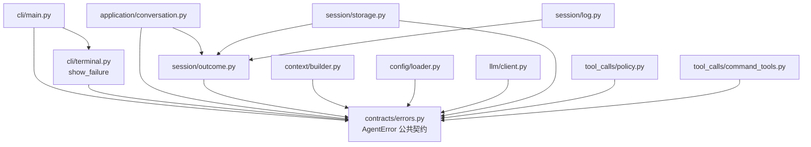

- AgentError 提供受控的 user_message、可选 partial_reply、稳定 code 与可选数值 http_status，不决定恢复或重试。展示层仍只使用前两个字段，不逐个匹配具体异常；ExecutionOutcome 将后两个字段转换为持久化结束信息。
- ConfigError、LLMError、StorageError、SessionNotFoundError、ToolError 和 CommandLogError 集中定义在 contracts/errors.py，调用方直接从定义模块导入。预算使用 BudgetError，回答未保存使用 TurnSaveError；新增业务错误类型无需增加 CLI 分支。
- 原始 HTTP 异常和响应错误由模型模块转换。原始 OSError 仅在 SessionStore 的实际文件/锁操作边界转为 StorageError，保留原因链且不直接展示系统异常文本。
- Conversation 在最终回答或其用量无法保存时转为 TurnSaveError，保留回答。ToolInvocation 将命令记录的存储或关联失败转为 CommandLogError，确保它不会被工具注册表当作可修正参数错误继续执行。
- 仅明确未发出的连接失败由 RequestPolicy 最多额外重试两次，每次独立记账；其他失败不因公共契约而自动重试。未识别的程序错误继续传播；终端输出自身的 OSError 也不会被误报为会话文件失败。open_application 的清理范围覆盖组件初始化、会话恢复与交互循环，初始界面或回答展示失败时均释放会话锁。
- 对公开存储接口做故障替身时使用 StorageError；模拟真实文件系统故障时在 IO 边界注入 OSError，验证实际转换、回滚和原因链。

公开异常契约与界面展示保持稳定。第 2、3 项在该契约上补齐状态、原因和耗时，V1.3.2 已通过自动化验收。组件组装和直接存储查询已分别移至 bootstrap 与 AgentApplication。

## 请求与轮次状态边界

- 每次模型请求前构造输入并检查累计消费、单次输入预算；输入估算包含工具 JSON Schema 及本轮新增结果。超限在 request_started 之前抛出 BudgetError，轮次记 failed / context_input_limit，不伪造请求记录或未知用量。
- 自动摘要沿用独立 compaction 事件，并通过 turn_id 关联触发轮次；摘要与聊天请求共同受每轮请求数和会话消费限制。预览没有副作用，旧工具缩减只作用于副本，只有提交完成的摘要才能替代对应历史。
- 开始事件建立 in_progress；request_finished 独立记录请求终态，和用量记录在同一块追加。响应有效而用量缺失时，请求可成功，整轮因预算统计不完整停止。
- 轮次成功只来自完整 message 块与 turn_completed 的成功提交；不能用独立状态事件跳过消息校验。turn_finished 只允许 failed / interrupted。
- Conversation 捕获失败后尽力保存终态，再传播原异常；KeyboardInterrupt / SystemExit 等退出信号记录 interrupted。失败日志本身出错只给原异常增加受控附注，不遮蔽最初失败。
- 原因与耗时通过 ExecutionOutcome 统一表达；Conversation 只负责在执行边界取单调时钟差，不在 CLI 增加错误类别分支。成功详情与完整消息同块保存，失败详情不含原始异常或远端正文。
- 新获会话写锁后，SessionStore 先备份原始字节，再用临时文件替换完整恢复结果；SessionLog 拒绝中间损坏，校验残留消息前缀并回放 session_recovered。完整物理记录不删除，未提交消息不成为历史。
- 恢复仅关闭缺少结束记录的操作，不推断真实请求结果、未知用量或未知命令结果，不自动重发。恢复失败保留原文件和原会话锁，重复重开不重复恢复。

## 文档维护

本文件统一维护当前架构图与职责边界。每次改动后的要求见 [AGENTS.md](../AGENTS.md) 的“架构文档同步”。测试中的组装辅助函数不属于生产架构。

B04.2 全量回归核对：RuntimeStateReader 在组装时解析相对工作目录；架构依赖不变。聊天与记忆对照明确区分运行状态和有效历史，新旧录制各自验证最早差异及停止边界。

## B26.1 后台进程基础

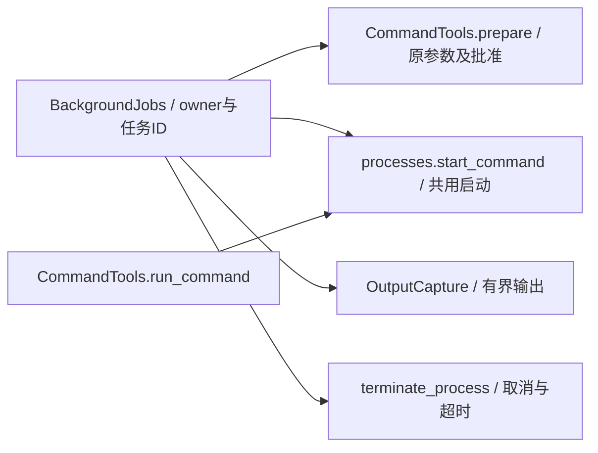

生产接入关系如下；见[后台任务范围](background-jobs.md)。

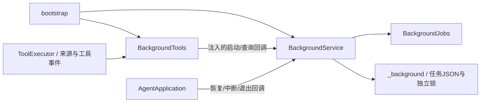

任务JSON记录已观察状态，不代替会话JSONL中的工具调用轨迹；启动意图早于实际进程，崩溃后的未知结果保持中断。工具层不导入应用服务实现，子Agent没有后台执行入口。内部任务目录加入主/子文件、文档及规则读取保护；批准的通用命令仍是宿主权限，不是沙箱。

## B27.1 运行事件基础

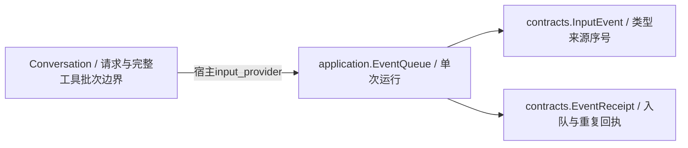

多个生产线程可投递，单个协调消费者peek后保存处理结果再ack；队列不做模型请求或持久写入。B27.2.1已连接Conversation，补充随成功轮次整体保存；B27.2.2通过可选--live-input接入CLI与独立输入记录，B27.3已接入按主会话提交事实恢复。[队列契约](running-events.md)描述容量、去重和关闭语义。
## B27.2.2 运行输入接入

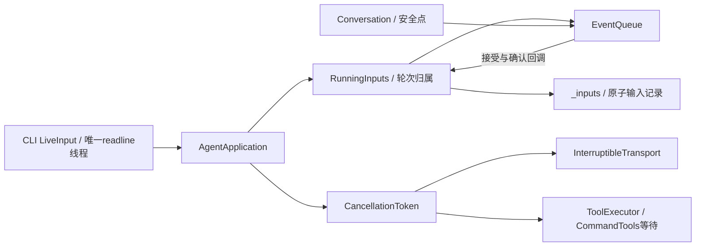

输入线程不访问SessionStore；成功上下文仍由主线程整体提交。默认不启用输入泵，启用时最终正文暂存以避免补充后的旧回答先被展示。B27.3已验收遗留输入恢复，恢复读取已提交轮次事实，不以in_context推断成功。
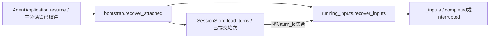

恢复器校验身份、顺序、容量和记录状态，原子替换更新；不创建输入队列，不调用模型。失败恢复保留主会话已选中的事实并明确报错。
## B28.1 父到子运行邮箱

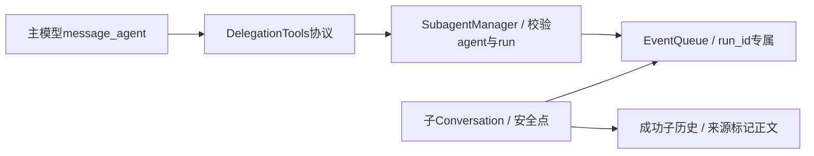

父工具轨迹保存消息参数与回执；B28.2已补充独立持久快照，见下图。权限不因父消息扩大，reviewer不接受运行中补充。[功能范围](subagent-messages.md)。
## B28.2 双向消息与持久化

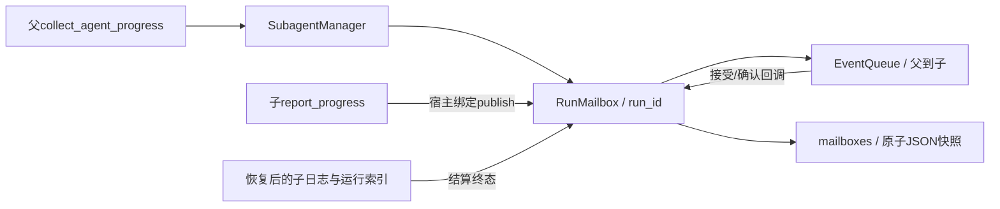

进展collected不会替代wait_agents的最终结果交付；邮箱恢复不重新入队。主/子读文件和资料工具保护内部子会话目录，子线程不共享主SessionStore。B28.3已验证待消费与成功提交后强杀恢复，不重发请求。
## B29.1 一次性本地定时记录

宿主协调线程 → LocalTimers（application/timers.py）→ timers.json；FileLock独占目录。schedule保存pending，due仅只读查询，finish/cancel保存终态，close释放锁。该API不发模型请求、不启动常驻线程，恢复不自动执行；B27投递及B26条件接入待B29.2。见[范围与验收](local-triggers.md)。

## B29.2.1 本地条件协调

~~~mermaid
flowchart LR
  Triggers[application.LocalTriggers] --> Timers[application.LocalTimers / 每会话持久状态]
  Triggers --> Query[B26 query_background 回调]
  Triggers --> Queue[B27 EventQueue / 固定原轮次]
~~~

LocalTriggers自身不执行模型、命令或常驻监听；只观察快照并投递带来源事件。满队列保持pending，跨轮次过期，delivered不等同于处理成功。宿主聊天安全点已于B29.2.2接入。
## B29.2.2 条件消息进入主聊天

~~~mermaid
flowchart LR
  Model[主模型：live-input启用] --> Tool[tool_calls.TriggerTools]
  Tool --> Triggers[application.LocalTriggers]
  Bootstrap[bootstrap.input_queue安全点] --> Triggers
  Triggers --> Queue[B27 EventQueue]
  Queue --> Log[RunningInputs接受和消费留痕]
  Queue --> Conversation[Conversation：带来源观察消息]
~~~

默认模式与子Agent不注册条件工具；来源会话/轮次由真实工具执行器绑定。恢复在持有会话锁时使遗留pending过期，不查询条件、不自动重发。原完整工具批次配对和请求预算保持。
## B30.1 持久管道终端API

~~~mermaid
flowchart LR
  Host[宿主协调调用方] --> TS[tool_calls.TerminalSessions]
  TS --> Approval[TerminalRequest / 启动及逐次输入确认]
  TS --> Start[processes.start_command / 可选stdin与批准env]
  TS --> Capture[OutputCapture / B26字节游标]
  TS --> Cleanup[processes.terminate_process / 进程树回收]
~~~

每个ID单独持有进程、输入写线程和输出捕获；默认命令仍关闭stdin并使用白名单环境。该步仅宿主API，聊天工具与持久来源记录待B30.2。详见[终端范围](persistent-terminals.md)。
## B30.2.1 终端持久协调

~~~mermaid
flowchart LR
  Service[application.TerminalService] --> State[每会话锁与每终端JSON快照]
  Service --> Live[tool_calls.TerminalSessions]
  State --> Recovery[恢复旧观察 / 未结算输入unknown]
~~~

启动和输入先写意图，实时查询再保存有界观察。终端ID由协调层预分配；恢复无活进程映射，不按PID重连或重发输入。聊天工具与CLI审批已于B30.2.2接入。
## B30.2.2 终端聊天边界

~~~mermaid
flowchart LR
  Model[主模型工具调用] --> Tools[tool_calls.TerminalTools]
  Tools --> Service[application.TerminalService]
  Service --> Sessions[tool_calls.TerminalSessions]
  Sessions --> Request[contracts.TerminalRequest]
  Request --> CLI[cli.confirm_terminal / 启动和每次输入]
  Bootstrap[bootstrap资源及取消管理] --> Service
~~~

CLI只理解批准契约，不导入终端进程实现。主会话绑定来源和身份；默认子Agent不注册终端工具，plan模式拒绝启动及输入。退出与取消回收活进程，重启只恢复旧记录。受保护目录新增_terminals。
## B31.1 固定任务与验证

~~~mermaid
flowchart LR
  Assets[scripts.task_eval_assets / 六题] --> Prepare[prepare_task / 全新目录]
  Prepare --> Memory[B06记忆种子]
  Prepare --> Sessions[SessionStore / 两个查证会话]
  Prepare --> Workspace[初始任务文件]
  Verify[verify_task / 宿主固定真值] --> Workspace
  Verify --> Evidence[JSON答案 / 来源ID / 实际工具列表]
~~~

验证器不执行模型生成代码，不读取模型自报成功字段。标准答案留在宿主，不放入workspace；旧评估产物不覆盖。runner与真实模型入口待B31.2。[范围](task-evaluation.md)。
## B31.2 评估运行矩阵

~~~mermaid
flowchart LR
  Runner[scripts.task_eval / 显式live或MockTransport] --> Prepare[prepare_task / 独立试验目录]
  Runner --> Bootstrap[build_application / 固定隔离配置]
  Bootstrap --> Loop[真实Conversation与工具循环]
  Runner --> Verify[verify_task / 独立终态]
  Runner --> Diagnostics[session.diagnostics / 请求用量]
  Verify --> Results[逐次JSON与累计报告]
  Diagnostics --> Results
~~~

模型调用在应用中执行，评估脚本不自造成功或用量。未知用量停止后续矩阵项，失败和未运行留在计划分母；真实质量与离线工程证据明确区分。
## B31.3 消融与证据报告

scripts.task_eval_report生成单一enabled开关配置，并只读manifest和逐次试验JSON，按case/iteration配对；缺失结果不从分母移除。task_eval通过已有observe_conversation接口包装生产memory_provider，只记录其实际返回身份，不修改选择结果。报告区分离线工程和真实模型结果，不把配置相关性当作机制因果证据。
## B32.1 首错证据

scripts.first_error复用session.log校验完整JSONL，再按物理行序提取请求/轮次/工具明确失败；B31单次结果通过session_id关联独立终态验证。输出物理行、运行身份和哈希，不修改会话，不调用模型；主次候选与根因未证明分开。环境快照及新模型续跑待B32.2/3。
## B38.1 可信验收边界

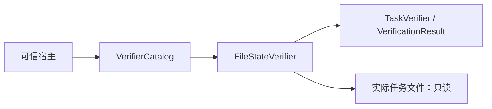

模型未获得登记/修改判据的工具；[模块](../adam/verification/files.py)仅依赖contracts，依赖方向加入架构检查。

## B38.2 收尾验收

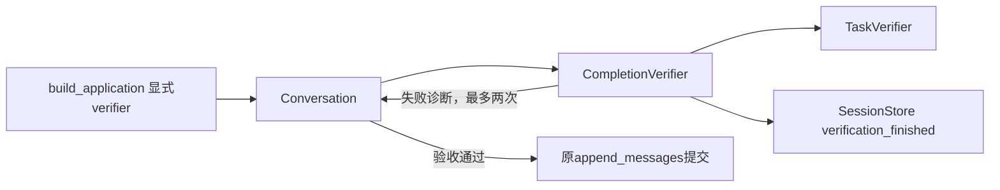

验收事件由session.log关联校验，diagnostics逐轮展示。失败、未知或写入故障不生成成功历史。

## B39.1 探索任务组

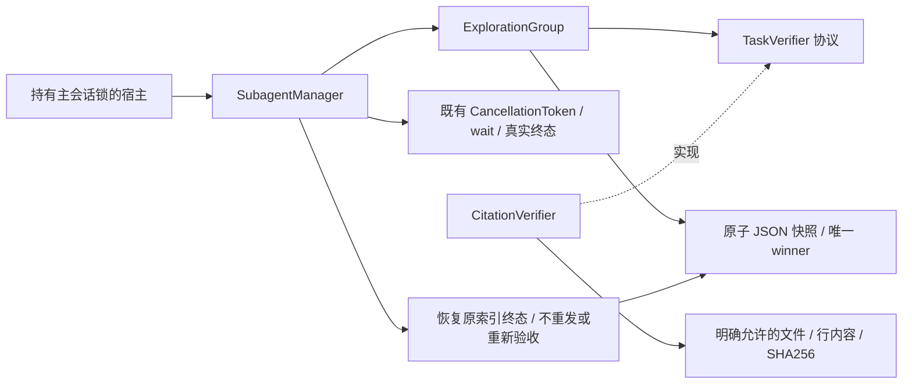

任务组成员固定为已派发的 agent_id/run_id。宿主提交真实已完成回复，独立判据通过且快照保存成功才发布 winner；恢复只读取记录，不重发任务。一个成员只验收一次，失败不阻断其他成员。宿主用 create_exploration 绑定本轮运行及可信判据，wait_exploration 收集；SubagentManager._poll 验收后取消同组兄弟，原工作线程清理后才记录 completed/interrupted/failed，取消信号本身不算结束。预算仍由原共享账户结算。模型没有注册或替换判据的工具入口。文件匹配只证明当时定位有效，不代表任意语义任务成功，也不保证未来文件保持不变。

B39.3：恢复要求 winner 有唯一通过记录，坏记录报错；先恢复既有子会话，再用索引刷新组内终态。恢复的组不绑定验收器、不重新验收旧回复；没有 winner 的旧组不会自行变成成功。若成员已有新运行，旧组等待入口拒绝等待新轮，原快照仍保留。

## B40.1 私有工作副本

```mermaid
flowchart LR
    Host[持有主会话锁的宿主] --> Copies[PrivateWorkspaces]
    Copies --> Source[干净普通仓库 / 固定 HEAD]
    Copies --> Private[独立 Git 仓库 / 不共享工作文件和索引]
    Copies --> Manifest[副本身份与创建/清理状态]
    Private --> Identity[PrivateCopy / 原规则根与记忆身份 / 收窄权限]
```

副本根目录与原仓库分离；只克隆已提交内容，首版拒绝脏工作区、子模块、符号链接和外部 Git filter。禁用全局 Git 配置及 hooks，去掉 origin；外部读范围保留，额外写目录不继承。宿主等待子任务停止后按登记 ID 清理，清理前检查路径不跳转、目标属于自有目录；重启取得会话锁后可显式清理遗留副本，保留 manifest。规则和记忆标识属于原项目，工具工作文件属于副本；宿主开启 private_children 后，SubagentManager 创建副本并将 source_workspace 保存进委派索引；子规则把实际目标映射回原项目读取，记忆继续继承主轮快照。默认普通委派仍只读。

## B40.2 私有子任务与主项目合并

```mermaid
flowchart LR
    Bootstrap[bootstrap / private_children] --> Manager[SubagentManager]
    Manager --> Copy[PrivateWorkspaces / ChildAgent source_workspace]
    Copy --> Child[_open_child / 独立上下文与原共享预算]
    Child --> Rules[原项目规则映射 / 主记忆快照]
    Child --> Edit[仅副本内文件编辑 / 不运行命令]
    Manager --> Identity[已结束运行的 private_workspace]
    Identity --> Merge[PrivateMerge / 实际基线与差异]
    Merge --> Approval[原 EditTools / 当前权限 / 文件版本 / 逐项批准]
    Approval --> Verify[宿主 TaskVerifier / 跨文件验收]
    Merge --> Record[proposal.json / 部分结果与验证状态]
```

当前是宿主编排入口，没有自动开启 CLI 私有模式。副本允许受限文件编辑，不运行通用命令，不改 AGENTS.md；普通辅助任务仍只读。任务不续聊，关闭/切换前须收集提案；停止后清理副本，保留生命周期与提案记录。主工具保护 `_private` 目录。规则来自原根，副本不能通过重写规则放宽约束。

PrivateMerge 从实际副本提取最多16个 UTF-8 新建/修改文件，首版不合并删除、链接或规则文件。全组先核对主项目版本，再复用逐文件审批与原子写入；多文件不是原子事务，拒绝或后续故障记录 incomplete，已经应用的结果保留可查。只有宿主跨文件验收通过才记 verified；失败不自称成功、不自动回滚、不提交 Git。已经尝试的提案不能重复应用。子编辑有原 JSONL 记录，合并状态保存在独立 proposal.json，不伪造主模型工具调用。

B40.3核对：子任务跨副本/主项目写入在原PathPolicy拒绝；主项目冲突在再次审批前拒绝。关闭等待子线程后清理，独立进程被强杀后的副本由重新获得锁的宿主显式清理。章末验收同时覆盖根/嵌套规则仍取原项目，并保留已收集提案。

## B41.1 可信角色上限

```mermaid
flowchart LR
    Config[宿主指定 roles TOML] --> Loader[load_roles / 允许模型与请求上限]
    Loader --> Role[RoleProfile / investigator 或 executor]
    Role --> Restrict[ToolRegistry.restricted]
    Restrict --> Tools[白名单说明与处理函数 / 保留模式、路径、审批和并发契约]
```

示例在 [roles.example.toml](../roles.example.toml)。宿主显式加载，不从模型输出或工作区自动识别角色。调查者只接受只读/会话状态能力；执行者还可请求编辑与命令，两者默认均不授予委派和未知能力。模型必须在宿主允许目录中，请求数不得超过宿主上限。工具名字必须已注册且能力符合角色，非法配置失败而非扩大范围。build_application(role=...) 在发现工具前应用目录收窄，固定连接配置模型，并用宿主与角色请求上限的较小值。角色会话不能通过模型切换接口换到其他模型。

## B41.2 显式角色移交

```mermaid
flowchart LR
    Host[持锁宿主 / 显式任务与背景] --> Handoff[RoleHandoff]
    Source[调查者 AgentApplication / 已保存回答] --> Handoff
    Handoff --> Boundary[相同工作目录、读写授权与模式 / 固定目标角色]
    Boundary --> Target[独立空执行者会话 / 原审批与工具限制]
    Handoff --> Record[JSON pending / running / succeeded / failed / interrupted]
```

只移交有界任务、背景、来源已保存回答与会话ID，作为普通用户资料而非新系统权限；不复制完整历史。角色需由宿主显式组装并发起移交，不自动启用终端角色切换。目标须为空会话，执行前再次核对身份、角色配置、模式及权限；工作目录或权限变化时拒绝。主工具保护标准 `_handoffs` 存储目录。

每个角色沿用自己的真实会话日志和原额度；移交记录保存目标用量，整体成本比较需合计双方，不声称共用一个额度账本。API错误/取消保留失败，重启将遗留running标记interrupted，不自动重发；已执行记录不可重复执行，用户核对副作用后可显式新建任务。目标成功回答与移交记录分开落盘，记录写入故障不被当成已确认成功。

B41.3：scripts.role_eval 复用B31固定任务与独立文件判据，为两方案各创建独立目录。单Agent显式加载真实Skill，角色链使用RoleHandoff；调查请求/token从执行预算扣除，未知或耗尽时不启动下一阶段。comparison.json保留每项失败、已知用量及总用量未知标记。当前Mock报告不代表真实效果，详见[角色对照](role-comparison.md)。

## B42.1 预算感知委派建议

```mermaid
flowchart LR
    Manager[SubagentManager.recommend_delegation] --> Account[SessionAccount / SharedTokenBudget]
    Account --> Tokens[TokenState / 已知消费 / 在途预留 / 未知状态]
    Manager --> Pending[当前轮活任务 / 未收集结果 / 剩余创建数]
    Tokens --> Policy[choose_delegation]
    Pending --> Policy
    Policy --> Decision[self / delegate / collect / wait / stop + 理由]
```

独立任务数量与主/子请求估算由宿主明确提供，不根据任务文本长度猜难度。建议先收集已完成结果，再评估已知剩余额度；为主任务保留估算空间，子数量同时受独立任务数、并发和创建上限约束。未知消费/预留不按零计算。recommend_delegation不预留或派发；dispatch_budgeted在真实模型请求结算后的宿主工具阶段调用，每次启动前重查，并受最初建议数量与候选数量约束。快照不是独占额度，实际子请求仍必须通过原SharedTokenBudget.reserve。

## B42.2 预算派发执行

```mermaid
flowchart LR
    Host[已绑定主请求来源的宿主] --> Dispatch[dispatch_budgeted]
    Dispatch --> Decision[逐次 recommend_delegation]
    Dispatch --> Log[DelegationStore / dispatches JSON / 决策与实际run_id]
    Dispatch --> Spawn[既有 spawn / 并发和创建上限]
    Spawn --> Request[子请求原子 reserve / 既有共享账本]
```

接口不隐式排队、不放宽配置额度。过低估算可能允许创建子任务，但不足以通过真实模型请求估算时会在远端调用之前失败；主任务预留只是调度估算，不承诺未来费用。已有原始spawn仍是显式人工/模型委派入口，预算策略是宿主可选编排接口，没有更换默认聊天行为。决策开始和每次启动结果保存失败时停止后续派发；已启动运行仍由原索引、取消与会话日志收尾，重启不重放决策。

## B42.3 预算策略的工具接入与对照

```mermaid
flowchart LR
    Bootstrap[build_application / delegation_dispatch] --> Handler[spawn_agent 宿主策略回调]
    Handler --> Dispatch[dispatch_budgeted / 已结算请求的真实工具来源]
    Eval[scripts.delegation_eval / 同任务独立环境] --> Bootstrap
    Eval --> Logs[主子JSONL / 请求和共享用量 / 真实终态]
```

delegation_dispatch由宿主显式提供，模型不能上传策略代码；未提供保持原spawn行为。回调在真实工具阶段执行，避免在远端请求尚未结算时查询主账本。对照入口只批准读取，不批准文件修改或命令；简单任务拒绝新增子任务，可拆分任务在额度内派发。收尾关闭应用并检查子任务终态，报告合计主子请求和共享已知token；未知总量记null，失败样本保留。具体结果与范围见[预算委派对照](delegation-comparison.md)。
[PDF 组合验收入口](../scripts/pdf_acceptance.py) 读取显式原文件，建立临时资料副本，调用 DocumentIndex → DocumentSearch → 原 read_pdf 工具，再修改副本核对版本拒绝；输出仅元数据。它不扫描整个原目录、不改原件、不调用付费模型，见 [验收结果](pdf-perception.md)。

## B19.2.3 隔离命令工具

~~~mermaid
flowchart LR
    ICT_CFG["command_isolation / 默认关闭"] --> ICT_BOOT["bootstrap / 只向主 Agent 注入"]
    ICT_BOOT --> ICT_TOOL["tool_calls.isolated_commands / 原 ToolRegistry、模式、Hook、预算"]
    ICT_BOOT --> ICT_BACK["isolation.commands / IsolatedCommands"]
    ICT_TOOL --> ICT_INPUT["原 PathPolicy / capture_inputs 与批准后 verify"]
    ICT_TOOL --> ICT_CLI["CommandRequest / CLI 环境、argv、来源与版本批准"]
    ICT_TOOL --> ICT_PORT["contracts.command_execution / CommandRunner"]
    ICT_BACK -.实现.-> ICT_PORT
    ICT_TOOL --> ICT_LOG["原 ToolInvocation / command_started、finished、denied"]
    ICT_LOG --> ICT_CHECK["session.command_log / 环境与来源不可改写"]
    ICT_CHECK --> ICT_FACT["执行报告、计划证据、反思 / 真实状态与退出码"]
    ICT_TOOL --> ICT_RESULT["原附件与重复失败预览 / 保留环境、原因与引用"]
~~~

B19.3.1 补充 invalid_utf8 解码事实：后端 → 结果契约 → 隔离工具 → 原附件完整性与命令日志；不新增执行权限。与下图真实后端通过窄契约连接；原宿主命令明确显示执行环境，失败不自动改走另一条路径。说明见 [隔离命令](runtime-isolation.md)。

## B19.2.1 原生命令隔离 API

~~~mermaid
flowchart LR
    IC_SELECT["显式虚拟名到源路径映射"] --> IC_CAPTURE["tool_calls.command_inputs / 原 PathPolicy 与有界读取"]
    IC_CAPTURE --> IC_FILES["contracts.command_inputs / 不可变字节与 SHA"]
    IC_CAPTURE --> IC_SOURCE["CapturedInputs.sources / 宿主来源及批准后 verify"]
    IC_FILES --> IC_API
    IC_CALL["显式 API 调用者 / 有界 argv"] --> IC_API["isolation.commands / IsolatedCommands"]
    IC_API --> IC_WIRE["command_protocol / 固定策略、请求与结果"]
    IC_WIRE --> IC_WSL["指定 WSL / linux_command 外部看守"]
    IC_WSL --> IC_TMP["全部数据校验 / 私有临时快照"]
    IC_TMP --> IC_BWRAP["原 Bubblewrap / 只读快照、namespace、seccomp"]
    IC_BWRAP --> IC_GUARD["linux_command_guard / 资源硬限额与 Landlock"]
    IC_GUARD --> IC_ELF["选定原生 ELF / 单进程、无网络"]
    IC_ELF --> IC_WSL
    IC_WSL --> IC_RESULT["有界双流、真实退出与停止原因"]
    IC_RESULT --> IC_API
~~~

B19.2.3 已通过上图接入主 Agent 工具与批准；原 CommandTools 宿主路径仍明确独立。见 [隔离策略与实测](runtime-isolation.md)。

## B18 命令输出

~~~mermaid
flowchart LR
    CMD_RUN["CommandTools / 原确认与进程启动"] --> CMD_PIPES["stdout 与 stderr / 各自排空线程"]
    CMD_PIPES --> CMD_BUFFER["command_output.OutputCapture / 固定头部与滚动尾部"]
    CMD_BUFFER --> CMD_SNAPSHOT["CapturedOutput / 一致计数、EOF、UTF-8与头尾"]
    CMD_SNAPSHOT --> CMD_RESULT["原命令结果与有界 command_finished"]
    CMD_RESULT --> CMD_ART["ToolArtifacts / 原附件先保存"]
    CMD_RUN --> CMD_CANCEL["取消 / 原进程树清理 / 捕获快照"]
    CMD_CANCEL --> CMD_INTERRUPTED["command_finished 留证后抛出原中断"]
    CMD_RESULT --> CMD_PREVIEW["result_preview / 实际 JSON 预算与两端文本"]
    CMD_ART --> CMD_PREVIEW
    CMD_PROGRESS["progress_output / 原结果文本与宿主重复失败观察"] --> CMD_PREVIEW
    CMD_PREVIEW --> CMD_FINAL["同一最终工具消息 / JSONL 与模型输入"]
~~~

宿主 CommandTools 的源头和最终预览保留头尾；极小额度可省略全部正文并明确计数。字符省略与原字节省略分开，附件完整性保持原义；见 [输出契约](command-output.md)。

## B17.3.1 图片分析扩展契约

~~~mermaid
flowchart LR
    IMAGE_CALL["调用者已授权读取的有限字节与问题"] --> IMAGE_API["documents.image_analysis / inspect_image"]
    IMAGE_API --> IMAGE_SOURCE["原字节 SHA、问题摘要、输入与输出上限"]
    IMAGE_API --> IMAGE_NONE["未注入后端 / unavailable"]
    IMAGE_API -. 显式注入 .-> IMAGE_PORT["contracts.perception / ImageAnalyzer"]
    IMAGE_PORT --> IMAGE_REPLY["ImageReply / 模型身份、文本及真实或未知用量"]
    IMAGE_REPLY --> IMAGE_CHECK["格式/限额/取消校验 / 不自动重试"]
    IMAGE_CHECK --> IMAGE_RESULT["ImageInspection / independently_verified=false"]
    IMAGE_SOURCE --> IMAGE_RESULT
~~~

此图是 B17 图片扩展 API；C04 的视觉/OCR 后端通过独立入口接入原请求日志、共享预算与未知用量处理，未直接实现该 B17 扩展端口，见 [PDF/图片能力范围](pdf-perception.md)。


[PDF 组合验收入口](../scripts/pdf_acceptance.py) 读取显式原文件，建立临时资料副本，调用 DocumentIndex → DocumentSearch → 原 read_pdf 工具，再修改副本核对版本拒绝；输出仅元数据。它不扫描整个原目录、不改原件、不调用付费模型，见 [验收结果](pdf-perception.md)。

## B22.3.1 生产创建工具

~~~mermaid
flowchart LR
    FC_MODEL["原工具发现 / create_file说明"] --> FC_REG["factory / editing与EDIT_FILE"]
    FC_REG --> FC_GATE["原参数、模式、路径、前置Hook"]
    FC_GATE --> FC_CREATE["EditTools.create_file / 固定创建计划"]
    FC_CREATE --> FC_EXEC["原execute_plan / 批准、日志和发布"]
    FC_EXEC --> FC_AFTER["原后置Hook / 版本化诊断"]
    FC_AFTER --> FC_DIAG["match_edit / FILE_EDIT_TOOLS与来源核对"]
    FC_REG --> FC_CHILD["子Agent / approval_required"]
~~~

模型读取实际版本后可继续替换，用户通过原undo恢复原内容再撤销创建；离线重放不重建或修改源文件。三个仓库Hook示例纳入创建，用户自己的脚本不会自动修改。见 [创建边界与验收](file-creation.md)。

## B22.2.3.2 撤销创建

~~~mermaid
flowchart LR
    FC_UNDO["UndoService / 最近成功编辑"] --> FC_UNDO_CP["SessionStore / 核对创建检查点"]
    FC_UNDO --> FC_RESTORE_PLAN["EditTools.prepare_restore / 当前权限与版本"]
    FC_RESTORE_PLAN --> FC_DELETE["DeletePlan / 缺失目标与完整删除diff"]
    FC_UNDO --> FC_DELETE_APPROVE["CLI / 明确删除批准"]
    FC_UNDO --> FC_RESTORE["apply_restore / 复核后unlink或原apply"]
    FC_UNDO --> FC_UNDO_LOG["原undo_* / 保存失败保持unknown"]
~~~

没有模型通用删除工具；版本检查与unlink并非跨进程比较删除事务。见 [撤销边界](file-creation.md)。

## B22.2.3.1 创建记录接入

~~~mermaid
flowchart LR
    FC_EXEC["EditTools.execute_plan / CreatePlan"] --> FC_CONFIRM["confirm_create / 原批准回调"]
    FC_EXEC --> FC_ACTION["ToolInvocation / 原动作记录回调"]
    FC_ACTION --> FC_SESSION_STORE["SessionStore / 父工具、操作与版本"]
    FC_SESSION_STORE --> FC_CHECKPOINT_STORE["CheckpointStore / create缺失状态"]
    FC_EXEC --> FC_APPLY["apply_create / 原子发布"]
~~~

创建由生产工具工厂注册，执行和留痕复用原链路；成功创建可通过原UndoService批准撤销。

## B22.2.2 新文件原子发布

~~~mermaid
flowchart LR
    FC_APPLY["EditTools.apply_create / 已批准候选"] --> FC_RECHECK["PathPolicy.resolve_create / 前后复核"]
    FC_APPLY --> FC_TEMP["同目录临时文件 / 写完整、flush、fsync"]
    FC_TEMP --> FC_LINK["os.link / 已有目标失败"]
    FC_LINK --> FC_UNLINK["只清理临时名字 / 不改共享属性"]
~~~

apply_create由原execute_plan在批准与开始记录后调用，调用方仍负责批准与执行日志。实际文件系统支持和边界见 [文件创建](file-creation.md)。

## B22.2.1 缺失状态检查点

~~~mermaid
flowchart LR
    FC_SNAPSHOT["EditCheckpoint / create与null原状态"] --> FC_STORE["CheckpointStore / v2创建与v1替换"]
    FC_LEDGER["EditLog / 创建纯事件投影"] --> FC_UNKNOWN["无结束仍unknown / 快照不证明成功"]
    FC_SESSION["SessionLog / 父工具类型校验"] --> FC_LEDGER
~~~

创建计划已经接入SessionStore写入链；plan_restore将缺失快照转换为DeletePlan，避免将原缺失错误恢复为空文件。

## B22.1 新文件规划与批准

~~~mermaid
flowchart LR
    FC_PREP["EditTools.prepare_create / 仅规划"] --> FC_PATH["PathPolicy.resolve_create / 写权限、父目录、缺失检查"]
    FC_PREP --> FC_PLAN["plan_create / UTF-8与完整diff"]
    FC_PLAN --> FC_CONTRACT["CreatePlan / 缺失状态与不可变候选"]
    FC_CONFIRM["EditTools.confirm_create"] --> FC_PATH
    FC_CONFIRM --> FC_UI["FileChangePlan回调 / CLI完整diff确认"]
    FC_CONTRACT --> FC_CONFIRM
~~~

创建批准已连接生产工具与发布；批准不锁定路径，不能代替发布时的不覆盖保证。见 [创建契约](file-creation.md)。

## B21.2 显式正则搜索

~~~mermaid
flowchart LR
    RX_QUERY["FileQueries / 显式regex与剩余期限"] --> RX_API["match_lines / 校验、取消、期限与结果复核"]
    RX_API --> RX_FILES["有界临时请求/结果文件"]
    RX_API --> RX_PROCESS["独立 Python -I -S / regex_worker"]
    RX_PROCESS --> RX_FILES
~~~

原search_text入口已接入显式mode，字面方式仍在原进程处理；固定脚本只接收授权文件快照，不读取项目路径、不执行模型代码。见 [资源及验收边界](file-search.md)。

## B21.1 文件查询与分页

~~~mermaid
flowchart LR
    FQ_TOOLS["FileTools / 原三类查询入口"] --> FQ_QUERY["FileQueries / 扫描、页面与版本复核"]
    FQ_QUERY --> FQ_SCAN["capture_inventory / 受限稳定扫描"]
    FQ_QUERY --> FQ_TEXT["read_snapshot / 有界字节与SHA-256"]
    FQ_SCAN --> FQ_POLICY["PathPolicy / 每次路径授权"]
    FQ_SCAN --> FQ_INVENTORY["QueryInventory / 元数据版本"]
    FQ_INVENTORY --> FQ_CONTRACT["contracts.file_query / 摘要与游标"]
~~~

原工具注册与并发适配器仍调用 FileTools，页面保留结构交给原日志/模型/录制路径。新max_scan_bytes约束总读取，旧AST查询不变。见 [查询范围与验收](file-search.md)。

## B20.2.2 诊断进入请求

~~~mermaid
flowchart LR
    DQ_BOOT["bootstrap / 主与子各自权限和存储"] --> DQ_READER["DiagnosticContextReader"]
    DQ_CHAT["Conversation / 实际普通请求"] --> DQ_READER
    DQ_CHAT --> DQ_BUILD["ContextBuilder / 独立消息及预算"]
    DQ_BUILD --> DQ_REQUEST["RequestRunner / 原请求记录与调用"]
    DQ_REQUEST --> DQ_LOG["SessionLog / 诊断来源核对"]
    DQ_READER --> DQ_CONTRACT["DiagnosticSelection / 观察与原报告"]
    DQ_CAPTURE["CaptureRuntime / context diagnostics"] --> DQ_READER
    DQ_REPLAY["离线 DiagnosticReader / 原观察"] --> DQ_CHAT
~~~

真实查询按轮次重新观察文件版本，重放只用原记录；旧轨迹缺少版本标记就不新增观察。子任务不能借查询获得编辑权。见 [完整调用与失败语义](edit-diagnostics.md)。

## B20.2.1 诊断选择与版本观察

~~~mermaid
flowchart LR
    DG_READER["application.diagnostics / DiagnosticContextReader"] --> DG_STORE["SessionStore.load_hooks / 本会话事实"]
    DG_READER --> DG_SELECTION["contracts.diagnostic_context / 有界选择及来源"]
    DG_READER --> DG_CHECK["注入 VersionCheck"]
    DG_CHECK --> DG_FILES["tool_calls.diagnostic_files / DiagnosticFiles"]
    DG_FILES --> DG_POLICY["原 PathPolicy 与 read_snapshot"]
~~~

查询本身不运行检查器、不改日志、不请求模型；B20.2.2 在真实请求构造时调用。消息只显示当前版本问题，完整证据保留原报告。见 [诊断范围与验证](edit-diagnostics.md)。

## B20.1 修改后诊断

~~~mermaid
flowchart LR
    DG_EDIT["原专用编辑 / applied 与 after_version"] --> DG_TOOL["ToolInvocation / tool_finished 已保存"]
    DG_TOOL --> DG_HOOK["原 ToolHooks / 后置检查"]
    DG_HOOK --> DG_RUN["HookRunner / 原有界进程"]
    DG_RUN --> DG_EX["显式用户检查器 / 新 Python 语法示例"]
    DG_RUN --> DG_PARSE["contracts.hooks.parse_response / v1 或 v2"]
    DG_PARSE --> DG_DATA["contracts.diagnostics / 报告及编辑来源校验"]
    DG_HOOK --> DG_LOG["HookLog / 绑定原工具结果与来源"]
    DG_LOG --> DG_DATA
~~~

检查状态不改写编辑事实；B20.2 在上层加入独立模型观察。契约与验证见 [修改后诊断](edit-diagnostics.md)。

主线 B19 同步核对：
本次核对范围：B19.3.2 真实用户进程的取消、宿主强杀、全部 Linux 身份回收与持锁恢复。

核对结论：生产架构无变化，保留图形与原注释。新增显式验收脚本，真实路径仍为原工具 → IsolatedCommands → Linux 看守/Bubblewrap/用户命令。宿主断线由看守清理，存储恢复不会推断命令结果或重新执行；修正旧隔离前置段落的阶段状态。

## C08.1 原文证据图

~~~mermaid
flowchart LR
    EG_INDEX["DocumentIndex / 原授权与刷新"] --> EG_CORPUS["Corpus / 原片段与文件版本"]
    EG_CORPUS --> EG_EXTRACT["documents.graph.evidence.extract_graph / 显式标记"]
    EG_EXTRACT --> EG_GRAPH["EvidenceGraph / 实体 ID、候选边与逐字来源"]
    EG_GRAPH --> EG_QUERY["query.query_paths / 节点、边、跳数限制与原证据路径"]
    EG_QUERY --> EG_MERGE["graph.retrieval.GraphSearch / 按 Chunk 合并来源"]
    EG_TEXT["原 DocumentSearch / 关键词或 B09 混合"] --> EG_MERGE
    EG_MERGE --> EG_TOOL["graph_tools / 原主子工具执行与 JSONL"]
~~~

提取只读取传入快照；同名 ID 不合并、冲突保留、超限整批失败，不自动发布 B12 知识。两跳由 query.query_paths 返回原边路径；graph_tools 借用原 DocumentSearch 注册主子只读查询；每次刷新，源代次不一致即失败。B17.1 页级 PDF API 与既有图保留。详见 [证据图](evidence-graph.md)。本次未删除既有 Python 注释；新增契约已核对。

C08.4：scripts.graph_evaluation 读取固定临时语料，经 DocumentSearch/GraphSearch 组装两个输入，调用本地 LLMClient 并保存独立结果；review_result 核对精确 ID 和来源覆盖。无聊天或存储协议变化。按最新要求，小项相关验证立即提交，大项结束局部测试，累计几个大项再全量。


## C04.3 本地 OCR

~~~mermaid
flowchart LR
    OCR_V["vision_tools / 显式配置、主子来源"] --> OCR_T["ocr_tools / 原路径授权、结果限额"]
    OCR_T --> OCR_A["vision.adapters.rapidocr / 本地模型、原生分数与像素坐标"]
    OCR_T --> OCR_P["pdf_ocr / B17 文本层和含图页渲染"]
    OCR_P --> OCR_D["documents.pdf / 有界提取"]
    OCR_P --> OCR_A
    OCR_T --> OCR_M["SessionMedia / 原图证据、真实来源"]
    OCR_P --> OCR_M
~~~

OCR 仅由 vision.enabled 与 ocr_models 显式开启；注册与绑定复用主子原 ImageTools，不扩展默认模型能力。PDF 原文本层和 OCR 分开，图像结果绑定原字节版本；原生推理协作取消、失败可能保留先前页证据。配置位置参数保持原兼容性，缺失原生分数保持未知。使用与验收见 [本地 OCR](ocr.md)。

C04.4：scripts.ocr_visual_evaluation 仅为显式离线验收编排，复用上述 OCR 工具及 C04.2 问答工厂；几何匹配、字符距离与人工语义判读分别记录，不增加生产调用关系。新评分契约已审查，未删除既有说明。


## C03.1 桌面观察

~~~mermaid
flowchart LR
    DS_HOST["显式宿主 / 句柄、进程、MediaSource"] --> DS_OBS["desktop.service.DesktopObserver"]
    DS_OBS --> DS_WIN["desktop.adapters.windows / UIA、临时 DPI context"]
    DS_WIN --> DS_FRAME["desktop.models / 身份、物理几何、控件树、PNG"]
    DS_OBS --> DS_MEDIA["SessionMedia / 原媒体来源与字节存储"]
    DS_FRAME --> DS_VERSION["Observation / 完整版本与像素映射"]
    DS_MEDIA --> DS_VERSION
~~~

只读宿主 API 不枚举或激活窗口；普通工具动作留在 C03.2。失焦、前后几何/身份变化整次拒绝，UIA/截图不是原子观察，截图不证明未遮挡。原媒体与配置/日志注释保留，新边界说明见 [桌面观察](desktop-observation.md)。


## C03.2 桌面工具

~~~mermaid
flowchart LR
    DA_BOOT["bootstrap / 主宿主显式backend、confirm"] --> DA_TOOLS["desktop_tools / 原注册表、来源、模式与额度"]
    DA_TOOLS --> DA_APPROVE["contracts.desktop.DesktopApproval / 逐次确认"]
    DA_TOOLS --> DA_VERSION["完整观察版本 / 会话、唯一引用、批准后复检"]
    DA_VERSION --> DA_WIN["WindowsDesktop.perform / UIA优先、固定键"]
    DA_WIN --> DA_OBS["DesktopObserver / 新观察和原SessionMedia"]
~~~

普通工具结果沿原日志持久化，窗口图像不隐式附给默认文本模型。原生派发后异常停止轮次，不以受控参数错误让模型重试；无桌面注入时不导入原生SDK。C03.1 的只读类说明已更新为含动作适配器，原DPI/非原子/来源解释保留；frame_version提取复用原算法。详情见 [桌面观察与动作](desktop-observation.md)。


## C03.3 输入租约与失效

~~~mermaid
flowchart LR
    DG_TOOLS["DesktopTools.invoke"] --> DG_LEASE["desktop.lease / 用户临时目录FileLock"]
    DG_LEASE --> DG_WINDOWS["WindowsDesktop / 观察和派发"]
    DG_WINDOWS --> DG_INPUT["adapters.input_desktop / WTSInfoEx + UOI_IO"]
    DG_WINDOWS --> DG_WATCH["只读看守 / 50ms失焦锁存"]
    DG_WATCH --> DG_INVALID["旧引用失效 / 显式观察恢复"]
    DG_APP["facade中断 + ExitStack退出"] --> DG_CLOSE["DesktopTools.close / 停看守、丢旧引用"]
~~~

租约异常释放；原bootstrap浏览器清理迁入与桌面共同的中断回调，两者都尝试清理。原批准、DPI、非原子观察与来源说明保留；动作复检不能清除失焦记录。实际锁屏拒绝已只读验证，真实动作恢复仍待验，见桌面文档。


## C09.1 独立文本互操作

~~~mermaid
flowchart LR
    IA_HOST["显式客户端宿主"] --> IA_CLIENT["interop.client / TextAgentClient"]
    IA_CLIENT --> IA_CARD["固定源 Agent Card / 0.3.0"]
    IA_CLIENT --> IA_RPC["真实回环 HTTP / JSON-RPC message/send"]
    IA_RPC --> IA_SERVER["独立进程 interop.server"]
    IA_SERVER --> IA_CALLBACK["宿主文本回调 / 无 SessionStore"]
    IA_CALLBACK --> IA_MESSAGE["Agent Message / 原关联 ID"]
    IA_MESSAGE --> IA_RESULT["interop.models / TextResult"]
~~~

新增 interop 仅依赖 contracts 与自身；HTTP 类型不进入公共结果契约。网络失败不自动重试，不从远端声明提升权限；未接入生产聊天或工具审批，生命周期待 C09.2。8项真实互通/失败场景与架构共38项通过。新增函数中文契约已核对，原有关键注释未删除。详见 [固定子集及使用边界](interop.md)。


## C09.2 任务关联与生命周期

~~~mermaid
flowchart LR
    IT_HOST["显式宿主 / 本地关联 ID"] --> IT_CLIENT["interop.tasks / TaskClient"]
    IT_CLIENT --> IT_LINK["RemoteTask / 源与远端 ID / unknown"]
    IT_CLIENT --> IT_HTTP["原回环 JSON-RPC / send get cancel"]
    IT_HTTP --> IT_SERVICE["interop.task_service / TaskService"]
    IT_SERVICE --> IT_WORK["独立任务线程 / 协作 CancellationToken"]
    IT_WORK --> IT_STATE["working / completed / failed / canceled"]
    IT_STATE --> IT_LINK
~~~

发送前保留关联，首次响应丢失不重新委派；已知ID时断连恢复只查原任务。同源快照恢复没有网络动作；服务内存状态不宣称持久化。取消仅在回调退出后标为 canceled；不撤销副作用。新增中文契约已核对，原服务回环/无访问正文说明保留并补充关闭责任。新增5项及文本回归共13项通过，静态检查通过；参考服务验收仍待C09.4。


## C09.3 原工具入口的远端调度

~~~mermaid
flowchart LR
    IR_HOST["bootstrap / 显式 RemoteAgentPolicy 与批准"] --> IR_TOOL["tool_calls.remote_tools / 主目录"]
    IR_EXEC["原 ToolExecutor / 模式 Hook 额度 来源"] --> IR_TOOL
    IR_TOOL --> IR_APPROVE["contracts.interop / 不可变 RemoteApproval"]
    IR_APPROVE --> IR_CLIENT["原 TaskClient / 固定回环服务"]
    IR_CLIENT --> IR_RESULT["远端状态与证据 / 实际费用未知"]
    IR_RESULT --> IR_LOG["原 tool_finished JSONL"]
    IR_LOG --> IR_RESTORE["同会话关联恢复 / 不重复派发"]
    IR_RESTORE --> IR_TOOL
~~~

RemoteTools 仅借用本地存储，远端只收到文本或ID；不发送SessionStore/本地权限。每次按原submit开始保守计数，宿主报价上限与未知实际费用分开；恢复只认真实远端工具结果及原合同。原注释保留，新增契约明确取消/未知和回调责任；6项业务与架构共36项通过。固定参考服务互操作待C09.4，见 [支持范围](interop.md)。


## C09.4 参考服务验收入口

~~~mermaid
flowchart LR
    IA_RUN["scripts.interop_acceptance / 项目环境"] --> IA_CLIENT["生产 TaskClient"]
    IA_RUN --> IA_PROCESS["自有独立参考进程 / 固定 SDK 0.3.0"]
    IA_CLIENT --> IA_WIRE["真实回环 JSON-RPC"]
    IA_WIRE --> IA_SDK["官方 A2AStarletteApplication / DefaultRequestHandler"]
    IA_SDK --> IA_REFERENCE["TextExecutor / 确定性业务与实际调用记录"]
    IA_REFERENCE --> IA_EVIDENCE["成功 失败 取消 重复 超时恢复报告"]
~~~

参考SDK仅在隔离验收环境，不进入生产公共端口或项目默认依赖。只在明确标记下延迟一次查询响应，不替换任务协议；保留官方取消回调的CancelledError限制。生产关系保持，新增脚本注释已核对，C09局部19项通过。见 [原始结果和支持子集](interop.md#c094-固定参考服务互操作)。


## C06.1 有界视频帧

~~~mermaid
flowchart LR
    VI_HOST["显式宿主 / 已授权字节与MediaSource"] --> VI_LOAD["video.service / VideoLoader"]
    VI_LOAD --> VI_PORT["video.models / VideoDecoder"]
    VI_PORT --> VI_AV["video.adapters.pyav / PyAV16.0.1"]
    VI_AV --> VI_CHECK["字节 时长 像素 帧数 时间轴 / 完整有界遍历"]
    VI_CHECK --> VI_FRAME["DecodedFrame / 原PTS与PNG"]
    VI_FRAME --> VI_MEDIA["原SessionMedia.publish / 真实来源与版本"]
    VI_MEDIA --> VI_RESULT["VideoFrames / 原片与帧引用"]
~~~

video只依赖自身和contracts；宿主注入媒体发布端口，不反向依赖SessionStore或视觉SDK。完整解码后发布，发布中失败可留下部分证据；不承诺原生硬取消。可选依赖及uv.lock同步，原关键注释未删除；8项真实视频场景通过，时间轴与独立核图见 [视频输入](video-input.md)。


## C06.2 采样时序事件

~~~mermaid
flowchart LR
    VT_SOURCE["原 VideoFrames / PTS和来源"] --> VT_ANALYZE["video.temporal / TemporalAnalyzer"]
    VT_ANALYZE --> VT_CHECK["原序/缺帧/来源/时间轴校验"]
    VT_CHECK --> VT_PORT["帧分析回调 / FrameMeaning"]
    VT_PORT --> VT_MODEL["宿主既有视觉问答 / 原请求与用量"]
    VT_PORT --> VT_EVENT["连续同标签观测片段 / 全部证据帧"]
    VT_CHECK --> VT_UNKNOWN["乱序或缺失 / 明确不确定性"]
    VT_EVENT --> VT_REPORT["SequenceReport / sampled_frames_only"]
    VT_UNKNOWN --> VT_REPORT
~~~

时序模块只依赖原帧值对象及contracts，视觉SDK由宿主端口隔离。起止是观测时间，不推断采样间的精确事件边界；失败/取消不重问。新增中文契约与不确定性边界已核对，原注释未删除。规则局部5项通过，真实结果见 [视频输入](video-input.md#c062-带证据的时序事件)。

C06.2实际核对：原C04图问4次真实请求保留来源/用量，时序对照复用已记录语义，模型颜色仅2/4正确。正常标签序已知不代表标签准确，倒序/缺帧不确定性正确；原报告见 [真实时序](video-input.md#c062-带证据的时序事件)。生产关系未另改。

同步注释审查：原媒体权限、输入安全点、取消和资源所有权说明均保留；原_interruption_cleanup并入_interrupt_scope，保留正常轮次不回收及清理失败不覆盖中断的行为。全部原架构章节保留，仅新增B26生产接入/B27关系；没有全量pytest。

## C06.3 实时视频播放

~~~mermaid
flowchart LR
    VP_INPUT["原 VideoFrames / PTS、来源"] --> VP_SOURCE["RealtimePlayback / 有界供帧线程"]
    VP_SOURCE --> VP_SLOT["单个待处理帧 / 覆盖与过期留证"]
    VP_SLOT --> VP_CALL["原帧分析回调 / 同步取消契约"]
    VP_CALL --> VP_CACHE["实际分析结果 / 墙钟延迟"]
    VP_CACHE --> VP_TIME["TemporalAnalyzer / 复用结果不重问"]
    VP_SLOT --> VP_DROP["DroppedFrame / 原帧与原因"]
    VP_TIME --> VP_REPORT["PlaybackReport / 缺帧不确定"]
    VP_DROP --> VP_REPORT
~~~

video仍只依赖自身及contracts。已解码帧按真实时钟播放，分析不持有供帧锁；退出回收线程，失败不重问。摄像头尚未接入；此图不宣称实时设备或桌面联动。时钟与取消契约见 [连续观察](video-input.md#c063-按pts实时播放与丢帧)。

C06.3核对结果：新增live模块只依赖video/contracts；20项大项局部通过（2.79秒），Ruff及定向Pyright通过。真实短片离线8请求、实时3请求及5帧丢弃完整留证，模型误识别未修正；取消与回收说明保持，原关键注释未删除。摄像头仍待办。

## C07.1 生成作业契约

~~~mermaid
flowchart LR
    GN_HOST["已授权宿主 / GenerationSpec和MediaSource"] --> GN_JOBS["generation.service / GenerationJobs"]
    GN_JOBS --> GN_PLAN["GenerationBackend.prepare / 本地校验和原ConsumptionPlan"]
    GN_JOBS --> GN_BUDGET["GenerationBudget端口 / 原UnitBudget预留及终态快照"]
    GN_JOBS --> GN_SAVE["宿主save回调 / 原子身份快照"]
    GN_JOBS --> GN_BACK["GenerationBackend.generate / 单次协作取消"]
    GN_BACK --> GN_DATA["GeneratedMedia / 字节、实际用量、种子"]
    GN_DATA --> GN_PUBLISH["注入原SessionMedia.publish / 来源及版本"]
    GN_PUBLISH --> GN_JOB["GenerationJob / 状态与原MediaRef"]
    GN_JOBS --> GN_UNKNOWN["未知保留 / 同ID禁止重提"]
~~~

generation仅依赖自身与contracts；UnitBudget和SessionMedia通过宿主注入，不反向导入应用或存储。图中的后端/快照为显式端口，真实生成适配器留C07.2、普通工具与持久化组装留C07.3。9项真实本地存储/额度业务与1项包边界通过（2.13秒），不把WAV fixture当作生成能力；Ruff和定向Pyright通过，新增说明已核对。见 [作业边界](generation.md)。

## C07.2 本地双模态生成

~~~mermaid
flowchart LR
    GB_SPEC["原GenerationJobs / 有界GenerationSpec"] --> GB_IMAGE["adapters.sd_turbo / SDTurboBackend"]
    GB_SPEC --> GB_AUDIO["adapters.musicgen / MusicGenBackend"]
    GB_IMAGE --> GB_RUN["LocalRuntime / 固定JSON、期限、进程回收"]
    GB_AUDIO --> GB_RUN
    GB_RUN --> GB_WORKER["generation.worker / 独立离线CUDA进程"]
    GB_WORKER --> GB_SD["本地SD-Turbo / PNG"]
    GB_WORKER --> GB_MUSIC["本地MusicGen / PCM WAV"]
    GB_SD --> GB_VERIFY["对应适配器完整解码、尺寸/帧数核对"]
    GB_MUSIC --> GB_VERIFY
    GB_VERIFY --> GB_RESULT["GeneratedMedia / 原C00实际单位"]
    GB_SETUP["显式setup_generation_models / 固定公开快照"] --> GB_WEIGHTS["本地safetensors与配置"]
    GB_WEIGHTS --> GB_WORKER
~~~

下载脚本与生成入口分离，普通聊天未获得任意Python或模型目录参数。独立推理环境不加入主安装依赖，主generation额外依赖只含Pillow；worker只通过固定JSON与字节产物返回，取消/超时回收自己的进程。对应边界见 [本地生成](generation.md#c072-本地图片与音乐后端)。

## C07.3 普通工具生成闭环

~~~mermaid
flowchart LR
    GC_MODEL["原模型工具响应"] --> GC_EXEC["原ToolExecutor / 权限、Hook、来源"]
    GC_EXEC --> GC_TOOLS["tool_calls.generation_tools / 生成与查询"]
    GC_BOOT["bootstrap显式后端与C00额度 / 主宿主"] --> GC_TOOLS
    GC_TOOLS --> GC_JOBS["GenerationJobs / 同ID单次派发"]
    GC_TOOLS --> GC_RESTORE["GenerationJournal / 全模态恢复后准入"]
    GC_RESTORE --> GC_DISK["受保护_media/generation / 原子JSON"]
    GC_JOBS --> GC_DISK
    GC_JOBS --> GC_BACK["固定SD-Turbo或MusicGen适配器"]
    GC_JOBS --> GC_MEDIA["原SessionMedia / 校验工具来源、发布与读回"]
    GC_MEDIA --> GC_REPLY["原MediaRef、实际用量、未知费用"]
    GC_REPLY --> GC_MODEL
~~~

生成包保持只依赖自身和contracts，工具层显式依赖生成包并通过SessionMedia校验来源；Conversation不识别生成SDK。快照放在已保护的媒体目录内，主子文件/文档读取不获得额外访问权。默认无生成工具，子任务不继承主后端；启用宿主必须注入共享UnitBudget。重启先恢复本会话全部已配置模态，遗留running转unknown；已存但撤销后端或损坏记录阻止新派发，不凭缺失内存缓存重做。见[生成闭环](generation.md#c073-普通工具生成闭环)。
C/B31同步核对（2026-11-03）：42个C提交已逐项rebase到固定main 771d9ed，原C与主线架构标题均已核对无遗漏。中断入口通过ExitStack回收桌面/浏览器，并调用主线后台/终端清理；会话选择继续使用recover_attached恢复后台、提醒、终端与运行输入。CLI浏览器与终端批准均复用唯一read入口。子图片读取补齐_background/_inputs/_triggers/_terminals/_subagents保留目录，子诊断读取补齐_media；扩展原图片隔离场景，不新增权限能力。相关Ruff与定向Pyright通过，原契约和注释保留。三大项批次全量唯一一次运行3990项通过（2101.14秒，墙钟2102.85秒）；基线d46193a加上述目录修复，日志.cache/c-batch-20261103。

## C05.1 有界语音输入

~~~mermaid
flowchart LR
    VS_CLI["scripts.voice_input / 按键与确认"] --> VS_MIC["audio.adapters.microphone / 原生采样率、看守、关闭设备"]
    VS_MIC --> VS_WAV["Recording / 实际PCM WAV与设备"]
    VS_WAV --> VS_INPUT["audio.input.SpeechInput / 原始转写与确认"]
    VS_INPUT --> VS_STORE["宿主指定草稿目录 / WAV摘要、原子JSON"]
    VS_INPUT --> VS_BUDGET["注入原UnitBudget / 音频毫秒与未知消费"]
    VS_INPUT --> VS_ASR["WhisperASR / 固定可取消子进程"]
    VS_ASR --> VS_WORKER["whisper_worker / 离线CPU模型"]
    VS_WORKER --> VS_DRAFT["SpeechDraft / 待确认、确认或失败"]
    VS_DRAFT --> VS_CLI
~~~

audio仅依赖自身与contracts，脚本负责注入原C00额度；默认聊天不加载设备或ASR。C05.1独立入口只保存草稿；C05.2显式宿主接入Conversation，来源保留真实录音/合成样本的明确设备说明及SHA。11项局部验证通过，真实ASR合成样本成功；MME/WASAPI打开真实麦克风失败，保留待验收。详情见[语音交互](voice-interaction.md)。

## C05.2 确认语音对话

~~~mermaid
flowchart LR
    VC_CLI["scripts.voice_chat / 原配置与批准"] --> VC_LOAD["audio.input.load_confirmed / 确认状态与WAV摘要"]
    VC_LOAD --> VC_CONTRACT["contracts.speech.ConfirmedSpeech"]
    VC_CLI --> VC_APP["application.voice.VoiceConversation / 排他提交身份"]
    VC_CONTRACT --> VC_APP
    VC_APP --> VC_SEND["原AgentApplication.send / Conversation"]
    VC_SEND --> VC_CALLBACK["原on_turn_started后绑定真实轮次"]
    VC_CALLBACK --> VC_MEDIA["原SessionMedia / input来源与录音"]
    VC_APP --> VC_RECEIPT["_media/voice_submissions / 原子回执"]
    VC_APP --> VC_HISTORY["原SessionStore.load_turns / 成功恢复"]
~~~

脚本显式组合原应用和独立草稿加载器；audio不反向依赖application。语音回执先排他创建，再调用原send，模型只收到确认后的普通用户文字。输入来源绑定在原轮次回调之后、模型请求之前；重复身份只读原结果，未知也不重新派发。原成功历史可恢复丢失的收尾回执；跨会话查询拒绝。原模式、命令/编辑批准与模型计量保持。6项相关业务测试和定向静态检查通过；图中类、回调与保存位置已按实现核对。详见[语音交互](voice-interaction.md#c052-确认文字接入原对话)。
## C05.3 独立朗读

~~~mermaid
flowchart LR
    SO_CLI["scripts.voice_chat / 显式speak选项"] --> SO_RESULT["VoiceConversation / 原成功回答"]
    SO_RESULT --> SO_OUT["audio.output.SpeechOutput / session与turn固定播放身份"]
    SO_OUT --> SO_BUDGET["原UnitBudget / 预留和真实PCM时长"]
    SO_OUT --> SO_ADAPTER["WindowsSpeech / 可取消有界进程"]
    SO_ADAPTER --> SO_TTS["windows_speech.ps1 / System.Speech合成"]
    SO_ADAPTER --> SO_PLAY["windows_speech.ps1 / SoundPlayer播放与释放"]
    SO_OUT --> SO_FILES["_media/speech_output / WAV摘要和独立状态"]
~~~

audio仅依赖自身与contracts；脚本注入原额度，并只在成功回答后调用。音频记录是宿主朗读附件，不伪造工具或用户输入媒体来源。独立state记录失败/取消，model_state保留成功；同turn排他占用，重复或重启不重新合成/播报。固定worker通过文件取文字，退出释放资源；取消先回收工作进程再返回。原Conversation、模型请求和成功历史无结构变化。5项业务及1项依赖检查通过，实际设备播放/取消/重开已留[证据](evaluations/c053/report.json)，首音听感未验。
## C05.4 播报打断控制器（已实现部分）

~~~mermaid
flowchart LR
    SI_HOST["显式宿主 / 绑定真实session和turn"] --> SI_LEASE["SpeechPlayback.begin / 随机播放身份"]
    SI_LEASE --> SI_START["start / 拒绝旧身份和重复启动"]
    SI_START --> SI_OUTPUT["原SpeechOutput / 同一playback_id回执"]
    SI_HOST --> SI_INTERRUPT["interrupt / 失效旧身份、取消并join"]
    SI_INTERRUPT --> SI_SUBMIT["宿主注入回调 / 原app.submit_input"]
    SI_SUBMIT --> SI_B27["原B27队列 / 请求与工具批次安全点"]
~~~

控制器仅依赖audio和contracts，以回调连接原应用；后台线程不访问会话JSONL。停止超时保留线程句柄并拒绝投递，旧身份立即失效；投递异常不补发模型或恢复旧声音。完整按键录音宿主尚未实现，图中宿主表示注入端口而非已完成的交互入口。4项新增及5项原朗读测试通过，原B27接受/消费日志有实际断言；真实五轮验收仍待办。见[实现范围](voice-interaction.md#c054-打断控制器工程进度未完成实机验收)。
### C05.4 连续按键宿主接入

~~~mermaid
flowchart LR
    VL_SCRIPT["scripts.voice_loop / 显式设备与本地ASR配置"] --> VL_HOST["application.voice_loop.VoiceLoop"]
    VL_HOST --> VL_INPUT["唯一输入线程 / 按键、Microphone、SpeechInput确认"]
    VL_INPUT --> VL_STOP["SpeechPlayback.close / 先停止旧声音"]
    VL_INPUT --> VL_QUEUE["空闲时容量1队列 / capture_id"]
    VL_QUEUE --> VL_MAIN["主线程VoiceConversation.send / 原SessionStore和模型"]
    VL_INPUT --> VL_B27["活轮次app.submit_input / 原B27安全点"]
    VL_B27 --> VL_RECEIPT["_media/voice_supplements / 绑定原草稿与接受回执"]
    VL_MAIN --> VL_PLAY["确认未在录音 / 固定轮次播报"]
~~~

SessionStore不跨线程访问，原on_turn_started先建B27队列再向输入线程发布身份；输入线程只写独立草稿/补充回执，通过原线程安全接口投递。补充WAV在草稿目录保留，不伪造SessionMedia来源；消费事实以原_inputs为准。录音中主回复不自动播出，封口竞争拒绝而不改成下一轮补发。默认plan与原权限保持，不自动批准。2项实际宿主路径通过（2.96秒），静态检查和CLI入口通过；上节未接入宿主的描述为前一提交阶段，当前完整入口已实现。真实麦克风五轮仍待验收。
## C10.1 Android观察

~~~mermaid
flowchart LR
    MO_HOST["显式宿主 / adb路径、serial、隔离端口"] --> MO_OBS["mobile.observation.AndroidObserver"]
    MO_OBS --> MO_LEASE["同serial FileLock / 设备输入租约"]
    MO_OBS --> MO_ADB["固定ADB客户端 / 状态、UI、截图"]
    MO_ADB --> MO_APP["隔离Android测试应用 / com.adam.practice"]
    MO_OBS --> MO_VERSION["transport、boot、前台、旋转、XML与PNG版本"]
    MO_OBS --> MO_PUBLISH["注入原SessionMedia.publish / 真实来源与截图引用"]
    MO_VERSION --> MO_CHECK["require_current / 失败失效、重新观察"]
~~~

mobile仅依赖自身与contracts，与desktop/robotics分开；不添加万能执行接口或默认注册手机工具。观察前后核对同一状态和完整UI，取消/不稳定不发布；版本只认当前宿主，设备租约跨实例互斥。测试应用和离线构建脚本在tests/support/android_app及scripts/build_android_practice.py；包无网络/硬件权限，私有记录供后续动作独立查询。真实旋转解析依据和测试范围见[Android观察](mobile.md)。
C10.1实机补证：正式AndroidObserver在API30测试应用完成竖/横两次观察及旧版本拒绝，经原SessionMedia发布2条来源；独立看图确认组件完整，原始失败和清理状态保留[报告](mobile.md#c101-模拟器实机结果)。测试7项+包边界1项通过；上述图与实现一致。

## C10.2 Android普通工具

~~~mermaid
flowchart LR
    MA_BOOT["bootstrap / 显式模拟器和批准回调"] --> MA_TOOLS["MobileTools / 主工具、绑定原执行来源"]
    MA_PIPE["原ToolExecutor / 模式、Hook、预算、日志"] --> MA_TOOLS
    MA_TOOLS --> MA_LEASE["AndroidObserver.lease / 同设备互斥"]
    MA_TOOLS --> MA_PLAN["mobile.actions.plan_action / 固定操作与参数"]
    MA_PLAN --> MA_APPROVE["MobileApproval / 逐次授权"]
    MA_APPROVE --> MA_CHECK["require_current / 批准后页面复核"]
    MA_CHECK --> MA_ACT["perform / 单次ADB输入"]
    MA_ACT --> MA_OBS["原observe / 新版本及SessionMedia来源"]
~~~

mobile_observe与mobile_action仅显式注入主宿主后注册，子任务不继承；输入操作归原EXTERNAL_ACTION权限。观察版本一次消费，派发后失败标未知并停止轮次；原来源和媒体保护不变。中断/退出丢弃动作引用，各ADB客户端自身finally释放。tool_calls→mobile是协调到执行适配器的新边；同时登记已实现application.VoiceLoop→audio协调依赖，audio/mobile反向依赖仍禁止。相关测试及实机范围见[Android动作](mobile.md#c102-原工具授权动作)。
C10.2实机补证：固定策略通过原工具/模式/批准/媒体来源运行，7批准7派发保存一次，独立文件查询一致；重复原版本和fresh版本真实断连分别拒绝。相关动作与观察17场景最终通过；[证据](mobile.md#c102-实机填写与独立查询)保留模型模拟边界，架构图与实际调用一致。

## C10.3 二维导航仿真

~~~mermaid
flowchart LR
    NG_HOST["bootstrap / 显式GridWorld"] --> NG_TOOLS["NavigationTools / 单主会话绑定"]
    NG_PIPE["原发现与ToolExecutor / 模式、Hook、预算、日志"] --> NG_TOOLS
    NG_TOOLS --> NG_GRID["robotics.grid.GridWorld / 位置、障碍、步数、版本"]
    NG_GRID --> NG_RESULT["实际转移与观察副本 / active-arrived-exhausted-stopped"]
    NG_RESULT --> NG_PIPE
    NG_CLOSE["原应用中断及退出"] --> NG_STOP["GridWorld.stop / 无工具复位"]
~~~

robotics仅依赖自身与contracts，和mobile/desktop完全分离；没有硬件接口。tool_calls注册nav_observe/nav_move/nav_stop，移动需原act模式。宿主固定地图，版本拒绝重复移动，碰撞消耗步数，急停不依赖旧版本。5项业务+35项架构检查通过，真实本地模型9请求6步到达，保留一次blocked及总结遗漏；[实测与边界](navigation.md)。
C10.4验收入口核对：scripts.navigation_acceptance创建独立GridWorld、原主应用和本地模型客户端；脚本BFS直接执行同一环境，模型经原工具发现/日志执行。RecordedWorld只追加轨迹并在指定场景触发原stop，不替换移动/碰撞计算；评分在app.close之前完成，避免清理造成假通过。生产Mermaid图与模块关系保留，架构无结构变化；测试对照规则见[导航验收](navigation.md#c104-固定策略对照)。
C10.4实际收尾：Android前后台/旋转/取消及旧引用拒绝通过，脚本1/1、文本模型0/1（只观察未动作）；导航脚本4/4、模型3/4（无路场景不通过）。真实结果与限制分别见[Android](mobile.md#c104-综合边界与策略对照)、[导航](navigation.md#c104-实际对照结果)。C10局部63项通过14.08秒，未运行全量。图与生产结构无变化，验收数据及脚本已保存。
