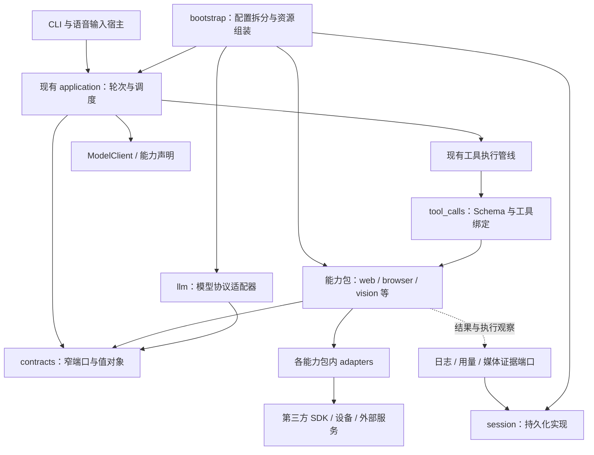

# C 系列能力模块设计（按实际消费者逐项落地）

最近核对：2026-11-01；已同步主线 B06.2。C00.1 可选注册与 C01.1 的 `web` 读取服务已实现，其余未勾选能力仍为规划。需求与小任务见 [C 系列练习规划](agent-capability-practice-plan.md)。本图是拟议边界，不代替 [已实现架构](architecture.md)。

目标：增加观察和动作种类时，主要改动落在所属能力包及组装入口；Conversation 不随着工具数量增加而不断出现新的工具分支。低耦合不等于零公共依赖，也不要求一个文件对应一个类。

## 先复用现有边界

| 现有位置 | 当前职责 | C 系列怎样接入 |
| --- | --- | --- |
| [bootstrap](../adam/bootstrap.py) | 组装应用、拆分配置、管理已创建资源 | 增加显式能力工厂；仍由它选择后端，基础模块不自行发现/导入 SDK |
| [ports](../adam/contracts/ports.py) | ModelClient、ToolRunner 等应用端口 | 公共类型按真实跨包需求增量扩展；不传整个 AppConfig、Conversation 或 SDK client |
| [ToolRegistry](../adam/tool_calls/registry.py) | Schema、校验器、处理器及能力注册 | 适配工具的薄层登记在这里；不在注册表中实现 OCR、抓取或播放器 |
| [ToolExecutor](../adam/tool_calls/executor.py) | 执行控制和工具入口 | 原权限、批准、Hook、预算、取消和调用日志继续经过该入口；新能力不能直接绕开 |
| [RequestRunner](../adam/application/request_runner.py) | 模型物理请求登记与结算 | 新视觉/审查模型请求复用其控制原则；确需不同请求形式时提取窄请求端口，不复制预算状态机 |
| [消息协议](../adam/contracts/protocol.py) | 当前文字消息与工具配对校验 | 联合 B24 增加有类型的媒体部分及版本化编码；不是把文件路径随意塞进文本 |
| [文本附件](../adam/session/artifacts.py) | UTF-8 长文本、来源与不可变版本 | 不能直接存音视频；C00.2 保留文本契约，新增二进制媒体引用和存储实现 |
| [SessionStore](../adam/session/storage.py) / [日志](../adam/session/log.py) | 会话锁、JSONL、执行关联与恢复 | 写入来源、状态及媒体引用，媒体字节存旁路目录；恢复不自动重发外部动作 |
| [录制运行](../adam/recording/runtime.py) | 模型/工具边界录制重放 | 扩展媒体摘要与资源状态证据；离线重放不再次点击、发送或生成计费产物 |

此表描述已有可复用点，并不声称所有 C 契约已经存在。实现前先读对应模块当前版本，尤其主线 B24、B27 可能新增的公共接口。

## 依赖方向

下图中的箭头表示“组装/调用依赖”，虚线表示输出观察数据，不是反向导入。能力包名称为建议，开工时根据已有目录归并。

应用经端口接收构造时注入的服务；图中的能力包到适配器表示模块内部调用，不要求业务服务 import 具体 SDK。组装层可以知道具体类，它的多 import 是装配职责；CLI 与主循环不因此知道每种 SDK。

约束：

1. `contracts` 放纯值对象和协议，无 I/O、无 SDK、无能力包导入。不把所有业务类型都搬进去；仅本模块使用的类型留在本模块。
2. 能力服务不 import CLI、Conversation、bootstrap 或 SessionStore 的具体实现。向日志/媒体/消费端口报告事实；是否推进轮次由现有应用层决定。
3. 能力包之间默认不直接访问内部类。例如 video 消费帧分析端口，documents 消费 OCR 端口；工厂把 vision 服务注入。禁止相互读取对方配置/缓存/数据库。
4. `tool_calls` 负责把模型参数转成用例输入、把结果编码成工具响应；真正的抓取、识别、点击等业务放所属能力包。主循环不添加按工具名判断的大段分支。
5. 权限决策属于现有执行控制；能力内仍验证资源身份、大小、当前观察版本等局部不变量。不得把“上层已经校验”当作使用过期页面或错误设备的理由。
6. 安全默认值来自代码与配置，模型只能提交数据。动态工具发现不会动态授予浏览器登录态、任意文件访问或通知目标。
7. 不要求现在搬动所有历史代码。新能力先遵守边界，确需修改既有边界时单独写出原因和影响，避免把功能提交变成全仓重构。

新增能力包时补 import 边界检查：SDK 只在约定 adapters 下导入；contracts 不依赖实现；能力包不依赖 CLI/application 的具体类。检查静态导入只证明结构约束，还需业务测试验证权限、资源释放和状态行为。

## 包内组织：按职责，而非按类数

每个能力的最小起点是包入口、业务服务、一个适配器、所需局部数据类型。文件多起来后再拆子目录，不预先生成所有空壳。

| 位置模式 | 保存内容 | 不承担的职责 |
| --- | --- | --- |
| `adam/<capability>/__init__.py` | 少量稳定公共导出 | 创建连接、读取用户配置、启动后台线程 |
| `service.py` / 按用例命名的文件 | 抓取、观察、操作、生成等内聚用例 | 格式化终端、驱动整个聊天循环 |
| `models.py` | 仅该能力使用的数据和局部校验 | 复制公共请求/轮次/预算类型 |
| `adapters/` | 一个供应商/平台的 SDK、协议编码和异常转换 | 决定用户权限、保存全部会话 |
| `adam/tool_calls/<capability>_tools.py` | 模型 Schema、输入映射、工具结果编码 | 大段业务逻辑、直接读全局配置 |
| `tests/features/test_<business>.py` | 用户能力闭环与可观察故障 | 按私有函数数量建立镜像测试 |
| `experiments/<topic>/` | 独立实验入口、参数与小样本 | 被正常启动路径导入、运行时修改模型代码 |

协议只有跨包注入或替换后端的实际需求时才提取。首版一个本地服务可以直接用函数，不需要强制 Repository/Factory/Manager 各一层。

## 能力归属与资源所有权

| 模块（建议） | 拥有的资源/状态 | 提供的窄接口语义 | 主要协作 |
| --- | --- | --- | --- |
| `web` | HTTP 客户端、抓取缓存、搜索配额 | 搜索候选；读取有来源网页 | 工具入口，不要求 browser |
| `browser` | 浏览器上下文、标签、元素引用、下载 | 观察页面；操作已观察元素；关闭上下文 | 媒体端口，权限/取消 |
| `desktop` | 目标窗口、桌面输入租约、观察版本 | 观察窗口；执行局部动作；释放租约 | 图像分析端口；不依赖 browser 实现 |
| `vision` | OCR/视觉后端连接和有界任务 | 图片问答；返回 OCR 文本/区域 | documents/video 通过端口使用 |
| `audio` | 录音、ASR/TTS、播放句柄 | 录音转文本；文本合成/播放；停止 | 输入适配后提交应用；B27 安全点 |
| `video` | 解码器、帧流、抽样/背压状态 | 带时间戳帧；事件片段 | 帧分析端口，不自己打开麦克风 |
| `generation` | 远端媒体作业身份与状态 | 提交生成；查询/取消；取产物引用 | 消费、媒体、作业记录端口 |
| `documents/graph` | 实体/边索引、来源版本 | 有界路径查询；返回证据 | 现有 documents 索引/来源边界 |
| `interop` | 外部任务映射、协议连接 | 发现；委派；查询；取消 | 身份端口、工具执行入口 |
| `mobile` | 模拟器连接、设备租约、UI 观察 | 观察设备；有限 UI 动作 | 图像、权限、取消端口 |
| `robotics` | 仿真环境、时间步与动作空间 | 观察环境；步进；停止/重置 | 独立实验策略，不驱动真实设备 |
| `safety_review` | 审查请求与规则版本 | 对动作提案给结构化建议 | 原权限/批准决定是否执行 |
| `integrations` | 身份绑定、凭据句柄、outbox、worker | 验证主体；请求投递；查投递结果 | B26～29 任务/事件基础 |
| `experiments/model_lab` | 数据清单、模型权重和实验产物 | 导出模型/报告；独立命令运行 | 经模型适配器验证后才能接入 Adam |

C11 是已有模型流与执行管线的优化，不为凑目录另建一个包；C13 不进入普通 Agent 启动路径。`integrations` 下身份与通知可以用独立文件起步，复杂后再分子包。

资源原则：创建方负责关闭，持有方显式借用。主会话拥有浏览器上下文；设备全局输入需独立租约；子 Agent 通过受控句柄申请资源，不能共享一个未加约束的全局浏览器/麦克风。初始化失败按逆序关闭已创建资源，关闭失败记录而不遮蔽最初错误。

## 公共契约要表达什么

名称是设计语义，不要求一次建立下表全部类。C00 由首个真实消费者推动，避免“以后可能用到”的大对象。

| 契约 | 必要信息 | 不放入其中的内容 |
| --- | --- | --- |
| 能力声明 | 支持的媒体/动作、是否可取消、是否可观察完成、并发约束、输出上限 | 密钥、SDK 实例、模型任意声明的权限 |
| 媒体引用 | 不可变内容 ID/摘要、类型、字节数、所有者、来源/版本；尺寸/时长可选 | 整块 base64、任意可逃逸路径、隐式公共下载链接 |
| 观察结果 | 资源身份、观察 ID/版本、时刻、可引用片段/元素；完整性说明 | 假定永远有效的元素坐标或全局 element ID |
| 动作请求 | 目标资源、观察依据、动作参数、来源轮次/请求/工具 ID、截止时间 | 整个 AppConfig、Conversation、所有历史消息 |
| 动作结果 | 成功/失败/中断/未知、可验证证据、已知副作用、原生错误分类 | 仅一个 `ok` 掩盖“发出请求”与“实际完成”的差别 |
| 消费观察 | 来源调用身份、计量种类/数量、未知标记、可选价格与币种 | 假定所有模型/媒体按同一价格，或未知填零 |
| 外部任务身份 | 本地/远端任务 ID、可信主体、状态版本、去重键 | 从模型文本提取后直接信任的账号权限 |

媒体消息与日志格式显式版本化；读取旧文本记录继续有效，无法处理的新版本明确报错。分享与备份既要包括有效媒体，也要校验所有权、摘要和大小；录制重放只消费冻结证据，不访问真实桌面或外部收件人。

## 一条闭环的数据流

以“看图后在测试网站录入数据”为例：

1. 输入层把图片交给媒体存储，取得有来源的引用；模型适配器按其视觉能力编码。
2. 应用构造消息并通过既有请求入口取得工具调用；视觉分析结果仍是可能有误的观察。
3. 工具执行入口完成参数/权限/额度检查；browser 观察页面并返回当前元素引用。
4. 模型提交填表动作；browser 校验引用对应当前页面，经批准执行并重新读取结果。
5. 日志保存每个请求/动作及媒体证据引用；只有实际保存的页面结果支持最终完成结论。

主循环始终处理“请求 → 工具结果 → 下一请求”；新增图片/页面服务无需让它理解截图坐标、DOM 或 TTS 协议。跨能力顺序由模型工具链或小型明确用例协调，不能让各包通过全局事件总线暗中互相调用。

## 同步、异步与故障边界

- 普通有界查询沿用现有调用模式。浏览器/音频依赖异步库时，在模块生命周期内拥有其 event loop，不在每个工具调用里随意创建新 loop。
- 长任务复用 B26 的任务语义；外部进度通过 B27 类型事件进入安全点。先没有这些 B 基础时，可做独立实验入口，不能把其正式接入勾选完成。
- 取消贯穿实际 I/O/进程/设备；只停止等待不等于后端停止。动作是否发生未知就如实记未知，下一次先查询/观察。
- 模型流增量、语音输入、外部进度是不同事件类型；不能为了共用队列而取消各自的顺序、身份和背压规则。
- SDK 异常在模块边界转成少量业务分类与安全的诊断细节。CLI 消费现有应用结果，不为每个服务商增加 `except`。
- 使用进程/RPC 的理由是隔离不可信执行、设备独占、故障域或明确跨服务实验；普通模块不为“成熟”而强拆成微服务。

## 配置与可选依赖

- 延续现有 TOML：新增能力分节按需解析，bootstrap 拆成各服务需要的配置。不要把全局 Config 传入每个工具。
- 保留 Python 为默认语言；只有测量显示独立 CPU 密集热点时才考虑 C++。识别/推理库内部已使用原生实现不等于 Adam 也要写一套 C++。
- 第三方包按 `web`、`browser`、`vision`、`audio` 等可选依赖组逐项增加，不在纯文本启动路径 import。下载模型/浏览器二进制也要显式安装步骤。
- 能力未启用不注册其工具；用户显式启用但缺配置/依赖时给出准确诊断，不静默换成未经授权的后端。
- 每个能力只有自身资源限制，例如页数、像素、音频秒数、帧数；总预算、请求身份、取消规则沿用公共执行边界。
- 配置示例不承诺尚未实现的键。实际落地一个子任务时再同步解析器、示例、配置说明与测试。

## 验证模块化是否成立

以下是未来实施的验收责任，不是本轮已经执行的测试：

- 不装可选 SDK，原文字聊天、会话恢复和已有工具能运行；不需要联网才 import 成功。
- 用两个实现（真实后端/确定性替身）替换同一端口时，主循环无需修改；替身只证明工程行为，真实后端另外验收。
- 新工具同时经过原权限、共享预算、Hook、日志与取消；主 Agent 和子 Agent 不出现两套逻辑。
- 关闭/强杀后能解释哪些资源已释放、哪些远端动作未知；恢复不会自动重放键鼠、生成计费任务或发通知。
- 单个能力故障不会迫使 CLI 了解其 SDK 异常；错误有业务分类与原始诊断依据。
- 新增依赖有明确去向；没有 capability A 直接 import capability B 的内部实现形成循环，没有万能 Context/Manager 汇集所有状态。

本轮文档验收：核对 14 类覆盖、60 个独立小任务编号、B/C 前置关系、已实现/规划边界和相对链接；Python 代码/注释未改动。功能实现时再新增业务测试与真实环境证据。

## 当前已落地增量

C01.1 在 `adam/web/` 实现值对象、网络策略、WebReader 与 HTTP 适配器；业务层只依赖本包及 contracts，HTTP SDK 仅在 adapters 导入。独立入口不创建模型/会话。C00.1 已由 bootstrap 按 WebConfig 为主/子注册原只读管线，默认关闭且不导入后端；web.runtime.open_reader 在每次调用独占/关闭连接，不为当前无持久资源的网页预建全局框架。后续浏览器/设备按真实生命周期扩展，不把本规划图误当已实现架构。见 [网页读取](web-reading.md) 与 [当前架构](architecture.md)。
