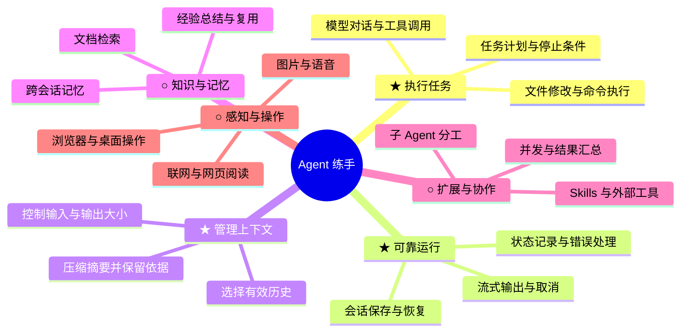

# Adam 迭代工单看板

更新日期：2026-11-12

本计划以 dev 的 `0e0d14e2208a82bb84bcdeba4d37be8bf5c771db` 为基线，不参考 main。当前已有多轮聊天、只读工具、经批准的命令执行、JSONL 会话保存与加载、请求与轮次状态；这些不重复排期。本文件是后续工单顺序和进度的唯一主记录，旧版编号见 [历史练手任务](agent-practice-todo.md)，实际架构见 [系统架构](architecture.md)。

## 如何使用

- 默认按迭代顺序推进，轮内按依赖完成重点工单；每轮交付一个完整可用的场景。
- ★ 重点工单必须完成才能通过该轮验收；○ 选做工单可跳过，不阻塞主线。后续需要选做能力时，必须提供最小替代路径。
- 每张工单通常练习 2～4 小时，每轮 3～5 张。约 300～500 行只是规模参考，不设上下限；按可观察行为拆分，不按函数或文件机械拆分。
- 工单状态：`待办 → 进行中 → 完成`，另有 `阻塞`、`跳过`。一次只把一张工单标为进行中。
- 开始时把状态改为“进行中”；完成且验证后把 `[ ]` 改为 `[x]`，状态改为“完成”，补验证结果和实现提交号。跳过仍保留 `[ ]`，写明“跳过”和原因，不冒充完成。
- 本文采用普通 Markdown 任务列表，不依赖拖拽插件。可直接勾选；若编辑器支持任务列表交互，可使用其勾选功能。工单 ID 和原定顺序保持稳定。
- 每单相关验证后提交；每轮结束跑一次局部回归和完整场景；约三轮跑一次全量，共享协议或存储格式的大改提前全量。必要失败边界不能因提速省略。不自动调用付费 API。
- 每轮验收还包括：能启动、原有功能可用、必要结果可保存、能退出。不为每张工单建立独立评估平台。
- 范围变更直接更新本文并说明原因；未来计划不得画进已实现架构图。

## 当前进度

- 完成：0 / 48；重点：0 / 30；选做：0 / 18。
- 当前工单：尚未开始；下一张：01。
- 每张工单只有下方一处勾选状态；完成后同步更新本节计数。

## 能力思维导图

★ 为重点练手方向，○ 为后续扩展。具体工单可以因练习阶段成为重点；整体投入仍优先前三个方向。

## 排期与覆盖索引

这是顺序排期，不是固定日历。按每周十几个小时安排，允许陌生能力跨周，不能为了赶时间跳过验收。

| 迭代 | 工单 | 可用成果 | 主要方向 |
| --- | --- | --- | --- |
| 1 | 01～03 | 失败可解释 | 可靠运行 |
| 2 | 04～07 | 完成受控小修改 | 执行任务、可靠运行 |
| 3 | 08～11 | 较长对话继续工作 | 管理上下文 |
| 4 | 12～15 | 能取消、能重启 | 可靠运行 |
| 5 | 16～19 | 项目规则与工作方法复用 | 扩展与协作 |
| 6 | 20～23 | 完成多步骤长任务 | 执行任务、管理上下文 |
| 7 | 24～28 | 记住约定、查到本地资料 | 知识与记忆 |
| 8 | 29～32 | 外部工具和网页资料 | 扩展与协作、感知与操作 |
| 9 | 33～36 | 子任务分工与汇总 | 扩展与协作 |
| 10 | 37～40 | 经确认的经验复用 | 知识与记忆 |
| 11（整轮选做） | 41～44 | 图片与浏览器任务 | 感知与操作 |
| 12（整轮选做） | 45～48 | 桌面和语音入口 | 感知与操作 |

## 顺序工单

以下“前置”仅列直接依赖；整体默认沿迭代推进。每张按“为什么做→具体用例→预期表现→怎么验收→本单边界”阅读，再自行设计实现。示例描述目标行为，并非当前已实现功能；验收描述是完成条件，不是已经通过的结果。步骤较多时，可继续拆成可独立验证的子工单，不要求一次写完。

### 迭代 1：让失败可解释

本轮验收：能继续聊天和使用工具，并分清模型失败与保存失败。

- [ ] **01 · ★ 请求与轮次结束信息** — 待办
  - 方向：可靠运行；前置：现有 dev。

  **为什么做：** 只有“失败”状态时，无法区分网络、服务端或本地处理出了问题；需要把原因和耗时写入日志，而不只打印到终端。

  **具体用例：** 你输入“读取 README，告诉我如何启动”。第一次模型请求要求读取文件，工具成功；第二次请求返回 HTTP 503。

  **预期表现：** 日志分别显示第一次请求成功、第二次请求因 HTTP 503 失败、整轮失败，并记录各自耗时。整轮还包含工具等耗时，不要求等于请求耗时之和；未知用量不写成零。

  **怎么验收：** 用模拟 HTTP 制造上述两次请求，检查它们属于同一轮且原因正确；用可控时钟检查非负耗时，再验证超时与额度停止能区分。

  **本单边界：** 先持久化原因、耗时和受控错误详情，直接读 JSONL 即可；不开发统计界面，不保存可能含密钥的完整服务端错误正文。

  - 完成记录：验证待填；实现提交待填。

- [ ] **02 · ★ 回答保存失败处理** — 待办
  - 方向：可靠运行；前置：01。

  **为什么做：** 模型已经回答，不代表本轮对话已经可靠保存；必须区分请求成功和本地提交失败。

  **具体用例：** 模型回答了启动方法，Adam 写入完整对话时遇到磁盘或权限错误。用户已经等到回答，不能再悄悄请求一次模型。

  **预期表现：** 终端展示带“未保存”标记的回答并解释保存失败；请求保持成功，轮次不算完整成功，这轮不进入有效历史，不自动重问。如果连失败记录也写不进去，明确说明记录失败。

  **怎么验收：** 在提交完整对话的边界注入写入错误，检查回答仍可见、没有额外模型请求、当前及重载后的有效历史均未增加该轮；再模拟失败记录也无法保存，确认不掩盖原始错误。

  **本单边界：** 处理可捕获的保存异常；掉电、残缺尾行和重启收尾在14、15处理。本单不承诺任何磁盘故障下都能留下错误记录。

  - 完成记录：验证待填；实现提交待填。

- [ ] **03 · ○ 读取日志并展示最近一次失败经过** — 待办
  - 方向：可靠运行；前置：01、02。

  **为什么做：** JSONL 有记录，但逐行找同一轮的请求和工具很费力；需要把已有事实整理成易读经过。

  **具体用例：** 昨天读取 README 失败，今天运行独立的查看命令并指定日志文件，得到“输入→第一次请求成功→读取成功→第二次请求503→整轮失败”。

  **预期表现：** 输出最近一次失败的输入、执行步骤、已知原因与耗时；缺失字段显示未知。只读文件，不调用模型、不重跑工具、不改变记录。

  **怎么验收：** 准备一份有成功轮次和失败轮次的日志，检查选中失败轮次、步骤顺序和原因正确，文件前后内容相同；没有失败记录时明确提示。

  **本单边界：** 只做独立开发查看入口，不增加 /turn 或 /diagnose 聊天命令；不统计跨会话成功率、费用排行或性能趋势。

  - 完成记录：验证待填；实现提交待填。

### 迭代 2：完成一次受控小修改

本轮验收：在含问候函数和测试的小项目中，完成“读取代码→准确预览→批准写入→运行验证→据真实结果汇报”。04～06必做，07可跳过。

- [ ] **04 · ★ 精确修改与预览** — 待办
  - 方向：执行任务；前置：现有工具机制。

  **为什么做：** 已有工具能读取文件和执行命令，但缺少可核对的专用编辑方式；先让修改意图变成准确预览。

  **具体用例：** 你要求“修复问候函数，去掉名字两侧空格”。Adam 读取 greeting.py，提交原文本和替换文本；程序检查原文本出现次数，再展示差异。

  **预期表现：** 恰好匹配一次才生成预览；零次提示重新读取，多次提示补充定位内容。展示文件名和前后内容，此时文件不变化。

  **怎么验收：** 用临时文件分别构造一次、零次、两次匹配，检查预览或错误准确，三种情况均不修改文件。

  **本单边界：** 只支持单文件一次唯一文本替换，不写入；不做模糊匹配、多文件修改或自动挑选重名位置。

  - 完成记录：验证待填；实现提交待填。

- [ ] **05 · ★ 确认与可靠写入** — 待办
  - 方向：执行任务、可靠运行；前置：04。

  **为什么做：** 正确预览仍可能被用户拒绝，文件也可能在批准前被别人修改；写入必须对应已确认内容。

  **具体用例：** 问候函数修改预览出现后，你批准则应用；另一轮预览后你先在编辑器改了该文件，再批准时程序拒绝覆盖并要求重新预览。

  **预期表现：** 批准且文件未变化才写入；拒绝不写入；检测到外部修改则保留新内容；替换前写入出错时保留完整原文件并报错。

  **怎么验收：** 验证批准、拒绝、外部修改三条路径；在替换原文件前注入写入故障，检查原内容完整、没有半截目标文件。

  **本单边界：** 单文件可靠写入与常见版本冲突检查；不承诺完整多进程并发协调，不做多文件事务、版本管理或撤销功能。

  - 完成记录：验证待填；实现提交待填。

- [ ] **06 · ★ 修改—验证闭环** — 待办
  - 方向：执行任务；前置：05。

  **为什么做：** 文件改成功不等于问题已解决；模型要看到实际检查结果，才能继续修正或准确汇报。

  **具体用例：** 你要求修复问候函数并运行项目测试。第一次修改只去掉左侧空格，测试仍失败；Adam 据此再次提案，经批准后修正并重新运行测试。

  **预期表现：** 每次修改都预览并批准，命令沿用现有批准流程；通过才报告验证通过，拒绝验证则说明未验证，仍失败则说明任务未完成。

  **怎么验收：** 模拟模型配合真实临时文件和本地检查命令，验证一次成功与失败后修正两条完整路径；检查拒绝无对应副作用，持续失败受已有次数上限限制。

  **本单边界：** 单文件、前台命令、串行执行；复用现有通用命令和次数限制，不把工具写死成 pytest/Ruff，不引入后台任务或复杂重试系统。

  - 完成记录：验证待填；实现提交待填。

- [ ] **07 · ○ 新建文件** — 待办
  - 方向：执行任务；前置：05。

  **为什么做：** 添加测试或文档时需要新文件；新建应与覆盖现有内容明确区分。

  **具体用例：** 你要求为问候函数补一个测试文件。Adam 展示新路径和完整内容，你批准后创建；如果文件已经存在则要求先读取再修改。

  **预期表现：** 批准且目标不存在才创建；拒绝不留下空文件，已有文件不覆盖，不能绕过目录权限限制。

  **怎么验收：** 在临时目录验证成功创建、拒绝、目标已存在、路径越界四种情况，分别检查内容或文件不存在。

  **本单边界：** 只在已存在目录中新建一个文本文件；不自动创建多层目录，不生成二进制文件，不批量创建。

  - 完成记录：验证待填；实现提交待填。

### 迭代 3：较长对话继续工作

本轮验收：连续读取多个文件后仍可继续任务，历史取舍可解释。

- [ ] **08 · ★ 查看与限制上下文** — 待办
  - 方向：管理上下文；前置：现有对话。

  **为什么做：** 会话累计消费额度限制花费，无法阻止某一次请求携带过长输入；需要单独管理输入大小。

  **具体用例：** 你连续粘贴长文后准备提问，查看当前上下文能看到系统说明、历史和本次输入的大致占用；本次输入本身已超过预算时直接提示。

  **预期表现：** 能说明将发送哪些内容、估算大小和预算；超限提示可采取的操作，不静默截断用户原话，也不把估算伪装成精确账单。

  **怎么验收：** 给定固定历史与输入，检查组成可追溯、预算边界触发正确；单条过大时未发出请求，已有历史不变。

  **本单边界：** 先提供查看和单次输入限制，不裁剪历史、不生成摘要；模型分词不可精确获得时明确标注估算。

  - 完成记录：验证待填；实现提交待填。

- [ ] **09 · ★ 按完整轮次选择历史** — 待办
  - 方向：管理上下文；前置：08。

  **为什么做：** 历史越来越长时，仅报超限会让对话无法继续；需要保留最近的完整交流而非任意截断消息。

  **具体用例：** 你已聊十轮，第十一轮超过输入预算。程序从较早轮次开始排除，保留近期对话以及本轮所需工具调用与结果。

  **预期表现：** 选入历史由完整轮次组成，工具调用和结果不失配；系统约束和本次用户输入保留，原始日志不删除；最小必要输入仍放不下则明确失败。

  **怎么验收：** 构造含工具往返的历史，检查实际请求消息配对正确、顺序正确、估算在预算内，原日志保持完整；覆盖无法再裁剪的情况。

  **本单边界：** 只做确定性历史选择，不做语义重要性排序；本轮正在执行的必要工具链不靠任意删除片段来凑预算。

  - 完成记录：验证待填；实现提交待填。

- [ ] **10 · ★ 大工具结果按需读取** — 待办
  - 方向：管理上下文、执行任务；前置：09。

  **为什么做：** 长命令或文件结果一次全部交给模型会挤满上下文，直接截掉又可能丢失关键证据。

  **具体用例：** 命令输出很长，错误在后半段。模型先收到有限片段和全文引用，再请求后续片段，找到错误并回答。

  **预期表现：** 完整结果有可读取的存放位置；返回明确的截断提示、片段位置和读取入口；后续读取仍受权限与单次大小限制。

  **怎么验收：** 用已知长输出在后段放固定错误标记，检查初始片段有限、后续能读到标记、完整内容保存正确；无效引用和越界读取报错。

  **本单边界：** 先支持当前会话内按范围读取文本，不做全文搜索服务；恢复后不可用的引用必须明确提示，不能假装仍能读取。

  - 完成记录：验证待填；实现提交待填。

- [ ] **11 · ○ 手动摘要** — 待办
  - 方向：管理上下文；前置：09。

  **为什么做：** 选择最近历史会遗忘较早的重要约定；手动摘要让用户决定何时压缩。

  **具体用例：** 聊过启动方式和禁止修改的目录后，你主动压缩历史，再问下一步修改计划。摘要应保留这些约束与未完成事项。

  **预期表现：** 摘要有明确覆盖范围，原始记录仍在；成功保存后才启用摘要，失败继续用压缩前历史；生成摘要也受额度限制。

  **怎么验收：** 模拟摘要返回，检查后续请求使用摘要及未覆盖历史、没有重复轮次；注入摘要生成或保存失败，检查原有效上下文仍可用。

  **本单边界：** 一次手动摘要和可靠切换，不做自动触发；离线测试证明流程，摘要是否遗漏语义另做人工查看。

  - 完成记录：验证待填；实现提交待填。

### 迭代 4：能取消、能重启

本轮验收：用户能停止任务，强杀重启后能继续聊天且不自动重复执行。

- [ ] **12 · ★ 流式回答** — 待办
  - 方向：可靠运行；前置：01、02。

  **为什么做：** 非流式请求必须等完整回答才有反馈；需要边接收边显示，同时避免把半截回答当成完整历史。

  **具体用例：** 你问项目如何启动，终端逐段出现回答；另一次模型返回分片工具参数，只有收齐并校验后才能执行工具。

  **预期表现：** 文本增量显示，完整响应结束后才结算并提交；中途断开明确标记未完成，不能执行半截工具参数或把部分文本当成功历史。

  **怎么验收：** 用模拟流分片发送文字、工具参数和结束标记；检查显示顺序、工具只执行一次且在完整之后，断流不产生成功轮次。

  **本单边界：** 先适配当前服务协议，不做多供应商兼容层，不在参数未收齐时提前执行工具。

  - 完成记录：验证待填；实现提交待填。

- [ ] **13 · ★ 取消当前任务** — 待办
  - 方向：可靠运行；前置：12。

  **为什么做：** 用户发现任务方向不对时需要及时停止，不能只能关整个终端或留下运行中的命令。

  **具体用例：** Adam 正在等待模型或运行一个长命令，你按 Ctrl+C；程序结束本次工作并回到输入提示，你能继续问新问题。

  **预期表现：** 取消当前请求及本次启动的命令，做必要资源清理，轮次标为中断；不再启动后续工具，不影响其他终端会话。

  **怎么验收：** 分别在模拟慢请求和真实测试子进程中取消，检查能回到输入状态、子进程按约定结束、记录未误标成功，再发送一次新输入验证可用。

  **本单边界：** 先覆盖当前前台任务及其受控子进程，不做后台任务管理器；已完成的外部副作用不会因取消自动撤销。

  - 完成记录：验证待填；实现提交待填。

- [ ] **14 · ★ 遗留状态恢复** — 待办
  - 方向：可靠运行；前置：01、02。

  **为什么做：** 强制关闭后没有机会写结束记录，重启仍看到进行中会误导使用者；恢复需要明确规则。

  **具体用例：** 模型请求开始后进程被强杀，下一次打开同一会话时程序发现该轮没有结束事件。

  **预期表现：** 先获得会话锁，再为遗留任务追加中断信息；未知用量保持未知，不重发请求或重跑工具；再次打开不重复追加同一恢复事件。

  **怎么验收：** 构造遗留请求和工具记录，重开后检查中断关联、历史和未知用量正确；再次重开验证幂等，模拟客户端确认无请求发送。真实强杀在15验收。

  **本单边界：** 只处理结构完整日志中的遗留状态；不能推断强杀瞬间外部命令是否已产生副作用，不自动补做任务。

  - 完成记录：验证待填；实现提交待填。

- [ ] **15 · ★ 残缺日志恢复** — 待办
  - 方向：可靠运行；前置：14。

  **为什么做：** 强杀可能让 JSONL 最后一行只有一半，直接读取失败会导致整个会话无法打开。

  **具体用例：** 测试进程写入部分末行后被强杀，重启打开会话。程序先保存原文件备份，再处理残缺尾部并执行遗留状态恢复。

  **预期表现：** 完整记录保留、备份可查、尾部恢复有说明；中间记录损坏拒绝自动修复；重启不自动请求模型或执行工具。

  **怎么验收：** 独立进程连接本地假服务，在明确同步点强杀后重启；另测残缺末行和中间损坏，检查备份原样、有效历史不丢、没有重发。

  **本单边界：** 只自动处理明确的末尾残缺，不把完整但非法的记录一律删掉；不做通用文件修复器或磁盘硬件恢复。

  - 完成记录：验证待填；实现提交待填。

### 迭代 5：复用项目规则与工作方法

本轮验收：按当前项目规则工作，并显式复用一个工作流程。

- [ ] **16 · ★ 项目规则加载** — 待办
  - 方向：扩展与协作；前置：09。

  **为什么做：** 不同项目有不同约定，反复在聊天里说明容易遗漏；规则需要在正确项目内稳定生效。

  **具体用例：** 项目A约定使用绝对导入，项目B有另一套约定。分别启动 Adam，让它解释当前采用的项目规则。

  **预期表现：** 从约定位置加载规则，能查看实际加载文件和内容；缺少规则时正常工作，切换项目不带入前一个项目规则。

  **怎么验收：** 创建两个临时项目和不同规则，检查发给模拟模型的内容分别正确；缺失文件可继续、无法读取时提示，不误用别处规则。

  **本单边界：** 先支持一种明确的项目规则文件与加载位置；不做多层继承、复杂优先级或自动写规则。规则文本不能越过程序权限限制。

  - 完成记录：验证待填；实现提交待填。

- [ ] **17 · ★ 显式启用 Skill** — 待办
  - 方向：扩展与协作；前置：16。

  **为什么做：** 重复的工作方法可以作为说明复用，不必每次重新输入长提示。

  **具体用例：** 你明确启用“检查配置错误”Skill，然后让 Adam 分析错误；Skill正文要求先查配置再定位加载代码，模型按流程调用现有工具。

  **预期表现：** 加载指定 Skill 并说明启用结果；找不到或内容无法读取时明确报错，不假装启用；普通聊天保持可用。

  **怎么验收：** 用临时 Skill 和模拟模型检查正文确实进入本次任务上下文，并能完成读取分析闭环；不存在的 Skill 不注入任何伪内容。

  **本单边界：** 只支持显式启用本地 Skill；不自动下载安装，不先设计远程商店，Skill不能自动取得更高执行权限。

  - 完成记录：验证待填；实现提交待填。

- [ ] **18 · ○ Skill 渐进加载** — 待办
  - 方向：扩展与协作、管理上下文；前置：17。

  **为什么做：** Skill 多了以后全部加载正文会挤占上下文，即使当前只用一个流程。

  **具体用例：** 本地有三个 Skill，用户问配置问题；模型先看到简短目录，选择相关 Skill 后才读取其完整说明。

  **预期表现：** 未选 Skill 正文不进入请求；加载结果可追溯，单份超大说明受预算限制；显式启用仍可用。

  **怎么验收：** 在不同正文中放独有标记，检查选择前只有摘要、选择后只有目标正文；重复加载不会无限堆叠，超大正文有明确反馈。

  **本单边界：** 先做本地目录和按需加载，不做语义检索或复杂自动推荐；跳过本单仍可用17显式启用。

  - 完成记录：验证待填；实现提交待填。

- [ ] **19 · ○ Skill 附属资源** — 待办
  - 方向：扩展与协作；前置：17。

  **为什么做：** 有些 Skill 需要参考模板或辅助脚本，仅一段说明不足以完成流程。

  **具体用例：** “配置检查”Skill 引用一个检查清单和一个脚本。Adam 先读清单，再请求批准执行脚本；你拒绝后改为说明未执行。

  **预期表现：** 引用相对 Skill 所在目录解析，资源按需读；脚本仍走原有批准机制，不因来自 Skill 就自动运行；缺失资源明确提示。

  **怎么验收：** 用临时资源检查正确定位，缺失引用返回错误；批准与拒绝分别检查真实测试脚本是否执行，越界路径遵守已有权限。

  **本单边界：** 先支持本地文本资源与现有命令工具可执行的脚本；不自动安装脚本依赖或下载资源。

  - 完成记录：验证待填；实现提交待填。

### 迭代 6：完成多步骤长任务

本轮验收：读文件、修改和验证的多步骤任务可以完成，上下文增长可处理。

- [ ] **20 · ★ 最小任务计划** — 待办
  - 方向：执行任务；前置：06。

  **为什么做：** 多步骤任务容易漏做，只有聊天描述难以明确哪些工作完成、哪些仍未做。

  **具体用例：** 你要求“读代码、修复空格、运行测试”。Adam 建立三个步骤，读取后更新第一步，修改和验证完成后依次更新剩余步骤。

  **预期表现：** 计划能被查看并有明确状态；同时进行中的步骤受约束，简单问答不强制建计划；更新只改变计划记录，不自行执行工具。

  **怎么验收：** 模拟模型建立和更新计划，检查顺序与状态可读取、无效更新被拒绝；普通问答仍能直接回答，计划状态不替代实际工具结果。

  **本单边界：** 先做一份当前任务计划和最少状态，不做日程、依赖图编辑器或任务管理平台。

  - 完成记录：验证待填；实现提交待填。

- [ ] **21 · ★ 调整计划与未完成收尾** — 待办
  - 方向：执行任务；前置：20。

  **为什么做：** 计划不是一次写完永不改变；工具失败后应调整，同时不能用最终回答掩盖未完成步骤。

  **具体用例：** 计划最后一步运行测试，但环境缺少依赖。Adam 记录阻碍并调整下一步；如果停止，应说明修改已完成、验证未完成及原因。

  **预期表现：** 变更保留理由，取消或失败步骤不能冒充成功；准备回答时仍有未完成项则有限提醒，最终明确未完成，不无限催促模型。

  **怎么验收：** 制造测试失败和模型直接声称完成的回复，检查有限提醒与未完成提示；验证计划修改前后及原因可追溯，原有请求上限生效。

  **本单边界：** 先处理当前轮计划的修订与收尾；不自动安装依赖，不用模型自报完成替代命令验证，不做复杂自动调度。

  - 完成记录：验证待填；实现提交待填。

- [ ] **22 · ★ 自动触发摘要** — 待办
  - 方向：管理上下文；前置：09；11可选。

  **为什么做：** 长任务不能总靠用户手动整理历史，需要在接近预算时自动腾出空间。

  **具体用例：** 读过多个文件后接近输入上限，程序先生成覆盖旧轮次的摘要，再携带摘要和近期历史继续修复任务。

  **预期表现：** 成功保存后才切换，原始记录保留；摘要请求计入额度，失败退回原有历史选择，仍放不下则明确停止；避免紧接着无条件重复摘要。

  **怎么验收：** 模拟超阈值历史，检查触发时机、覆盖范围、摘要与近期历史不重复；注入生成和保存失败，检查回退不损坏历史且请求数有界。

  **本单边界：** 若11未做，本单补最小摘要生成及可靠保存，不要求先做手动入口；不做多模型摘要竞赛，语义保留效果另行人工检查。

  - 完成记录：验证待填；实现提交待填。

- [ ] **23 · ○ 无进展停止** — 待办
  - 方向：执行任务、可靠运行；前置：21。

  **为什么做：** 次数上限能防无限运行，但相同错误反复出现时继续耗尽额度没有价值。

  **具体用例：** 模型连续尝试读取同一个不存在的路径，错误完全相同；程序提醒改变方法，继续重复则结束并说明没有进展。

  **预期表现：** 识别有限窗口内相同失败操作，给出停止原因；改变参数后的合理尝试可以继续，已有次数限制仍保留。

  **怎么验收：** 构造重复失败序列与修正路径后成功序列，分别检查停止和继续；确保检测不凭相同工具名就误杀正常多次读取。

  **本单边界：** 只处理明显重复失败，不判断所有任务的语义进展；阈值保持简单可解释，不增加专门模型请求。

  - 完成记录：验证待填；实现提交待填。

### 迭代 7：记住约定并检索本地资料

本轮验收：新会话可使用明确保存的约定，并据本地文档回答。

- [ ] **24 · ★ 显式保存项目记忆** — 待办
  - 方向：知识与记忆；前置：16。

  **为什么做：** 跨会话约定不能靠模型凭空记住，需要用户可控制的项目记忆。

  **具体用例：** 你明确说“记住这个项目测试前要设置测试环境变量”。确认保存后关闭会话，重新打开同项目能查看该记录，换项目看不到。

  **预期表现：** 只在明确请求或确认后保存，支持查看、修改和删除；来源项目明确，保存失败提示；不把普通讨论自动当成永久事实。

  **怎么验收：** 在临时项目保存后重启读取，验证修改删除和项目隔离；失败写入不报告成功，其他会话原始记录不受影响。

  **本单边界：** 先做少量明确文本记忆，不自动总结全部历史，不存密钥，不做向量检索。

  - 完成记录：验证待填；实现提交待填。

- [ ] **25 · ★ 选择相关记忆** — 待办
  - 方向：知识与记忆、管理上下文；前置：24、09。

  **为什么做：** 记忆越来越多时全部发送会浪费输入，也可能把无关约定带进当前任务。

  **具体用例：** 项目有测试约定、文档措辞和部署流程。当前任务是补测试，程序选择测试约定并能说明使用了哪条记忆。

  **预期表现：** 相关条目在限制内进入请求，来源可查看；未命中可以不加载；删除或修改记忆后下一轮不会沿用旧版本。

  **怎么验收：** 用固定任务和条目检查选择结果、数量或大小上限、删除后的刷新；无记忆时正常聊天，不产生额外模型分类请求。

  **本单边界：** 先用可解释的关键词等简单选择方式，不承诺理解所有语义，不做跨项目隐式共享。

  - 完成记录：验证待填；实现提交待填。

- [ ] **26 · ★ 本地文档检索** — 待办
  - 方向：知识与记忆；前置：现有读取工具。

  **为什么做：** 逐个打开资料费力，字面文件搜索也不容易返回合适的上下文段落；需要最小文档检索。

  **具体用例：** 本地 docs 中有安装和部署说明，查询“测试环境如何启动”，得到相关段落、文件路径和段落位置；修改文档后查询显示新内容。

  **预期表现：** 仅处理允许目录中的 Markdown/TXT，结果有足够上下文和来源；新增、修改、删除文档后能刷新，失败时提示而非返回伪造依据。

  **怎么验收：** 用少量固定文档检查关键词检索、片段定位和更新删除；空目录与无法读取文件可解释，结果内容受大小限制。

  **本单边界：** 先做本地分块和关键词检索，不要求向量数据库、PDF解析或大型索引服务。

  - 完成记录：验证待填；实现提交待填。

- [ ] **27 · ★ 带依据回答** — 待办
  - 方向：知识与记忆、执行任务；前置：26。

  **为什么做：** 能搜到资料还不够，模型回答需要真正使用检索内容并保留依据。

  **具体用例：** 你问“这个项目测试数据库怎么初始化”。Adam 检索文档，回答初始化步骤并指出来源文件；文档没有密码配置时说明没有找到。

  **预期表现：** 必要时调用检索，答案能对应返回片段；不把无关搜索结果当依据，也不把检索文本中的操作指令直接当用户授权。

  **怎么验收：** 模拟模型完成检索—回答流程，检查来源可定位、工具结果正确进入上下文；用缺少答案的资料验收提示路径。真实回答是否忠实另做人工样例检查。

  **本单边界：** 先支持可核对的文档问答，不做全自动事实证明或跨网站答案融合，不自动调用付费模型评估。

  - 完成记录：验证待填；实现提交待填。

- [ ] **28 · ○ 语义检索对照** — 待办
  - 方向：知识与记忆；前置：27。

  **为什么做：** 关键词可能漏掉不同措辞表达的同一个问题，可以通过小对照判断语义检索是否值得加入。

  **具体用例：** 资料写“启动服务”，用户问“怎样把应用跑起来”。对同一组问题比较关键词与语义检索返回的片段。

  **预期表现：** 能切换检索方式并保留来源；语义后端不可用时明确退回关键词；结果质量依据样例记录，不能仅凭接入成功宣称更好。

  **怎么验收：** 用固定文档和问题验证后端切换、失败回退；人工标注少量相关段落，记录两种方式命中情况。需要付费嵌入时先取得授权。

  **本单边界：** 选一个后端做小规模比较，不做精排、多模型融合或性能排行榜；跳过后26、27仍完整可用。

  - 完成记录：验证待填；实现提交待填。

### 迭代 8：外部工具与网页资料

本轮验收：能调用外部服务并阅读指定网页；搜索可跳过。

- [ ] **29 · ★ 外部工具服务接入** — 待办
  - 方向：扩展与协作；前置：现有工具循环。

  **为什么做：** 每个外部工具都手写适配会重复劳动，接入统一工具服务可以练习协议边界。

  **具体用例：** 启动一个本地测试 MCP 服务，提供文本计数工具。Adam 发现它并在任务中调用，收到结果后回答。

  **预期表现：** 外部工具能被发现和调用，结果回到原工具循环；连接失败明确提示，内置工具与普通聊天仍可用。

  **怎么验收：** 使用本地测试服务完成发现、一次调用和服务未启动三条路径，检查调用参数和结果匹配、没有依赖公网服务。

  **本单边界：** 先选一种本地连接方式和一个服务，不做完整协议特性覆盖、服务市场或自动安装。

  - 完成记录：验证待填；实现提交待填。

- [ ] **30 · ★ 外部工具边界** — 待办
  - 方向：扩展与协作、可靠运行；前置：29。

  **为什么做：** 外部服务可能卡住、输出巨大或与内置工具重名，不能破坏整个 Agent。

  **具体用例：** 服务暴露同名工具，又有一次调用不返回；程序区分工具来源并在超时后反馈失败，你还能继续聊天。

  **预期表现：** 名称可区分、参数被校验、超时有界、大结果受限制；危险操作不能因来自外部就绕过批准；退出清理本次启动的服务资源。

  **怎么验收：** 测试服务分别制造重名、慢响应和长结果，检查明确失败或有限输出；批准拒绝及退出后资源状态可验证。

  **本单边界：** 补29的必要边界，不做远程账号、OAuth或多租户；无法确定副作用的调用按保守批准策略处理。

  - 完成记录：验证待填；实现提交待填。

- [ ] **31 · ★ 阅读指定网页** — 待办
  - 方向：感知与操作；前置：现有工具循环、10。

  **为什么做：** 有时资料只在网页上，需要读取指定页面并带来源回答，而不是猜网页内容。

  **具体用例：** 你给出一个安装说明页面，要求提取启动步骤。Adam 获取正文，忽略导航噪声，回答并给出来源；404时说明读取失败。

  **预期表现：** 正文有URL来源，空内容和网络失败明确返回；网页是资料，不能借正文指令改变权限；抓取遵守明确的网络范围与重定向限制。

  **怎么验收：** 用本地测试网页提供正常正文、空页、404和重定向，检查提取、错误、大小限制和地址限制；不依赖会变化的公网网页。

  **本单边界：** 先支持直接可读网页，不做登录、复杂脚本渲染或自动搜索；测试允许的本地服务需显式配置，不默认开放任意内部地址。

  - 完成记录：验证待填；实现提交待填。

- [ ] **32 · ○ 联网搜索** — 待办
  - 方向：感知与操作；前置：31。

  **为什么做：** 用户不总知道资料网址，搜索可以先找到候选来源，再阅读原文。

  **具体用例：** 你问某工具的安装方法，Adam 搜索得到候选页，读取其中一个后总结；搜索服务不可用时说明无法搜索。

  **预期表现：** 搜索结果和网页正文区分开，回答来源可访问核对；没有搜索配置仍能读取用户指定网址，不编造搜索成功。

  **怎么验收：** 用模拟搜索响应和本地网页验证搜索—选页—阅读路径，检查服务失败和无结果；真实来源质量由少量人工样例检查。

  **本单边界：** 只接一个搜索来源，不做聚合排名、深度爬虫；外部服务费用和凭据须单独确认。

  - 完成记录：验证待填；实现提交待填。

### 迭代 9：子任务分工与汇总

本轮验收：两个独立分析子任务完成后，主 Agent 汇总一个完整答案。

- [ ] **33 · ★ 单个只读子 Agent** — 待办
  - 方向：扩展与协作；前置：13、现有工具循环。

  **为什么做：** 主 Agent 不必把所有分析都塞进自己的上下文；可以把独立只读任务交给一个助手。

  **具体用例：** 你让主 Agent 找出配置加载入口。它给子 Agent 一个明确任务和必要背景，子 Agent 读取相关文件，返回入口位置和依据。

  **预期表现：** 子 Agent 使用独立上下文和明确工作目录，只能用允许的只读工具；结果可关联主任务，失败明确返回，不复制全部聊天。

  **怎么验收：** 模拟主子模型调用，检查任务背景传递、只读权限、结果关联和子任务失败；拒绝子 Agent 写文件或创建下一层子 Agent。

  **本单边界：** 先运行一个子 Agent，主任务可等待它结束；不做并发、嵌套派生或写入能力。后台无交互时不能卡在无人处理的批准提示。

  - 完成记录：验证待填；实现提交待填。

- [ ] **34 · ★ 结果汇总与继续追问** — 待办
  - 方向：扩展与协作；前置：33。

  **为什么做：** 子 Agent 第一次结果可能缺细节；重新创建会丢掉已分析的背景。

  **具体用例：** 子 Agent 返回配置入口后，主 Agent 继续问“配置格式错误如何传到终端”，同一个子 Agent 使用自己的历史补充答案，主 Agent 汇总。

  **预期表现：** 能通过稳定身份继续原子任务，主会话只接收必要结果；子会话上下文保存，重启不自动重发未完成任务，后续继续需显式发起。

  **怎么验收：** 完成一次初始任务和追问，检查第二次含正确子历史且不混入其他会话；重载后可读取历史，中断任务不会自动请求模型。

  **本单边界：** 支持简单的完成后追问和保存，不做运行中消息队列；主 Agent 汇总仍需区分子任务的观察与推测。

  - 完成记录：验证待填；实现提交待填。

- [ ] **35 · ★ 有限并发与统一取消** — 待办
  - 方向：扩展与协作、可靠运行；前置：34。

  **为什么做：** 两个独立分析任务串行等待浪费时间，但并发也会带来额度、输出和取消竞争。

  **具体用例：** 主 Agent 同时让两个子 Agent 分别查配置和日志，一个先完成，一个仍在读文件。你取消主任务，剩余子任务也停止。

  **预期表现：** 最多两个只读子任务并发，共享主会话额度；终端只显示清楚的任务状态，结果不会串线；取消本组不影响其他终端。

  **怎么验收：** 用同步信号验证两任务确实重叠执行而非靠睡眠猜测；检查结果身份、共享额度到限后不再开新请求、取消能收尾。

  **本单边界：** 先固定小并发并可配置，不做跨机器调度；已发出的请求可能稍后返回用量，必须记账且不能承诺远端绝不超额。

  - 完成记录：验证待填；实现提交待填。

- [ ] **36 · ○ 子 Agent 修改提案** — 待办
  - 方向：扩展与协作、执行任务；前置：35、05。

  **为什么做：** 子 Agent 可以分析修改，但多人直接写同一文件容易互相覆盖；先把修改变成可审核提案。

  **具体用例：** 子 Agent 找到问候函数问题，返回建议替换内容；主 Agent 展示预览，你批准后应用。若文件已变化则重新读取，不强行套用。

  **预期表现：** 子 Agent 不直接写文件，提案有来源和目标；主流程复用预览、批准和冲突检查，拒绝不产生副作用。

  **怎么验收：** 模拟子提案，验证批准应用、拒绝不写和文件变化拒绝三条路径；主 Agent 不把未经应用的提案当已完成修改。

  **本单边界：** 只支持既有单文件修改提案，不做独立工作树、多提案自动合并或并发直接写入。

  - 完成记录：验证待填；实现提交待填。

### 迭代 10：经确认的经验复用

本轮验收：已确认经验可用于新任务；未经确认候选不复用。

- [ ] **37 · ★ 有限失败反思** — 待办
  - 方向：知识与记忆；前置：01、现有工具循环。

  **为什么做：** 失败后模型可能只重复原操作；一次有边界的反思能整理事实并提出下一步检查。

  **具体用例：** 命令返回“找不到配置文件”。Adam 进行一次反思：事实是路径不存在，可能原因是工作目录不对，建议先查看当前目录；它不能直接认定代码有bug。

  **预期表现：** 分析区分工具事实和可能原因，每轮次数有限并计入原额度；格式失败不无限重问，用户拒绝、取消和存储故障不靠反思绕过。

  **怎么验收：** 模拟首次失败、反思返回、后续检查，断言只增加允许次数的请求；反思失败、额度不足和取消时仍按原规则收尾。

  **本单边界：** 先针对主 Agent 工具失败，不给每条输入单独分类，不自动保存经验或安装修复环境。

  - 完成记录：验证待填；实现提交待填。

- [ ] **38 · ★ 经验候选确认** — 待办
  - 方向：知识与记忆；前置：37、24。

  **为什么做：** 模型总结可能错误，不能把一次猜测立即变成所有后续任务的规则。

  **具体用例：** 反思提出“运行测试前先确认项目根目录”。轮次结束后作为候选展示，附命令失败依据；你接受后才保存为项目经验。

  **预期表现：** 候选与正式记忆分开，可查看、改写、接受或丢弃；只观察到失败时标为尚未验证，接受不等于已经证明有效。

  **怎么验收：** 生成候选后检查新任务不会自动加载；接受后可读取正式记录，丢弃不进入记忆；重复接受不产生重复条目，保存失败不显示成功。

  **本单边界：** 只做简洁候选确认流程，不反复在工具执行中弹窗，不自动把每次失败都变成永久规则。

  - 完成记录：验证待填；实现提交待填。

- [ ] **39 · ★ 新任务复用经验** — 待办
  - 方向：知识与记忆；前置：38、25。

  **为什么做：** 保存经验并不代表它有用，需要在另一个相关任务上检查是否能帮助正确行动。

  **具体用例：** 上次确认了“测试前检查项目根目录”。本次在另一个子目录启动任务，Agent 选入经验后先核对目录，再运行检查；若经验不适用，可以修改或删除。

  **预期表现：** 能说明用了哪条经验，经验不是不可违背的事实；修订或删除后后续请求刷新，任务结果仍由实际检查决定。

  **怎么验收：** 用一个不同的固定任务检查经验进入上下文及后续动作路径；记录有无经验的行为差异。离线模拟只验流程，真实效果需单独人工样例，不自动付费。

  **本单边界：** 先做少量样例对照与经验维护，不建立学习排行榜，不承诺自动提升模型能力。

  - 完成记录：验证待填；实现提交待填。

- [ ] **40 · ○ 经验转为 Skill** — 待办
  - 方向：知识与记忆、扩展与协作；前置：39、17。

  **为什么做：** 反复有效的经验可能是一套步骤，整理成 Skill 比零散记忆更易复用。

  **具体用例：** 几次配置排查都采用“查配置路径→验证格式→追踪异常”。Adam 据此生成一个 Skill 草稿，你检查修改后才启用。

  **预期表现：** 草稿包含适用场景、步骤和依据，未确认不自动进入可用 Skill；启用后可通过17显式使用，仍受已有权限约束。

  **怎么验收：** 从固定经验生成草稿，检查未确认时不可启用、批准后可加载；同名 Skill 不被静默覆盖。真实流程质量人工检查。

  **本单边界：** 只发布本地草稿，不做远程分享、自动安装或模型自主修改现有规则。

  - 完成记录：验证待填；实现提交待填。

### 迭代 11：图片与浏览器（整轮选做）

本轮验收：按所选工单验收图片问答或完整浏览器场景；不标记未做分支完成。

- [ ] **41 · ○ 图片输入与问答** — 待办
  - 方向：感知与操作；前置：现有模型接口。

  **为什么做：** 纯文本输入无法让用户直接就截图提问，需要明确的图片输入路径。

  **具体用例：** 你附上一张测试程序截图，问哪个按钮显示错误。支持图片的模型收到图片并回答；不支持时提示换模型或用文字描述。

  **预期表现：** 图片作为实际图像输入而非仅传路径，尺寸和大小有边界；记录引用可定位，缺失图片有提示；纯文本聊天不受影响。

  **怎么验收：** 模拟接口检查图像请求结构、大小拒绝和不支持模型提示；再用一张已知截图进行经授权的人工模型验收，不把模拟回答当视觉能力证明。

  **本单边界：** 先支持单张本地图片问答，不做OCR专用管线、图片编辑或自动截图。缺少历史图片时明确说明，不悄悄丢弃。

  - 完成记录：验证待填；实现提交待填。

- [ ] **42 · ○ 浏览器会话与观察** — 待办
  - 方向：感知与操作；前置：现有工具循环。

  **为什么做：** 普通网页读取不能保留页面状态，交互页面需要一个可持续观察的浏览器会话。

  **具体用例：** 打开本地测试页面，读取标题、按钮和输入框；再次观察仍是同一个页面，关闭任务时释放本次创建的资源。

  **预期表现：** 有明确会话和页面身份，返回模型可用的可见结构；打开失败明确提示，不误操作用户已有浏览器页面。

  **怎么验收：** 用本地固定页面验证打开、连续观察和关闭；检查页面身份一致，启动失败后资源可清理。

  **本单边界：** 先做打开和观察，不能点击填写；不依赖41图片能力，不做登录态迁移、多标签管理或真实账号操作。

  - 完成记录：验证待填；实现提交待填。

- [ ] **43 · ○ 浏览器动作闭环** — 待办
  - 方向：感知与操作、执行任务；前置：42。

  **为什么做：** 观察页面后需要执行动作并检查结果，才能完成实际浏览器任务。

  **具体用例：** 在本地演示页面填写姓名并点击预览，再观察页面，确认出现了预期问候文本。

  **预期表现：** 动作目标来自已观察页面，执行后重新读取结果；元素不存在或不明确时返回错误，不凭旧位置盲点；基础批准与超时边界从本单起生效。

  **怎么验收：** 通过真实本地页面完成观察—填写—点击—观察，检查页面结果；元素缺失时没有误点其他控件。

  **本单边界：** 先做本地可逆动作，不涉及购物、发消息等外部提交；复杂动态页面与完整取消边界在44补齐。

  - 完成记录：验证待填；实现提交待填。

- [ ] **44 · ○ 浏览器中断与边界** — 待办
  - 方向：感知与操作、可靠运行；前置：43、13。

  **为什么做：** 页面可能在观察后变化，动作也可能超时；浏览器不能因这些情况卡死或重复提交。

  **具体用例：** 模型准备点击按钮时页面已更新，程序要求重新观察；另一任务等待页面时你取消，返回终端。重要提交动作需要明确批准。

  **预期表现：** 过期目标失效，超时与取消可解释；拒绝提交不执行，响应不确定时不自动重复提交；原有浏览器会话能按约定关闭或保留。

  **怎么验收：** 本地页面制造目标替换、慢响应和可计数的提交按钮，验证旧目标拒绝、取消收尾、批准只提交一次、拒绝零提交。

  **本单边界：** 补43常见故障，不做验证码绕过、任意网站兼容或复杂账号体系。

  - 完成记录：验证待填；实现提交待填。

### 迭代 12：桌面与语音（整轮选做）

本轮验收：桌面与语音分别验收，可只选其一，普通终端聊天始终可用。

- [ ] **45 · ○ 桌面观察** — 待办
  - 方向：感知与操作；前置：41。

  **为什么做：** 桌面软件没有网页结构可读时，需要先观察明确目标窗口的画面。

  **具体用例：** 你选择测试程序窗口并问当前显示什么。程序取得该窗口截图，模型描述画面；切换或关闭窗口后提示目标失效。

  **预期表现：** 截图与选定窗口关联，不默认抓取所有屏幕；图像尺寸或坐标信息清楚，不执行点击键盘动作，观察失败不假装成功。

  **怎么验收：** 在固定测试窗口检查目标身份、图像范围和关闭后的错误；截图实际内容需人工核对或按当前视觉工具规定检查，模型描述质量另行验收。

  **本单边界：** 只做单窗口观察，不做持续监控、多屏自动寻找或后台采集；依赖41图像输入，不引入桌面动作。

  - 完成记录：验证待填；实现提交待填。

- [ ] **46 · ○ 桌面动作闭环** — 待办
  - 方向：感知与操作、可靠运行；前置：45、13。

  **为什么做：** 能看截图还不能完成桌面任务，动作必须针对当前观察的窗口并回读结果。

  **具体用例：** 在测试程序输入名字并点击预览，然后重新观察显示结果。执行前窗口关闭或身份变化时停止，而不是把文字输入其他应用。

  **预期表现：** 每次动作绑定明确目标并检查有效性，重要动作需批准；动作后重新观察，取消能停止后续动作，不能凭执行成功就声称业务成功。

  **怎么验收：** 在本地测试程序验证输入、点击与结果回读；关闭目标、焦点变化、拒绝及取消时检查没有误输入到其他窗口。

  **本单边界：** 先做少量可逆动作，不支持任意应用自动化、复杂拖拽或无人值守桌面控制。

  - 完成记录：验证待填；实现提交待填。

- [ ] **47 · ○ 语音输入** — 待办
  - 方向：感知与操作；前置：现有聊天入口。

  **为什么做：** 语音可以作为输入方式，但识别错误不应直接变成模型指令。

  **具体用例：** 你按键开始录音，说“解释配置加载过程”，停止后看到转写文本；可以编辑或取消，确认后才发送给 Agent。

  **预期表现：** 文字入口始终保留，录音状态明确；无设备、权限失败、无声或识别失败都有提示；未确认内容不进入有效会话。

  **怎么验收：** 用预录音频与模拟转写验证确认、编辑、取消路径；设备失败可继续文字聊天，真实麦克风和识别准确性单独人工验收。

  **本单边界：** 按键录音和一次转写，不做唤醒词、后台监听或实时双向对话；不依赖桌面动作，外部识别费用需另行授权。

  - 完成记录：验证待填；实现提交待填。

- [ ] **48 · ○ 语音输出与打断** — 待办
  - 方向：感知与操作、可靠运行；前置：47、13。

  **为什么做：** 有了语音输入后可以选择朗读回答，但播放不能阻塞继续操作。

  **具体用例：** Adam 回答启动步骤并朗读，你中途停止播放，再输入下一个问题；文字回答仍完整保留。

  **预期表现：** 语音输出可关闭和打断，播放失败不影响已保存文本；停止播放不删除回答，也不误发新的模型请求；退出释放音频资源。

  **怎么验收：** 用模拟语音输出验证播放、停止、失败和资源清理，检查下一条输入可处理；真实扬声器及朗读质量人工验收。

  **本单边界：** 只朗读已完成回答，不做边生成边播、情感音色或全双工语音；使用现有取消机制，区分停止播放与取消运行中任务。

  - 完成记录：验证待填；实现提交待填。
