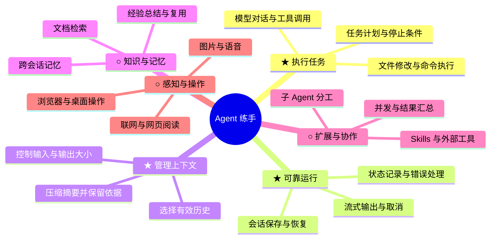

# Adam 迭代工单看板

更新日期：2026-11-11

本计划以 dev 的 `0e0d14e2208a82bb84bcdeba4d37be8bf5c771db` 为基线，不参考 main。当前已有多轮聊天、只读工具、经批准的命令执行、JSONL 会话保存与加载、请求与轮次状态；这些不重复排期。本文件是后续工单顺序和进度的唯一主记录，旧版编号见 [历史练手任务](agent-practice-todo.md)，实际架构见 [系统架构](architecture.md)。

## 如何使用

- 默认按迭代顺序推进，轮内按依赖完成重点工单；每轮交付一个完整可用的场景。
- ★ 重点工单必须完成才能通过该轮验收；○ 选做工单可跳过，不阻塞主线。后续需要选做能力时，必须提供最小替代路径。
- 每张工单通常练习 2～4 小时，每轮 3～5 张。约 300～500 行只是规模参考，不设上下限；按可观察行为拆分，不按函数或文件机械拆分。
- 工单状态：`待办 → 进行中 → 完成`，另有 `阻塞`、`跳过`。一次只把一张工单标为进行中。
- 开始时把状态改为“进行中”；完成且验证后把 `[ ]` 改为 `[x]`，状态改为“完成”，补验证结果和实现提交号。跳过仍保留 `[ ]`，写明“跳过”和原因，不冒充完成。
- 本文采用普通 Markdown 任务列表，不依赖拖拽插件。可直接勾选；若编辑器支持任务列表交互，可使用其勾选功能。工单 ID 和原定顺序保持稳定。
- 每单相关验证后提交；每轮结束跑一次局部回归和完整场景；约三轮跑一次全量，共享协议或存储格式的大改提前全量。必要失败边界不能因提速省略。不自动调用付费 API。
- 每轮验收还包括：能启动、原有功能可用、必要结果可保存、能退出。不为每张工单建立独立评估平台。
- 范围变更直接更新本文并说明原因；未来计划不得画进已实现架构图。

## 当前进度

- 完成：0 / 48；重点：0 / 30；选做：0 / 18。
- 当前工单：尚未开始；下一张：01。
- 每张工单只有下方一处勾选状态；完成后同步更新本节计数。

## 能力思维导图

★ 为重点练手方向，○ 为后续扩展。具体工单可以因练习阶段成为重点；整体投入仍优先前三个方向。

## 排期与覆盖索引

这是顺序排期，不是固定日历。按每周十几个小时安排，允许陌生能力跨周，不能为了赶时间跳过验收。

| 迭代 | 工单 | 可用成果 | 主要方向 |
| --- | --- | --- | --- |
| 1 | 01～03 | 失败可解释 | 可靠运行 |
| 2 | 04～07 | 完成受控小修改 | 执行任务、可靠运行 |
| 3 | 08～11 | 较长对话继续工作 | 管理上下文 |
| 4 | 12～15 | 能取消、能重启 | 可靠运行 |
| 5 | 16～19 | 项目规则与工作方法复用 | 扩展与协作 |
| 6 | 20～23 | 完成多步骤长任务 | 执行任务、管理上下文 |
| 7 | 24～28 | 记住约定、查到本地资料 | 知识与记忆 |
| 8 | 29～32 | 外部工具和网页资料 | 扩展与协作、感知与操作 |
| 9 | 33～36 | 子任务分工与汇总 | 扩展与协作 |
| 10 | 37～40 | 经确认的经验复用 | 知识与记忆 |
| 11（整轮选做） | 41～44 | 图片与浏览器任务 | 感知与操作 |
| 12（整轮选做） | 45～48 | 桌面和语音入口 | 感知与操作 |

## 顺序工单

以下“前置”仅列直接依赖；整体默认沿迭代推进。每项的验收描述是完成条件，不是已经通过的结果。

### 迭代 1：让失败可解释

本轮验收：能继续聊天和使用工具，并分清模型失败与保存失败。

- [ ] **01 · ★ 请求与轮次结束信息** — 待办
  - 方向：可靠运行；前置：现有 dev。
  - 范围与验收：记录原因、耗时和受控错误；第一次请求成功、第二次失败时能从日志解释整轮失败。不做报表。
  - 完成记录：验证待填；实现提交待填。

- [ ] **02 · ★ 回答保存失败处理** — 待办
  - 方向：可靠运行；前置：01。
  - 范围与验收：保存失败显示未保存回答；请求成功与轮次失败分开记录；失败内容不进入有效历史。
  - 完成记录：验证待填；实现提交待填。

- [ ] **03 · ○ 最小故障诊断** — 待办
  - 方向：可靠运行；前置：01、02。
  - 范围与验收：只读开发脚本按轮次整理日志；不增加聊天诊断命令，不做复杂报表。
  - 完成记录：验证待填；实现提交待填。

### 迭代 2：完成一次受控小修改

本轮验收：完成一次批准后的修改并运行验证，不做复杂补丁或多文件事务。

- [ ] **04 · ★ 精确修改与预览** — 待办
  - 方向：执行任务；前置：现有工具机制。
  - 范围与验收：唯一文本替换生成预览；零匹配或多匹配拒绝，不修改文件。
  - 完成记录：验证待填；实现提交待填。

- [ ] **05 · ★ 确认与可靠写入** — 待办
  - 方向：执行任务、可靠运行；前置：04。
  - 范围与验收：批准后写入；预览后文件变化则拒绝覆盖；拒绝和写入失败不损坏原文件。
  - 完成记录：验证待填；实现提交待填。

- [ ] **06 · ★ 修改—验证闭环** — 待办
  - 方向：执行任务；前置：05。
  - 范围与验收：模型提出修改、批准应用、复用命令工具验证，并能根据失败进行有限修正。
  - 完成记录：验证待填；实现提交待填。

- [ ] **07 · ○ 新建文件** — 待办
  - 方向：执行任务；前置：05。
  - 范围与验收：批准创建新文件；目标已存在不静默覆盖。
  - 完成记录：验证待填；实现提交待填。

### 迭代 3：较长对话继续工作

本轮验收：连续读取多个文件后仍可继续任务，历史取舍可解释。

- [ ] **08 · ★ 查看与限制上下文** — 待办
  - 方向：管理上下文；前置：现有对话。
  - 范围与验收：查看输入范围和估算大小；单条输入过大明确报错，区分输入预算和会话消费额度。
  - 完成记录：验证待填；实现提交待填。

- [ ] **09 · ★ 按完整轮次选择历史** — 待办
  - 方向：管理上下文；前置：08。
  - 范围与验收：超预算移除较早完整轮次，不拆开工具调用与结果；原始日志不删除。
  - 完成记录：验证待填；实现提交待填。

- [ ] **10 · ★ 大工具结果按需读取** — 待办
  - 方向：管理上下文、执行任务；前置：09。
  - 范围与验收：保存完整输出，返回有限片段和读取入口；模型能取得后续内容。
  - 完成记录：验证待填；实现提交待填。

- [ ] **11 · ○ 手动摘要** — 待办
  - 方向：管理上下文；前置：09。
  - 范围与验收：手动压缩历史并保留原始日志；保存失败仍使用压缩前上下文。
  - 完成记录：验证待填；实现提交待填。

### 迭代 4：能取消、能重启

本轮验收：用户能停止任务，强杀重启后能继续聊天且不自动重复执行。

- [ ] **12 · ★ 流式回答** — 待办
  - 方向：可靠运行；前置：01、02。
  - 范围与验收：增量显示文本，完整结束后提交历史；工具参数未完整时不执行。
  - 完成记录：验证待填；实现提交待填。

- [ ] **13 · ★ 取消当前任务** — 待办
  - 方向：可靠运行；前置：12。
  - 范围与验收：Ctrl+C 停止请求或命令，清理资源并回到输入状态，不误标成功。
  - 完成记录：验证待填；实现提交待填。

- [ ] **14 · ★ 遗留状态恢复** — 待办
  - 方向：可靠运行；前置：01、02。
  - 范围与验收：获得会话锁后将遗留任务标中断；重启不自动重发或重跑，用量未知保持未知。
  - 完成记录：验证待填；实现提交待填。

- [ ] **15 · ★ 残缺日志恢复** — 待办
  - 方向：可靠运行；前置：14。
  - 范围与验收：先备份再恢复残缺尾行；中间损坏报错；用独立进程强杀和重启验证。
  - 完成记录：验证待填；实现提交待填。

### 迭代 5：复用项目规则与工作方法

本轮验收：按当前项目规则工作，并显式复用一个工作流程。

- [ ] **16 · ★ 项目规则加载** — 待办
  - 方向：扩展与协作；前置：09。
  - 范围与验收：从明确位置加载规则并可查看；换项目不串用规则。
  - 完成记录：验证待填；实现提交待填。

- [ ] **17 · ★ 显式启用 Skill** — 待办
  - 方向：扩展与协作；前置：16。
  - 范围与验收：指定 Skill 后加载正文并完成一个流程；找不到明确提示。
  - 完成记录：验证待填；实现提交待填。

- [ ] **18 · ○ Skill 渐进加载** — 待办
  - 方向：扩展与协作、管理上下文；前置：17。
  - 范围与验收：常驻名称和短说明，按需加载正文；不全量占用上下文。
  - 完成记录：验证待填；实现提交待填。

- [ ] **19 · ○ Skill 附属资源** — 待办
  - 方向：扩展与协作；前置：17。
  - 范围与验收：按需读取引用资源；脚本执行仍走批准机制。
  - 完成记录：验证待填；实现提交待填。

### 迭代 6：完成多步骤长任务

本轮验收：读文件、修改和验证的多步骤任务可以完成，上下文增长可处理。

- [ ] **20 · ★ 最小任务计划** — 待办
  - 方向：执行任务；前置：06。
  - 范围与验收：建立和更新步骤状态；简单问答不强制生成计划。
  - 完成记录：验证待填；实现提交待填。

- [ ] **21 · ★ 调整计划与未完成收尾** — 待办
  - 方向：执行任务；前置：20。
  - 范围与验收：失败后调整步骤并记录原因；步骤未完成时不得宣称全部成功。
  - 完成记录：验证待填；实现提交待填。

- [ ] **22 · ★ 自动触发摘要** — 待办
  - 方向：管理上下文；前置：09；11可选。
  - 范围与验收：接近输入预算触发并可靠保存摘要，失败有退路；若跳过11，本单先补最小摘要生成与保存路径，不强制手动入口。
  - 完成记录：验证待填；实现提交待填。

- [ ] **23 · ○ 无进展停止** — 待办
  - 方向：执行任务、可靠运行；前置：21。
  - 范围与验收：重复相同失败操作时停止或要求改变方案，保留已有结果；原有次数限制仍生效。
  - 完成记录：验证待填；实现提交待填。

### 迭代 7：记住约定并检索本地资料

本轮验收：新会话可使用明确保存的约定，并据本地文档回答。

- [ ] **24 · ★ 显式保存项目记忆** — 待办
  - 方向：知识与记忆；前置：16。
  - 范围与验收：明确要求才保存约定；支持查看、修改、删除及项目隔离。
  - 完成记录：验证待填；实现提交待填。

- [ ] **25 · ★ 选择相关记忆** — 待办
  - 方向：知识与记忆、管理上下文；前置：24、09。
  - 范围与验收：按任务选择有限记忆并说明所用来源，不全量塞入。
  - 完成记录：验证待填；实现提交待填。

- [ ] **26 · ★ 本地文档检索** — 待办
  - 方向：知识与记忆；前置：现有读取工具。
  - 范围与验收：先支持 Markdown/TXT，分块检索带来源位置；文件更新后结果更新，不先引入向量数据库。
  - 完成记录：验证待填；实现提交待填。

- [ ] **27 · ★ 带依据回答** — 待办
  - 方向：知识与记忆、执行任务；前置：26。
  - 范围与验收：模型按需检索、回答带来源；材料没有答案时承认缺少依据。
  - 完成记录：验证待填；实现提交待填。

- [ ] **28 · ○ 语义检索对照** — 待办
  - 方向：知识与记忆；前置：27。
  - 范围与验收：引入语义检索与关键词比较固定问题；可以退回关键词方案。
  - 完成记录：验证待填；实现提交待填。

### 迭代 8：外部工具与网页资料

本轮验收：能调用外部服务并阅读指定网页；搜索可跳过。

- [ ] **29 · ★ 外部工具服务接入** — 待办
  - 方向：扩展与协作；前置：现有工具循环。
  - 范围与验收：接一个 MCP 服务，发现并调用工具；连接失败不影响基本聊天。
  - 完成记录：验证待填；实现提交待填。

- [ ] **30 · ★ 外部工具边界** — 待办
  - 方向：扩展与协作、可靠运行；前置：29。
  - 范围与验收：处理超时、重名、大结果与退出清理，沿用权限和日志。
  - 完成记录：验证待填；实现提交待填。

- [ ] **31 · ★ 阅读指定网页** — 待办
  - 方向：感知与操作；前置：现有工具循环、10。
  - 范围与验收：获取正文和来源，网页作为资料而非指令；失败和空内容明确反馈。
  - 完成记录：验证待填；实现提交待填。

- [ ] **32 · ○ 联网搜索** — 待办
  - 方向：感知与操作；前置：31。
  - 范围与验收：接一个搜索来源，再读取所选页面回答；无搜索配置仍可阅读指定网页。
  - 完成记录：验证待填；实现提交待填。

### 迭代 9：子任务分工与汇总

本轮验收：两个独立分析子任务完成后，主 Agent 汇总一个完整答案。

- [ ] **33 · ★ 单个只读子 Agent** — 待办
  - 方向：扩展与协作；前置：13、现有工具循环。
  - 范围与验收：传递任务和必要背景，独立上下文完成只读分析，先不支持嵌套创建。
  - 完成记录：验证待填；实现提交待填。

- [ ] **34 · ★ 结果汇总与继续追问** — 待办
  - 方向：扩展与协作；前置：33。
  - 范围与验收：主 Agent 汇总结果，能向同一个子 Agent 补充任务。
  - 完成记录：验证待填；实现提交待填。

- [ ] **35 · ★ 有限并发与统一取消** — 待办
  - 方向：扩展与协作、可靠运行；前置：34。
  - 范围与验收：两个只读子任务并发，共享额度，取消能停止本组任务。
  - 完成记录：验证待填；实现提交待填。

- [ ] **36 · ○ 子 Agent 修改提案** — 待办
  - 方向：扩展与协作、执行任务；前置：35、05。
  - 范围与验收：返回修改提案，经主流程确认应用；不无约束并发写同一文件。
  - 完成记录：验证待填；实现提交待填。

### 迭代 10：经确认的经验复用

本轮验收：已确认经验可用于新任务；未经确认候选不复用。

- [ ] **37 · ★ 有限失败反思** — 待办
  - 方向：知识与记忆；前置：01、现有工具循环。
  - 范围与验收：首次工具失败后可分析一次，不绕过预算；区分事实与猜测。
  - 完成记录：验证待填；实现提交待填。

- [ ] **38 · ★ 经验候选确认** — 待办
  - 方向：知识与记忆；前置：37、24。
  - 范围与验收：生成带依据候选，接受后才进入记忆；可丢弃，不自动污染后续任务。
  - 完成记录：验证待填；实现提交待填。

- [ ] **39 · ★ 新任务复用经验** — 待办
  - 方向：知识与记忆；前置：38、25。
  - 范围与验收：用不同但相关任务检查经验是否有帮助；无效经验可修订或删除，不把流程通过等同真实效果提升。
  - 完成记录：验证待填；实现提交待填。

- [ ] **40 · ○ 经验转为 Skill** — 待办
  - 方向：知识与记忆、扩展与协作；前置：39、17。
  - 范围与验收：有效经验整理为可检查的 Skill 草稿，人工确认启用。
  - 完成记录：验证待填；实现提交待填。

### 迭代 11：图片与浏览器（整轮选做）

本轮验收：按所选工单验收图片问答或完整浏览器场景；不标记未做分支完成。

- [ ] **41 · ○ 图片输入与问答** — 待办
  - 方向：感知与操作；前置：现有模型接口。
  - 范围与验收：支持图片的模型接收图片参与任务；不支持则提示，保留纯文本入口。
  - 完成记录：验证待填；实现提交待填。

- [ ] **42 · ○ 浏览器会话与观察** — 待办
  - 方向：感知与操作；前置：现有工具循环。
  - 范围与验收：打开页面读取可见结构，保持状态并清理资源；可独立于41实现。
  - 完成记录：验证待填；实现提交待填。

- [ ] **43 · ○ 浏览器动作闭环** — 待办
  - 方向：感知与操作、执行任务；前置：42。
  - 范围与验收：观察、点击或填写、再观察，在本地测试网页完成小任务。
  - 完成记录：验证待填；实现提交待填。

- [ ] **44 · ○ 浏览器中断与边界** — 待办
  - 方向：感知与操作、可靠运行；前置：43、13。
  - 范围与验收：页面变化、超时和取消能收场，提交等重要动作需批准。
  - 完成记录：验证待填；实现提交待填。

### 迭代 12：桌面与语音（整轮选做）

本轮验收：桌面与语音分别验收，可只选其一，普通终端聊天始终可用。

- [ ] **45 · ○ 桌面观察** — 待办
  - 方向：感知与操作；前置：41。
  - 范围与验收：选择目标窗口，获取截图并描述；此单不执行桌面动作。
  - 完成记录：验证待填；实现提交待填。

- [ ] **46 · ○ 桌面动作闭环** — 待办
  - 方向：感知与操作、可靠运行；前置：45、13。
  - 范围与验收：在测试程序点击输入并重新观察；目标失效停止。
  - 完成记录：验证待填；实现提交待填。

- [ ] **47 · ○ 语音输入** — 待办
  - 方向：感知与操作；前置：现有聊天入口。
  - 范围与验收：按键录音转文字，确认后送入原聊天流程；保留文字入口，不依赖桌面能力。
  - 完成记录：验证待填；实现提交待填。

- [ ] **48 · ○ 语音输出与打断** — 待办
  - 方向：感知与操作、可靠运行；前置：47、13。
  - 范围与验收：回答可朗读且可停止；不做唤醒词和实时双向语音。
  - 完成记录：验证待填；实现提交待填。
